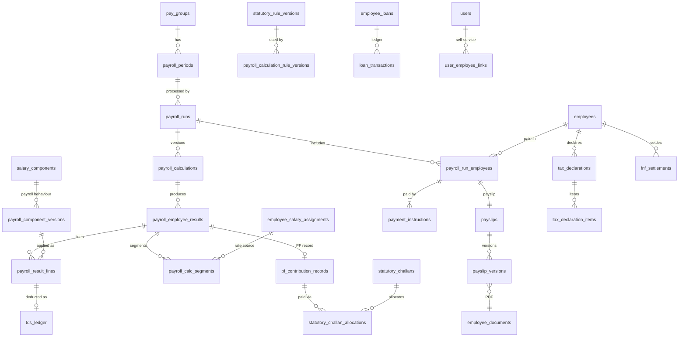

# PAYROLL_AND_STATUTORY_COMPLIANCE.md
# EMS Addendum: Payroll Processing, Income Tax (TDS) and Indian Statutory Compliance

| Item | Value |
|---|---|
| Document | PAYROLL_AND_STATUTORY_COMPLIANCE.md |
| Version | 1.0 (Draft for review) |
| Date | 2026-10-30 |
| Base specifications | EMPLOYEE_MANAGEMENT_SYSTEM.md v1.0 (2026-10-28), "the EMS"; ONBOARDING_ATTENDANCE_AND_LEAVE.md v1.0 (2026-10-29), "the OAL addendum" |
| Document type | Additive specification (addendum). It does not replace, restate or redesign the EMS or the OAL addendum. |
| Modules | Payroll Configuration (PCFG), Salary Structure (PSTR), Payroll Processing (PAY), Arrears (ARR), Loans and Advances (LOAN), Income Tax and TDS (TAX), Statutory Compliance (PF, ESI, PT, LWF, BON, GRAT, MW), Payslips (PSLP), Payroll Self-Service (SELFP), Full and Final Settlement (FNF), Reporting (PRPT) |
| Target platform | Python, FastAPI, SQLAlchemy ORM, Alembic, Pydantic, MySQL 8.0.16+ / MariaDB 10.6+ (§14.1) |
| Statutory research date | All legal facts were checked on 2026-10-30 (Appendix A). |
| Status | Source of truth for payroll once approved. Items in §23 require product-owner, Indian payroll-professional and/or legal sign-off before production use. |

> **Legal notice.** This document is a product and technical specification. It is **not legal or tax advice**. Every statutory value in it is configuration data with a recorded source and verification status (§4.6, Appendix A). Before go-live, a qualified Indian payroll professional or legal adviser must confirm each rule version used in production (§23.3).

---

## 1. Document Metadata, Conventions and Relationship to the EMS

### 1.1 Purpose
This addendum specifies the additions, modifications and integration changes needed to add payroll processing, income-tax withholding and Indian statutory compliance to the HRMS defined by the EMS and the OAL addendum. It is precise enough for a separate engineering team to implement the database, services, background jobs, authorization, APIs and automated tests without inventing core business rules. Where the law is unsettled, the rule is modelled as effective-dated configuration and flagged for legal review instead of being assumed.

### 1.2 Relationship to the EMS and the OAL Addendum
- The EMS and the OAL addendum remain authoritative for every rule, entity, field, API and convention not explicitly changed here.
- Every change to an existing EMS or OAL rule is listed in §2.6 and Appendix B, with a disposition of Unchanged, Extended or Superseded. No other rule is modified, even implicitly.
- Existing field catalogs are referenced by section and field name, not copied.
- The EMS salary model (EMS §16–§18) is **reused** as the source of salary rates. This addendum adds payroll behaviour to it; it does not create a second salary model.
- The attendance and leave modules (OAL §5, §6) remain unchanged in what they compute. Payroll reads their outputs and never writes to their records, except for the single leave-ledger extension in §12.6 (LEV encashment postings).

### 1.3 Reference and Identifier Conventions
- "EMS §n" refers to EMPLOYEE_MANAGEMENT_SYSTEM.md, "OAL §n" to ONBOARDING_ATTENDANCE_AND_LEAVE.md, and a bare "§n" to this addendum.
- The highest existing identifiers were verified in both documents before new ones were assigned. Two identifiers suggested in the specification brief would collide and are therefore shifted:

| Family | Highest existing (verified) | This addendum | Note |
|---|---|---|---|
| Objectives | OBJ-11 (OAL §2.2) | OBJ-12 onwards | — |
| Non-functional requirements | NFR-37 (OAL §15) | NFR-38 onwards | The brief suggested NFR-36, which already exists |
| Acceptance criteria | AC-64 (OAL §17.2) | AC-65 onwards | The brief suggested AC-61, which already exists |
| Edge cases | E-50 (OAL §16.3) | E-51 onwards | — |
| Assumptions | A-20 (OAL §18.2) | A-21 onwards | — |
| Open decisions | Q-23 (EMS), OD-27 (OAL) | POD-01 onwards | P prefix avoids collision |
| Legal review items | Item 19 (OAL §13.6) | Item 20 onwards | — |
| Functional requirements | FR-SAL-01…05 (EMS), FR-INT-01…06 (OAL) | FR-PAY, FR-ARR, FR-LOAN, FR-TAX, FR-PF, FR-ESI, FR-PT, FR-LWF, FR-STAT, FR-SELF-PAY, FR-FNF, FR-RPT; FR-INT-07 onwards | FR-SAL and the first six FR-INT are not reused |
| Business rules | EMP-, INV-, C-, ONB-, ATT-, LEV-, INT- | PCFG-, PSTR-, PAY-, ARR-, LOAN-, TAX-, PF-, ESI-, PT-, LWF-, BON-, GRAT-, MW-, PSLP-, SELFP-, FNF-, PINT-, PINV- | PINT- replaces INT- (taken) |
| Warning codes | W-*, W-ONB-*, W-ATT-*, W-LEAVE-* | W-PAY-*, W-TAX-*, W-PF-*, W-ESI-*, W-PT-*, W-LWF-*, W-LOAN-*, W-FNF-* | — |
| Roles | SSA, OA, HRA, HRE, DM, RV, RDR, SELF, OTO, AIC | PAD, PPR, PAPV, FIN, SCO, PAUD, SELF_ALUMNI | §16.1 |

### 1.4 Convention Extensions
All conventions in EMS §1.4–§1.5 and OAL §1.4 apply unchanged: Required? codes (M, M-A, O, C, SYS, DER, DER (stored)), flags ([R], [E], [H]), half-open intervals `[effective_from, effective_to)`, UTC timestamps, organization-timezone business dates, and change markers [NEW], [CHG], [REUSE], [INT]. This addendum adds:

| Convention | Definition |
|---|---|
| Logical type MONEY | DECIMAL(15,2), currency INR. Python `decimal.Decimal`; SQLAlchemy `Numeric(15, 2, asdecimal=True)`. Floating-point types are prohibited for any monetary or tax value, in storage, code and transport (PINV-01). |
| Logical type MONEY_PRECISE | DECIMAL(19,6). Unrounded intermediate amounts stored in calculation traces only. |
| Logical type RATE_PCT | DECIMAL(7,4) (EMS percentage type). 12% is stored as `12.0000`. |
| Logical type DAYS | DECIMAL(7,2) (same as OAL LEAVE_DAYS). Multiples of 0.50 for payroll day counts. |
| Money in JSON | Payroll APIs accept and return MONEY and RATE_PCT values as **JSON strings** (for example `"18000.00"`). A JSON number in a payroll money field returns `422 MONEY_MUST_BE_STRING`. EMS salary endpoints (EMS §24.4.6) are unchanged. |
| Tax year | 1 April to 31 March. Identified by its start year (`tax_year_start = 2026` means 1 April 2026 to 31 March 2027) and labelled "2026-27". The Income-tax Act, 2025 uses the term "tax year"; the 1961 Act used "previous year" and "assessment year". This addendum uses "tax year" (TY) for both. |
| Payroll period | One calendar month in v1 (POD-01). Identified by `period_month` = first day of the month. |
| Pay segment | A sub-interval of a payroll period during which every calculation input (salary assignment, statutory rule version, employment status) is constant (§6.7). |
| Rule version | An effective-dated, immutable-once-published set of statutory parameters (§4.6). |
| Value layers | Every tax and statutory amount belongs to exactly one layer: DECLARED (employee), VERIFIED (HR), COMPUTED (system), DEDUCTED/PAID (actual), REPORTED (filed with a government system). Layers are separate columns or rows and are never overwritten by another layer (TAX-01). |

### 1.5 Glossary Additions

| Term | Definition |
|---|---|
| Pay group | Organization-scoped set of employees processed together with one calendar and one set of processing settings (§4.3). |
| Payroll run | One processing instance for a pay group and period: REGULAR, SUPPLEMENTARY or FNF (§6.2). |
| Calculation version | One complete, immutable calculation of a run. Recalculation creates a new version; earlier versions are retained (§6.3). |
| Run employee | An employee's membership in a run (§14.4). |
| Result line | One computed amount for one employee, component and calculation version (§14.4). |
| Code wages | "Wages" as defined in the Code on Wages, 2019 and applied by the Code on Social Security, 2020, including the 50% add-back rule (§9.1). |
| PF wages / ESI wages / PT gross / LWF wages / bonus wages / gratuity wages | Statutory bases derived from result lines by component classification (§5.3) and rule versions (§9). |
| LOP | Loss of pay: unpaid half-day units derived from attendance and leave (§6.6). Computed only by payroll. |
| Paid days | Days for which wages are payable in a period (§6.6). |
| Arrear | Difference between what should have been paid for an already-locked period and what was paid (§6.11). |
| Adjustment | A one-off addition or recovery in a run (§6.10). |
| Challan | A statutory payment record (TDS, PF, ESI, PT, LWF). |
| Statutory return | A periodic statement filed with an authority (Form 138, ECR, ESI monthly contribution, PT and LWF returns). |
| F&F | Full and final settlement on separation (§12). |
| Alumni access | Restricted self-service access for a separated employee to their own payslips and tax documents (§11.1). |

---

## 2. Scope Changes and Existing Functionality Reuse

### 2.1 Amended Scope Statement (EMS §1.3, as amended by OAL §2.1) [CHG]
EMS §1.3 is replaced by:

> The EMS is a **system of record for employee information**, extended by ONBOARDING_ATTENDANCE_AND_LEAVE.md with onboarding checklists, attendance recording and leave management, and by PAYROLL_AND_STATUTORY_COMPLIANCE.md with **payroll processing, income-tax withholding (TDS), Indian statutory contribution computation, statutory challan and return preparation, payslips, payroll self-service and full and final settlement**. It performs **no** recruitment, performance, training, expense-claim, asset-management or general-ledger accounting workflows, and it **does not initiate payments or file returns with government systems directly** (§2.4).

### 2.2 Product Objectives (EMS §2, OAL §2.2) [CHG — extended]

| # | Objective | Measure of success |
|---|---|---|
| OBJ-12 | Calculate monthly payroll accurately and reproducibly for each organization. | Every locked result reproduces to the paisa from its stored snapshot (AC-96); zero floating-point use (static analysis gate, NFR-44). |
| OBJ-13 | Compute TDS and statutory contributions from effective-dated, source-referenced rule versions. | Every computed statutory amount references a rule version with a legal source (AC-77); historical runs unchanged after rule changes (AC-74). |
| OBJ-14 | Keep historical payroll, tax and statutory records immutable and auditable. | No update or delete on locked results (DB grants, AC-95); every change audited (NFR-10 extended). |
| OBJ-15 | Give every employee secure self-service access to their own payroll and tax data. | Zero cross-employee or cross-organization exposure in security tests (AC-88, AC-89). |
| OBJ-16 | Prepare statutory challans and returns and reconcile them with payments. | Each period's liability equals the sum of locked contributions; variances listed (AC-82). |
| OBJ-17 | Settle separations within statutory timelines with full traceability. | F&F due dates computed and tracked; every component traceable to its source (AC-91, AC-92). |

### 2.3 In-Scope Additions (EMS §4.1, OAL §2.3) [CHG — extended]

| Area | Included capability |
|---|---|
| Payroll configuration | Payroll settings, pay groups, payroll periods and calendar, rounding policies, statutory registration settings, effective-dated statutory rule versions with legal-source tracking |
| Salary structure | Payroll behaviour of EMS salary components, formula-based components, CTC breakup, employee payroll profiles |
| Payroll processing | Regular, supplementary and F&F runs; input collection from attendance and leave; LOP; proration; earnings; deductions; employer contributions; adjustments; arrears; validation; review; approval; locking; reopening; payment batches and bank advice files |
| Loans and advances | Loan types, applications, approvals, disbursement records, schedules, interest, payroll recovery, prepayment, foreclosure, separation handling |
| Income tax | Regimes, rule versions, declarations, rent and landlord details, proofs and verification, previous employment, projections, monthly TDS, TDS ledger, challans, quarterly statements (Form 138, formerly 24Q), certificates (Form 130, formerly Form 16; Form 123, formerly 12BA) |
| Statutory | PF (EPF, EPS, EDLI, administrative charges, VPF), ESI, PT, LWF, statutory bonus, gratuity, minimum-wage checks, optional overtime pay, maternity-pay configuration, wage-payment timelines and deduction limits |
| Compliance | Challans, returns, payment tracking, compliance calendar (in-app), reconciliation |
| Payslips | Generation, PDF rendering, versioning, reissue, download audit |
| Self-service | Payroll dashboard, payslips, tax centre, loans, F&F statement, alumni access |
| F&F | Settlement case, components, approvals, statement, payment and closure |
| Reporting | Registers, summaries, statutory and TDS reports, variance and YTD reports, exports |

### 2.4 Out-of-Scope Revisions (EMS §4.2, OAL §2.4) [CHG]

| EMS/OAL out-of-scope row | Disposition | Still excluded (MUST NOT be built) | Now in scope |
|---|---|---|---|
| Payroll processing, salary payment calculation, net pay, payslip generation | Superseded | Direct payment initiation through bank APIs; payroll for non-employees (contractors, vendors) | Payroll runs, net pay, payslips, bank advice files (§6.14) |
| Income tax computation, TDS, regime processing, Form 16/24Q | Superseded | Filing directly with TRACES or the e-filing portal; generating the FVU file (done with the official utility, POD-15); employees' own return filing; tax on non-salary income heads beyond what an employee declares for TDS | Salary TDS, statements and certificates (§8) |
| PF/EPF, ESIC, PT, LWF calculation, challans, returns | Superseded | Direct portal submission; employee-side withdrawal or transfer claims; pension computations | Contributions, return files, challan records, reconciliation (§9) |
| Exit/offboarding workflows, F&F, gratuity calculation | Partly superseded | Offboarding checklists (still excluded per OAL §2.4) | F&F settlement and gratuity (§12) |
| Leave encashment (OAL §2.4) | Superseded | Encashment outside separation in v1 (POD-12) | Encashment in F&F (§12.6) |
| Overtime pay, loss-of-pay, payable days (OAL §2.4, §2.5) | Superseded **for the payroll module only** | Attendance and leave modules still MUST NOT compute these (§2.5) | Payroll computes them (§6.6, §9.9) |
| Expense claims, reimbursements, payments | Partly superseded | Claim submission and approval workflows | Approved reimbursement amounts entered as payroll inputs (§6.5) |
| Asset allocation and inventory | Unchanged | Asset tracking | Separately authorized F&F recoveries only (§12.9) |
| Accounting, invoicing, ERP | Unchanged | General ledger posting | Cost-centre-wise payroll summary export (§15.13) |
| Notifications/workflow engines | Unchanged | Email, SMS and push reminders | In-app compliance calendar and queues (§9.13) |

### 2.5 Computation Guardrails (EMS §4.3, OAL §2.5) [CHG]
EMS §4.3 and OAL §2.5 are superseded as follows:

| Rule | Statement |
|---|---|
| PINV-01 | All monetary and tax arithmetic uses `decimal.Decimal` with an explicit context (§6.8). Python `float`, SQL `FLOAT`/`DOUBLE` and JSON numbers for money are prohibited. A CI static check rejects `float(` usage and float columns in payroll packages (NFR-44). |
| PINV-02 | Only payroll-module services (§14.2 owning services) may compute net pay, gross pay, deductions, tax, statutory contributions, LOP, payable days, arrears, overtime pay, leave encashment, gratuity, bonus or settlement amounts. |
| PINV-03 | The EMS salary module (EMS §16–§18) and the attendance and leave modules (OAL §5, §6) continue to perform no such computation. EMS §17.6 comparison views remain free of arithmetic; payroll provides its own CTC and payslip views (§5.8, §10). |
| PINV-04 | Every computed amount is traceable to: its inputs, the formula or rule applied, the rule version, and the calculation version that produced it (§6.9). |
| PINV-05 | A locked calculation version is never modified. Any later difference is expressed as an arrear, adjustment, reissue or reversal in a later run (§6.12). |

### 2.6 Disposition of Existing EMS and OAL Rules

| Ref | Rule | Disposition | Addendum ref |
|---|---|---|---|
| EMS §1.3 / OAL §2.1 | Scope statement | Superseded | §2.1 |
| EMS §4.2, §4.3; OAL §2.4, §2.5 | Exclusions and computation guardrails | Superseded as stated | §2.4, §2.5 |
| EMS §5.1–§5.3; OAL §10.1–§10.3 | Roles, permissions, matrix | Extended | §16 |
| EMS §5.6; OAL §11 | Self-service | Extended (payroll self-service, alumni access) | §11 |
| EMS §7.4 | Organization registrations | Reused; extended by registration settings | §4.5 |
| EMS §7.5; OAL §9.1 | Organization settings | Extended (three module flags) | §4.1 |
| EMS §9.3 | Lookups | Extended (new lists) | §4.8 |
| EMS §10.3, §10.9; OAL §7.5 | Status transitions, rehire, transfer side effects | Extended | §13 |
| EMS §11.1–§11.6 | Identifiers (PAN, UAN, PF member ID, ESIC IP) | Reused unchanged | §8, §9 |
| EMS §11.4 | PT and LWF state reference fields | Reused as primary input | §9.5, §9.6 |
| EMS §14.1, §14.2 | Bank accounts; "MUST NOT generate payment files" | Superseded (bank advice files allowed; payment initiation still prohibited) | §6.14 |
| EMS §15.2 | Document categories | Extended | §10.1 |
| EMS §16.3–§16.7 | Components and templates as reference data | Extended (payroll behaviour versions; formulas) | §5 |
| EMS §17.1–§17.6 | Assignments, overrides, history | Reused; derivation side table added | §5.6 |
| EMS §18.1–§18.8 | Salary effective dating, O1–O4 | Reused; payroll change events added to O1–O4 transactions | §6.11, §13 |
| EMS §20.2 | Audited events | Extended | §17.1 |
| EMS §23.1 | PostgreSQL recommended | Extended with MySQL/MariaDB implementation rules for payroll | §14.1 |
| EMS §24.3, §24.5; OAL §16.1 | Error codes | Extended | §20 |
| EMS §25.5, §25.6, §25.8; OAL §13.5, §13.6 | Revocation, retention, legal review | Extended | §11.1, §17 |
| EMS §28 AC-24; OAL §17.1 AC-24 (amended), AC-60 | Excluded modules; no payroll computation | Superseded | §22.1 |
| EMS §29 Q-07, Q-14 | Arithmetic in comparisons; validation against CTC | Resolved by payroll views | §5.8 |
| OAL §6.2 | `paid_classification`, `encashment_eligible` labels | Extended (now consumed by payroll) | §6.6, §12.6 |
| OAL §6.5 | Leave ledger transaction types | Extended (ENCASHMENT, ENCASHMENT_REVERSAL) | §12.6 |
| OAL §7.3 | Global lock order | Extended | §18.4 |
| OAL §14.1, §14.2 | Jobs, `background_job_runs` | Extended | §18 |
| OAL OD-07, OD-08, OD-14 | Lateness penalties, comp-off, encashment at separation | OD-14 resolved by §12; OD-07 and OD-08 unchanged | §12, §23 |

### 2.7 Reused Functionality [REUSE]

| Existing artefact | Ref | Use in payroll |
|---|---|---|
| `organizations` (timezone, `financial_year_start_month`, `default_currency`) | EMS §7.2 | Tenant root; INR enforced for payroll (PCFG-03) |
| `organization_registrations` (TAN, PF_ESTABLISHMENT, ESIC_EMPLOYER, ESIC_SUB_CODE, PT_REGISTRATION, PT_ENROLMENT, LWF) | EMS §7.4 | Statutory establishment identity for challans and returns |
| `branches`, masters, `states` | EMS §8, §9, §23.2 | Pay-group scope, reporting dimensions, state resolution |
| `employees`, job and status history | EMS §10 | Eligibility, dates, attributes as of a date |
| `employee_identifiers` | EMS §11.1 | PAN, UAN, PF member ID, ESIC IP (masked; reveal audited) |
| `employees.professional_tax_state`, `labour_welfare_fund_state`, `international_worker_status` | EMS §11.4 | PT/LWF state and PF international-worker handling |
| `employee_bank_accounts` (primary, verified) | EMS §14 | Salary payment account |
| `employee_documents`, categories, upload, download, verification | EMS §15 | Payslips, tax certificates, proofs, F&F statements |
| `organization_files` | EMS §23.2 | Challan receipts, return acknowledgements, TRACES files |
| `salary_components`, templates, versions, mappings | EMS §16 | Component catalog and template defaults |
| `employee_salary_assignments`, `employee_salary_components`, `salary_revision_history` | EMS §17 | Rate source and revision history |
| Salary operations O1–O4 | EMS §18 | Arrear and change detection triggers |
| `users`, `user_organization_access`, roles, permissions | EMS §5, §23.2 | All access; SELF provisioning |
| `audit_logs`, warnings protocol, error envelope, ETag, Idempotency-Key, pagination | EMS §20, §21.3, §24 | All payroll endpoints |
| Encryption, blind index, KMS | EMS §23.7 | Landlord PAN, bank account in advice files, revealed values |
| SCHEDULE(E, D), attendance records, finalization, revisions | OAL §5.6, §5.9, §5.12, §5.13 | LOP and working-day inputs |
| Leave types, applications, slots, ledger, balances | OAL §6 | Unpaid leave, encashment |
| Shared approval model | OAL §7.1 | Reused pattern for loan and proof approvals where noted |
| `background_job_runs` | OAL §14.2 | All payroll jobs |
| Self-service access provisioning endpoint | OAL §4.14 | Extended for payroll (§11.1) |

---

## 3. Updated Functional Requirements (EMS §3.1, OAL §3 extension)

### 3.1 Configuration and Salary Structure

| ID | Requirement | Priority | Section | Depends on |
|---|---|---|---|---|
| FR-PAY-01 | Enable payroll per organization and maintain payroll settings. | Must | §4.1, §4.2 | EMS §7.5 |
| FR-PAY-02 | Maintain pay groups, payroll periods and a payroll calendar. | Must | §4.3, §4.4 | — |
| FR-PAY-03 | Maintain statutory registration settings per EMS registration. | Must | §4.5 | EMS §7.4 |
| FR-PAY-04 | Maintain effective-dated statutory rule versions with legal sources and verification status. | Must | §4.6 | — |
| FR-PAY-05 | Configure payroll behaviour of salary components as effective-dated versions. | Must | §5.2 | EMS §16.3 |
| FR-PAY-06 | Support formula-based components with a safe expression language and dependency checking. | Must | §5.4 | — |
| FR-PAY-07 | Attach formulas to salary template mappings and resolve them into assignment values. | Must | §5.5, §5.6 | EMS §16.6, §17 |
| FR-PAY-08 | Maintain effective-dated employee payroll profiles. | Must | §5.7 | — |
| FR-PAY-09 | Display CTC, gross, deductions, employer contributions and net as distinct concepts. | Must | §5.8 | — |

### 3.2 Payroll Processing

| ID | Requirement | Priority | Section |
|---|---|---|---|
| FR-PAY-10 | Create regular, supplementary and F&F runs with a defined lifecycle. | Must | §6.2 |
| FR-PAY-11 | Determine run eligibility deterministically. | Must | §6.4 |
| FR-PAY-12 | Collect and snapshot inputs (salary, attendance, leave, variable inputs, adjustments, loans, tax data). | Must | §6.5 |
| FR-PAY-13 | Derive LOP and paid days from finalized attendance and approved unpaid leave. | Must | §6.6 |
| FR-PAY-14 | Split periods into pay segments at rate and rule changes. | Must | §6.7 |
| FR-PAY-15 | Calculate earnings, deductions and employer contributions in a fixed order with decimal arithmetic. | Must | §6.8 |
| FR-PAY-16 | Store an immutable calculation trace per employee and version. | Must | §6.9 |
| FR-PAY-17 | Record adjustments and carry-forward recoveries. | Must | §6.10 |
| FR-PAY-18 | Validate results and block approval on errors. | Must | §6.13 |
| FR-PAY-19 | Review, approve (maker-checker), lock, reopen and cancel runs. | Must | §6.2, §6.12 |
| FR-PAY-20 | Hold and release individual salaries. | Should | §6.14 |
| FR-PAY-21 | Generate payment batches and bank advice files; record payment outcomes; prevent duplicate payment. | Must | §6.14 |
| FR-ARR-01 | Detect retrospective salary and input changes and compute arrears. | Must | §6.11 |
| FR-ARR-02 | Pay or recover arrears in a later run with statutory and tax treatment. | Must | §6.11 |

### 3.3 Loans and Advances

| ID | Requirement | Priority | Section |
|---|---|---|---|
| FR-LOAN-01 | Configure loan and advance types. | Must | §7.1 |
| FR-LOAN-02 | Apply, approve, disburse and track loans with schedules and a ledger. | Must | §7.2–§7.5 |
| FR-LOAN-03 | Recover installments through payroll within deduction limits. | Must | §7.6 |
| FR-LOAN-04 | Support prepayment, foreclosure, deferral, waiver and separation recovery. | Must | §7.7 |

### 3.4 Income Tax

| ID | Requirement | Priority | Section |
|---|---|---|---|
| FR-TAX-01 | Maintain tax rule versions per tax year and Act. | Must | §8.1, §8.2 |
| FR-TAX-02 | Record regime elections with change rules. | Must | §8.3 |
| FR-TAX-03 | Capture declarations, rent and landlord details, previous employment and other declared income. | Must | §8.4, §8.5 |
| FR-TAX-04 | Verify proofs with partial acceptance and rejection reasons. | Must | §8.6 |
| FR-TAX-05 | Compute exemptions, deductions, annual tax and monthly TDS. | Must | §8.7–§8.9 |
| FR-TAX-06 | Maintain a TDS ledger and challans with allocations. | Must | §8.10 |
| FR-TAX-07 | Prepare quarterly salary TDS statements (Form 138 / 24Q). | Must | §8.11 |
| FR-TAX-08 | Issue Form 130 / Form 16 and Form 123 / 12BA. | Must | §8.12 |
| FR-TAX-09 | Provide tax computation statements and annual summaries. | Must | §8.13 |

### 3.5 Statutory Compliance

| ID | Requirement | Priority | Section |
|---|---|---|---|
| FR-STAT-01 | Compute Code wages with the 50% add-back rule. | Must | §9.1 |
| FR-PF-01 | Determine PF and EPS membership; compute EE, ER, EPS, EDLI, admin charges and VPF per segment. | Must | §9.3 |
| FR-PF-02 | Produce ECR data and reconcile PF challans. | Must | §9.3, §9.11 |
| FR-ESI-01 | Determine ESI coverage per contribution period; compute contributions. | Must | §9.4 |
| FR-ESI-02 | Produce ESI monthly contribution data and reconcile. | Must | §9.4, §9.11 |
| FR-PT-01 | Apply state-specific PT slabs, frequencies, exemptions and annual caps. | Must | §9.5 |
| FR-LWF-01 | Apply state-specific LWF contributions by schedule. | Must | §9.6 |
| FR-STAT-02 | Compute statutory bonus per accounting year. | Must | §9.7 |
| FR-STAT-03 | Compute gratuity eligibility and amount; optional monthly provision. | Must | §9.8 |
| FR-STAT-04 | Check pay against minimum wages. | Must | §9.2 |
| FR-STAT-05 | Compute overtime pay from approved hours (optional). | Should | §9.9 |
| FR-STAT-06 | Enforce wage payment timelines and deduction limits. | Must | §9.10 |
| FR-STAT-07 | Maintain challans, returns and reconciliations. | Must | §9.11, §9.12 |
| FR-STAT-08 | Provide an in-app compliance calendar. | Must | §9.13 |

### 3.6 Payslips, Self-Service, F&F, Reporting and Integration

| ID | Requirement | Priority | Section |
|---|---|---|---|
| FR-PAY-22 | Generate, version, reissue and protect payslips. | Must | §10 |
| FR-SELF-PAY-01 | Provision and revoke employee self-service access, including bulk and alumni access. | Must | §11.1 |
| FR-SELF-PAY-02 | Payroll dashboard with YTD values. | Must | §11.2 |
| FR-SELF-PAY-03 | Own payslip list, detail, PDF download and version history. | Must | §11.3 |
| FR-SELF-PAY-04 | Tax centre: regime, declarations, proofs, projection, certificates. | Must | §11.4 |
| FR-SELF-PAY-05 | Own loan information and F&F statement. | Must | §11.5 |
| FR-FNF-01 | Create F&F cases from separation events. | Must | §12.1 |
| FR-FNF-02 | Compute final salary, encashment, gratuity, bonus, notice adjustments, recoveries, statutory deductions and final TDS. | Must | §12.2–§12.10 |
| FR-FNF-03 | Approve, document, pay and close F&F within statutory timelines. | Must | §12.11 |
| FR-RPT-01 | Provide payroll, statutory, tax and management reports with controlled exports. | Must | §15.13 |
| FR-INT-07 | Integrate payroll with employee lifecycle, salary revisions, attendance, leave and organization changes. | Must | §13 |
| FR-INT-08 | Detect input changes after calculation and route them to stale-marking or arrears. | Must | §6.11, §13.3 |

---

## 4. Payroll Configuration and Organization Settings

### 4.1 New `organization_settings` Columns (EMS §7.5, OAL §9.1 extension) [CHG]

| Field | Data Type | Required? | Validation / Constraints | Example | Notes |
|---|---|---|---|---|---|
| enable_payroll_module | BOOLEAN | M | Default false; enabling requires a `payroll_settings` row and `default_currency = INR` | true | PCFG-01 |
| enable_payroll_self_service | BOOLEAN | M | Default false | true | §11 |
| enable_payroll_alumni_access | BOOLEAN | M | Default true | true | §11.1 |

Disabling the payroll module follows OAL §9.1 semantics: reads continue for authorized users, mutations return `403 MODULE_NOT_ENABLED`, jobs skip the organization, nothing is deleted. Disabling is rejected with `422 PAYROLL_RUNS_IN_PROGRESS` while any run is in a non-terminal state other than DRAFT.

### 4.2 Payroll Settings (`payroll_settings`, 1:1 with organization) [NEW]

| Field | Data Type | Required? | Validation / Constraints | Example | Notes |
|---|---|---|---|---|---|
| organization_id | UUID | M | PK; FK organizations | | |
| payroll_go_live_period | DATE | M | First day of a month; immutable once any run exists | 2026-11-01 | No runs before this period |
| opening_ytd_required | BOOLEAN | M | Default true when go-live is not April | true | §8.14 opening YTD import |
| default_proration_basis | ENUM | M | CALENDAR_DAYS (default), FIXED_30, WORKING_DAYS | CALENDAR_DAYS | §6.6; overridable per pay group |
| component_rounding_default | ENUM | M | NEAREST_RUPEE (default), UP_RUPEE, DOWN_RUPEE, TWO_DECIMALS | NEAREST_RUPEE | §6.8 |
| net_pay_rounding | ENUM | M | NEAREST_RUPEE (default), NONE | NEAREST_RUPEE | Difference recorded as line NET_ROUNDING |
| lop_requires_finalized_attendance | BOOLEAN | M | Default true | true | §6.6 PAY-21 |
| lop_lookback_periods | SMALLINT | M | 0–12; default 3 | 3 | Retro LOP adjustments (§6.11) |
| arrear_lookback_periods | SMALLINT | M | 0–36; default 12 | 12 | Max periods recomputed for arrears |
| salary_hold_default_on_notice | BOOLEAN | M | Default false | false | Auto-hold during notice |
| deduction_limit_percent | RATE_PCT | M | 0–100; default from MW rule set (§9.10) | 50.0000 | Cap on total deductions vs wages |
| maker_checker_mode | ENUM | M | STRICT (default, fixed) | STRICT | POD-02 asks whether small organizations may relax |
| one_time_tds_method | ENUM | M | INCREMENTAL_IN_MONTH (default), SPREAD_REMAINING | INCREMENTAL_IN_MONTH | §8.9 |
| tds_proof_cutoff_date | DATE | O | Within the tax year; set per tax year via `tax_year_settings` | 2027-01-31 | §8.6 |
| bonus_accounting_year_start_month | SMALLINT | M | 1–12; default 4 | 4 | Statutory bonus year (§9.7) |
| gratuity_provision_enabled | BOOLEAN | M | Default false | false | Monthly employer-cost line only |
| overtime_pay_enabled | BOOLEAN | M | Default false | false | §9.9 |
| maternity_pay_method | ENUM | M | REGULAR_SALARY (default), AVERAGE_DAILY_WAGE | REGULAR_SALARY | §9.10; legal review item 27 |
| payslip_zero_pay_generate | BOOLEAN | M | Default true | true | §10.2 |
| alumni_access_months | SMALLINT | M | 0–36; default 18 | 18 | Covers Form 130 issuance after separation |
| fnf_wage_payment_working_days | SMALLINT | M | 0–30; default from MW rule set (2) | 2 | §12.11 |
| payment_file_formats | — | — | Child rows in `payment_file_formats` | | §6.14 |
| standard columns | EMS §1.5 | SYS | | | |

| Rule | Statement |
|---|---|
| PCFG-01 | Payroll is enabled per organization. Each organization is an independent employer: its own TAN, registrations, pay groups, rules, runs and records. No payroll entity references two organizations (EMS §6.4 unchanged). |
| PCFG-02 | The **tax year is fixed at 1 April to 31 March** for every organization and is independent of `organizations.financial_year_start_month` (which governs employee-code tokens only, EMS §19.1) and of `leave_year_start_month` (OAL §6.1). |
| PCFG-03 | Payroll currency is INR. Enabling payroll for an organization whose `default_currency ≠ INR` is rejected (`422 PAYROLL_CURRENCY_NOT_SUPPORTED`). Salary assignments in another currency are excluded from runs with error PAY_ASSIGNMENT_CURRENCY (POD-03). |

### 4.3 Pay Groups (`pay_groups`) [NEW]

| Field | Data Type | Required? | Validation / Constraints | Example | Notes |
|---|---|---|---|---|---|
| id | UUID | SYS | PK | | |
| organization_id | UUID | M | FK organizations | | |
| pay_group_code | VARCHAR(30) | M | V-CODE; unique per organization; immutable | MAIN | |
| pay_group_name | VARCHAR(100) | M | 2–100 | Monthly staff | |
| pay_frequency | ENUM | M | MONTHLY (only value in v1) | MONTHLY | POD-01 |
| proration_basis | ENUM | O | As settings; null = organization default | | |
| input_window_mode | ENUM | M | SAME_MONTH (default), OFFSET_CYCLE | OFFSET_CYCLE | §6.6 |
| input_cycle_start_day | SMALLINT | C | Required iff OFFSET_CYCLE; 2–28 | 26 | Window = [day of previous month, day − 1 of current month] |
| input_cutoff_offset_days | SMALLINT | M | 0–15; default 2 | 2 | Cut-off = window end + offset days, 23:59 org time |
| target_payment_day | SMALLINT | M | 1–28; default 1; validated against the wage-payment rule (§9.10) | 1 | Day of the following month (or same month if `pay_in_period = true`) |
| pay_in_period | BOOLEAN | M | Default false | false | true = pay on or before period end |
| status | ENUM | M | ACTIVE, INACTIVE | ACTIVE | |
| standard columns | EMS §1.5 | SYS | | | |

Employees join a pay group through `employee_payroll_profiles.pay_group_id` (§5.7). An employee belongs to exactly one pay group on any date (PAY-01).

### 4.4 Payroll Periods and Calendar (`payroll_periods`) [NEW]

| Field | Data Type | Required? | Validation / Constraints | Example | Notes |
|---|---|---|---|---|---|
| id | UUID | SYS | PK | | |
| organization_id, pay_group_id | UUID | M | Composite FK pay_groups | | |
| period_month | DATE | M | First day of month; unique (pay_group_id, period_month); ≥ go-live | 2026-11-01 | |
| period_start, period_end | DATE | DER (stored) | Calendar month; period_end inclusive | 2026-11-01, 2026-11-30 | |
| tax_year_start | SMALLINT | DER (stored) | Year of the 1 April on or before period_start | 2026 | |
| input_window_start, input_window_end | DATE | DER (stored) | From pay-group mode; inclusive | 2026-10-26, 2026-11-25 | |
| input_cutoff_at | TIMESTAMP | DER (stored) | §4.3 | 2026-11-27T18:29:59Z | |
| payment_due_date | DATE | DER (stored) | Statutory latest date (§9.10) | 2026-12-07 | |
| target_payment_date | DATE | M | ≤ payment_due_date else warning W-PAY-PAYDATE-LATE | 2026-12-01 | Editable while OPEN |
| status | ENUM | SYS | OPEN, CLOSED | OPEN | CLOSED when the REGULAR run is PAID and no supplementary run is open |
| standard columns | EMS §1.5 | SYS | | | |

Periods are generated by the PAYROLL_CALENDAR job (§18.1) 13 months ahead. The payroll calendar view merges periods, cut-offs, payment dates and compliance obligations (§9.13).

### 4.5 Statutory Registration Settings (`statutory_registration_settings`) [NEW, extends EMS §7.4 rows]
One row per EMS `organization_registrations` row of type TAN, PF_ESTABLISHMENT, ESIC_EMPLOYER, ESIC_SUB_CODE, PT_REGISTRATION, PT_ENROLMENT or LWF. It holds payroll-only attributes; identity stays in EMS.

| Field | Data Type | Required? | Validation / Constraints | Example | Notes |
|---|---|---|---|---|---|
| id | UUID | SYS | PK | | |
| organization_id | UUID | M | | | |
| registration_id | UUID | M | Composite FK organization_registrations; unique | | |
| pf_contribution_rate_category | ENUM | C | PF only: STANDARD, REDUCED; rule-version parameters give the rates | STANDARD | Legal review item 21 |
| pf_exempted_trust | BOOLEAN | C | PF only; default false | false | Exempted establishment (own trust); EPS still EPFO |
| pf_trust_name | VARCHAR(200) | C | Required iff pf_exempted_trust | | |
| esi_implemented_area | BOOLEAN | C | ESIC only; default true | true | Coverage applies only where implemented |
| deductor_category | ENUM | C | TAN only: COMPANY, GOVERNMENT, OTHERS, INDIVIDUAL_HUF, FIRM, LLP, AOP_BOI, TRUST, OTHER | COMPANY | Form 138 header |
| responsible_person_name, responsible_person_designation | VARCHAR(150), VARCHAR(100) | C | TAN only | | Certificate signatory |
| responsible_person_pan | BYTES | C [E][R] | TAN only; V-PAN | | Encrypted |
| branch_ids | — | O | Child rows `statutory_registration_branches` (registration_setting_id, branch_id, effective_from, effective_to) | | Which branches report under this code |
| standard columns | EMS §1.5 | SYS | | | |

| Rule | Statement |
|---|---|
| PCFG-10 | For each employee and period, the reporting registration of each family is resolved: PF and ESI by the employee's branch as of period end through `statutory_registration_branches` (fallback: the organization-level ACTIVE registration); PT and LWF by the resolved state (§9.5, §9.6); TDS by the organization's ACTIVE TAN as of the payment date. No match → run error `PAY_REGISTRATION_MISSING` for that family. |

### 4.6 Statutory Rule Framework [NEW]
All statutory values (tax slabs, rebates, surcharges, cess, deduction limits, PF and ESI rates and ceilings, PT and LWF schedules, bonus limits, gratuity limits, minimum wages, due-date rules, form references) are **data** in the tables below, never constants in code.

**`statutory_rule_sets`** (platform-level, SSA-managed): id; rule_family ENUM {INCOME_TAX, TAX_EXEMPTIONS, PF, ESI, PT, LWF, BONUS, GRATUITY, MIN_WAGE, WAGE_CODE, OVERTIME, LEAVE_ENCASHMENT_TAX, DUE_DATES, FORM_REFERENCES}; jurisdiction_code VARCHAR(10) (`IN` for central, or a GST state code such as `24`); rule_set_code VARCHAR(40) unique (rule_family, jurisdiction_code, rule_set_code); description; status; standard columns.

**`statutory_rule_versions`**

| Field | Data Type | Required? | Validation / Constraints | Example | Notes |
|---|---|---|---|---|---|
| id | UUID | SYS | PK | | |
| rule_set_id | UUID | M | FK statutory_rule_sets | | |
| version_number | INTEGER | SYS | 1, 2, … per rule set | 3 | |
| effective_from | DATE | M | Inclusive | 2026-09-17 | |
| effective_to | DATE | O | Exclusive; set when the next version is published | | Versions of one set never overlap (PCFG-21) |
| status | ENUM | SYS | DRAFT, PUBLISHED, WITHDRAWN | PUBLISHED | WITHDRAWN only if never used by a locked run |
| parameter_schema_version | VARCHAR(20) | M | `{FAMILY}.v{n}`; defines allowed parameter codes and slab types | PF.v2 | |
| verification_status | ENUM | M | UNVERIFIED, SECONDARY_CONFIRMED, PRIMARY_CONFIRMED, LEGALLY_APPROVED | SECONDARY_CONFIRMED | §4.6 PCFG-22 |
| legal_review_notes | TEXT | O | | | |
| prepared_by, published_by | UUID | SYS | published_by ≠ prepared_by (PCFG-23) | | |
| published_at | TIMESTAMP | SYS | | | |
| standard columns | EMS §1.5 | SYS | | | |

**`statutory_rule_parameters`**: id; rule_version_id (FK); parameter_code VARCHAR(60) (must exist in the schema version); value_type ENUM {DECIMAL, MONEY, RATE_PCT, INTEGER, BOOLEAN, DATE, TEXT, CODE}; value_decimal DECIMAL(19,6); value_text VARCHAR(500); value_boolean; value_date; CHECK exactly one value column non-null; unique (rule_version_id, parameter_code); created_at, created_by.

**`statutory_rule_slabs`**: id; rule_version_id; slab_table_code VARCHAR(40) (for example `NEW_REGIME_RATES`, `PT_MONTHLY`, `SURCHARGE_NEW`); sequence_no; condition_code VARCHAR(40) (O; for example `GENDER=FEMALE`, `AGE_BAND=SENIOR`, `MONTH=02`); lower_bound MONEY (inclusive); upper_bound MONEY (exclusive; null = no upper bound); rate_pct RATE_PCT (O); fixed_amount MONEY (O); CHECK rate_pct or fixed_amount present; unique (rule_version_id, slab_table_code, condition_code, sequence_no); slabs of one table and condition are contiguous and non-overlapping (validated at publish).

**`statutory_rule_list_values`**: id; rule_version_id; list_code VARCHAR(40) (for example `HRA_HIGH_RATE_CITIES`, `PT_EXEMPT_CATEGORIES`); value_code VARCHAR(100); label; unique (rule_version_id, list_code, value_code).

**`legal_sources`** and **`statutory_rule_version_sources`**: legal_sources(id, source_code unique, title, issuing_authority, instrument_type ENUM {ACT, RULES, SCHEME, NOTIFICATION, CIRCULAR, OFFICIAL_FAQ, PRESS_RELEASE, SECONDARY_COMMENTARY}, instrument_reference VARCHAR(100), url VARCHAR(500), date_checked DATE, notes); link table (rule_version_id, legal_source_id, applies_to_parameter_codes VARCHAR(500)). Appendix A seeds these.

**`organization_rule_overrides`** [NEW]: organization-scoped choices the law leaves to the employer (for example the PF contribution base option, the VPF policy, the bonus percentage for a year, the overtime divisor). Fields: id, organization_id, rule_family, parameter_code, value columns as above, effective_from, effective_to, approved_by, reason; allowed only for parameter codes the schema marks `org_overridable = true`; non-overlapping per (organization, parameter_code).

| Rule | Statement |
|---|---|
| PCFG-20 | Resolution: for a family, jurisdiction and date D, the PUBLISHED version with `effective_from ≤ D < coalesce(effective_to, ∞)` applies; an organization override for the same parameter applies on top where allowed. No version → run error `STATUTORY_RULE_MISSING` (no fallback). |
| PCFG-21 | Versions of one rule set never overlap; publishing version n sets version n−1's effective_to (MySQL: rule-set row lock and an in-transaction overlap query). |
| PCFG-22 | A run can be **approved** only if every rule version it used is PRIMARY_CONFIRMED or LEGALLY_APPROVED, unless the approver acknowledges warning `W-PAY-RULE-UNVERIFIED`, which is recorded with the approval. Production go-live requires LEGALLY_APPROVED for every version in use (§23.4). |
| PCFG-23 | Publishing a rule version is maker-checker: preparer ≠ publisher. Changes to PUBLISHED versions are impossible; corrections publish a new version. A version used by any locked run can never be withdrawn. |
| PCFG-24 | Every calculation version records the IDs of all rule versions it used (§14.4 `payroll_calculation_rule_versions`), so historical runs are reproducible after rule changes. |

### 4.7 Tax Provision Reference Map (`tax_provision_references`) [NEW]
Maps a stable concept code to the provision applicable in a tax year. Payroll logic uses concept codes; documents and returns print the mapped references.

| concept_code | TY ≤ 2025-26 (Income-tax Act, 1961; Rules, 1962) | TY ≥ 2026-27 (Income-tax Act, 2025; Rules, 2026) | Verification |
|---|---|---|---|
| TDS_SALARY | Section 192 | Section 392(1) | SECONDARY_CONFIRMED |
| NEW_REGIME | Section 115BAC | Section 202 | SECONDARY_CONFIRMED |
| REBATE | Section 87A | Section 156 | SECONDARY_CONFIRMED |
| STANDARD_DEDUCTION_SALARY | Section 16(ia) | Section 19 (table) | SECONDARY_CONFIRMED |
| DEDUCTION_80C_EQUIV | Section 80C | Section 123 | SECONDARY_CONFIRMED |
| HRA_EXEMPTION | Section 10(13A), Rule 2A | Rule 279 (Rules, 2026); Act section TBD | Act section: UNVERIFIED |
| SALARY_TDS_CERTIFICATE | Form 16 | Form 130 | SECONDARY_CONFIRMED |
| QUARTERLY_SALARY_TDS_STATEMENT | Form 24Q | Form 138 | SECONDARY_CONFIRMED |
| PERQUISITE_STATEMENT | Form 12BA | Form 123 | SECONDARY_CONFIRMED |
| EMPLOYEE_CLAIMS_EVIDENCE | Form 12BB | Form 124 | SECONDARY_CONFIRMED |
| EMPLOYEE_DECLARATION_OTHER_INCOME_PREV_EMPLOYER | Form 12B | Form 122 | SECONDARY_CONFIRMED; whether Form 122 also carries the regime option is UNVERIFIED (POD-16) |
| ANNUAL_TAX_STATEMENT | Form 26AS | Form 168 | SECONDARY_CONFIRMED |
| All other concepts (Chapter VI-A heads, 89 relief, gratuity and leave-encashment exemptions, perquisite valuation, higher TDS without PAN) | 1961 references | **TBD** | UNVERIFIED — legal review item 20 |

Fields: id, concept_code, act_code ENUM {ITA_1961, ITA_2025}, provision_reference VARCHAR(100), form_reference VARCHAR(30), applies_from_tax_year SMALLINT, applies_to_tax_year SMALLINT (O), verification_status, legal_source_id; unique (concept_code, act_code, applies_from_tax_year).

### 4.8 Lookups (EMS §9.3 extension) [CHG]

| list_code | Default values | Editable? | Use |
|---|---|---|---|
| PAYROLL_ADJUSTMENT_REASON | REIMBURSEMENT, INCENTIVE, RECOVERY_EXCESS_PAY, RECOVERY_DAMAGE_AUTHORIZED, ONE_TIME_PAYMENT, CORRECTION, OTHER | Yes | §6.10 |
| SALARY_HOLD_REASON | NOTICE_PERIOD, ABSCONDING, INVESTIGATION, BANK_DETAILS_PENDING, OTHER | Yes | §6.14 |
| PAYMENT_FAILURE_REASON | ACCOUNT_CLOSED, INVALID_ACCOUNT, NAME_MISMATCH, BANK_REJECTED, OTHER | Yes | §6.14 |
| TAX_PROOF_REJECTION_REASON | ILLEGIBLE, NAME_MISMATCH, OUT_OF_PERIOD, AMOUNT_MISMATCH, NOT_ELIGIBLE, OTHER | Yes | §8.6 |
| MIN_WAGE_SKILL_CATEGORY | UNSKILLED, SEMI_SKILLED, SKILLED, HIGHLY_SKILLED | No (system fixed; labels editable) | §9.2 |

---

## 5. Salary Structure Management

### 5.1 Layered Model
| Layer | Owner | Holds | Changes |
|---|---|---|---|
| Component catalog | EMS `salary_components` [REUSE] | Code, name, category, value_type, amount_period | EMS §16.3 rules |
| Payroll behaviour | `payroll_component_versions` [NEW] | How payroll treats the component (nature, calculation, statutory inclusion, tax, payslip, CTC) | Effective-dated versions (PSTR-01) |
| Template defaults and formulas | EMS template versions [REUSE] + `salary_template_component_formulas` [NEW] | Default values and structure-time formulas | EMS §16.7 rules |
| Employee rates | EMS assignments and assignment components [REUSE] + `employee_salary_component_derivations` [NEW] | Resolved annual or monthly rates per employee | EMS §17–§18 operations |
| Run-time calculations | Payroll engine | Proration, LOP, statutory contributions, TDS, loans, adjustments | Per calculation version |

### 5.2 Payroll Component Versions (`payroll_component_versions`) [NEW]

| Field | Data Type | Required? | Validation / Constraints | Example | Notes |
|---|---|---|---|---|---|
| id | UUID | SYS | PK | | |
| organization_id | UUID | M | | | |
| component_id | UUID | C | Composite FK EMS salary_components; null only for SYSTEM components | | |
| system_component_code | VARCHAR(30) | C | Required iff component_id null; one of the system codes in §5.3 | PF_EE | Seeded per organization |
| version_number | INTEGER | SYS | Per component | 2 | |
| effective_from | DATE | M | Version ≥ 2: ≥ today and not inside a locked period (PSTR-02) | 2027-04-01 | |
| effective_to | DATE | O | Exclusive; set on next publish | | |
| status | ENUM | SYS | DRAFT, PUBLISHED | PUBLISHED | |
| nature | ENUM | M | EARNING, DEDUCTION, EMPLOYER_CONTRIBUTION, REIMBURSEMENT, INFORMATION | EARNING | Drives gross/net/CTC |
| pay_type | ENUM | M | FIXED, VARIABLE, ONE_TIME, STATUTORY, LOAN, SYSTEM | FIXED | |
| calculation_method | ENUM | M | ASSIGNMENT_VALUE, FORMULA, VARIABLE_INPUT, STATUTORY_ENGINE, LOAN_ENGINE, ADJUSTMENT, SYSTEM | ASSIGNMENT_VALUE | §6.8 |
| rate_period | ENUM | C | MONTHLY, ANNUAL; required for ASSIGNMENT_VALUE and FORMULA; must agree with EMS amount_period where set | ANNUAL | Monthly rate = annual ÷ 12 (PSTR-04) |
| runtime_formula | TEXT | C | Required iff FORMULA; §5.4 grammar; parsed and stored as AST | `ROUND(C.BASIC * 0.4, 0)` | Evaluated per segment |
| proration_rule | ENUM | M | PAID_DAYS, EMPLOYMENT_DAYS, NONE | PAID_DAYS | §6.6 |
| rounding_rule | ENUM | O | As settings; null = organization default | | |
| allow_negative | BOOLEAN | M | Default false; true only for ADJUSTMENT | false | |
| wage_code_class | ENUM | M | WAGE (basic, DA, retaining allowance), EXCLUSION_IN_50_TEST, EXCLUSION_OUTSIDE_50_TEST, NOT_REMUNERATION | WAGE | §9.1; legal review item 22 |
| pf_wage_inclusion | ENUM | M | FOLLOW_CODE_WAGES (default), ALWAYS, NEVER | FOLLOW_CODE_WAGES | §9.3 |
| esi_wage_inclusion | ENUM | M | INCLUDE, EXCLUDE, INCLUDE_FOR_CONTRIBUTION_ONLY | INCLUDE | Overtime example: contribution only |
| pt_gross_inclusion | BOOLEAN | M | | true | §9.5 |
| lwf_wage_inclusion | BOOLEAN | M | | true | §9.6 |
| bonus_wage_inclusion | ENUM | M | FOLLOW_CODE_WAGES, ALWAYS, NEVER | FOLLOW_CODE_WAGES | §9.7 |
| gratuity_wage_inclusion | ENUM | M | FOLLOW_CODE_WAGES, ALWAYS, NEVER | FOLLOW_CODE_WAGES | §9.8 |
| encashment_base_inclusion | BOOLEAN | M | | true | §12.6 |
| overtime_base_inclusion | BOOLEAN | M | | true | §9.9 |
| min_wage_inclusion | BOOLEAN | M | | true | §9.2 |
| tax_treatment | ENUM | M | TAXABLE, EXEMPT_BY_RULE, PARTIALLY_EXEMPT_BY_RULE, NON_TAXABLE, PERQUISITE | TAXABLE | §8.7 |
| tax_exemption_code | VARCHAR(40) | C | Required for *_BY_RULE; must exist in TAX_EXEMPTIONS rule versions | HRA | |
| tax_regime_applicability | ENUM | M | BOTH, OLD_ONLY, NEW_ONLY | BOTH | Exemption applicability, not payment |
| arrear_eligible | BOOLEAN | M | Default true for FIXED, false otherwise | true | §6.11 |
| ctc_inclusion | BOOLEAN | M | | true | §5.8 |
| payslip_visibility | ENUM | M | SHOW, SHOW_IF_NONZERO, HIDE | SHOW_IF_NONZERO | |
| payslip_group | ENUM | M | EARNINGS, DEDUCTIONS, EMPLOYER_CONTRIBUTIONS, REIMBURSEMENTS, INFORMATION | EARNINGS | |
| display_order | INTEGER | M | ≥ 0 | 10 | |
| change_note | VARCHAR(1000) | C | Required for version ≥ 2 | | |
| standard columns | EMS §1.5 | SYS | | | |

| Rule | Statement |
|---|---|
| PSTR-01 | Payroll behaviour is effective-dated independently of the EMS component. A run uses the version effective on each segment start; the version ID is snapshotted on each result line. |
| PSTR-02 | A version may not start inside a period whose REGULAR run is LOCKED or PAID; such changes take effect from the next open period. Earlier periods are corrected only through arrears (§6.11). |
| PSTR-03 | Components used by any locked result line cannot change `nature` in a new version (`422 PAY_COMPONENT_NATURE_LOCKED`). |
| PSTR-04 | Annual-rate components are converted to monthly rates as `annual / 12` without intermediate rounding; rounding happens once, at the result line (§6.8). |
| PSTR-05 | EMS components of category EMPLOYER_BENEFIT or EMPLOYEE_DEDUCTION_REFERENCE (for example EMPLOYER_PF_REF) remain reference values for CTC display. When a payroll statutory engine computes the actual amount, the payroll version sets `nature = INFORMATION` and `ctc_inclusion = true`; the actual employer cost appears only on system lines (§5.3). |

### 5.3 System Components (seeded per organization; `system_component_code`)

| Code | Nature | Method | Notes |
|---|---|---|---|
| LOP_DEDUCTION_INFO | INFORMATION | SYSTEM | LOP days display; amounts are reflected through proration, not a separate deduction (PAY-24) |
| PF_EE, VPF_EE | DEDUCTION | STATUTORY_ENGINE | §9.3 |
| PF_ER_EPF, PF_ER_EPS, PF_EDLI, PF_ADMIN | EMPLOYER_CONTRIBUTION | STATUTORY_ENGINE | PF_ADMIN per employee is an allocation for CTC only; the establishment minimum is applied at challan level |
| ESI_EE / ESI_ER | DEDUCTION / EMPLOYER_CONTRIBUTION | STATUTORY_ENGINE | §9.4 |
| PT | DEDUCTION | STATUTORY_ENGINE | §9.5 |
| LWF_EE / LWF_ER | DEDUCTION / EMPLOYER_CONTRIBUTION | STATUTORY_ENGINE | §9.6 |
| TDS | DEDUCTION | STATUTORY_ENGINE | §8.9 |
| LOAN_EMI, LOAN_INTEREST, ADVANCE_RECOVERY | DEDUCTION | LOAN_ENGINE | §7.6 |
| LOAN_DISBURSEMENT | REIMBURSEMENT | LOAN_ENGINE | Non-taxable payout |
| LOAN_PERQUISITE | INFORMATION (taxable perquisite) | LOAN_ENGINE | §7.4 |
| ARREAR_* | EARNING/DEDUCTION | SYSTEM | One line per component with an arrear (§6.11) |
| OVERTIME_PAY | EARNING | STATUTORY_ENGINE | §9.9 |
| GRATUITY_PROVISION | EMPLOYER_CONTRIBUTION | STATUTORY_ENGINE | Only when enabled; not paid |
| STAT_BONUS | EARNING | SYSTEM | §9.7 |
| LEAVE_ENCASHMENT, GRATUITY_PAYOUT, NOTICE_PAY, NOTICE_RECOVERY | EARNING/DEDUCTION | SYSTEM | F&F only (§12) |
| NET_ROUNDING | INFORMATION | SYSTEM | Net pay rounding difference |
| RECOVERY_CARRY_FORWARD | DEDUCTION | SYSTEM | §6.10 |

### 5.4 Formula Language (PSTR-10 to PSTR-15)
Formulas are parsed by a dedicated parser into an AST; `eval`, `exec` or any host-language evaluation is prohibited (PSTR-10).

| Element | Allowed |
|---|---|
| Literals | Decimal literals (`0.4`, `12.5`); integer literals |
| References | `C.<COMPONENT_CODE>` (monthly-rate amount of a component in the same structure or segment); `V.<VARIABLE>` |
| Variables | `V.CTC_ANNUAL`, `V.CTC_MONTHLY`, `V.PAID_DAYS`, `V.PERIOD_DAYS`, `V.SEGMENT_DAYS`, `V.SERVICE_YEARS`, `V.AGE_YEARS`, `V.IS_METRO_RENT` (structure time: false), `V.MIN_WAGE_MONTHLY`, `V.PF_CEILING` |
| Operators | `+ − * /`, unary `−`, parentheses, comparisons `< <= > >= == !=`, `AND`, `OR`, `NOT` |
| Functions | `MIN(a, b, …)`, `MAX(a, b, …)`, `ROUND(x, n)`, `ROUND_UP(x, n)`, `ROUND_DOWN(x, n)`, `IF(cond, a, b)`, `CLAMP(x, lo, hi)` |

| Rule | Statement |
|---|---|
| PSTR-11 | References form a directed graph per template version or component version. Cycles are rejected at publish (`422 PAY_FORMULA_CYCLE`). Evaluation follows topological order, ties broken by display_order then code. |
| PSTR-12 | Evaluation uses the decimal context of §6.8 with no intermediate rounding unless the formula calls a rounding function. |
| PSTR-13 | Division by zero, unknown references or type errors produce employee-level errors (`PAY_FORMULA_ERROR` with the component code); the run continues for other employees. |
| PSTR-14 | Formula text, parsed AST hash and referenced versions are snapshotted on each result line or derivation row. |
| PSTR-15 | Maximum formula length 1,000 characters; maximum AST depth 32; maximum 64 references. |

### 5.5 Template Formulas (`salary_template_component_formulas`) [NEW, extends EMS §16.6]
Fields: id; organization_id; template_version_id (composite FK; version must be DRAFT to insert or change); template_component_id (FK EMS salary_template_components, unique); formula TEXT (§5.4); formula_ast_hash CHAR(64) SYS; formula_role ENUM {STRUCTURE_DEFAULT, BALANCING} — at most one BALANCING component per version (for example SPECIAL_ALLOWANCE = CTC − other CTC components); standard columns. Immutable once the version is ACTIVE (EMS §16.7 unchanged).

### 5.6 Assignment Derivations (`employee_salary_component_derivations`) [NEW, extends EMS §17.2]
When a salary assignment is created from a template with formulas, the **structure calculator** (`POST …/salary-structure/calculate`, §15.4) evaluates formulas from the declared CTC and inputs and pre-fills EMS assignment component values. The user may override where EMS §17.3 permits. On confirmation, the following side row is written per derived component in the same EMS O1 transaction:

| Field | Data Type | Required? | Validation / Constraints | Example | Notes |
|---|---|---|---|---|---|
| id | UUID | SYS | PK | | |
| organization_id | UUID | M | | | |
| assignment_component_id | UUID | M | FK EMS employee_salary_components; unique | | |
| formula_snapshot | TEXT | M [H] | | `C.CTC_ANNUAL * 0.5` | |
| formula_ast_hash | CHAR(64) | M [H] | | | |
| inputs_snapshot | JSON(schema) | M [H] | {reference: value-as-string} | {"V.CTC_ANNUAL":"720000.00"} | No personal data |
| derived_value | MONEY | M [H] | Before user override | 360000.00 | |
| was_overridden | BOOLEAN | M | value in EMS ≠ derived_value | false | EMS override_reason applies |
| created_at, created_by | | SYS | | | Append-only |

| Rule | Statement |
|---|---|
| PSTR-20 | EMS assignment component values remain the authoritative rates (EMS INV-5 unchanged). Payroll never recomputes structure-time formulas during a run. |
| PSTR-21 | The structure calculator validates: total of `ctc_inclusion` annual amounts equals the declared CTC within ₹1 (warning W-PAY-CTC-MISMATCH otherwise); Code-wages share ≥ the WAGE_CODE threshold (warning W-PAY-WAGE-50-RULE, informational because the add-back rule applies anyway, §9.1); minimum wage check (§9.2). This resolves EMS Q-14 for payroll-enabled organizations. |

### 5.7 Employee Payroll Profiles (`employee_payroll_profiles`) [NEW]
Effective-dated; non-overlapping per employee (MySQL: employee row lock and overlap query). Holds only payroll attributes that do not exist in EMS.

| Field | Data Type | Required? | Validation / Constraints | Example | Notes |
|---|---|---|---|---|---|
| id | UUID | SYS | PK | | |
| organization_id, employee_id | UUID | M | Composite FK employees | | |
| effective_from | DATE | M | ≥ joining_date | 2026-11-02 | |
| effective_to | DATE | O | Exclusive | | |
| pay_group_id | UUID | M | Composite FK pay_groups (ACTIVE) | | |
| payroll_eligible | BOOLEAN | M | Default true | true | false = excluded from runs (e.g., deputation paid elsewhere) |
| payment_mode | ENUM | M | BANK_TRANSFER (default), CHEQUE, CASH | BANK_TRANSFER | CASH requires warning W-PAY-CASH-PAYMENT (legal review item 26) |
| pf_status | ENUM | M | MEMBER, NOT_MEMBER_ABOVE_CEILING, EXCLUDED, NOT_APPLICABLE | MEMBER | §9.3 |
| pf_previous_member | BOOLEAN | M | Default = an EMS UAN or PREVIOUS_PF_MEMBER_ID exists | true | Existing-member rule |
| eps_member | BOOLEAN | M | §9.3 PF-04 | true | |
| pf_ee_base_option | ENUM | M | RESTRICT_TO_CEILING (default), ACTUAL_PF_WAGES | RESTRICT_TO_CEILING | Joint option rules (PF-06) |
| pf_er_base_option | ENUM | M | RESTRICT_TO_CEILING (default), ACTUAL_PF_WAGES | RESTRICT_TO_CEILING | |
| vpf_mode | ENUM | M | NONE, PERCENT, AMOUNT | NONE | |
| vpf_value | DECIMAL(15,4) | C | Required unless NONE | 5.0000 | |
| esi_disabled_person | BOOLEAN | M | Default false | false | Higher ESI ceiling (§9.4) |
| pt_exemption_code | VARCHAR(40) | O | Value from the state PT rule version list `PT_EXEMPT_CATEGORIES` | SENIOR_CITIZEN | Supporting document required |
| lwf_exempt | BOOLEAN | M | Default false; reason required when true | false | |
| min_wage_category | LOOKUP(MIN_WAGE_SKILL_CATEGORY) | C | Required when the MW rule set for the work state has categories | SKILLED | §9.2 |
| min_wage_zone | VARCHAR(20) | O | Zone code from the MW rule version | ZONE_I | |
| tax_residential_status | ENUM | M | RESIDENT (default), NON_RESIDENT | RESIDENT | NON_RESIDENT: rebate not applied; POD-14 |
| salary_hold | BOOLEAN | M | Default false | false | §6.14 |
| salary_hold_reason | LOOKUP(SALARY_HOLD_REASON) | C | Required when hold | | |
| reason | VARCHAR(500) | C | Required (≥ 10) for any change after the first row | | |
| standard columns | EMS §1.5 | SYS | | | |

Fields that already exist in EMS are not duplicated: UAN, PF member ID and ESIC IP (EMS §11), PT state, LWF state and international-worker status (EMS §11.4), bank accounts (EMS §14), notice period (EMS §10.6).

### 5.8 CTC and Pay Concepts (PSTR-30)

| Concept | Definition | Computed by |
|---|---|---|
| CTC (annual) | Σ annual-rate amounts of assignment components whose payroll version has `ctc_inclusion = true`, plus projected annual employer statutory contributions shown as INFORMATION lines | Structure calculator and CTC view |
| Gross earnings (period) | Σ result lines with nature EARNING in a calculation version | Payroll run |
| Reimbursements (period) | Σ REIMBURSEMENT lines (outside gross, outside statutory bases unless configured) | Payroll run |
| Employee deductions (period) | Σ DEDUCTION lines | Payroll run |
| Employer contributions (period) | Σ EMPLOYER_CONTRIBUTION lines (never deducted from the employee) | Payroll run |
| Net pay (period) | Gross + reimbursements − employee deductions, then net rounding | Payroll run |

---

## 6. Payroll Processing

### 6.1 Overview
A run moves an eligible employee population through: input snapshot → segment split → calculation → validation → review → approval → lock (liabilities, payslips) → payment → closure. Every calculation produces a new immutable calculation version.

### 6.2 Run Types and Lifecycle

| run_type | Purpose | Cardinality |
|---|---|---|
| REGULAR | Monthly salary of a pay group | At most one non-cancelled REGULAR run per (pay group, period) (PAY-02) |
| SUPPLEMENTARY | Off-cycle payments (arrears, bonus, corrections, held-salary recalculation) for selected employees | Any number per period; only after the period's REGULAR run is LOCKED |
| FNF | Final settlement calculation for one separating employee | One non-cancelled per F&F case (§12) |

**Run states:**

| From | To | Action | Permission | Conditions | Side effects |
|---|---|---|---|---|---|
| (none) | DRAFT | Create | payroll.run_create | Period OPEN; PAY-02; module enabled | Run events; eligibility preview |
| DRAFT, CALCULATED, CALCULATION_FAILED | CALCULATING | Calculate | payroll.calculate | No concurrent calculation (§18.4); inputs past cut-off or warning W-PAY-BEFORE-CUTOFF acknowledged | Job PAYROLL_CALCULATION; new calculation version |
| CALCULATING | CALCULATED | System | — | All employees processed; any employee errors leave them in ERROR | Validation (§6.13) |
| CALCULATING | CALCULATION_FAILED | System | — | Job failure | Failure details |
| CALCULATED | UNDER_REVIEW | Submit | payroll.calculate | No blocking validation errors; no STALE employees | Reviewer queue |
| UNDER_REVIEW | CALCULATED | Return | payroll.review | Comment ≥ 10 | — |
| UNDER_REVIEW | APPROVED | Approve | payroll.approve | PAY-40 maker-checker; PCFG-22 | Approval record |
| APPROVED | CALCULATED | Revoke approval | payroll.approve or payroll.reopen | Reason ≥ 20 | — |
| APPROVED | LOCKED | Lock | payroll.lock | Re-check PAY-40 and staleness; final stale scan | §6.12 lock transaction |
| LOCKED | PAYMENT_IN_PROGRESS | First payment batch released | payroll.payment_manage | — | — |
| PAYMENT_IN_PROGRESS | PAID | System | — | Every non-held employee with net > 0 has a PAID instruction | Period may close |
| LOCKED | REOPENED → CALCULATED | Reopen | payroll.reopen | PAY-50 | Previous version superseded, liabilities voided, payslip versions superseded |
| DRAFT, CALCULATED, CALCULATION_FAILED, UNDER_REVIEW | CANCELLED | Cancel | payroll.run_create | Reason ≥ 10 | Terminal |
| PAID, CANCELLED | any | — | — | `422 INVALID_PAYROLL_RUN_TRANSITION` | — |

### 6.3 Calculation Versions
Each calculation creates `payroll_calculations` row n+1 for the run. Results of version n are retained and marked SUPERSEDED when n+1 completes. The run's `current_calculation_id` points to the latest COMPLETED version. Approval, lock and payslips always reference one specific calculation version (PAY-03). A recalculation may target the whole run or a subset of employees; untouched employees' results are **copied by reference** (the new version's run-employee result points to the earlier result row, flagged `carried_from_calculation_id`), so unchanged results are not recomputed.

### 6.4 Eligibility (PAY-10 to PAY-14)

| Rule | Statement |
|---|---|
| PAY-10 | An employee E is eligible for the REGULAR run of period P if: E is not archived; E has a payroll profile with `payroll_eligible = true` and the run's pay group for at least one day of P; `joining_date ≤ period_end`; `coalesce(employment_end_date, ∞) ≥ period_start`; E's status was not DRAFT on any included day; E has a confirmed salary assignment covering at least one employed day of P (EMS §18.1 as-of predicate); and E's status-as-of-date (OAL ATT-02 method) is ACTIVE, ON_NOTICE or INACTIVE for at least one day. |
| PAY-11 | INACTIVE days (EMS §10.2, suspension or sabbatical) are unpaid unless the INACTIVE status reason is mapped to "paid" in `payroll_settings` child table `inactive_reason_pay_rules` (status_reason, paid BOOLEAN, pay_percent RATE_PCT); legal review item 28 (subsistence allowance). |
| PAY-12 | ABSCONDING days are unpaid; separated statuses end eligibility after employment_end_date. |
| PAY-13 | Employees whose `employment_end_date` falls in P and who have an F&F case are calculated in the F&F run, not the REGULAR run, unless the F&F case selects `final_salary_in_regular_run = true` (§12.3). |
| PAY-14 | Eligibility is evaluated at calculation time and stored per run employee with reason codes. HR may exclude an eligible employee (reason ≥ 10; excluded employees are reported) or add one (only if PAY-10 holds). |

### 6.5 Input Collection and Snapshot
At calculation start, for each employee, the engine reads a consistent snapshot (`START TRANSACTION WITH CONSISTENT SNAPSHOT`, REPEATABLE READ, read-only) and stores in `payroll_run_employees`:

| Input | Source | Snapshot stored |
|---|---|---|
| Employment dates, status intervals, attributes | EMS §10, job and status history | Interval list, row versions |
| Salary assignments covering P | EMS §17–§18 (confirmed, as-of predicate) | Assignment IDs and row versions |
| Payroll profile intervals | §5.7 | Profile IDs |
| Attendance halves | OAL §5.9 records (FINALIZED or OPEN per PAY-21) and revisions | `payroll_lop_entries` rows with record ID and revision_no |
| Leave | OAL §6.8 ACTIVE slots of APPROVED applications | Slot IDs in `payroll_lop_entries` |
| Variable inputs | §6.5 `payroll_variable_inputs` (APPROVED, period P) | Input IDs |
| Adjustments, carry-forwards | §6.10 | IDs |
| Arrear cases | §6.11 (READY) | IDs |
| Loan installments | §7.5 (schedule lines due in P) | Line IDs |
| Tax inputs | §8 (regime, declarations, verified proofs, previous employment, YTD) | IDs and row versions |
| Rule versions | §4.6 | `payroll_calculation_rule_versions` |
| Input hash | All of the above | `input_hash` CHAR(64) (SHA-256 of a canonical serialization) |

**`payroll_variable_inputs`** [NEW]: id; organization_id; employee_id; period_id; component_id (payroll version calculation_method VARIABLE_INPUT or ADJUSTMENT); quantity DECIMAL(9,2) (O); rate MONEY (O); amount MONEY (M; string in API); source ENUM {MANUAL, IMPORT, OVERTIME_APPROVED, INCENTIVE_UPLOAD, REIMBURSEMENT_APPROVED}; source_reference VARCHAR(100); status ENUM {DRAFT, APPROVED, CANCELLED, CONSUMED}; approved_by (≠ created_by); consumed_by_run_employee_id; reason; standard columns. Bulk import is all-or-nothing per file with per-row validation report (≤ 5,000 rows). CONSUMED inputs are never edited; corrections are new inputs or adjustments.

### 6.6 Attendance and Leave Integration, LOP and Paid Days [INT]

**Input window.** SAME_MONTH: window = period. OFFSET_CYCLE: window = `[day c of previous month, day c−1 of current month]` where c = `input_cycle_start_day`. Joining and exit proration always uses the calendar period; LOP uses the window (PAY-20).

| Rule | Statement |
|---|---|
| PAY-20 | Only half-day units inside both the input window and the employee's employment interval are considered for LOP. |
| PAY-21 | When attendance is enabled and `lop_requires_finalized_attendance = true`, the calculation requires every attendance record of the employee in the window to be FINALIZED. Missing or OPEN records → employee error `PAY_ATTENDANCE_NOT_FINALIZED`, unless the reviewer marks the employee `attendance_override = ASSUME_PRESENT` with a reason (recorded; subject to later LOP adjustment, §6.11). When attendance is disabled for the organization or before `attendance_tracking_start_date`, only leave and manual LOP inputs are used. |
| PAY-22 | A half-day unit (date d, half h) is an **LOP half** if any of the following holds, evaluated in this order (first match wins and no unit is counted twice): (1) the unit is covered by an ACTIVE slot of an APPROVED leave application whose leave type has `paid_classification = UNPAID` and the slot is `counted = true`; (2) the attendance half status is ABSENT on a WORKING_DAY; (3) the attendance half is undetermined (INCOMPLETE) in a record accepted via override and the policy setting `incomplete_halves_as_lop = true` (default false); (4) the unit is covered by an APPROVED manual LOP input (`payroll_variable_inputs` of system component LOP_DAYS_MANUAL, quantity in half-days). Leave of type PAID or NOT_SPECIFIED is never LOP (NOT_SPECIFIED raises warning W-PAY-LEAVE-PAID-UNSPECIFIED once per run). |
| PAY-23 | `lop_days = 0.5 × count(LOP halves)`. WEEKLY_OFF and HOLIDAY halves are never LOP, even if flanked by absences ("sandwich" rules are not supported, POD-04). |
| PAY-24 | LOP reduces pay through proration; there is no separate negative LOP deduction line. The LOP_DEDUCTION_INFO line shows LOP days and the notional amount for transparency only. |
| PAY-25 | Payroll never modifies attendance records, leave applications, slots or ledgers (OAL INT-13 analogue). |

**Paid-day formulas** (per employee, per segment s; segment boundaries in §6.7):

| Basis | period_days | employed_days(s) | paid_days(s) |
|---|---|---|---|
| CALENDAR_DAYS | Days in the month (28–31) | Calendar days of s within employment and paid status | employed_days(s) − lop_days(s) |
| FIXED_30 | 30 | `30 × (calendar employed days of s) / days in month` (exact decimal) | employed_days(s) − lop_days(s) × 30 / days in month |
| WORKING_DAYS | Count of WORKING_DAY dates in the month per SCHEDULE(E, d) (OAL §5.6) | WORKING_DAY dates of s within employment | employed_days(s) − LOP halves on working days × 0.5 |

`lop_days(s)` assigns each LOP half to the segment containing its date; for OFFSET_CYCLE windows, LOP halves dated before period_start are assigned to the first segment. paid_days(s) is floored at 0. For a prorated component with monthly rate R in segment s: `amount(s) = R × paid_days(s) / period_days` (exact decimal; rounded once per line, §6.8). EMPLOYMENT_DAYS proration uses employed_days instead of paid_days.

**Worked example.** Basis CALENDAR_DAYS, November 2026 (30 days), joining 2026-11-02, two LOP halves on 2026-11-18 (one full day), BASIC monthly rate ₹18,000: employed_days = 29; paid_days = 28; BASIC = 18,000 × 28 / 30 = 16,800.00.

**Late changes** (PINT-10 to PINT-12):

| Rule | Statement |
|---|---|
| PINT-10 | A change to an input after a calculation's snapshot (attendance revision, leave approval or cancellation, salary O1–O4, profile change, variable input approval) inserts a `payroll_input_change_events` row in the same transaction as the change (§13.3). |
| PINT-11 | While the run is CALCULATED, UNDER_REVIEW or APPROVED, affected run employees become STALE. Submission, approval and lock are blocked while STALE employees exist (`422 PAYROLL_STALE_EMPLOYEES`) until they are recalculated or explicitly excluded. |
| PINT-12 | After LOCK, the change is never applied to the locked version. It is picked up by the next REGULAR run as an LOP adjustment or arrear (§6.11), limited to `lop_lookback_periods` and `arrear_lookback_periods`; older changes create a manual-review item (`W-PAY-CHANGE-BEYOND-LOOKBACK`). |

### 6.7 Pay Segments (PAY-30)
The period is split at every date on which any of these changes: salary assignment (EMS timeline), payroll profile, payroll component version, statutory rule version of any family used (for example the PF wage ceiling change on 2026-09-17), status-based paid/unpaid state, joining, exit. Each segment `[s_start, s_end]` has constant inputs. Segment-level amounts are computed unrounded, summed per component and rounded once per line. Segments are stored in `payroll_calc_segments` for traceability.

### 6.8 Calculation Algorithm and Precision

**Decimal context (PINV-02):** `decimal.Context(prec=34, rounding=ROUND_HALF_UP, traps=[InvalidOperation, DivisionByZero, Overflow])`, created per calculation and never mutated globally. Quantization uses `Decimal("1")` for rupee rounding and `Decimal("0.01")` for paise. ROUND_UP and ROUND_DOWN rules use `ROUND_CEILING` and `ROUND_FLOOR` on positive amounts.

**Order of calculation per employee** (fixed; each step reads only outputs of earlier steps):

| Step | Computation | Output |
|---|---|---|
| 1 | Eligibility and segments (§6.4, §6.7) | Segments |
| 2 | LOP and paid days per segment (§6.6) | paid_days(s) |
| 3 | Fixed earnings: ASSIGNMENT_VALUE and FORMULA components, monthly rate × proration per segment | Earning lines |
| 4 | Variable earnings, reimbursements, one-time payments, approved adjustments (positive), arrears (§6.11) | Lines |
| 5 | Overtime pay (§9.9) if enabled | OVERTIME_PAY |
| 6 | Statutory bases: Code wages with add-back (§9.1), PF wages, ESI wages, PT gross, LWF wages | Bases (stored on result) |
| 7 | Minimum-wage check (§9.2) | Errors/warnings |
| 8 | PF, VPF, EPS, EDLI, admin (§9.3) | Lines |
| 9 | ESI (§9.4) | Lines |
| 10 | PT (§9.5), LWF (§9.6) | Lines |
| 11 | Gratuity provision (§9.8), employer-only lines | Lines |
| 12 | TDS (§8.9), using steps 3–10 | TDS line, tax computation row |
| 13 | Loans, advances, recoveries, negative adjustments in priority order under the deduction limit (§9.10) | Lines, carry-forwards |
| 14 | Net pay, net rounding, negative-net handling (PAY-35) | Net |
| 15 | Validation (§6.13), result hash | Result |

**Rounding.** Each line's amount = quantize(Σ segment amounts, rule), where rule = component version rounding_rule or the organization default. Statutory lines use the rule version's rounding parameter (for example PF to the nearest rupee, ESI up to the next rupee, TDS to the nearest rupee).

| Rule | Statement |
|---|---|
| PAY-31 | Recalculating the same calculation inputs with the same rule versions yields byte-identical result lines and the same `result_hash` (determinism; AC-96). |
| PAY-32 | Annual components prorate on the monthly rate (`annual / 12`); there is no daily-rate table. |
| PAY-33 | A salary revision inside the period produces two segments; each segment uses its own assignment (EMS §18.1 as-of predicate per segment start). |
| PAY-34 | Zero-pay employees (paid_days = 0) are included with zero earnings; statutory records carry zero amounts and the reason code (PF NCP days, ESI reason); payslip per `payslip_zero_pay_generate`. |
| PAY-35 | Net pay is never negative in REGULAR and SUPPLEMENTARY runs. If deductions exceed available pay: statutory deductions (TDS, PF, ESI, PT, LWF) are applied first in that order; TDS is reduced to what is available (the shortfall flows into later projections); then non-statutory deductions are reduced in reverse priority and the unrecovered remainder is written to `payroll_recovery_carryforwards`. F&F runs may produce a net receivable (§12.10). |

### 6.9 Calculation Trace
Each result line stores: component version ID, segment IDs, base amount, rate or formula snapshot, quantity, unrounded amount (MONEY_PRECISE), rounded amount, rounding rule, rule version IDs and a `trace` JSON(schema) array of {step, label, value} with values as strings. Traces contain no names, identifiers or bank details.

### 6.10 Adjustments and Carry-Forwards
**`payroll_adjustments`** [NEW]: id; organization_id; employee_id; target_period_id; component_id; direction ENUM {ADDITION, RECOVERY}; amount MONEY (> 0); reason LOOKUP(PAYROLL_ADJUSTMENT_REASON); remarks (≥ 10); authorization_document_id (C: required for RECOVERY_DAMAGE_AUTHORIZED; composite FK employee_documents); status ENUM {DRAFT, APPROVED, CONSUMED, CANCELLED}; approved_by ≠ created_by; consumed_by_result_line_id; standard columns.

**`payroll_recovery_carryforwards`** [NEW]: id; organization_id; employee_id; origin_result_line_id; component_id; amount_outstanding MONEY; status ENUM {OPEN, RECOVERED, WAIVED, MOVED_TO_FNF}; waived_by, waiver_reason; standard columns. Open carry-forwards are recovered in later runs before new non-statutory deductions, under the deduction limit.

### 6.11 Arrears and Retrospective Adjustments (ARR-01 to ARR-10)

| Rule | Statement |
|---|---|
| ARR-01 | Triggers: (a) EMS O1 confirming an assignment with `effective_from` inside a period whose REGULAR run is LOCKED or PAID; (b) EMS O3 correcting an assignment that covered such a period; (c) a `payroll_input_change_events` row for attendance or leave inside a locked window; (d) a manual arrear case by `arrear.manage` (for example a retrospective statutory change). |
| ARR-02 | Each trigger creates or updates one `arrear_cases` row per (employee, trigger) with status DETECTED. Detection runs in the trigger transaction (insert only); computation runs in the next calculation of a REGULAR or SUPPLEMENTARY run that includes the employee. |
| ARR-03 | For each affected locked period P (≤ `arrear_lookback_periods` back): recompute "should-have-been" earnings for components with `arrear_eligible = true` using P's **original** snapshot (paid days, LOP, rule versions, profile) with only the changed input replaced (new assignment, or new LOP entries). Arrear(P, component) = should-have-been − paid, per component. Only the changed dimension is varied, so unrelated rule changes since P do not leak into the arrear (AC-74). |
| ARR-04 | Positive arrears are paid as ARREAR_{COMPONENT} earning lines in the current run; negative arrears become RECOVERY adjustments requiring approval (`arrear.approve_recovery`) before inclusion. |
| ARR-05 | Statutory treatment of arrears is driven by rule-version parameters: `PF_ARREAR_TREATMENT` ∈ {CONTRIBUTE_IN_PAYMENT_MONTH, CONTRIBUTE_AGAINST_ORIGINAL_MONTH}; `ESI_ARREAR_COVERAGE_BASIS` ∈ {ORIGINAL_PERIOD_COVERAGE}; PT on arrears per state parameter `PT_ON_ARREARS` ∈ {INCLUDE_IN_PAYMENT_MONTH_GROSS, EXCLUDE}. All three are legal review item 23. |
| ARR-06 | Arrears are taxable in the tax year of payment (TDS treats them as one-time income, §8.9). Relief for arrears (1961 Act section 89 and its 2025 Act equivalent) is recorded only from an employee declaration verified by HR; the system does not compute the relief (POD-17). |
| ARR-07 | LOP arrears: a reduction in LOP for a locked window yields positive arrears; an increase yields a recovery adjustment requiring approval. |
| ARR-08 | Arrear lines carry `arrear_period_id` and link to `arrear_period_lines` (case, period, component, should-have-been, paid, difference, trace). |
| ARR-09 | A case whose periods exceed the lookback becomes REVIEW_REQUIRED and is never auto-computed. |
| ARR-10 | Arrear computation for a case is idempotent: a case is CONSUMED by exactly one locked result; recalculation before lock recomputes it; reopening returns it to READY. |

### 6.12 Approval, Locking and Reopening

| Rule | Statement |
|---|---|
| PAY-40 | **Maker-checker (mandatory).** The approving user must not be any user who triggered a calculation of the approved version, submitted it for review, or created inputs consumed by it in this run (variable inputs, adjustments). Otherwise `403 PAYROLL_SELF_APPROVAL_NOT_ALLOWED`. The approver must not be one of the run's employees (any run employee linked to the approver's user, via `user_employee_links`, §11.1). |
| PAY-41 | Approval requires: run UNDER_REVIEW; no ERROR or STALE employees unless excluded; no unacknowledged blocking validation (§6.13); PCFG-22 satisfied. |
| PAY-42 | **Lock transaction** (one transaction; lock order §18.4): lock the run row; verify APPROVED and the approved calculation is current; re-scan `payroll_input_change_events` committed after the snapshot (any unprocessed event affecting included employees → `409 PAYROLL_INPUTS_CHANGED`, run returns to CALCULATED); mark calculation LOCKED; mark consumed inputs, adjustments, arrear cases and loan schedule lines CONSUMED; post loan ledger rows (§7.5); post TDS ledger rows (§8.10); write statutory contribution records (§9.3–§9.6); create payslip rows (PDF rendering is asynchronous, §10.2); create payment instructions for non-held employees with net > 0; write audit `PAYROLL_RUN_LOCKED`. |
| PAY-43 | Locked result tables are append-only: the application role has INSERT and SELECT only on `payroll_result_lines`, `payroll_employee_results`, statutory contribution records and the TDS ledger (§17.3). |
| PAY-50 | **Reopen** (payroll.reopen, reason ≥ 20) is allowed only if: the run is LOCKED (not PAYMENT_IN_PROGRESS or PAID); no payment instruction has left PENDING; no statutory challan or return referencing its records is PAID or FILED; no later REGULAR run for the pay group is beyond DRAFT. Reopen marks the locked calculation SUPERSEDED (rows retained), voids its statutory records and TDS ledger rows with reversal rows, reverses loan postings, cancels PENDING payment instructions, returns consumed inputs and cases to their prior state, supersedes payslip versions, and moves the run to CALCULATED. A new approval by a different user is required (PAY-40 applies afresh). |
| PAY-51 | After PAYMENT_IN_PROGRESS or PAID, corrections use supplementary runs, adjustments or arrears in later runs; payslips are reissued only through the reissue flow (§10.4). |

### 6.13 Validation
Each calculation runs validations and stores `payroll_validation_results` (run, calculation, employee (O), code, severity ENUM {ERROR, WARNING, INFO}, details JSON(schema), acknowledged_by, acknowledged_at).

| Code | Severity | Check |
|---|---|---|
| PAY_NO_SALARY_ASSIGNMENT | ERROR | No assignment covering an employed day |
| PAY_ATTENDANCE_NOT_FINALIZED | ERROR | PAY-21 |
| PAY_BANK_ACCOUNT_MISSING | ERROR (BANK_TRANSFER) | No primary account effective on the payment date (EMS §14.2) |
| PAY_BANK_UNVERIFIED | WARNING | Primary account not VERIFIED |
| PAY_PAN_MISSING | WARNING | TDS > 0 and no PAN (higher-rate rule, §8.9) |
| PAY_UAN_MISSING | WARNING | PF member without UAN |
| PAY_ESIC_IP_MISSING | WARNING | ESI covered without IP number |
| PAY_MIN_WAGE_BREACH | ERROR | §9.2 |
| PAY_DEDUCTION_LIMIT_HIT | WARNING | §9.10 |
| PAY_NET_ZERO | INFO | Net = 0 |
| PAY_VARIANCE_HIGH | WARNING | Net changed by more than the configured variance % against the previous locked period |
| PAY_REGISTRATION_MISSING | ERROR | PCFG-10 |
| STATUTORY_RULE_MISSING | ERROR | PCFG-20 |
| W-PAY-RULE-UNVERIFIED | WARNING | PCFG-22 |

### 6.14 Salary Holds and Payments

| Rule | Statement |
|---|---|
| PAY-60 | A held employee is calculated and locked normally; no payment instruction is created. Release (payroll.payment_manage, reason) creates the instruction later. Holds never alter amounts. |
| PAY-61 | Payment batches (`payment_batches`) group PENDING instructions by payment mode and debit account. Releasing a batch generates a bank advice file through a configured format (`payment_file_formats`: format_code, bank_code, column mapping version, encoding, delimiter), stored as an `organization_files` row with restricted access. Account numbers are decrypted only in memory for file generation; the file is encrypted at rest and downloadable only by `payroll.payment_manage` within 24 hours (audited). |
| PAY-62 | **Duplicate payment prevention.** Each run employee has at most one instruction in status PENDING, RELEASED or PAID (MySQL: generated column `active_key = IF(status IN ('PENDING','RELEASED','PAID'), run_employee_id, NULL)` with a UNIQUE index). The amount is copied from the locked result and is immutable. A RETURNED (failed) instruction may be re-issued as a new instruction after the bank account is corrected. |
| PAY-63 | Payment outcomes are recorded manually or by importing a bank response file: PAID (with UTR/reference and value date) or RETURNED (with failure reason). The system never initiates a transfer (§2.4). |
| PAY-64 | Supplementary runs follow the same lifecycle and payment rules. |

**Payment instruction states:** PENDING → RELEASED (in a released batch) → PAID | RETURNED; PENDING → CANCELLED (reopen or hold). PAID and CANCELLED are terminal; RETURNED is terminal for that instruction.

### 6.15 Run History
`payroll_run_events` (append-only): run state transitions, calculations started and completed, approvals, locks, reopens, cancellations, batch releases, with actor, reason and calculation ID. The run detail API exposes history; audit records mirror the events (§17.1).

---

## 7. Loans, Advances and Recoveries

### 7.1 Loan Types (`loan_types`) [NEW]

| Field | Data Type | Required? | Validation / Constraints | Example | Notes |
|---|---|---|---|---|---|
| id | UUID | SYS | PK | | |
| organization_id | UUID | M | | | |
| loan_type_code | VARCHAR(30) | M | V-CODE; unique per organization; immutable | PERS-LOAN | |
| name | VARCHAR(100) | M | | Personal loan | |
| category | ENUM | M | LOAN, SALARY_ADVANCE | LOAN | |
| interest_method | ENUM | M | NONE, REDUCING_BALANCE_MONTHLY, FLAT | REDUCING_BALANCE_MONTHLY | |
| annual_interest_rate | RATE_PCT | C | Required unless NONE; 0–36 | 6.0000 | Effective-dated via loan_type_rates child rows |
| max_amount_mode | ENUM | M | FIXED, MULTIPLE_OF_MONTHLY_GROSS | MULTIPLE_OF_MONTHLY_GROSS | |
| max_amount_value | DECIMAL(15,2) | M | > 0 | 3.00 | |
| max_tenure_months | SMALLINT | M | 1–120 | 24 | |
| min_service_days | SMALLINT | O | | 180 | |
| allowed_employment_type_ids | — | O | Child rows | | |
| max_active_loans_per_employee | SMALLINT | M | 1–5; default 1 | 1 | |
| approval_chain | ENUM | M | HR_ONLY, MANAGER_THEN_HR, HR_THEN_FINANCE | HR_THEN_FINANCE | Reuses OAL §7.1 rules INT-31 to INT-39 with HR permission = loan.approve and finance level = loan.approve_finance |
| disbursement_mode | ENUM | M | OFF_PAYROLL, VIA_PAYROLL | OFF_PAYROLL | |
| perquisite_applicable | BOOLEAN | M | Default true when interest below the prescribed rate | true | §7.4; legal review item 24 |
| recovery_on_separation | ENUM | M | RECOVER_IN_FNF, CONTINUE_DIRECT | RECOVER_IN_FNF | |
| status | ENUM | M | ACTIVE, INACTIVE | ACTIVE | |
| standard columns | EMS §1.5 | SYS | | | |

### 7.2 Employee Loans (`employee_loans`) and Lifecycle
Fields: id; organization_id; employee_id; loan_type_id; loan_number VARCHAR(30) SYS (unique per organization); principal MONEY; tenure_months; annual_interest_rate_snapshot [H]; interest_method_snapshot [H]; purpose VARCHAR(500) [R]; requested_start_period; status; approval fields per OAL §7.1 pattern (current_approval_level, current_approver_type, current_approver_user_id); disbursed_amount MONEY; disbursed_on DATE; disbursement_reference VARCHAR(100); outstanding_principal MONEY DER (stored, from ledger); supporting_document_id (O); standard columns.

| From | To | Action | Actor |
|---|---|---|---|
| (none) | DRAFT | Create | Employee (self.loan) or loan.manage |
| DRAFT | SUBMITTED | Submit | Owner | 
| SUBMITTED | SUBMITTED (next level) / APPROVED / REJECTED | Approve / reject | Current approver (loan.approve, loan.approve_finance); self-approval prohibited (INT-33 pattern) |
| SUBMITTED | WITHDRAWN | Withdraw | Owner |
| APPROVED | DISBURSED | Record disbursement | loan.disburse (FIN); OFF_PAYROLL: reference required; VIA_PAYROLL: set automatically at lock of the run paying LOAN_DISBURSEMENT |
| DISBURSED | ACTIVE | First repayment posted | System |
| ACTIVE | CLOSED | Outstanding = 0 | System |
| ACTIVE | FORECLOSED | Full prepayment | loan.manage |
| ACTIVE | WRITTEN_OFF | Write-off | loan.approve_finance (reason ≥ 20; maker-checker) |
| APPROVED | CANCELLED | Cancel before disbursement | loan.manage |

### 7.3 Repayment Schedules
`loan_schedule_versions` (loan_id, version_number, reason ENUM {INITIAL, PREPAYMENT, DEFERRAL, RATE_CHANGE, RESTRUCTURE}, created_by, created_at; append-only) and `loan_schedule_lines` (schedule_version_id, installment_no, due_period_month, principal_component, interest_component, emi_amount, status ENUM {DUE, CONSUMED, DEFERRED, SUPERSEDED}, consumed_by_result_line_id).

**EMI (REDUCING_BALANCE_MONTHLY):** r = annual rate / 12 / 100; EMI = P × r × (1 + r)^n / ((1 + r)^n − 1), computed in Decimal with prec 34 and rounded **up** to the rupee; installment interest = round(outstanding × r, 2) then to the rupee per the line rounding; principal = EMI − interest; the last installment equals the remaining principal plus its interest. r = 0 → EMI = ceil(P / n). FLAT: interest = P × rate × n / 1200 spread equally. A new schedule version supersedes all DUE lines of the previous version; CONSUMED lines are never altered.

### 7.4 Interest and Perquisites
Interest is recognized through installments (ledger INTEREST_CHARGED at consumption). Where `perquisite_applicable` and the tax rule version says concessional loans are a perquisite (parameters: `LOAN_PERQ_BENCHMARK_RATE`, `LOAN_PERQ_AGGREGATE_THRESHOLD`, exempt purposes list), the loan engine computes a monthly LOAN_PERQUISITE INFORMATION line (taxable) = outstanding at period start × (benchmark − charged rate) / 1200, included in TDS and Form 123. All parameters are UNVERIFIED pending legal review item 24.

### 7.5 Loan Ledger (`loan_transactions`, append-only)
Types and signs (positive increases outstanding): DISBURSEMENT (+), INTEREST_CHARGED (+), REPAYMENT_PAYROLL (−), REPAYMENT_DIRECT (−), PREPAYMENT (−), WAIVER (−), WRITE_OFF (−), FNF_RECOVERY (−), REVERSAL (= −target). Idempotency keys: `LDB:{loan_id}`, `LRP:{result_line_id}`, `LRV:{target_id}`, `LDR:{Idempotency-Key}`; unique (organization_id, idempotency_key). Outstanding = Σ quantity; invariant LOAN-INV-1: `employee_loans.outstanding_principal` equals the ledger principal sum (nightly check).

### 7.6 Payroll Recovery (LOAN-01 to LOAN-04)

| Rule | Statement |
|---|---|
| LOAN-01 | Due schedule lines for the period become LOAN_EMI (principal) and LOAN_INTEREST lines in step 13 (§6.8). |
| LOAN-02 | Deduction priority within step 13: carry-forwards, salary advances, loans (oldest first), other recoveries. The total of all deductions other than statutory items (TDS, PF, ESI, PT, LWF) and of all deductions together must respect the deduction limit (§9.10); if the limit is reached, the remaining installment is DEFERRED and a DEFERRAL schedule version is created at lock (warning W-LOAN-DEFERRED). |
| LOAN-03 | Prepayment (REPAYMENT_DIRECT or PREPAYMENT with reference) and foreclosure create a new schedule version. |
| LOAN-04 | Loan installments are never deducted from an employee whose salary is held in a way that would increase the held amount's deficit; holds do not change calculations (PAY-60). |

### 7.7 Separation
On F&F creation, ACTIVE loans with `recovery_on_separation = RECOVER_IN_FNF` contribute their outstanding (principal plus interest accrued to the last working day) to F&F recoveries (§12.9). Unrecovered balances after F&F become `MOVED_TO_FNF` receivables and are tracked until collected or written off.

---

## 8. Income Tax and TDS Management

### 8.1 Tax Year and Act Selection

| Rule | Statement |
|---|---|
| TAX-01 | Five value layers are stored separately (§1.4): declarations and proofs (DECLARED, VERIFIED), `tax_computations` (COMPUTED), `tds_ledger` (DEDUCTED), challans and statements (PAID, REPORTED). No layer overwrites another. |
| TAX-02 | Tax year TY = [1 April Y, 31 March Y+1]. TY ≤ 2025-26 uses ACT_1961 references; TY ≥ 2026-27 uses ACT_2025 references (§4.7). A payment's tax year is the year of the **payment date** (target payment date of the run), not the period of work (legal review item 25 on accrual vs payment for March salary paid in April). |
| TAX-03 | Rule versions for INCOME_TAX and TAX_EXEMPTIONS are keyed to tax years: effective_from = 1 April of the year; mid-year changes publish a new version effective from the notified date, and the engine applies the version effective on the payment date. |

### 8.2 Tax Rule Parameters (schema INCOME_TAX.v1)
All values are seeded as rule data with verification status (Appendix A); none are code constants.

| Parameter / slab table | Meaning | Seed for TY 2026-27 (status) |
|---|---|---|
| NEW_REGIME_RATES (slab table) | Slabs for the default regime | Nil to ₹4L; 5% to ₹8L; 10% to ₹12L; 15% to ₹16L; 20% to ₹20L; 25% to ₹24L; 30% above (SECONDARY_CONFIRMED; unchanged by Finance Act 2026 per reports) |
| OLD_REGIME_RATES with condition AGE_BAND = BELOW_60 / SENIOR / SUPER_SENIOR | Old-regime slabs by age | Seed from Finance Act 2026 (UNVERIFIED — legal review) |
| STD_DEDUCTION_NEW / STD_DEDUCTION_OLD | Standard deduction for salary | ₹75,000 / ₹50,000 (SECONDARY_CONFIRMED) |
| REBATE_NEW_INCOME_LIMIT / REBATE_NEW_MAX | Rebate threshold and cap | ₹12,00,000 / ₹60,000 (SECONDARY_CONFIRMED) |
| REBATE_OLD_INCOME_LIMIT / REBATE_OLD_MAX | | ₹5,00,000 / ₹12,500 (SECONDARY_CONFIRMED) |
| REBATE_MARGINAL_RELIEF_NEW | BOOLEAN | true (SECONDARY_CONFIRMED) |
| SURCHARGE_NEW / SURCHARGE_OLD (slab tables) | Surcharge bands with marginal relief flag | Seed per Finance Act (UNVERIFIED) |
| CESS_RATE | Health and education cess | 4% (SECONDARY_CONFIRMED) |
| TOTAL_INCOME_ROUNDING_UNIT | Rounding of total income | ₹10 (UNVERIFIED for 2025 Act) |
| TDS_ROUNDING | Rounding of TDS | NEAREST_RUPEE (UNVERIFIED for 2025 Act) |
| NO_PAN_MIN_RATE | Minimum average rate when PAN absent | Seed (UNVERIFIED) |
| HRA_HIGH_RATE_CITIES (list) / HRA_HIGH_RATE / HRA_LOW_RATE / HRA_RENT_EXCESS_RATE | HRA exemption | 8 cities (Mumbai, Delhi, Kolkata, Chennai, Bengaluru, Hyderabad, Pune, Ahmedabad) from TY 2026-27 under Rule 279; 50% / 40% / 10% (SECONDARY_CONFIRMED). TY 2025-26: 4 cities. |
| LANDLORD_PAN_RENT_THRESHOLD | Annual rent above which landlord PAN is required | Seed (UNVERIFIED) |
| DEDUCTION_HEADS (child table `tax_deduction_heads`) | Heads, regime applicability, limits, age-based limits, aggregate groups | Seed (UNVERIFIED except DEDUCTION_80C_EQUIV group concept) |
| PT_DEDUCTIBLE_OLD_REGIME | BOOLEAN | Seed (UNVERIFIED) |
| HOUSE_PROPERTY_LOSS_SETOFF_CAP_OLD | Cap on set-off against salary | Seed (UNVERIFIED) |

**`tax_deduction_heads`** [NEW, platform]: id; rule_version_id; head_code VARCHAR(40) (for example `SEC_80C_EQUIV`, `SEC_80D_SELF`, `SEC_80D_PARENTS`, `SEC_80CCD_1B_EQUIV`, `SEC_80CCD_2_EQUIV`, `HOME_LOAN_INTEREST_SELF_OCC`, `SEC_80E_EQUIV`, `SEC_80G_EQUIV`, `SEC_80TTA_EQUIV`); regime_applicability ENUM {OLD_ONLY, NEW_ONLY, BOTH}; limit_amount MONEY (O); limit_formula TEXT (O; §5.4 grammar with `V.SALARY_BASIS` and `V.AGE_YEARS`); aggregate_group_code (O; for example `GROUP_80C_80CCC_80CCD1`) with group limit in `tax_deduction_groups`; proof_required BOOLEAN; employer_contribution_head BOOLEAN (for example employer NPS, sourced from payroll lines); provision_concept_code (§4.7).

### 8.3 Regime Elections (`tax_regime_elections`) [NEW]
Fields: id; organization_id; employee_id; tax_year_start; regime ENUM {NEW, OLD}; source ENUM {DEFAULT, EMPLOYEE, HR_ON_BEHALF}; declared_at; declared_by; declaration_form_reference (§4.7); supporting_document_id (O); supersedes_election_id; is_current; standard columns.

| Rule | Statement |
|---|---|
| TAX-10 | NEW is the default for every employee and tax year until a valid OLD election exists. |
| TAX-11 | The organization's `tax_year_settings.regime_change_policy` ∈ {ONCE_PER_YEAR (default), UNTIL_CUTOFF, NOT_ALLOWED_AFTER_FIRST_RUN}; `regime_election_cutoff_date`. Under the 1961 Act, CBDT guidance limited employer intimation to once per year; the 2025 Act position is legal review item 26. A rejected change returns `422 TAX_REGIME_CHANGE_NOT_ALLOWED`. |
| TAX-12 | A regime change takes effect for the next calculation; TDS already deducted is not recomputed retrospectively; the projection redistributes the remaining tax (§8.9). |
| TAX-13 | The regime used by every computation is snapshotted on the `tax_computations` row. |

### 8.4 Declarations (`tax_declarations`, `tax_declaration_items`) [NEW]
`tax_declarations`: one per (employee, tax year): status ENUM {OPEN, SUBMITTED, PROOF_WINDOW, PROOFS_SUBMITTED, VERIFIED, LOCKED_FOR_YEAR}; window dates from `tax_year_settings` (declaration_window_from/to, proof_window_from/to, proof_cutoff_date); submitted_at; standard columns.

`tax_declaration_items`: id; declaration_id; head_code (FK `tax_deduction_heads` of the year's version); description VARCHAR(200); declared_amount MONEY; proof_submitted_amount MONEY (O); verified_amount MONEY (O); verification_status ENUM {DECLARED, PROOF_SUBMITTED, VERIFIED, PARTIALLY_VERIFIED, REJECTED}; rejection_reason LOOKUP(TAX_PROOF_REJECTION_REASON); verifier_comment; verified_by ≠ submitter (`403 TAX_SELF_VERIFICATION_NOT_ALLOWED`); verified_at; dependent details where needed (for example 80D insured person relationship and age band); standard columns.

**`tax_rent_details`**: id; declaration_id; from_month, to_month (within the year); monthly_rent MONEY; rent_city VARCHAR(100); rent_city_code (O; matched against HRA_HIGH_RATE_CITIES); landlord_name (V-NAME); landlord_pan_encrypted BYTES [E][R] (C: required above threshold); landlord_pan_last_four; landlord_address VARCHAR(500); landlord_relationship ENUM {UNRELATED, RELATIVE} (OAL news: new rules require disclosure — legal review item 27a); proof and verification fields as items.

**`tax_home_loan_details`**: lender name, lender PAN encrypted (C), property status ENUM {SELF_OCCUPIED, LET_OUT}, interest_declared, interest_verified, possession date.

**`tax_other_income_declarations`**: income head (OTHER_SOURCES, HOUSE_PROPERTY_LOSS), declared and verified amounts; included in projections only if `tax_year_settings.consider_other_income = true` (old-regime house-property loss per the rule cap).

### 8.5 Previous Employment (`tax_previous_employment`) [NEW]
Fields: id; organization_id; employee_id; tax_year_start; employer_name; employer_tan VARCHAR(10) (V-TAN); period_from, period_to (within the year, before current joining); gross_salary MONEY; exempt_allowances MONEY; standard_deduction_claimed MONEY; pt_paid MONEY; pf_ee MONEY; tds_deducted MONEY; regime_applied ENUM {NEW, OLD, UNKNOWN}; declaration_form_reference; certificate_document_id (C: required for VERIFIED); status ENUM {DECLARED, VERIFIED, REJECTED}; verified_by; prefilled_from_employee_id (O; group transfer prefill with lawful-basis confirmation, EMS §10.9); standard columns. Only VERIFIED rows are used after the proof cut-off; DECLARED rows are used before it (TAX-20).

### 8.6 Proofs and Verification

| Rule | Statement |
|---|---|
| TAX-20 | Before `proof_cutoff_date`, projections use: verified amount if VERIFIED or PARTIALLY_VERIFIED, else declared amount. After the cut-off, only verified amounts are used; unverified items contribute zero (warning shown to the employee). |
| TAX-21 | Proof files are EMS documents of category TAX_PROOF (restricted, §10.1), uploaded through self-service or by HR (tax.declaration_manage), linked through `tax_proof_documents` (item_id, document_id, link_status). |
| TAX-22 | Verification (tax.proof_verify) records verified amount (0 ≤ verified ≤ proof_submitted), status, reason and comment, in one transaction with audit `TAX_PROOF_VERIFIED`. The verifier must not be the employee or the uploader. |
| TAX-23 | Bulk verification is per-item; there is no "approve all" without per-item amounts. |

### 8.7 Exemptions and Deductions
**HRA (old regime only)**, monthly for each month m of the tax year in which HRA is paid and rent is declared:
- `salary_m` = Σ result-line amounts in m of components flagged by the TAX_EXEMPTIONS rule as HRA salary basis (default: WAGE components BASIC and DA; legal review item 27b).
- `pct_m` = HRA_HIGH_RATE if the rent city for m is in HRA_HIGH_RATE_CITIES of the version effective in m, else HRA_LOW_RATE.
- `exempt_m = max(0, min(HRA_m, rent_m − HRA_RENT_EXCESS_RATE × salary_m, pct_m × salary_m))`.
- Annual HRA exemption = Σ exempt_m over actual months plus projected months (projected months use the current monthly HRA rate, declared rent and current salary basis).

**Other exemptions** (component `tax_treatment = EXEMPT_BY_RULE` or `PARTIALLY_EXEMPT_BY_RULE`): limits come from TAX_EXEMPTIONS parameters keyed by `tax_exemption_code` and regime (for example LTA, children's education allowance, meal benefit), each UNVERIFIED until legal review.

**Chapter VI-A equivalent deductions:** for each head, `allowed = min(value per TAX-20, head limit)`, then group limits applied in head order; heads not applicable to the regime contribute zero. Employer-contribution heads (for example employer NPS) use payroll amounts, not declarations.

### 8.8 Annual Taxable Income and Tax Liability
For employee E, tax year Y, computation month M (payment month of the current run):

| Symbol | Definition |
|---|---|
| A | Taxable earnings in locked runs of Y (current employer), including arrears and perquisites (`tax_treatment ∈ {TAXABLE, PARTIALLY_EXEMPT_BY_RULE, PERQUISITE}`) plus opening YTD imports (§8.14) |
| B | Taxable earnings of the current calculation |
| C | Projected regular taxable earnings for remaining months after M up to `min(31 March, employment_end_date)`, at current monthly rates without LOP; one-time components excluded |
| D | Previous-employer gross salary (TAX-20) |
| X | Exemptions per regime (§8.7) over A+B+C+D (previous-employer exemptions from D's record) |
| SD | Standard deduction for the regime, capped at salary |
| PTD | PT paid and projected, if deductible in the regime |
| O | Other income less allowed house-property loss (if considered) |
| VIA | Allowed deductions (§8.7) |
| TI | Total income = round_to_unit(max(0, A+B+C+D − X − SD − PTD + O − VIA)) |
| T0 | Slab tax on TI for the regime and age band (age band from date of birth reached at any time in Y, per rule parameter) |
| Rebate | If resident and TI ≤ limit: min(T0, max); with marginal relief for the new regime: if TI > limit, tax payable is capped at TI − limit when that is lower |
| SC | Surcharge from bands with marginal relief |
| T | Annual tax = round(max(0, T0 − Rebate) + SC) × (1 + CESS_RATE), rounded per TDS_ROUNDING |

**Worked example (new regime, TY 2026-27, illustrative):** annual taxable salary ₹15,00,000 with no other items: TI = 15,00,000 − 75,000 = 14,25,000; slab tax = 0 + 20,000 + 40,000 + 15% × 2,25,000 = 93,750; no rebate; cess 3,750; T = 97,500. In April with no prior TDS and 12 remaining months: monthly TDS = 8,125.

### 8.9 Monthly TDS (TAX-30 to TAX-36)

| Rule | Statement |
|---|---|
| TAX-30 | `remaining = T − TDS_ledger_YTD(E, Y, this organization's TAN) − verified previous-employer TDS`. Months left m_left = number of payroll months from M to the last month of employment in Y, inclusive. |
| TAX-31 | Regular TDS for M = max(0, round(remaining_regular / m_left)), where remaining_regular is computed with one-time income excluded. |
| TAX-32 | One-time income in M (bonus, arrears, encashment, one-time earnings): with INCREMENTAL_IN_MONTH, TDS_onetime = T(with one-time) − T(without one-time), deducted fully in M; with SPREAD_REMAINING, one-time income is added to C and distributed per TAX-31. |
| TAX-33 | If remaining < 0 (excess deducted), regular TDS for M is 0; excess is not refunded by the employer (the 2025 Act permits the employer to adjust deductions within the year — legal review item 25). |
| TAX-34 | PAN absent: TDS = max(computed TDS, TI-based average-rate TDS at NO_PAN_MIN_RATE) per the rule version; warning PAY_PAN_MISSING. |
| TAX-35 | The final month of employment uses no projection (C = 0) and deducts all remaining tax, subject to PAY-35 (shortfall is reported in the tax computation as `tax_short_deducted`). |
| TAX-36 | Each computation writes a `tax_computations` row (inputs, all symbols of §8.8, regime, rule version IDs, result) and `tax_computation_lines`; rows are append-only. Self-service projections between runs use the PROJECTION computation type and never affect TDS. |

### 8.10 TDS Ledger and Challans
**`tds_ledger`** (append-only): id; organization_id; employee_id; tan_registration_id; tax_year_start; payment_date; quarter (Q1–Q4 by payment date); result_line_id (unique for DEDUCTION rows); entry_type ENUM {DEDUCTION, REVERSAL}; amount MONEY (signed); tax_component split: income_tax, surcharge, cess (MONEY; derived proportionally from the computation and adjusted so the parts sum exactly to the amount, remainder to income_tax); reverses_entry_id (unique); challan_allocation_id (O); created_at, created_by.

Challans use the generic statutory challan model (§9.11) with `family = TDS_SALARY`: BSR code, challan serial number, deposit date, CIN-equivalent reference, amounts (tax, surcharge, cess, interest, fee, other); `statutory_challan_allocations` link ledger rows (fully or partly) to challans. Deposit due date from DUE_DATES rule set: 7th of the following month, 30 April for March deductions (SECONDARY_CONFIRMED).

### 8.11 Quarterly Statement (Form 138; Form 24Q for TY ≤ 2025-26)
`statutory_returns` with family TDS_SALARY and period = quarter. Preparation builds: deductor header (TAN, deductor category, responsible person), challan details with allocations, deductee rows (one per employee per allocation: PAN or "PAN not available" marker, name, payment date, amount paid, TDS, section concept code mapped via §4.7, regime flag), and for Q4 the annual salary details per employee (from the final `tax_computations`). The system exports the data in the format configured in `statutory_file_formats` (format version per tax year); generating the FVU file and filing are done outside the system with the official utilities (POD-15). Filing outcome (token/receipt number, filing date, ACCEPTED or REJECTED with defects) is recorded; corrections create a REVISION return linked to the original. Due dates: 31 July, 31 October, 31 January, 31 May (SECONDARY_CONFIRMED).

### 8.12 Tax Certificates (Form 130 / Form 16; Form 123 / Form 12BA)
**`tax_certificates`** [NEW]: id; organization_id; employee_id; tax_year_start; certificate_type ENUM {SALARY_TDS_CERTIFICATE, PERQUISITE_STATEMENT}; form_reference (§4.7, for example "Form 130" for TY ≥ 2026-27, "Form 16" earlier); part ENUM {PART_A, PART_B, PART_C, FULL}; source ENUM {TRACES_DOWNLOAD, SYSTEM_GENERATED}; document_id (FK EMS employee_documents, category TAX_CERTIFICATE); version_number; supersedes_certificate_id; status ENUM {DRAFT, ISSUED, SUPERSEDED, WITHDRAWN}; signed BOOLEAN; signature_method ENUM {NONE, DIGITAL_EXTERNAL} (POD-18); issued_at; issued_by; standard columns.

| Rule | Statement |
|---|---|
| TAX-40 | The TRACES-generated part (Part A) is uploaded by `tax.certificate_manage` as a bulk ZIP; files are matched to employees by PAN blind index (EMS §11.5) and TAN; unmatched files are listed and never auto-assigned. |
| TAX-41 | System-generated parts use the final `tax_computations` row of the year and the form layout version configured for the tax year (`certificate_layouts`, versioned; layout content is configuration, legal review item 28a). |
| TAX-42 | A perquisite statement is generated only when the employee had PERQUISITE lines in the year and the rule threshold applies. |
| TAX-43 | Issue due date from DUE_DATES rule set (15 June following the tax year; SECONDARY_CONFIRMED). Certificates are issued to separated employees too; alumni access (§11.1) lets them download. |
| TAX-44 | Re-issuing creates a new version; the previous one is SUPERSEDED and stays downloadable in history. |

### 8.13 Statements and Reconciliation
Tax computation statements (PDF, category TAX_COMPUTATION) are generated on demand from a computation row. Annual tax summaries show the five layers side by side. TDS reconciliation (§9.12) compares: ledger vs challan allocations vs filed statement rows vs an uploaded government consolidated/justification file (parsed by format version, POD-15); differences are listed per employee and quarter.

### 8.14 Mid-Year Go-Live (Opening YTD)
When `payroll_go_live_period` is not April, `opening_ytd_balances` (employee, tax year, component-level taxable earnings, exemptions, PT, PF, TDS deducted with challan references) must be imported and verified (maker-checker) before the first calculation of the year; otherwise `422 TAX_OPENING_YTD_MISSING`.

---

## 9. Statutory Compliance

Every family below resolves a rule version per §4.6. Seed values in this section are **examples of rule data with their verification status**, not code constants.

### 9.1 Code Wages and the 50% Rule (WAGE_CODE family)
For each segment:
- `W` = Σ lines with `wage_code_class = WAGE`.
- `E50` = Σ lines with `EXCLUSION_IN_50_TEST`.
- `R` = W + E50 (total remuneration for the test; `EXCLUSION_OUTSIDE_50_TEST` and `NOT_REMUNERATION` are outside it).
- `excess = max(0, E50 − ADDBACK_THRESHOLD_PCT × R)` with ADDBACK_THRESHOLD_PCT = 50% (SECONDARY_CONFIRMED; Code on Wages 2019 wage definition proviso, in force since 21 Nov 2025).
- `code_wages = W + excess`.

Component classification into the clause lists is organization configuration reviewed by counsel (legal review item 22). The engine stores W, E50, R, excess and code_wages on the result.

### 9.2 Minimum Wages (MW family)
Rule sets per jurisdiction (central floor wage where notified, and each state) with slab-like tables keyed by `condition_code` (skill category, zone, industry schedule) giving monthly or daily minimum rates, including VDA revisions as new versions.

| Rule | Statement |
|---|---|
| MW-01 | Check: full-month equivalent of `min_wage_inclusion` components (monthly rates of the assignment, before LOP) ≥ applicable minimum for the work state (branch state as of segment), category and zone. Daily-rated minimums are converted using the rule version's `MONTHLY_CONVERSION_DAYS` parameter. |
| MW-02 | Breach → ERROR PAY_MIN_WAGE_BREACH (blocks approval) unless the rule set for the jurisdiction is missing, which is itself ERROR STATUTORY_RULE_MISSING for employees whose profile requires a category. Organizations may set `mw_enforcement = WARN` only with a recorded legal sign-off (POD-05). |

### 9.3 Provident Fund, EPS, EDLI and Administrative Charges (PF family)
**Legal basis:** Code on Social Security, 2020 (in force 21 Nov 2025); EPF Scheme, 2026 and Employees' Pension Scheme, 2026 (reported effective 29 June 2026); wage-ceiling notification S.O. 5109(E) raising the ceiling from ₹15,000 to ₹25,000 per month with effect from 17 Sep 2026 (PRIMARY_CONFIRMED via a Ministry of Labour release). Rates: employee 12%, employer 12% split 8.33% EPS (on wages up to the ceiling) and the balance to EPF; EDLI 0.5% and administrative charges 0.5% (minimum per establishment) — SECONDARY_CONFIRMED.

**Parameters (PF.v2):** PF_WAGE_CEILING (MONEY), EE_RATE, ER_RATE, EPS_RATE, EDLI_RATE, ADMIN_RATE, ADMIN_MIN_PER_ESTABLISHMENT, ADMIN_MIN_NO_CONTRIBUTOR, REDUCED_EE_RATE, REDUCED_ER_RATE, EPS_MAX_AGE, PF_WAGE_BASIS ∈ {CODE_WAGES (default), BASIC_DA_RETAINING}, ROUNDING (NEAREST_RUPEE), SEGMENT_METHOD (CALENDAR_DAY_PRORATION), INTERNATIONAL_WORKER_CEILING_APPLIES (BOOLEAN), ESTABLISHMENT_EDLI_MIN.

| Rule | Statement |
|---|---|
| PF-01 | Applicability requires a PF_ESTABLISHMENT registration resolved for the employee (PCFG-10). Without it, PF is not computed and no error is raised unless the profile says MEMBER (then ERROR PAY_REGISTRATION_MISSING). |
| PF-02 | Membership at joining (and at each PF rule version boundary): if monthly PF wages at the assignment rate ≤ PF_WAGE_CEILING, or `pf_previous_member = true`, or international worker → MEMBER (mandatory). Otherwise NOT_MEMBER_ABOVE_CEILING unless the employer enrols voluntarily. When a ceiling increase makes a NOT_MEMBER employee eligible, the PF_COVERAGE_REVIEW job (§18.1) creates a worklist item and the profile change is made by HR effective from the version date (warning W-PF-NEWLY-COVERED in the next run until resolved). |
| PF-03 | PF wages(s) = Σ lines included by `pf_wage_inclusion` (FOLLOW_CODE_WAGES uses code_wages(s), ALWAYS adds, NEVER excludes). |
| PF-04 | EPS membership: false if the employee is above EPS_MAX_AGE (from the month after reaching it), or if the scheme parameters exclude new members joining above the ceiling who were not EPS members before; legal review item 21. Non-EPS members: entire employer 12% goes to EPF. |
| PF-05 | Per segment: `ceiling(s) = PF_WAGE_CEILING(version of s) × segment_days / period_days`. EE base(s) = PF wages(s) if `pf_ee_base_option = ACTUAL_PF_WAGES` else min(PF wages(s), ceiling(s)); ER base likewise with its own option; EPS base(s) = min(PF wages(s), ceiling(s)); EDLI base(s) = min(PF wages(s), ceiling(s)). |
| PF-06 | `pf_er_base_option = ACTUAL_PF_WAGES` requires `pf_ee_base_option = ACTUAL_PF_WAGES` (joint option; legal review item 21). |
| PF-07 | Amounts (summed over segments, then rounded): PF_EE = round(EE_RATE × Σ EE base); VPF_EE = round(vpf % × Σ PF wages) or the fixed amount; ER_TOTAL = round(ER_RATE × Σ ER base); PF_ER_EPS = eps_member ? round(EPS_RATE × Σ EPS base) : 0; PF_ER_EPF = ER_TOTAL − PF_ER_EPS; PF_EDLI = round(EDLI_RATE × Σ EDLI base); PF_ADMIN (CTC allocation) = round(ADMIN_RATE × Σ ER base). Reduced-rate establishments use REDUCED rates. |
| PF-08 | NCP days = period days − (employed paid days under CALENDAR basis), recorded per employee for the return. |
| PF-09 | Establishment-level minimums (admin charge minimum, EDLI minimum) are applied on the challan (§9.11), not on employee lines. |
| PF-10 | Exempted establishments (`pf_exempted_trust`): EPF amounts are reported to the trust; EPS and EDLI (unless exempted) follow EPFO; parameters are legal review item 21. |

**`pf_contribution_records`** (append-only, one per locked run employee with PF): registration_id, uan_last_four [H], member_id_last_four [H], gross_wages, pf_wages, eps_wages, edli_wages, ee_amount, vpf_amount, er_epf_amount, eps_amount, edli_amount, admin_allocation, ncp_days, segment details (JSON(schema), ceiling per segment), rule_version_id, voided_by_reversal_id.

**Worked example (illustrative, September 2026, 30 days, no LOP, PF wages = code wages ₹18,000, restricted options):** segments 1–16 Sep (16 days) and 17–30 Sep (14 days). Ceilings: 15,000 × 16/30 = 8,000.00; 25,000 × 14/30 = 11,666.67. PF wages: 9,600.00 and 8,400.00. Bases: 8,000.00 and 8,400.00 (Σ 16,400.00). PF_EE = 1,968; ER_TOTAL = 1,968; PF_ER_EPS = round(8.33% × 16,400) = 1,366; PF_ER_EPF = 602; PF_EDLI = 82. The segment-proration method follows EPFO's published split-month approach as reported; verification before production is legal review item 21. For this one month, the ECR due date was reported as extended to 31 Oct 2026 (one-off DUE_DATES override version).

**ECR output:** per registration and period, rows with UAN, name, gross wages, EPF wages, EPS wages, EDLI wages, EE share, EPS share, ER EPF share, NCP days and refund of advances, exported through `statutory_file_formats` (format version configurable).

### 9.4 Employees' State Insurance (ESI family)
**Seeds:** wage ceiling ₹21,000 per month (₹25,000 for persons with disability); employee 0.75%, employer 3.25%; employee share exempt where average daily wages ≤ ₹176; contribution periods 1 Apr–30 Sep and 1 Oct–31 Mar; contributions rounded up to the next rupee; due by the 15th of the following month (SECONDARY_CONFIRMED; Code on Social Security (Central) Rules, 2026 reported as carrying the rates).

| Rule | Statement |
|---|---|
| ESI-01 | Applicability requires an ESIC_EMPLOYER registration (and sub-code for the state, where configured) with `esi_implemented_area = true`. |
| ESI-02 | Coverage test at the start of each contribution period, or at joining if later: `coverage_wages` = monthly-rate Σ of components with `esi_wage_inclusion = INCLUDE` (overtime and other INCLUDE_FOR_CONTRIBUTION_ONLY components excluded). Covered if ≤ ceiling (disabled-person ceiling when flagged). Stored in `esi_coverage_periods` (employee, period start, end, covered, coverage_wages, rule_version_id). |
| ESI-03 | Coverage is fixed for the contribution period even if wages later exceed the ceiling (ESI-02 recomputed only at the next period start). |
| ESI-04 | Monthly contribution base `esi_wages` = Σ lines with INCLUDE or INCLUDE_FOR_CONTRIBUTION_ONLY actually paid in the month. ESI_ER = ceil(ER_RATE × esi_wages); ESI_EE = ceil(EE_RATE × esi_wages) unless average daily wage (esi_wages ÷ paid days) ≤ the exemption threshold, then 0. |
| ESI-05 | Zero paid days → zero contribution with a reason code (ON_LEAVE, LEFT_SERVICE, OTHER) for the return. |
| ESI-06 | Arrears follow ARR-05. |

**`esi_contribution_records`** (append-only): registration_id, ip_number_last_four [H], covered, esi_wages, paid_days, ee_amount, er_amount, reason_code, last_working_day (if separated), rule_version_id. The monthly contribution file is exported per registration.

### 9.5 Professional Tax (PT family; one rule set per state)
**Model:** slab tables `PT_MONTHLY` with optional condition codes (GENDER, MONTH, AGE_BAND, DISABILITY); parameters FREQUENCY ∈ {MONTHLY, HALF_YEARLY, ANNUAL}, DEDUCTION_MONTHS (list), GROSS_BASIS ∈ {EARNED_MONTH, RATE_MONTH}, ANNUAL_CAP (Constitution Art. 276: ₹2,500 — SECONDARY_CONFIRMED), RETURN_FREQUENCY, DUE_DAY_RULE; list PT_EXEMPT_CATEGORIES.

| Rule | Statement |
|---|---|
| PT-01 | State resolution: `employees.professional_tax_state` (EMS §11.4) if set, else branch state as of period end. Rule `PT_STATE_RESOLUTION = PERIOD_END` (configurable to MAJORITY_DAYS, POD-06). |
| PT-02 | No PT rule set for the state, or the state levies none → no deduction (INFO PT_NOT_APPLICABLE). |
| PT-03 | Amount = slab amount for `pt_gross` (Σ `pt_gross_inclusion` lines, earned or rate per GROSS_BASIS), applying the most specific condition match (MONTH and GENDER conditions only where present in the state's version). |
| PT-04 | Annual cap: deductions for (employee, state, tax year) never exceed ANNUAL_CAP; the engine reduces the last applicable month as needed. |
| PT-05 | Exemption codes on the profile (§5.7) suppress PT when listed in the state's PT_EXEMPT_CATEGORIES. |
| PT-06 | PT is deducted only by the employer registered in the state (PT_REGISTRATION resolved); missing registration with a non-zero slab amount → ERROR PAY_REGISTRATION_MISSING. |

**Seed example — Gujarat (code 24):** monthly salary up to ₹12,000 nil; above ₹12,000 ₹200 per month (SECONDARY_CONFIRMED). Secondary sources disagree on (a) lower slabs for ₹6,000–₹11,999 and (b) a February amount of ₹300; both are **UNVERIFIED** and excluded from the seed until confirmed against the Gujarat State Tax Department notification (legal review item 29).

**`pt_deduction_records`** (append-only): registration_id, state_code, pt_gross, amount, slab_reference, exemption_code, rule_version_id.

### 9.6 Labour Welfare Fund (LWF family; one rule set per state)
Parameters: FREQUENCY, CONTRIBUTION_MONTHS, EE_AMOUNT/ER_AMOUNT or percentages with caps and wage slabs (slab tables), APPLICABILITY_MIN_EMPLOYEES, EXCLUDED_DESIGNATION_CLASSES, WAGE_THRESHOLD, DUE_DAY_RULE.

| Rule | Statement |
|---|---|
| LWF-01 | State from `employees.labour_welfare_fund_state` (EMS §11.4), else branch state at period end. |
| LWF-02 | Deducted only in CONTRIBUTION_MONTHS for employees employed on the applicability date defined by the version (for example on the last day of the contribution period), not exempt, and with an LWF registration. |
| LWF-03 | Employer contribution is an EMPLOYER_CONTRIBUTION line. |

**Seed example — Gujarat:** employee ₹6 and employer ₹12, half-yearly, deducted from June and December salaries (SECONDARY_CONFIRMED; due-date conventions differ between sources, UNVERIFIED).

### 9.7 Statutory Bonus (BONUS family)
Statutory bonus is now governed by the Code on Wages, 2019 (sections 26–41 reported). Seeds: eligibility wage up to ₹21,000 per month; calculation base ₹7,000 per month or the minimum wage, whichever is higher; minimum 8.33% (or ₹100) and maximum 20%; payment within 8 months of the accounting year end (SECONDARY_CONFIRMED; reported as re-notified on 25 Aug 2026 by S.O. 4710(E)/4711(E) with effect from 21 Nov 2025; one secondary source states the Central Rules contain no figure — legal review item 30).

**`bonus_cycles`**: organization_id, accounting_year_start, accounting_year_end, bonus_percent (8.33–20, entered by HR with approval; allocable-surplus computation is out of scope), status {DRAFT, COMPUTED, APPROVED, PAID}, payment_run_id. **`bonus_employee_lines`**: employee, months eligible, Σ bonus wages (per month min(bonus wages, calculation base)), days worked, eligible flag and reason, disqualification code, computed amount, advance/puja-bonus adjustments, final amount.

| Rule | Statement |
|---|---|
| BON-01 | Eligibility per employee: worked at least MIN_DAYS_WORKED days in the accounting year and monthly bonus wages ≤ the eligibility ceiling (evaluated per rule parameter ELIGIBILITY_TEST ∈ {ANY_MONTH, EVERY_MONTH, AVERAGE}; legal review item 30). |
| BON-02 | Amount = max(MIN_AMOUNT, bonus_percent × Σ monthly min(bonus wages, calc base)), with pro-rata for partial years inherent in the monthly sum. |
| BON-03 | Paid through a SUPPLEMENTARY run (or REGULAR run lines) as STAT_BONUS; TDS treats it as one-time income. |
| BON-04 | Separated employees receive bonus in F&F if the cycle is APPROVED, else a pending bonus item is tracked until approval. |

### 9.8 Gratuity (GRATUITY family)
Seeds: 15 days' wages per completed year (7 days for seasonal establishments) on last drawn wages; monthly-rated divisor 26; ceiling ₹20 lakh; eligibility after 5 years' continuous service for permanent employees, 1 year (pro-rata) for fixed-term employees under the Code on Social Security, no minimum on death or disablement; payment within 30 days (SECONDARY_CONFIRMED). Rounding of part years (more than six months counted as a year) and the "continuous service" day tests are parameters under legal review item 31.

| Rule | Statement |
|---|---|
| GRAT-01 | Eligibility from EMS employment_type base_type (FIXED_TERM → fixed-term rule), service from joining_date to employment_end_date (previous records not counted unless `continuity_recognized`, EMS Q-03), separation reason (DEATH, disablement reasons from STATUS_REASON mapping). |
| GRAT-02 | Gratuity wages = last drawn monthly rate of components per `gratuity_wage_inclusion` (FOLLOW_CODE_WAGES uses code wages at full-month rate). |
| GRAT-03 | Amount = min(CEILING, round(DAYS_PER_YEAR / DIVISOR × gratuity wages × service_years_counted)). |
| GRAT-04 | Tax exemption on payout is computed from TAX_EXEMPTIONS parameters (GRATUITY_EXEMPT_CEILING etc.; UNVERIFIED for 2025 Act). |
| GRAT-05 | Optional monthly GRATUITY_PROVISION line = round(gratuity wages × DAYS_PER_YEAR / DIVISOR / 12) for CTC display; never paid; not an actuarial valuation. |

### 9.9 Overtime Pay (OVERTIME family; optional)
Seeds: overtime paid at twice the normal rate of wages (Code on Wages, legal review item 32); hourly rate = code wages monthly rate ÷ (MONTHLY_DAYS_DIVISOR × DAILY_HOURS), both parameters. Inputs are APPROVED variable inputs of source OVERTIME_APPROVED with hours (attendance worked minutes are **not** treated as overtime automatically, OAL §5.9). OVERTIME_PAY = round(hours × hourly rate × MULTIPLIER). Overtime consent and hour limits are not validated in v1 (POD-07).

### 9.10 Wage Payment Timelines, Deductions and Maternity Pay
| Rule | Statement |
|---|---|
| MW-10 | Payment due date for monthly wages: before the expiry of the 7th day of the following month (parameter WAGE_PAYMENT_DAY = 7; Code on Wages; SECONDARY_CONFIRMED). `target_payment_date` later than the due date → W-PAY-PAYDATE-LATE. |
| MW-11 | Separation wages are due within 2 working days of the last working day (parameter; Code on Wages section 17(2) as reported); working days are computed with SCHEDULE (OAL §5.6) for the employee's branch (§12.11). Whether the deadline covers the whole F&F or only wages is legal review item 33. |
| MW-12 | Total deductions in a month must not exceed DEDUCTION_LIMIT_PCT (50% seed, SECONDARY_CONFIRMED) of wages; the base (`code_wages` or gross) is parameter DEDUCTION_LIMIT_BASE (legal review item 34). Statutory deductions are always applied; other deductions are deferred (LOAN-02, PAY-35). |
| MW-13 | Maternity pay: leave types flagged `maternity_benefit = true` (new column on OAL `leave_types` [CHG], default false). For ESI-covered employees the benefit is paid by ESIC: halves on such leave are unpaid by the employer but not counted as LOP for PF NCP purposes (`ncp_reason = ESI_BENEFIT`). For others: REGULAR_SALARY (paid leave) or AVERAGE_DAILY_WAGE (rate = average daily wage over the parameter lookback; legal review item 27). |

### 9.11 Challans and Payment Tracking (generic model)
**`statutory_challans`** [NEW]: id; organization_id; family ENUM {TDS_SALARY, PF, ESI, PT, LWF}; registration_id; liability_period (month or half-year or quarter as the family requires); due_date (DUE_DATES rule set); computed_amount MONEY DER (stored, Σ allocations); challan_amount MONEY; status ENUM {DRAFT, GENERATED, PAID, RECONCILED, CANCELLED}; payment_reference fields (bsr_code, challan_serial, trrn, crn, receipt_number); paid_on DATE; paid_amount MONEY; interest, damages, late_fee MONEY (entered, never computed in v1, POD-08); receipt_file_id (organization_files); standard columns. **`statutory_challan_lines`**: per account head (for PF: A/c 1 EE+ER EPF, A/c 2 admin, A/c 10 EPS, A/c 21 EDLI; for ESI: EE, ER; for TDS: tax, surcharge, cess) with amounts. **`statutory_challan_allocations`**: links contribution records or TDS ledger rows to challans (amount allocated; Σ allocations ≤ record amount).

| Rule | Statement |
|---|---|
| PINV-10 | A challan can be generated only from LOCKED records. Reopening a run whose records are allocated to a PAID challan is blocked (PAY-50). |
| PINV-11 | Establishment minimums (PF-09) are added on challan lines as `establishment_adjustment` rows with the rule reference. |

### 9.12 Returns and Reconciliation
**`statutory_returns`** [NEW]: id; organization_id; family; return_type ENUM {PF_ECR, ESI_MONTHLY, TDS_QUARTERLY_SALARY, PT_RETURN, LWF_RETURN}; registration_id; period; status ENUM {DRAFT, GENERATED, FILED, ACCEPTED, REJECTED, REVISED}; generated_file_id; acknowledgement_reference; filed_on; filed_by (user recording the fact); revision_of_return_id; defects TEXT; standard columns. **`statutory_return_rows`**: per employee or deductee row with snapshot fields used in the file (masked identifiers stored as last four plus record IDs).

**`statutory_reconciliations`**: family, registration, period, sources compared (LIABILITY = Σ locked records; CHALLAN = Σ paid challans; RETURN = Σ filed rows; PORTAL = Σ imported portal statement), status {OPEN, BALANCED, VARIANCE, RESOLVED}; **`statutory_reconciliation_lines`**: per employee and head with amounts from each source, variance, resolution note. Portal statement imports are file uploads parsed by format version (POD-15).

### 9.13 Compliance Calendar
**`compliance_obligations`** [NEW]: generated per organization from DUE_DATES rule sets and registrations: obligation_type (TDS_DEPOSIT, TDS_STATEMENT, TAX_CERTIFICATE_ISSUE, PF_ECR, ESI_RETURN, PT_PAYMENT, PT_RETURN, LWF_PAYMENT, BONUS_PAYMENT, WAGE_PAYMENT, FNF_WAGE_PAYMENT, GRATUITY_PAYMENT), registration, period, due_date, status {UPCOMING, DUE_SOON, OVERDUE, COMPLETED, NOT_APPLICABLE}, linked challan/return/run/F&F, completed_at. Status is derived daily (§18.1). Display only, in-app; no email or SMS (§2.4).

---

## 10. Payslips and Salary Documents

### 10.1 Document Categories (EMS §15.2 extension) [CHG]
Seeded for every organization (existing organizations by migration):

| category_code | Restricted | Verification | Multiple current | Extra access rule |
|---|---|---|---|---|
| PAYSLIP | Yes | No | Yes | Requires payslip.view (or SELF own) |
| TAX_PROOF | Yes | No (verified through §8.6) | Yes | tax.view or SELF own |
| TAX_CERTIFICATE | Yes | No | Yes | tax.view or SELF own |
| TAX_COMPUTATION | Yes | No | Yes | tax.view or SELF own |
| FNF_STATEMENT | Yes | No | Yes | fnf.view or SELF own |
| PAYROLL_SUPPORTING_DOCUMENT | Yes | No | Yes | payroll.view (adjustment authorizations, recovery consents) |

EMS §15.6 checks apply; the extra rule is added to the category check in the same place as the existing SALARY_* rule. All downloads of these categories are audited regardless of `audit_all_document_downloads`.

### 10.2 Payslip Generation

| Rule | Statement |
|---|---|
| PSLP-01 | At lock, a `payslips` row is created per run employee (one per employee per run), and a `payslip_versions` row (version 1) referencing the locked calculation. |
| PSLP-02 | The PAYSLIP_RENDER job renders the PDF outside the lock transaction from the payslip version's data snapshot and the active `payslip_templates` version, stores it through the EMS document subsystem (new `employee_documents` row, category PAYSLIP, uploaded_by = system user), and sets `document_id`. Rendering is retried up to 5 times; failure leaves the payslip viewable as data with status RENDER_FAILED. |
| PSLP-03 | Payslip content: organization and employee identity (code, name, designation, department, PAN masked, UAN masked, bank last four), period, paid days, LOP days, earnings, deductions, employer contributions (separate section), reimbursements, net pay in figures and words, YTD totals, loan balances, tax regime and TDS summary, version and reissue notice. No full identifiers. |
| PSLP-04 | Templates are configuration: `payslip_templates` (organization_id, template_code, version, layout_definition JSON(schema) limited to section ordering, labels, logo file, visibility flags; status). Templates never contain executable code. |
| PSLP-05 | Payslips become visible to SELF only when `released_to_employee_at` is set: at lock (default) or at the first PAID instruction (`payslip_release_point` setting ∈ {ON_LOCK, ON_PAYMENT}). |
| PSLP-06 | PDF password protection is optional (`payslip_pdf_password_mode` ∈ {NONE (default), CONFIGURED_PATTERN}); POD-09. |

### 10.3 Payslip Tables
`payslips`: id; organization_id; employee_id; run_id; run_employee_id (unique); period_id; current_version_id; status {ACTIVE, SUPERSEDED_BY_REOPEN}; released_to_employee_at; standard columns.
`payslip_versions`: id; payslip_id; version_number; calculation_id; result_id; data_snapshot JSON(schema) [H] (all printed values as strings); template_version_id; document_id (C); render_status {PENDING, RENDERED, RENDER_FAILED}; reason ENUM {ORIGINAL, REISSUE_CORRECTION, REISSUE_FORMAT, REOPEN}; supersedes_version_id; issued_at; created_by; append-only except render fields.

### 10.4 Reissue and History
Reissue (payslip.reissue, reason ≥ 10) creates a new version from the **same** locked result (format or bank-detail correction) or from a supplementary correction (with a reference). Earlier versions remain visible in the version history to authorized users and to the employee, marked "Superseded". Values of a locked result are never changed by a reissue (PINV-05).

---

## 11. Employee Payroll Self-Service

### 11.1 Account Provisioning, Links and Revocation (SELFP-01 to SELFP-12)
**`user_employee_links`** [NEW, extends EMS `users.employee_id`]: id; user_id; organization_id; employee_id (composite FK); link_status {ACTIVE, ALUMNI, REVOKED}; alumni_until DATE (C); linked_by; linked_at; revoked_at; revoke_reason; unique (organization_id, employee_id) WHERE link_status ≠ REVOKED (MySQL generated-column key); unique (user_id, organization_id) WHERE link_status = ACTIVE. `users.employee_id` is kept in sync with the user's most recent ACTIVE link for backward compatibility (EMS §5.4, OAL §11).

| Rule | Statement |
|---|---|
| SELFP-01 | Provisioning uses the OAL §4.14 endpoint, now authorized by `self_access.manage` (new) **or** `onboarding.self_access_manage`. It creates or links a user, inserts an ACTIVE link and a SELF grant only. Granting any other role is impossible through this path. |
| SELFP-02 | Bulk provisioning (`POST Org/self-service-access/bulk`, ≤ 500 employees, per-item results) creates accounts for employees without an ACTIVE link. Employees whose personal email is missing are reported, not skipped silently. Invitation and activation use the identity provider's process (OAL OD-02); no passwords are handled by the HRMS. |
| SELFP-03 | An employee record has at most one non-REVOKED link (prevents two users per employee). An existing user (for example a manager who also has HR roles) may be linked; the SELF grant is added alongside existing grants and confers no other permissions. |
| SELFP-04 | A user may hold ACTIVE links in several organizations (one per organization), for example after an inter-organization transfer; each organization's self-service data is reachable only through that organization's path and grant. |
| SELFP-05 | **Separation.** On the day after `employment_end_date` (job ALUMNI_ACCESS, §18.1): if `enable_payroll_alumni_access = true`, the link becomes ALUMNI with `alumni_until = employment_end_date + alumni_access_months`; the SELF grant is replaced with a SELF_ALUMNI grant (permissions self.payslip and self.tax_documents only, own records only). Otherwise the link is REVOKED and grants revoked. This extends EMS §25.5 (auto-revocation) and takes effect within the EMS 60-second permission propagation guarantee. |
| SELFP-06 | When `alumni_until` passes, the link and grant are revoked. HR may revoke earlier at any time (reason). |
| SELFP-07 | **Rehire** (EMS §10.9): the new record is linked to the same user (new ACTIVE link); the previous record's link stays ALUMNI (or REVOKED) independently. Each payroll object is resolved to exactly one employee record; SELF never sees one record's data through another record's link. |
| SELFP-08 | User deactivation (EMS §24.4.8) revokes all sessions and refresh tokens immediately; links remain for history. |
| SELFP-09 | Every provisioning, link change, alumni conversion and revocation is audited (SELF_SERVICE_ACCESS_GRANTED, …, §17.1). |
| SELFP-10 | Self endpoints live under `Org/me/payroll…`, never accept an employee ID, and resolve the employee from the caller's ACTIVE or ALUMNI link for `{orgId}`. Any resource ID (payslip, payslip version, document, declaration, item, loan, certificate, F&F) whose employee differs from the resolved employee returns `404 RESOURCE_NOT_FOUND` (no existence disclosure) and is audited as SELF_ACCESS_DENIED. |
| SELFP-11 | SELF users see only LOCKED and released data (PSLP-05). Draft calculations, run IDs of other employees, registers and reports are never exposed. |
| SELFP-12 | A SELF user who also holds payroll roles cannot approve, verify or process anything for their own employee record (PAY-40, TAX-22, INT-33 pattern). |

### 11.2 Payroll Dashboard (`GET Org/me/payroll/dashboard`)
Returns for the latest released payslip and the current tax year: period, gross earnings, total deductions, net pay, payment status (PENDING/PAID/RETURNED/HELD shown as "On hold") and paid date, earnings and deduction breakdown, employer contributions (separate), YTD gross, YTD deductions by family (PF, ESI, PT, LWF, TDS), YTD taxable salary, latest projected annual tax and TDS remaining (from the last REGULAR computation), loan outstanding per loan, arrears and adjustments in the period, and the last 12 periods' summary. Values come from locked results only.

### 11.3 Payslips
List (filter by tax year), detail (latest version and version history), and download URL (EMS §15.6 mechanism, 5-minute URL, `Cache-Control: no-store`, always audited). Historical tax years remain accessible while the link is ACTIVE or ALUMNI.

### 11.4 Tax Centre
| Capability | Endpoint group | Conditions |
|---|---|---|
| Regime election | `Org/me/tax/{taxYear}/regime` | TAX-11 |
| Declarations, rent and landlord, home loan, other income | `Org/me/tax/{taxYear}/declaration…` | Declaration window OPEN; values validated; landlord PAN masked after save |
| Proof upload | `Org/me/tax/{taxYear}/items/{itemId}/proofs` | Proof window OPEN; EMS upload flow with category TAX_PROOF fixed |
| Status and rejection reasons | GET endpoints | — |
| Previous employment | `Org/me/tax/{taxYear}/previous-employment` | Joining in the same tax year |
| Projection and what-if | `GET …/projection`; `POST …/projection/simulate` (no writes) | Simulation uses current declared values plus supplied hypothetical values |
| Monthly TDS summary | `GET …/tds` | From the TDS ledger |
| Certificates and statements | `GET …/certificates`, `POST …/certificates/{id}/download-url`, `POST …/computation-statement` | ISSUED certificates only |
| Annual salary statement | `POST …/salary-statement` | Generated PDF (category TAX_COMPUTATION) |

### 11.5 Loans and F&F
`Org/me/loans` (list, detail, schedule, ledger summary, apply when enabled), `Org/me/fnf` (status, approved statement download).

---

## 12. Full and Final Settlement

### 12.1 F&F Case Lifecycle
**`fnf_settlements`** [NEW]: id; organization_id; employee_id (unique where status ≠ CANCELLED); trigger ENUM {ON_NOTICE, SEPARATION_STATUS, MANUAL}; last_working_day (= employment_end_date); separation_status_snapshot [H]; separation_reason [H]; notice_required_days [H] (EMS notice_period_days); notice_start_date [H]; notice_waived_days DAYS; final_salary_in_regular_run BOOLEAN; fnf_run_id; status; wage_due_date (MW-11); gratuity_due_date; net_payable MONEY DER (stored); net_receivable MONEY DER (stored); approved_by; approved_at; paid_at; closed_at; statement_document_id; standard columns.

| From | To | Action | Permission | Conditions |
|---|---|---|---|---|
| (none) | INITIATED | Create (system on ON_NOTICE with end date, or on separation; or manual) | fnf.manage | FNF-01 |
| INITIATED | IN_PROGRESS | Start computing | fnf.manage | — |
| IN_PROGRESS | CALCULATED | F&F run calculated | System | §12.3 |
| CALCULATED | UNDER_REVIEW | Submit | fnf.manage | No blocking validation |
| UNDER_REVIEW | APPROVED | Approve | fnf.approve | Approver ≠ any calculator/submitter/item creator; ≠ the employee (FNF-02) |
| UNDER_REVIEW | IN_PROGRESS | Return | fnf.approve | Comment |
| APPROVED | PAYMENT_PENDING | Lock F&F run | fnf.approve | PAY-42 applies to the FNF run |
| PAYMENT_PENDING | PAID | Payment recorded | fnf.payment | PAY-62/63 |
| PAID / APPROVED with net = 0 / RECEIVABLE_SETTLED | CLOSED | Close | fnf.manage | Outstanding receivable settled or written off |
| Any before APPROVED | CANCELLED | Cancel (for example resignation withdrawn) | fnf.manage | Reason; F&F run cancelled |

| Rule | Statement |
|---|---|
| FNF-01 | One non-cancelled case per employment record. Created automatically in the same transaction as the EMS status change that sets ON_NOTICE with an end date or a separated status (OAL §7.5 extension). |
| FNF-02 | Maker-checker as PAY-40. |
| FNF-03 | Resignation withdrawal (end date cleared) cancels an un-approved case automatically (reason RESIGNATION_WITHDRAWN). |

### 12.2 Components
Each component is an `fnf_components` row (settlement_id, component_type, source, computed_amount, override_amount (C, fnf.manage with reason and maker-checker), final_amount DER, tax_treatment, statutory treatment flags, trace, result_line_id after calculation).

| component_type | Source | Section |
|---|---|---|
| FINAL_SALARY | F&F run, period of LWD, prorated to LWD | §12.3 |
| HELD_SALARY_RELEASE | Locked results with held instructions | §12.4 |
| PENDING_ARREARS | Arrear cases READY | §6.11 |
| LEAVE_ENCASHMENT | Leave balances | §12.6 |
| GRATUITY_PAYOUT | §9.8 | §12.7 |
| BONUS | §9.7 | §12.8 |
| INCENTIVE / OTHER_EARNING | Variable inputs | §6.5 |
| NOTICE_PAY (pay in lieu, employer-initiated) / NOTICE_RECOVERY | §12.5 | |
| LOAN_RECOVERY / ADVANCE_RECOVERY / CARRY_FORWARD_RECOVERY | §7.7, §6.10 | §12.9 |
| AUTHORIZED_RECOVERY | Separately authorized items | §12.9 |
| STATUTORY_DEDUCTIONS (PF, ESI, PT, LWF) | Engine on wage components only | §12.10 |
| TDS | Final computation | §12.10 |

### 12.3 Final Salary
The FNF run calculates the final period from period start to LWD with the regular engine (PAY-13). If `final_salary_in_regular_run = true`, the REGULAR run calculates it and the FNF run excludes it.

### 12.4 Held and Pending Salary
Locked results with no PAID instruction (held) are released through F&F payment instructions; amounts are not recalculated.

### 12.5 Notice Period
`served_days = max(0, LWD − notice_start_date + 1)`; `shortfall = max(0, notice_required_days − served_days − notice_waived_days)`; daily rate = Σ `encashment_base_inclusion`-type base defined by parameter NOTICE_RATE_BASE ÷ NOTICE_DIVISOR (organization override; default 30). NOTICE_RECOVERY = round(shortfall × daily rate), included only if `notice_recovery_policy = RECOVER` (default) and the separation reason is RESIGNATION. Pay in lieu of notice for employer-initiated separations is entered as NOTICE_PAY. Tax treatment of notice recovery is legal review item 35 (default: shown as a deduction, not reducing taxable salary).

### 12.6 Leave Encashment [INT]
- Eligible leave types: OAL `leave_types.encashment_eligible = true` and `tracks_balance = true`.
- Encashable days per type = min(posted balance available on LWD as known at calculation (OAL §6.14 formula), policy cap `encashment_max_days` (new column on OAL `leave_policy_versions` [CHG], null = no cap)). Negative balances are not recovered unless `negative_leave_recovery = true` (POD-10).
- Rate = monthly rate of `encashment_base_inclusion` components ÷ ENCASHMENT_DIVISOR (organization override; default 30).
- On F&F lock, a leave ledger transaction of new type **ENCASHMENT** (quantity = −days; key `ENC:{fnf_settlement_id}:{leave_type_id}`) is posted into the open leave year containing LWD, under the OAL lock order; if that year is CLOSED, the posting goes to the year's successor with `reason` noting the closure. Reopen posts **ENCASHMENT_REVERSAL** (key `ENR:…`). This extends OAL §6.5's sign table [CHG]: ENCASHMENT < 0, ENCASHMENT_REVERSAL > 0.
- Tax exemption on encashment at retirement or resignation uses TAX_EXEMPTIONS parameters (lifetime limit seed ₹25 lakh for non-government employees, SECONDARY_CONFIRMED for the 1961 Act; 2025 Act section and computation of other limbs UNVERIFIED — legal review item 36).

### 12.7 Gratuity
GRAT-01 to GRAT-04. Gratuity due date = LWD + 30 days (parameter). If eligibility is uncertain (for example continuity questions), the component is set to REVIEW_REQUIRED and blocks approval until decided.

### 12.8 Bonus and Incentives
Statutory bonus per BON-04; discretionary incentives through variable inputs.

### 12.9 Recoveries
Loans and advances: outstanding plus interest to LWD (§7.7). Authorized recoveries (asset loss, excess payment) require an `fnf_recovery_authorizations` row with document evidence (category PAYROLL_SUPPORTING_DOCUMENT), approver ≠ creator, and legal basis code; unauthorized recoveries are rejected (`422 FNF_RECOVERY_NOT_AUTHORIZED`). Deduction limits (MW-12) apply to wages; whether they apply to the whole settlement is legal review item 34.

### 12.10 Statutory Deductions, Tax and Net
PF, ESI, PT and LWF are computed by the engine on F&F lines according to component classification (for example gratuity and encashment are normally excluded from PF wages through their `pf_wage_inclusion` settings; confirmation is legal review item 22). TDS uses TAX-35 (no projection) with gratuity and encashment exemptions. Net = earnings − deductions; if negative, `net_receivable` is recorded, payment is skipped, and receipt of the amount is recorded later (`fnf_receipts`). No collection workflow is built.

### 12.11 Approval, Statement, Payment and Closure
On approval the F&F statement (category FNF_STATEMENT) is rendered with all components, traces summarized, tax computation and payment plan. `wage_due_date` = the 2nd working day after LWD (MW-11, SCHEDULE of the employee's branch); the compliance calendar shows FNF_WAGE_PAYMENT and GRATUITY_PAYMENT obligations. Late approval beyond the due date requires acknowledging W-FNF-WAGE-DUE-PASSED. Payment uses §6.14. The case closes when payments are PAID and any receivable is settled or written off (fnf.approve, reason).

---

## 13. Integration and Lifecycle Rules

### 13.1 Employee Lifecycle (OAL §7.5 extension) [CHG]

| EMS event (trigger transaction) | Payroll effect (same transaction unless stated) |
|---|---|
| Employee created (DRAFT) | None |
| Activation | Payroll profile required for inclusion: if `auto_create_payroll_profile = true` (setting), a profile is created in the default pay group with PF/ESI defaults derived from the active assignment; else W-PAY-PROFILE-MISSING appears in the next run eligibility preview |
| joining_date change (EMP-09) | [CHG] Rejected with `422 JOINING_DATE_CONFLICT` if any locked payroll result exists for a period before the new joining date, or if a payroll profile or loan would start before it |
| Salary O1/O2/O3 | Input change event (PINT-10); arrear detection (ARR-01) |
| O4 employment end date set or changed | Input change event; F&F case created or updated (FNF-01); loans flagged; self-service alumni scheduling |
| ON_NOTICE | F&F case INITIATED; optional auto hold (`salary_hold_default_on_notice`) |
| Separated status | Eligibility ends after LWD; F&F case; ALUMNI_ACCESS job converts access |
| INACTIVE / ABSCONDING | Unpaid days (PAY-11/12); optional hold (ABSCONDING default hold) |
| Status correction (EMS §10.3) | Input change event; no automatic reversal of locked payroll; arrear or recovery cases created for review (POD-11) |
| Job change (branch, department, grade) | Input change event; PT/LWF/PF/ESI registration resolution changes from the next period end; mid-period branch change does not split statutory registration (period-end rule) |
| Reporting manager change | No payroll effect (managers have no payroll access) |
| Rehire | New record: new profile, new tax computations; previous employer income in the same tax year may be prefilled from the previous record of the same organization (TAN same → YTD continues: TAX-30 uses the organization TAN ledger, so prior TDS of the earlier record in the same TY is included automatically) |
| Inter-organization transfer | New employer: previous-employment tax data prefilled from the source organization only with the EMS §10.9 lawful-copy confirmation; PF continues on the same UAN (transfer claims out of scope); no balances or loans moved |
| Archive | Archiving employees with locked payroll results is blocked (`422 EMPLOYEE_HAS_PAYROLL_HISTORY`); drafts are unaffected |

### 13.2 Organization and Configuration Changes
- Organization INACTIVE: new runs blocked; in-flight runs may complete through PAID; statutory filings continue.
- Registration changes are effective-dated (EMS §7.4); runs resolve registrations at period end (PCFG-10).
- `timezone` changes affect future cut-off timestamps only (stored periods keep their computed values).
- Pay group changes on a profile take effect from the next period; mid-period changes are rejected (`422 PAY_GROUP_CHANGE_MID_PERIOD`).

### 13.3 Input Change Events (`payroll_input_change_events`, append-only) [NEW]
Fields: id; organization_id; employee_id; event_source ENUM {SALARY_O1, SALARY_O2, SALARY_O3, SALARY_O4, ATTENDANCE_REVISION, LEAVE_APPROVED, LEAVE_CANCELLED, PROFILE_CHANGED, VARIABLE_INPUT, STATUS_CHANGED, JOB_CHANGED, TAX_INPUT}; affected_from DATE; affected_to DATE (O); source_entity_type, source_entity_id; created_at; processed_by_calculation_id (O, set when consumed); created_by. Inserted by the owning EMS/OAL services inside their existing transactions — a single INSERT that takes no additional locks, so the OAL global lock order is unaffected (PINT-13).

### 13.4 Attendance and Leave Consistency
- Payroll never writes attendance or leave records (PAY-25), except the encashment ledger postings (§12.6).
- Attendance finalization is the expected input state; reopening a finalized record after lock produces a retro LOP change (PINT-12).
- Leave approved after cut-off for dates in a locked window produces LOP reversals when the leave type is PAID and the dates were absent (ARR-07).

---

## 14. Database Design and Entity Catalog

### 14.1 MySQL/MariaDB Implementation Rules (EMS §23.1 extension for payroll) [CHG]

| Topic | Rule |
|---|---|
| Versions | MySQL 8.0.16+ (enforced CHECK constraints) or MariaDB 10.6+ (`SKIP LOCKED`). InnoDB, `utf8mb4`, `utf8mb4_0900_ai_ci` (MySQL) / `utf8mb4_unicode_520_ci` (MariaDB). |
| UUID | BINARY(16) via a SQLAlchemy `TypeDecorator` (UUIDv7, EMS §1.4). |
| ENUM | VARCHAR(40) + CHECK (EMS §1.4); Python `enum.Enum` in models; never MySQL native ENUM. |
| Money | `Numeric(15,2, asdecimal=True)`; MONEY_PRECISE `Numeric(19,6)`. |
| JSON | MySQL `JSON`; MariaDB `LONGTEXT CHECK (JSON_VALID(col))`; validated against Pydantic schemas on write. |
| Timestamps | DATETIME(6) in UTC (EMS §1.4). |
| Partial unique indexes | Generated STORED/PERSISTENT columns that are NULL when the predicate is false, with a UNIQUE index (OAL §8.7 pattern). |
| Exclusion constraints | Replaced by: lock the owning parent row (`SELECT … FOR UPDATE`), run an in-transaction overlap query, then write; plus nightly integrity checks (§18.1). |
| Row-level security | Not available; the mandatory repository filter on `organization_id` (EMS §23.6) applies to every payroll query, plus automated cross-organization tests per endpoint (AC-89). |
| Isolation | Writes use READ COMMITTED with explicit locks (EMS §18.8). Calculation reads use a consistent snapshot (REPEATABLE READ, read-only). |
| Partitioning | Not used for FK-bearing tables (InnoDB partitioned tables cannot have foreign keys). High-volume tables are clustered by `(organization_id, period/calculation, id)` and governed by retention (§17.5). |
| Append-only | Application DB role: INSERT, SELECT only (no UPDATE/DELETE) on tables marked A; a separate maintenance role for retention purges. |
| Migrations | Alembic: one revision per table group (§19.2 order), seed data revisions for permissions, roles, categories, lookups, system components; no destructive changes to EMS/OAL tables (only additive columns listed in Appendix B). |

### 14.2 Entity Catalog
Kinds: **B** business (standard columns), **A** append-only, **M** materialized, **O** operational, **P** platform. Owning service in brackets.

| Table | Purpose [service] | Catalog | Kind | Delete/archive |
|---|---|---|---|---|
| payroll_settings | Org payroll settings [config] | §4.2 | B | Never deleted |
| pay_groups | Pay groups [config] | §4.3 | B | Deactivate |
| payroll_periods | Periods [config] | §4.4 | B | Never deleted |
| statutory_registration_settings, statutory_registration_branches | Registration payroll attributes [config] | §4.5 | B | Effective-dated |
| statutory_rule_sets, statutory_rule_versions, statutory_rule_parameters, statutory_rule_slabs, statutory_rule_list_values | Rule framework [rules] | §4.6 | P/B | Withdraw only unused versions |
| legal_sources, statutory_rule_version_sources | Sources [rules] | §4.6 | P | Never deleted |
| organization_rule_overrides | Employer options [rules] | §4.6 | B | Effective-dated |
| tax_provision_references | Act/section/form map [tax] | §4.7 | P | Never deleted |
| tax_deduction_heads, tax_deduction_groups | Deduction heads [tax] | §8.2 | P | Versioned with rules |
| payroll_component_versions | Component payroll behaviour [structure] | §5.2 | B | Versioned |
| salary_template_component_formulas | Template formulas [structure] | §5.5 | B | Immutable after publish |
| employee_salary_component_derivations | Derivation trace [structure] | §5.6 | A | — |
| employee_payroll_profiles | Payroll profile [structure] | §5.7 | B | Effective-dated |
| payroll_variable_inputs | Variable inputs [processing] | §6.5 | B | CONSUMED immutable |
| payroll_runs | Runs [processing] | §14.3 | B | Never deleted |
| payroll_run_events | Run history [processing] | §6.15 | A | — |
| payroll_calculations | Calculation versions [processing] | §14.3 | B | Never deleted |
| payroll_calculation_rule_versions | Rule versions used [processing] | §14.3 | A | — |
| payroll_run_employees | Membership, eligibility, snapshot [processing] | §14.4 | B | Never deleted |
| payroll_employee_results | Per employee per calculation [processing] | §14.4 | A | — |
| payroll_calc_segments | Segments [processing] | §14.4 | A | — |
| payroll_result_lines | Lines [processing] | §14.4 | A | — |
| payroll_lop_entries | LOP input snapshot [processing] | §14.4 | A | — |
| payroll_validation_results | Validations [processing] | §6.13 | B | — |
| payroll_input_change_events | Change feed [integration] | §13.3 | A | — |
| payroll_adjustments, payroll_recovery_carryforwards | Adjustments [processing] | §6.10 | B | Status only |
| arrear_cases, arrear_period_lines | Arrears [processing] | §6.11, §14.5 | B/A | — |
| payment_batches, payment_instructions, payment_instruction_events, payment_file_formats | Payments [payments] | §6.14, §14.6 | B/A | — |
| loan_types, loan_type_rates, employee_loans, loan_actions, loan_schedule_versions, loan_schedule_lines, loan_transactions | Loans [loans] | §7 | B/A | — |
| tax_year_settings | Per org per tax year windows and policies [tax] | §14.7 | B | — |
| tax_regime_elections | Regime [tax] | §8.3 | B | Superseded rows retained |
| tax_declarations, tax_declaration_items, tax_rent_details, tax_home_loan_details, tax_other_income_declarations, tax_proof_documents | Declarations and proofs [tax] | §8.4, §8.6 | B | — |
| tax_previous_employment | Previous employer [tax] | §8.5 | B | — |
| opening_ytd_balances | Mid-year go-live [tax] | §8.14 | B | — |
| tax_computations, tax_computation_lines | Computations [tax] | §8.9 | A | — |
| tds_ledger | Deducted TDS [tax] | §8.10 | A | — |
| tax_certificates, certificate_layouts | Certificates [tax] | §8.12 | B | Superseded retained |
| pf_contribution_records, esi_coverage_periods, esi_contribution_records, pt_deduction_records, lwf_contribution_records | Statutory records [statutory] | §9 | A (coverage: B) | — |
| bonus_cycles, bonus_employee_lines | Bonus [statutory] | §9.7 | B | — |
| statutory_challans, statutory_challan_lines, statutory_challan_allocations | Challans [compliance] | §9.11 | B | Cancel only |
| statutory_returns, statutory_return_rows, statutory_file_formats | Returns [compliance] | §9.12 | B/A | — |
| statutory_reconciliations, statutory_reconciliation_lines | Reconciliation [compliance] | §9.12 | B | — |
| compliance_obligations | Calendar [compliance] | §9.13 | O | Regenerated |
| payslip_templates, payslips, payslip_versions | Payslips [payslips] | §10 | B/A | — |
| fnf_settlements, fnf_components, fnf_recovery_authorizations, fnf_actions, fnf_receipts | F&F [fnf] | §12 | B/A | — |
| user_employee_links | Self-service links [access] | §11.1 | B | Status only |
| report_exports | Export jobs [reporting] | §15.13 | O | Files expire after 24 h |
| background_job_runs [REUSE, CHG] | Jobs | OAL §14.2 | O | OAL retention |
| audit_logs [REUSE] | Audit | EMS §20.1 | A | EMS retention |

### 14.3 Core Run Tables

**`payroll_runs`**

| Field | Data Type | Required? | Validation / Constraints | Example | Notes |
|---|---|---|---|---|---|
| id | UUID | SYS | PK | | |
| organization_id | UUID | M | | | |
| pay_group_id, period_id | UUID | M | Composite FKs | | |
| run_type | ENUM | M | REGULAR, SUPPLEMENTARY, FNF | REGULAR | |
| run_number | VARCHAR(40) | SYS | `{PAY_GROUP}-{YYYYMM}-{R|S|F}{n}`; unique per organization | MAIN-202611-R1 | |
| status | ENUM | SYS | §6.2 states | CALCULATED | |
| regular_active_key | BINARY(16) | SYS | Generated: `IF(run_type='REGULAR' AND status<>'CANCELLED', period_id, NULL)`; UNIQUE (pay_group_id, regular_active_key) | | PAY-02 |
| fnf_settlement_id | UUID | C | Required iff FNF | | |
| target_payment_date | DATE | M | ≥ period_start | 2026-12-01 | Tax year of payment (TAX-02) |
| current_calculation_id | UUID | SYS | | | |
| approved_calculation_id, locked_calculation_id | UUID | SYS | | | |
| submitted_by/at, approved_by/at, locked_by/at, reopened_count | | SYS | | | |
| description | VARCHAR(500) | O | | | |
| standard columns | EMS §1.5 | SYS | | | If-Match on all transitions |

**`payroll_calculations`**: id; organization_id; run_id; calculation_number (1, 2, …; unique per run); scope ENUM {FULL, SUBSET}; status ENUM {RUNNING, COMPLETED, FAILED, SUPERSEDED, LOCKED}; inputs_snapshot_at TIMESTAMP; engine_version VARCHAR(20) (code version of §6.8 algorithm); triggered_by; started_at; finished_at; employee_counts (processed, succeeded, errors); totals (gross, deductions, employer, net as MONEY, DER stored); job_run_id; standard columns. **`payroll_calculation_rule_versions`** (A): calculation_id, rule_version_id, unique pair.

### 14.4 Employee Result Tables

**`payroll_run_employees`**

| Field | Data Type | Required? | Validation / Constraints | Example | Notes |
|---|---|---|---|---|---|
| id | UUID | SYS | PK | | |
| organization_id, run_id, employee_id | UUID | M | Composite FKs | | |
| inclusion_status | ENUM | SYS | INCLUDED, EXCLUDED, ERROR, STALE | INCLUDED | |
| exclusion_reason | VARCHAR(500) | C | Required when EXCLUDED by user | | |
| regular_period_key | BINARY(16) | SYS | Generated: `IF(run_type_snapshot='REGULAR' AND inclusion_status<>'EXCLUDED' AND run_active, period_id, NULL)`; UNIQUE (employee_id, regular_period_key) | | One regular inclusion per period |
| eligibility_trace | JSON(schema) | SYS | Reason codes | | |
| attendance_override | ENUM | O | NONE, ASSUME_PRESENT | NONE | PAY-21 |
| attendance_override_reason | VARCHAR(500) | C | | | |
| current_result_id | UUID | SYS | | | |
| input_hash | CHAR(64) | SYS | | | |
| on_hold | BOOLEAN | SYS | Snapshot of profile hold at lock | false | |
| standard columns | EMS §1.5 | SYS | | | |

**`payroll_employee_results`** (A): id; organization_id; calculation_id; run_employee_id; employee_id; carried_from_result_id (O); status {CALCULATED, ERROR}; error_code; employee_snapshot JSON(schema) [H] (code, name, department, designation, branch, state codes, PAN last four, UAN last four, IP last four, bank last four, regime); paid_days, period_days, lop_days (DAYS); code wage figures W, E50, R, excess, code_wages; pf_wages, esi_wages, pt_gross, lwf_wages (MONEY); gross, reimbursements, deductions, employer_contributions, net_before_rounding, net (MONEY); result_hash CHAR(64); created_at, created_by. Unique (calculation_id, run_employee_id).

**`payroll_calc_segments`** (A): id; result_id; segment_no; segment_start; segment_end; segment_days; paid_days; assignment_id; profile_id; rule_version_ids (child rows `payroll_segment_rule_versions`).

**`payroll_result_lines`** (A)

| Field | Data Type | Required? | Validation / Constraints | Example | Notes |
|---|---|---|---|---|---|
| id | UUID | SYS | PK | | |
| organization_id, result_id, employee_id | UUID | M | | | |
| component_version_id | UUID | M | FK payroll_component_versions | | |
| component_code_snapshot, component_name_snapshot | VARCHAR | M [H] | | BASIC, Basic Salary | |
| nature, payslip_group | ENUM | M [H] | | EARNING | |
| line_type | ENUM | M | REGULAR, ARREAR, ADJUSTMENT, LOAN, STATUTORY, TAX, ROUNDING, INFORMATION | REGULAR | |
| quantity | DECIMAL(9,2) | O | | 28.00 | Days, hours |
| rate | MONEY_PRECISE | O | | 18000.000000 | Monthly rate or rate per unit |
| amount_unrounded | MONEY_PRECISE | M | | 16800.000000 | |
| amount | MONEY | M | Rounded; ≥ 0 unless allow_negative | 16800.00 | |
| rounding_rule | ENUM | M | | NEAREST_RUPEE | |
| arrear_period_id | UUID | C | Required iff ARREAR | | |
| source_entity_type, source_entity_id | VARCHAR(40), UUID | O | Input, adjustment, loan line, arrear case | | |
| formula_snapshot | TEXT | O [H] | | | |
| trace | JSON(schema) | M | §6.9 | | |
| created_at, created_by | | SYS | | | |

Indexes: (organization_id, result_id); (organization_id, employee_id, component_version_id); (source_entity_type, source_entity_id).

**`payroll_lop_entries`** (A): id; run_employee_id; calculation_id; date; half; lop_source ENUM {UNPAID_LEAVE, ABSENT, INCOMPLETE_AS_LOP, MANUAL}; attendance_record_id (O) + revision_no; leave_slot_id (O); variable_input_id (O); counted BOOLEAN; window_flag ENUM {IN_WINDOW, LOOKBACK_ADJUSTMENT}.

### 14.5 Arrears
**`arrear_cases`**: id; organization_id; employee_id; trigger_type (ARR-01); trigger_entity_type/id; earliest_period_month; status {DETECTED, READY, COMPUTED, CONSUMED, REVIEW_REQUIRED, CANCELLED}; consumed_by_result_id; standard columns. **`arrear_period_lines`** (A): case_id, calculation_id, period_id, component_version_id, should_have_been, paid, difference, trace.

### 14.6 Payments
**`payment_batches`**: id, organization_id, batch_number, payment_mode, debit_account_label, status {DRAFT, RELEASED, CLOSED}, file_id (organization_files), released_by/at, totals. **`payment_instructions`**: id, organization_id, run_employee_id, employee_id, fnf_settlement_id (O), amount MONEY (immutable), bank_account_id (EMS §14), bank_account_last_four [H], ifsc_snapshot [H], status (§6.14), active_key (PAY-62), batch_id, utr_reference, value_date, failure_reason, supersedes_instruction_id, standard columns. **`payment_instruction_events`** (A).

### 14.7 Tax Year Settings
**`tax_year_settings`**: organization_id, tax_year_start (unique pair), declaration_window_from/to, proof_window_from/to, proof_cutoff_date, regime_change_policy, regime_election_cutoff_date, consider_other_income BOOLEAN, status {OPEN, CLOSED}; standard columns.

### 14.8 Keys, Constraints and Indexes (selected; all others follow EMS §23.3 patterns)

| Table | Unique | Check | Indexes |
|---|---|---|---|
| payroll_runs | (organization_id, run_number); (pay_group_id, regular_active_key) | status in list | (organization_id, period_id, status) |
| payroll_calculations | (run_id, calculation_number) | — | (run_id, status) |
| payroll_run_employees | (run_id, employee_id); (employee_id, regular_period_key) | — | (organization_id, employee_id, run_id) |
| payroll_employee_results | (calculation_id, run_employee_id) | net ≥ 0 unless run_type FNF | (organization_id, employee_id) |
| payroll_component_versions | (component_id, version_number); generated active key for non-overlap per component | effective_to > effective_from | (organization_id, component_id, effective_from) |
| employee_payroll_profiles | — (overlap by lock + query) | effective_to > effective_from | (employee_id, effective_from) |
| payment_instructions | (active_key) | amount > 0 | (batch_id), (organization_id, status) |
| tds_ledger | (result_line_id) where DEDUCTION; (reverses_entry_id) | sign by entry_type | (organization_id, tax_year_start, quarter, tan_registration_id) |
| loan_transactions | (organization_id, idempotency_key) | sign by type | (loan_id) |
| statutory_rule_versions | (rule_set_id, version_number) | effective_to > effective_from | (rule_set_id, effective_from) |
| user_employee_links | (organization_id, employee_id, nonrevoked_key); (user_id, organization_id, active_key) | — | (user_id) |
| fnf_settlements | (employee_id, active_key) | — | (organization_id, status, wage_due_date) |
| statutory_challan_allocations | (challan_id, source_type, source_id) | amount > 0 | (source_type, source_id) |

All foreign keys are composite with `organization_id` where the target is organization-scoped (EMS §23.1); every FK is `ON DELETE RESTRICT`.

### 14.9 Relationships (summary)

---

## 15. API Specification

### 15.1 Conventions
EMS §24.1 and OAL §12.1 apply unchanged (base `/api/v1`; `Org = /orgs/{orgId}`; four checks; ETag/If-Match; Idempotency-Key; error envelope; warnings protocol; cursor pagination; restricted-field omission). Additions:
- Money as strings (§1.4).
- All payroll mutations require `enable_payroll_module = true` (`403 MODULE_NOT_ENABLED`).
- Idempotency-Key is required on: run creation, calculation trigger, approval, lock, reopen, batch release, payment outcome import, variable-input import, adjustment creation, loan application, disbursement, ledger postings, challan creation, return generation, certificate upload, F&F creation and approval, bulk self-service provisioning.
- Long operations (calculate, lock follow-ups, return generation, exports) return `202 Accepted` with a `job_run_id` and a status URL.
- Self endpoints (`Org/me/…`) never accept employee, run or calculation IDs in the path; object IDs they accept are validated per SELFP-10.
- Every endpoint listed below is also subject to field visibility in §16.4.

### 15.2 Configuration

| Method | Path | Purpose | Permission | Request | Response | Key validations / errors |
|---|---|---|---|---|---|---|
| GET / PUT | Org/payroll-settings | Read / replace settings | payroll.view / payroll.config_manage | §4.2 fields; If-Match | Settings | PAYROLL_RUNS_IN_PROGRESS for go-live change; PAYROLL_CURRENCY_NOT_SUPPORTED |
| GET / POST | Org/pay-groups | List / create | payroll.view / payroll.config_manage | §4.3 | Pay group | Unique code |
| GET / PATCH | Org/pay-groups/{id} | Read / edit | as above | If-Match | Pay group | Cycle changes apply to future periods only |
| GET | Org/payroll-periods | List periods and calendar | payroll.view | pay_group_id, from, to | Periods + obligations | — |
| PATCH | Org/payroll-periods/{id} | Edit target payment date | payroll.config_manage | target_payment_date, acknowledged_warnings | Period | OPEN only; W-PAY-PAYDATE-LATE |
| GET / PUT | Org/statutory-registration-settings/{registrationId} | Registration payroll attributes | statutory.config_manage | §4.5 | Settings | Registration in org |
| GET | /statutory-rules (platform) | Browse rule sets and versions | any payroll role | family, jurisdiction, as_of | Versions with parameters, slabs, sources | — |
| POST | /statutory-rules/{setId}/versions | Draft a rule version | SSA (statutory.rule_prepare) | parameters, slabs, lists, sources | Version (DRAFT) | Schema validation |
| POST | /statutory-rules/versions/{vid}/publish | Publish | SSA (statutory.rule_publish) | verification_status, notes | Version | PCFG-21, PCFG-23 (RULE_SELF_PUBLISH_NOT_ALLOWED) |
| GET / POST / PATCH | Org/rule-overrides[/{id}] | Employer options | statutory.config_manage | §4.6 | Override | Parameter overridable; no overlap |
| GET | /tax-provision-references | Act/section/form map | any payroll role | tax_year | Map | — |

### 15.3 Salary Structure

| Method | Path | Purpose | Permission | Request | Response | Key validations / errors |
|---|---|---|---|---|---|---|
| GET / POST | Org/payroll-components | List / create payroll versions (system and EMS-linked) | payroll.view / salary_structure.manage | §5.2 | Versions | PAY_COMPONENT_NATURE_LOCKED; PAY_FORMULA_CYCLE |
| POST | Org/payroll-components/{componentId}/versions/{vid}/publish | Publish version | salary_structure.manage | — | Version | PSTR-02 (PAY_COMPONENT_VERSION_IN_LOCKED_PERIOD) |
| POST | Org/payroll-components/validate-formula | Parse and dry-run a formula | salary_structure.manage | formula, sample values | AST hash, references, result | PAY_FORMULA_INVALID |
| PUT | Org/salary-templates/{tid}/versions/{vid}/formulas | Set template formulas (EMS template DRAFT) | salary_structure.manage | formulas[] | Formulas | Version DRAFT; one BALANCING |
| POST | Org/employees/{id}/salary-structure/calculate | Structure calculator (no writes) | salary.view + salary.revision_create | template_id, effective_from, ctc_annual, overrides | Component values, CTC breakup, warnings (W-PAY-CTC-MISMATCH, W-PAY-WAGE-50-RULE, PAY_MIN_WAGE_BREACH) | — |
| GET | Org/employees/{id}/ctc | CTC breakup as of date | salary.view | as_of | CTC, gross monthly, projected employer contributions | §5.8 |
| GET / POST | Org/employees/{id}/payroll-profiles | List / add profile row | payroll.view / payroll.profile_manage | §5.7, reason | Profile | Overlap; PF-06; PAY_GROUP_CHANGE_MID_PERIOD |

Employee salary assignments continue to use EMS §24.4.6 endpoints unchanged; confirmation now also writes derivations (§5.6) and change events (§13.3).

### 15.4 Payroll Runs, Inputs and Calculation

| Method | Path | Purpose | Permission | Request | Response | Key validations / errors |
|---|---|---|---|---|---|---|
| GET / POST | Org/payroll-runs | List / create run | payroll.view / payroll.run_create | pay_group_id, period_id, run_type, employee_ids (SUPPLEMENTARY), target_payment_date | Run (DRAFT) + eligibility preview counts | PAYROLL_RUN_EXISTS (PAY-02); PERIOD_CLOSED |
| GET | Org/payroll-runs/{rid} | Detail | payroll.view | — | Run, calculations, totals, validation summary, events | — |
| GET | Org/payroll-runs/{rid}/eligibility | Eligibility preview | payroll.view | cursor | Employees with reason codes | — |
| POST | Org/payroll-runs/{rid}/employees | Add / exclude employees | payroll.run_create | add_ids[], exclude [{id, reason}] | Run employees | PAY-10, PAY-14 |
| POST | Org/payroll-runs/{rid}/calculate | Calculate (full or subset) | payroll.calculate | scope, employee_ids, acknowledged_warnings | 202 + job | PAYROLL_CALCULATION_IN_PROGRESS; INVALID_PAYROLL_RUN_TRANSITION |
| GET | Org/payroll-runs/{rid}/results | Register view | payroll.register_view | calculation_id (default current), filters (department, branch, status, error), cursor | Per employee totals (amount visibility §16.4) | — |
| GET | Org/payroll-runs/{rid}/results/{runEmployeeId} | Employee result with lines, segments, traces | payroll.register_view | calculation_id | Result | — |
| GET | Org/payroll-runs/{rid}/validations | Validations | payroll.view | severity, code | List | — |
| POST | Org/payroll-runs/{rid}/validations/{vid}/acknowledge | Acknowledge warning | payroll.review | comment | Validation | Errors cannot be acknowledged |
| POST | Org/payroll-runs/{rid}/submit · /return · /approve · /revoke-approval · /lock · /reopen · /cancel | Lifecycle | as §6.2 | comment / reason; acknowledged_warnings; If-Match | Run | PAYROLL_SELF_APPROVAL_NOT_ALLOWED; PAYROLL_STALE_EMPLOYEES; PAYROLL_INPUTS_CHANGED; PAYROLL_REOPEN_NOT_ALLOWED |
| GET | Org/payroll-runs/{rid}/variance | Variance vs previous locked period | payroll.register_view | threshold | Employees and components with changes | — |
| GET / POST | Org/payroll-inputs | List / create variable inputs | payroll.view / payroll.input_manage | §6.5 | Inputs | Component method VARIABLE_INPUT/ADJUSTMENT |
| POST | Org/payroll-inputs/import | Bulk import (CSV/XLSX, ≤ 5,000 rows) | payroll.input_manage | file, period_id | 202; per-row report | All-or-nothing |
| POST | Org/payroll-inputs/{id}/approve · /cancel | Approve / cancel | payroll.input_approve / payroll.input_manage | — | Input | Approver ≠ creator |
| GET / POST | Org/payroll-adjustments | Adjustments | payroll.view / payroll.input_manage | §6.10 | Adjustment | RECOVERY requires reason and (for damage) authorization doc |
| POST | Org/payroll-adjustments/{id}/approve | Approve | payroll.input_approve | — | Adjustment | Maker-checker |
| GET | Org/arrear-cases | Arrear cases | arrear.view | status, employee | Cases | — |
| POST | Org/arrear-cases | Manual case | arrear.manage | employee_id, from_period, reason | Case | — |
| POST | Org/arrear-cases/{id}/approve-recovery | Approve negative arrear | arrear.approve_recovery | comment | Case | — |
| GET | Org/payroll-input-changes | Change feed (pending) | payroll.view | employee, source, unprocessed | Events | — |

### 15.5 Payments

| Method | Path | Purpose | Permission | Request | Response | Key validations / errors |
|---|---|---|---|---|---|---|
| GET | Org/payment-instructions | Instructions | payroll.payment_view | run_id, status, cursor | Instructions (amount; account last four) | — |
| POST | Org/payment-batches | Create batch | payroll.payment_manage | instruction_ids[] or run_id, payment_mode | Batch (DRAFT) | Instructions PENDING |
| POST | Org/payment-batches/{bid}/release | Release and generate advice file | payroll.payment_manage | format_code | Batch + file reference | BANK_FILE_FORMAT_MISSING |
| POST | Org/payment-batches/{bid}/file/download-url | Download advice file | payroll.payment_manage | reason | URL (5 min) | Within 24 h; audited |
| POST | Org/payment-instructions/outcomes | Record outcomes (manual or file) | payroll.payment_manage | items[] {instruction_id, status, utr, value_date, failure_reason} or file | Per-item results | State machine; idempotent |
| POST | Org/payment-instructions/{iid}/reissue | Reissue after RETURNED | payroll.payment_manage | bank_account_id | New instruction | PAY-62 |
| POST | Org/employees/{id}/salary-hold · /salary-release | Hold / release | payroll.payment_manage | reason, run_employee_ids | Profile / instructions | — |

### 15.6 Loans

| Method | Path | Purpose | Permission | Request | Response | Key validations / errors |
|---|---|---|---|---|---|---|
| GET / POST / PATCH | Org/loan-types[/{id}] | Loan types | loan.view / loan.config_manage | §7.1 | Type | — |
| GET / POST | Org/loans | List / create on behalf | loan.view / loan.manage | employee_id, loan_type_id, principal, tenure, purpose | Loan + schedule preview | LOAN_LIMIT_EXCEEDED; LOAN_NOT_ELIGIBLE |
| GET | Org/loans/{lid} | Detail | loan.view | — | Loan, schedule versions, ledger | — |
| POST | Org/loans/{lid}/submit · /approve · /reject · /withdraw · /cancel | Lifecycle | per §7.2 | comment; If-Match | Loan | Self-approval prohibited |
| POST | Org/loans/{lid}/disburse | Record disbursement | loan.disburse | amount, date, reference | Loan + ledger | OFF_PAYROLL only |
| POST | Org/loans/{lid}/repayments | Direct repayment / prepayment | loan.manage | amount, date, reference, type | Ledger + new schedule | — |
| POST | Org/loans/{lid}/reschedule | Defer / restructure | loan.manage | reason, new tenure/start | Schedule version | — |
| POST | Org/loans/{lid}/write-off | Write off | loan.approve_finance | reason ≥ 20 | Loan | Maker-checker |

### 15.7 Income Tax

| Method | Path | Purpose | Permission | Request | Response | Key validations / errors |
|---|---|---|---|---|---|---|
| GET / PUT | Org/tax-year-settings/{taxYear} | Windows and policies | tax.view / tax.config_manage | §14.7 | Settings | — |
| GET / PUT | Org/employees/{id}/tax/{taxYear}/regime | Regime (HR on behalf) | tax.view / tax.declaration_manage | regime, reason, document | Election | TAX_REGIME_CHANGE_NOT_ALLOWED |
| GET / PUT | Org/employees/{id}/tax/{taxYear}/declaration | Declaration (HR on behalf) | tax.view / tax.declaration_manage | items[], rent[], home_loan, other_income | Declaration | Window rules (TAX_WINDOW_CLOSED) |
| GET | Org/tax-proofs | Verification queue | tax.proof_verify | tax_year, status, cursor | Items with proofs | — |
| POST | Org/tax-proofs/{itemId}/verify | Verify / reject item | tax.proof_verify | verified_amount, status, reason, comment; If-Match | Item | TAX_SELF_VERIFICATION_NOT_ALLOWED; amount bounds |
| GET / POST | Org/employees/{id}/tax/{taxYear}/previous-employment | Previous employer | tax.view / tax.declaration_manage | §8.5 | Row | — |
| POST | Org/employees/{id}/tax/{taxYear}/previous-employment/{pid}/verify | Verify | tax.proof_verify | status, comment | Row | — |
| GET | Org/employees/{id}/tax/{taxYear}/computations | Computations | tax.view | type, cursor | Rows with lines | — |
| POST | Org/employees/{id}/tax/{taxYear}/projection | On-demand projection (no TDS effect) | tax.view | — | Computation (PROJECTION) | — |
| POST | Org/opening-ytd/import | Opening YTD import | tax.config_manage | file, tax_year | 202; report | Maker-checker approval endpoint `…/approve` |
| GET | Org/tds-ledger | TDS ledger | tax.view | tax_year, quarter, tan | Rows | — |
| GET / POST | Org/statutory-challans?family=TDS_SALARY | TDS challans | tax.view / statutory.challan_manage | §9.11 | Challan | — |
| POST | Org/statutory-challans/{cid}/allocations | Allocate ledger rows | statutory.challan_manage | source ids, amounts | Allocations | Over-allocation |
| POST | Org/tax-statements/{taxYear}/{quarter}/generate | Prepare Form 138 / 24Q data | tax.return_manage | tan_registration_id | 202 → return + file | TDS_UNALLOCATED_LEDGER |
| POST | Org/statutory-returns/{rid}/record-filing | Record filing outcome | tax.return_manage | status, ack, filed_on, defects | Return | — |
| POST | Org/tax-certificates/part-a/import | Upload TRACES ZIP | tax.certificate_manage | file, tax_year, tan | 202; matches, unmatched | — |
| POST | Org/tax-certificates/generate | Generate system parts | tax.certificate_manage | tax_year, employee filter | 202 | Final computation required |
| POST | Org/tax-certificates/issue | Issue | tax.certificate_manage | certificate_ids | Certificates | Maker-checker vs generator |

### 15.8 PF, ESI, PT, LWF, Bonus, Gratuity, Challans and Returns

| Method | Path | Purpose | Permission | Request | Response | Key validations / errors |
|---|---|---|---|---|---|---|
| GET | Org/pf/contributions | PF records | pf.view | period, registration, cursor | Records | — |
| GET | Org/pf/coverage-review | Newly covered / to-review list | pf.manage | as_of | Employees | — |
| POST | Org/pf/ecr/generate | Generate ECR data | pf.manage | period, registration, format_version | 202 → return | Run LOCKED |
| GET | Org/esi/contributions · Org/esi/coverage-periods | ESI data | esi.view | period | Rows | — |
| POST | Org/esi/returns/generate | Monthly contribution data | esi.manage | period, registration | 202 | — |
| GET | Org/pt/deductions · Org/lwf/contributions | PT/LWF data | pt.view / lwf.view | state, period | Rows | — |
| POST | Org/pt/returns/generate · Org/lwf/returns/generate | Returns | pt.manage / lwf.manage | state, period | 202 | — |
| GET / POST / PATCH | Org/statutory-challans[/{cid}] | Challans (all families) | statutory.challan_view / statutory.challan_manage | §9.11 | Challan | Locked records only |
| POST | Org/statutory-challans/{cid}/record-payment | Record payment | statutory.challan_manage | references, paid_on, paid_amount, receipt file | Challan | — |
| GET | Org/statutory-returns | Returns | statutory.return_view | family, period | Returns | — |
| POST | Org/statutory-returns/{rid}/download-url | Download generated file | statutory.return_manage | reason | URL | Audited |
| POST / GET | Org/statutory-reconciliations | Run / view reconciliation | statutory.reconcile | family, period, portal file (O) | Reconciliation + lines | — |
| GET / POST | Org/bonus-cycles | Bonus cycles | bonus.manage | year, percent | Cycle | Percent 8.33–20 per rule |
| POST | Org/bonus-cycles/{id}/compute · /approve | Compute / approve | bonus.manage / payroll.approve | — | Lines | Maker-checker |
| GET | Org/compliance-calendar | Obligations | statutory.challan_view or payroll.view | from, to, status, family | Obligations | — |

### 15.9 Payslips

| Method | Path | Purpose | Permission | Request | Response | Key validations / errors |
|---|---|---|---|---|---|---|
| GET | Org/payslips | List | payslip.view | period, run, employee, cursor | Payslips | — |
| GET | Org/payslips/{pid} | Detail with versions | payslip.view | — | Payslip | — |
| POST | Org/payslips/{pid}/versions/{vid}/download-url | Download | payslip.view | — | URL (5 min) | Audited always |
| POST | Org/payslips/{pid}/reissue | Reissue | payslip.reissue | reason, mode | New version | PINV-05 |
| POST | Org/payroll-runs/{rid}/payslips/render | Re-render failed PDFs | payslip.generate | — | 202 | — |
| GET / POST | Org/payslip-templates | Templates | payroll.config_manage | layout | Template version | Schema-validated |

### 15.10 F&F

| Method | Path | Purpose | Permission | Request | Response | Key validations / errors |
|---|---|---|---|---|---|---|
| GET / POST | Org/fnf-settlements | List / create manually | fnf.view / fnf.manage | employee_id | Case | FNF_ALREADY_EXISTS |
| GET | Org/fnf-settlements/{fid} | Detail | fnf.view | — | Case, components, run, statement | — |
| PATCH | Org/fnf-settlements/{fid} | Edit inputs (notice waiver, options) | fnf.manage | notice_waived_days, final_salary_in_regular_run, reason; If-Match | Case | Before APPROVED |
| POST | Org/fnf-settlements/{fid}/calculate | Calculate (FNF run) | fnf.manage | — | 202 | — |
| POST | Org/fnf-settlements/{fid}/components/{cid}/override | Override amount | fnf.manage | amount, reason | Component | Maker-checker at approval |
| POST | Org/fnf-settlements/{fid}/recovery-authorizations | Add authorized recovery | fnf.manage | type, amount, document_id, legal_basis_code | Authorization | FNF_RECOVERY_NOT_AUTHORIZED |
| POST | Org/fnf-settlements/{fid}/submit · /approve · /return · /lock · /close · /cancel | Lifecycle | per §12.1 | comment, acknowledged_warnings; If-Match | Case | W-FNF-WAGE-DUE-PASSED |
| POST | Org/fnf-settlements/{fid}/receipts | Record employee repayment of receivable | fnf.payment | amount, date, reference | Receipt | — |

### 15.11 Self-Service Provisioning (extends OAL §4.14)

| Method | Path | Purpose | Permission | Request | Response | Key validations / errors |
|---|---|---|---|---|---|---|
| POST | Org/employees/{id}/self-service-access | Provision/link | self_access.manage or onboarding.self_access_manage | as OAL §4.14 | user_id, link_id, grant_id | SELFP-03 (EMPLOYEE_ALREADY_LINKED, USER_LINKED_ELSEWHERE) |
| POST | Org/self-service-access/bulk | Bulk provision | self_access.manage | employee filter or ids (≤ 500) | Per-item results | — |
| DELETE | Org/employees/{id}/self-service-access/{linkId} | Revoke | self_access.manage | reason | 204 | Within 60 s |
| POST | Org/employees/{id}/self-service-access/{linkId}/alumni | Convert / extend alumni | self_access.manage | alumni_until, reason | Link | ≤ settings maximum |

### 15.12 Employee Self-Service (`Org/me/…`)

| Method | Path | Purpose | Permission | Response / rules |
|---|---|---|---|---|
| GET | Org/me/payroll/dashboard | Dashboard | self.payroll | §11.2 |
| GET | Org/me/payroll/history | Period summaries | self.payroll | Locked, released only |
| GET | Org/me/payslips | List | self.payslip (SELF, SELF_ALUMNI) | Own only |
| GET | Org/me/payslips/{pid} | Detail with versions | self.payslip | SELFP-10 |
| POST | Org/me/payslips/{pid}/versions/{vid}/download-url | Download | self.payslip | Audited |
| GET / PUT | Org/me/tax/{taxYear}/regime | Regime | self.tax | TAX-11 |
| GET / PUT | Org/me/tax/{taxYear}/declaration | Declaration | self.tax | Window |
| POST | Org/me/tax/{taxYear}/items/{itemId}/proofs (initiate) · …/proofs/{docId}/complete | Proof upload | self.tax | EMS §15.4 flow, category TAX_PROOF |
| GET / POST | Org/me/tax/{taxYear}/previous-employment | Previous employer | self.tax | — |
| GET | Org/me/tax/{taxYear}/projection · /tds · /status | Projection, TDS, verification status | self.tax | — |
| POST | Org/me/tax/{taxYear}/projection/simulate | What-if (no writes) | self.tax | — |
| GET | Org/me/tax/{taxYear}/certificates | Certificates | self.tax_documents (SELF, SELF_ALUMNI) | ISSUED only |
| POST | Org/me/tax/{taxYear}/certificates/{cid}/download-url | Download | self.tax_documents | Audited |
| POST | Org/me/tax/{taxYear}/computation-statement · /salary-statement | Generate statements | self.tax_documents | Rate-limited 10/hour |
| GET / POST | Org/me/loans | Loans; apply | self.loan | Loan type allows self-application |
| GET | Org/me/loans/{lid} | Loan detail | self.loan | Own only |
| GET | Org/me/fnf · POST Org/me/fnf/statement/download-url | F&F status and statement | self.payroll / self.tax_documents | APPROVED statement only |

### 15.13 Reporting and Exports

| Method | Path | Purpose | Permission | Request | Response |
|---|---|---|---|---|---|
| POST | Org/payroll-reports/{reportCode} | Generate report (async) | report-specific (below) | filters, format (CSV, XLSX, PDF) | 202 → report_exports row |
| GET | Org/payroll-reports/exports/{eid} | Status and download URL | requester | — | URL (5 min; file expires 24 h) |

| reportCode | Content | Permission |
|---|---|---|
| SALARY_REGISTER | Per employee per component, period | payroll.register_view |
| PAYROLL_SUMMARY | Totals by department, branch, cost centre, business unit, organization | payroll.report_view |
| VARIANCE | Period-over-period | payroll.register_view |
| YTD_EARNINGS | Tax-year to date per employee | payroll.register_view |
| CTC_REPORT | Annual CTC per employee | salary.view |
| PF_REPORT, ESI_REPORT, PT_REPORT, LWF_REPORT | Statutory detail and summaries | pf.view / esi.view / pt.view / lwf.view |
| TDS_REPORT | Ledger, projections, quarterly summaries | tax.view |
| STATUTORY_REGISTERS | Registers in formats configured per jurisdiction (format versions; legal review item 37) | statutory.return_view |
| LOAN_OUTSTANDING | Loans and balances | loan.view |
| FNF_REPORT | Cases and status | fnf.view |
| BANK_ADVICE_SUMMARY | Batches and outcomes (no full account numbers) | payroll.payment_view |
| COST_CENTRE_JOURNAL_EXPORT | Cost-centre totals by component for accounting import | payroll.report_view |

Exports never include full PAN, UAN, IP number or bank account numbers unless the requester holds the corresponding reveal permission and supplies a reason (audited `PAYROLL_EXPORT_REVEALED`); EMS §25.7 bulk-export rules apply.

---

## 16. Roles, Permissions and Authorization

### 16.1 New Roles (EMS §5.1, OAL §10.1 extension) [CHG]

| Role | Code | Scope | Purpose |
|---|---|---|---|
| Payroll Administrator | PAD | Granted organizations | Payroll configuration, pay groups, components, templates' payroll behaviour, registrations' payroll settings, templates for payslips, report access |
| Payroll Processor | PPR | Granted organizations | Inputs, run creation, calculation, submission, payslip operations, F&F preparation |
| Payroll Approver | PAPV | Granted organizations | Review, approve, lock, reopen (with reason), F&F approval |
| Finance User | FIN | Granted organizations | Payments, bank advice files, loan disbursement and finance approval, challan payment recording; no component-level salary view by default |
| Statutory Compliance Officer | SCO | Granted organizations | Statutory registrations' settings, challans, returns, reconciliation, tax certificates, compliance calendar |
| Payroll Auditor | PAUD | Granted organizations | Read-only access to payroll, tax, statutory and audit data; no reveal |
| Employee alumni | SELF_ALUMNI | Own record only | §11.1 |

Existing roles receive **no payroll permissions by default**: HRA, HRE, DM, RV, RDR, OTO, AIC. HR Managers obtain payroll access only through an explicit payroll role grant or per-organization C enablement (§16.3). Department Managers never receive payroll access to reportees (requirement 2 of the brief).

### 16.2 New Permission Codes
| Code | Description |
|---|---|
| payroll.view | View runs, periods, settings, totals |
| payroll.config_manage | Manage payroll settings, pay groups, periods, payslip templates |
| payroll.profile_manage | Manage employee payroll profiles |
| payroll.input_manage / payroll.input_approve | Create / approve variable inputs and adjustments |
| payroll.run_create | Create, edit membership, cancel runs |
| payroll.calculate | Calculate and submit runs |
| payroll.review | Review, return, acknowledge warnings |
| payroll.approve | Approve runs |
| payroll.lock | Lock runs |
| payroll.reopen | Reopen locked runs |
| payroll.register_view | View per-employee results and registers |
| payroll.amount_reveal | View per-employee component amounts where otherwise masked (§16.4) |
| payroll.report_view | Aggregate reports |
| payroll.payment_view / payroll.payment_manage | View / manage payments, holds, batches |
| salary_structure.manage | Manage payroll component versions and template formulas |
| arrear.view / arrear.manage / arrear.approve_recovery | Arrears |
| loan.view / loan.config_manage / loan.manage / loan.approve / loan.approve_finance / loan.disburse | Loans |
| tax.view / tax.config_manage / tax.declaration_manage / tax.proof_verify / tax.return_manage / tax.certificate_manage | Income tax |
| statutory.config_manage | Registration settings, rule overrides |
| statutory.rule_prepare / statutory.rule_publish | Platform rule versions (SSA only) |
| pf.view / pf.manage, esi.view / esi.manage, pt.view / pt.manage, lwf.view / lwf.manage | Families |
| statutory.challan_view / statutory.challan_manage | Challans |
| statutory.return_view / statutory.return_manage | Returns |
| statutory.reconcile | Reconciliation |
| bonus.manage | Bonus cycles |
| payslip.view / payslip.generate / payslip.reissue | Payslips |
| fnf.view / fnf.manage / fnf.approve / fnf.payment | F&F |
| self_access.manage | Provision self-service accounts |
| self.payroll / self.payslip / self.tax / self.tax_documents / self.loan | Self-service |

Existing EMS codes continue to apply: salary.view (EMS salary structures), salary.revision_* (EMS assignments), identity.reveal, bank.reveal, audit.view.

### 16.3 Permission Matrix
Legend (EMS §5.3, OAL §10.3): Y granted; N not granted; C not granted by default, may be enabled per organization by an OA; S/A as in OAL; **O** = own record only.

| Capability | SSA | OA | HRA | HRE | DM | PAD | PPR | PAPV | FIN | SCO | PAUD | SELF | SELF_ALUMNI |
|---|---|---|---|---|---|---|---|---|---|---|---|---|---|
| payroll.view | N | C | C | N | N | Y | Y | Y | Y | Y | Y | N | N |
| payroll.config_manage | N | C | N | N | N | Y | N | N | N | N | N | N | N |
| payroll.profile_manage | N | N | C | N | N | Y | Y | N | N | N | N | N | N |
| payroll.input_manage | N | N | C | C | N | N | Y | N | N | N | N | N | N |
| payroll.input_approve | N | N | C | N | N | Y | N | Y | N | N | N | N | N |
| payroll.run_create / calculate | N | N | N | N | N | C | Y | N | N | N | N | N | N |
| payroll.review | N | N | N | N | N | Y | N | Y | N | N | N | N | N |
| payroll.approve / lock | N | N | N | N | N | N | N | Y | N | N | N | N | N |
| payroll.reopen | N | N | N | N | N | N | N | Y | N | N | N | N | N |
| payroll.register_view | N | N | C | N | N | Y | Y | Y | N | C | Y | N | N |
| payroll.amount_reveal | N | N | C | N | N | Y | Y | Y | N | N | C | N | N |
| payroll.report_view | N | C | C | N | N | Y | Y | Y | Y | Y | Y | N | N |
| payroll.payment_view / payment_manage | N | N | N | N | N | Y / N | Y / N | Y / N | Y / Y | N | Y / N | N | N |
| salary_structure.manage | N | C | C | N | N | Y | N | N | N | N | N | N | N |
| arrear.view / manage / approve_recovery | N | N | C/N/N | N | N | Y/Y/N | Y/Y/N | Y/N/Y | N | N | Y/N/N | N | N |
| loan.view / manage | N | N | C | N | N | Y | Y | Y | Y | N | Y | N | N |
| loan.approve / approve_finance / disburse | N | N | C/N/N | N | N | N | N | Y/N/N | N/Y/Y | N | N | N | N |
| tax.view | N | N | C | N | N | Y | Y | Y | N | Y | Y | N | N |
| tax.config_manage / declaration_manage | N | N | N/C | N | N | Y/Y | N/Y | N | N | Y/N | N | N | N |
| tax.proof_verify | N | N | C | C | N | Y | Y | N | N | Y | N | N | N |
| tax.return_manage / certificate_manage | N | N | N | N | N | N | N | N | N | Y | N | N | N |
| statutory.config_manage | N | N | N | N | N | Y | N | N | N | Y | N | N | N |
| statutory.rule_prepare / rule_publish | Y¹ | N | N | N | N | N | N | N | N | N | N | N | N |
| pf/esi/pt/lwf .view | N | N | C | N | N | Y | Y | Y | N | Y | Y | N | N |
| pf/esi/pt/lwf .manage | N | N | N | N | N | N | N | N | N | Y | N | N | N |
| statutory.challan_view / manage | N | N | N | N | N | Y/N | N | Y/N | Y/C | Y/Y | Y/N | N | N |
| statutory.return_view / manage, reconcile | N | N | N | N | N | Y/N/N | N | Y/N/N | N | Y/Y/Y | Y/N/N | N | N |
| bonus.manage | N | N | C | N | N | Y | Y | N | N | N | N | N | N |
| payslip.view / generate / reissue | N | N | C/N/N | N | N | Y/Y/Y | Y/Y/Y | Y/N/N | N | N | Y/N/N | N | N |
| fnf.view / manage / approve / payment | N | N | C/C/N/N | N | N | Y/N/N/N | Y/Y/N/N | Y/N/Y/N | Y/N/N/Y | N | Y/N/N/N | N | N |
| self_access.manage | N | Y | Y | C | N | Y | N | N | N | N | N | N | N |
| self.payroll, self.tax, self.loan | N | N | N | N | N | N | N | N | N | N | N | O | N |
| self.payslip, self.tax_documents | N | N | N | N | N | N | N | N | N | N | N | O | O |
| audit.view (payroll events) | Y² | Y | Y³ | N | N | Y | N | Y | N | Y | Y | N | N |

Notes:
1. Platform-level only; preparer ≠ publisher (PCFG-23). SSA has no employee payroll data access outside EMS break-glass (EMS §5.3 note 1).
2. Platform events and break-glass only.
3. HRA sees payroll audit events only when also holding payroll.view (salary-event rule of EMS §20.3 extended: payroll events require payroll.view or salary.view).

### 16.4 Field Visibility and Masking

| Data | Default visibility |
|---|---|
| Per-employee component amounts in registers and result detail | payroll.register_view **and** payroll.amount_reveal; register_view alone shows totals per employee (gross, deductions, net) |
| Net pay per employee in payment lists | payroll.payment_view |
| Bank account number | Last four only; full value only during advice-file generation (in memory) and via EMS bank.reveal |
| PAN, UAN, PF member ID, ESIC IP | Masked (EMS §11.6); reveal via EMS endpoint (audited) |
| Landlord PAN, lender PAN | Last four; reveal requires identity.reveal (audited `TAX_PAN_REVEALED`) |
| Tax declarations and proofs | tax.view / tax.proof_verify; never DM |
| Loan purpose | loan.view |
| F&F components | fnf.view |
| Payroll data of the viewer's own employee record via admin endpoints | Denied when the viewer lacks the self route: admins may see their own data only through `Org/me` endpoints (prevents self-edit; PAY-40 extension, `403 PAYROLL_SELF_RECORD_ADMIN_ACCESS`) |

### 16.5 Maker-Checker Summary

| Operation | Maker | Checker | Rule |
|---|---|---|---|
| Run approval | Calculator/submitter/input creators | Different PAPV | PAY-40 |
| Run reopen re-approval | Any | Different from new calculator | PAY-50 |
| Variable inputs, adjustments | Creator | Different approver | §6.5, §6.10 |
| Negative arrears | System/creator | arrear.approve_recovery holder | ARR-04 |
| Proof verification | Employee/uploader | Different verifier | TAX-22 |
| Opening YTD | Importer | Different approver | §8.14 |
| Loan approval, write-off | Applicant/manager | Approver(s) | §7.2 |
| Rule version publish | Preparer | Different SSA | PCFG-23 |
| F&F approval, overrides | Preparer | Different approver | FNF-02 |
| Tax certificate issue | Generator | Different issuer | §15.7 |

---

## 17. Audit, Security, Privacy and Data Retention

### 17.1 Audited Events (EMS §20.2 extension) [CHG]

| Area | Actions |
|---|---|
| Configuration | PAYROLL_SETTINGS_UPDATED, PAY_GROUP_*, PAYROLL_PERIOD_UPDATED, REGISTRATION_SETTINGS_UPDATED, STATUTORY_RULE_VERSION_DRAFTED, STATUTORY_RULE_VERSION_PUBLISHED, STATUTORY_RULE_VERSION_WITHDRAWN, RULE_OVERRIDE_*, PAYROLL_COMPONENT_VERSION_*, TEMPLATE_FORMULA_UPDATED, PAYROLL_PROFILE_CHANGED |
| Runs | PAYROLL_RUN_CREATED, PAYROLL_RUN_CALCULATED, PAYROLL_RUN_SUBMITTED, PAYROLL_RUN_RETURNED, PAYROLL_RUN_APPROVED, PAYROLL_APPROVAL_REVOKED, PAYROLL_RUN_LOCKED, PAYROLL_RUN_REOPENED, PAYROLL_RUN_CANCELLED, PAYROLL_EMPLOYEE_EXCLUDED, PAYROLL_WARNING_ACKNOWLEDGED |
| Inputs | PAYROLL_INPUT_CREATED/APPROVED/CANCELLED, PAYROLL_INPUT_IMPORTED, PAYROLL_ADJUSTMENT_*, ARREAR_CASE_* |
| Payments | SALARY_HOLD_SET, SALARY_HOLD_RELEASED, PAYMENT_BATCH_RELEASED, PAYMENT_FILE_DOWNLOADED, PAYMENT_OUTCOME_RECORDED, PAYMENT_REISSUED |
| Loans | LOAN_* (created, submitted, approved, rejected, disbursed, repayment, rescheduled, written_off) |
| Tax | TAX_REGIME_ELECTED, TAX_DECLARATION_SUBMITTED, TAX_PROOF_UPLOADED, TAX_PROOF_VERIFIED, TAX_PREVIOUS_EMPLOYMENT_*, TAX_PAN_REVEALED, OPENING_YTD_IMPORTED/APPROVED, TAX_STATEMENT_GENERATED, TAX_RETURN_FILING_RECORDED, TAX_CERTIFICATE_IMPORTED/GENERATED/ISSUED |
| Statutory | PF_ECR_GENERATED, ESI_RETURN_GENERATED, PT_RETURN_GENERATED, LWF_RETURN_GENERATED, CHALLAN_CREATED, CHALLAN_PAYMENT_RECORDED, RECONCILIATION_RUN, BONUS_CYCLE_* |
| Documents | PAYSLIP_RENDERED, PAYSLIP_REISSUED, PAYSLIP_DOWNLOADED, STATUTORY_FILE_DOWNLOADED, PAYROLL_EXPORT_CREATED, PAYROLL_EXPORT_REVEALED |
| F&F | FNF_CREATED, FNF_CALCULATED, FNF_COMPONENT_OVERRIDDEN, FNF_RECOVERY_AUTHORIZED, FNF_APPROVED, FNF_PAID, FNF_CLOSED, FNF_CANCELLED |
| Self-service | SELF_SERVICE_ACCESS_GRANTED, SELF_SERVICE_ACCESS_REVOKED, SELF_ALUMNI_ACCESS_GRANTED, SELF_ALUMNI_ACCESS_EXPIRED, SELF_ACCESS_DENIED |

"Payroll audit events" (brief) are stored in EMS `audit_logs`; no separate audit table is created. Run, loan, F&F and payment event tables are business history referenced by audit entries.

### 17.2 Audit Content Rules (EMS §20.3 applied)
Salary and payroll amounts may appear in before/after values but are visible only to holders of payroll.view or salary.view. Full identifiers, bank numbers, landlord PANs and file contents never appear in audit records or application logs. Calculation traces are referenced by ID, not copied.

### 17.3 Security Controls
- Tenant isolation: composite FKs, mandatory repository filter, cross-organization tests on every endpoint, `404` for foreign IDs (EMS §5.5).
- Append-only enforcement by DB grants (§14.1) plus result hashes verified nightly (§18.1 PAYROLL_INTEGRITY).
- Self-service isolation per SELFP-10 with dedicated test suites (AC-88).
- Bank advice files: encrypted at rest, 24-hour download window, download audited, no plaintext retention after expiry.
- Statutory files containing identifiers are treated the same way.
- Secrets and keys per EMS §23.7; payroll uses the same per-organization DEKs.
- Rate limits: self statement generation 10/hour/user; reveal endpoints per EMS; report exports 20/hour/user.
- Logs: no salary amounts, identifiers or payloads in application logs (EMS §25.9).
- PDF generation runs in a sandboxed worker without network access; templates are data, not code (PSLP-04).

### 17.4 Privacy
Payroll processing of employee data relies on the organization's lawful-basis decisions (EMS §25.8 item 1). Tax declarations include third-party data (landlords, insured family members, lenders) — collected only as required by the tax rule for the claimed head, encrypted where identifiers, and covered by legal review item 38. Alumni access keeps former employees' documents available without retaining HR access.

### 17.5 Retention (EMS §25.6, OAL §13.5 extension) [CHG]
All values are **placeholders** pending counsel (legal review item 39); configurable per organization; executed by the EMS retention purge with two-person approval and legal hold.

| Data | Placeholder retention | Action at end |
|---|---|---|
| Payroll runs, calculations, results, lines, segments, LOP entries | 8 years after the end of the tax year of payment | Delete lines and traces; keep per-employee annual totals |
| Payslips (data and PDFs) | 8 years after the tax year | Purge |
| Tax declarations, proofs, computations, TDS ledger, certificates | 8 years after the tax year (longer if under proceedings; legal hold) | Purge |
| Statutory records, challans, returns, reconciliations | 8 years after the period | Purge |
| Loans and ledgers | 8 years after closure | Purge |
| F&F | 8 years after closure | Purge |
| Bank advice files | 24 hours (file); metadata 8 years | Purge file |
| Report exports | 24 hours | Purge |
| Rule versions and legal sources | Indefinite | — |

---

## 18. Background Processing, Idempotency and Concurrency

### 18.1 Jobs (OAL §14.1 extension) [CHG]
`background_job_runs.job_code` is extended with the codes below (OAL §14.2 table reused).

| Job | Trigger | Scope and behaviour | Idempotency | Failure handling |
|---|---|---|---|---|
| PAYROLL_CALCULATION | API (calculate) | Workers claim employees in chunks of 200 (`SELECT … FOR UPDATE SKIP LOCKED` on a work-queue table `payroll_calc_work_items`); each employee computed independently and written in its own transaction under the calculation ID | Unique (calculation_id, run_employee_id) result; retries overwrite nothing (insert-if-absent) | Employee errors recorded; job FAILED only on infrastructure errors; heartbeat 60 s; stale > 15 min → resumable |
| PAYSLIP_RENDER | After lock / reissue | Renders PDFs | One document per payslip version (unique) | 5 retries, then RENDER_FAILED |
| TAX_PROJECTION_REFRESH | Nightly 01:00 org time | PROJECTION computations for employees with changed tax inputs | Run key = date | Next night |
| STATUTORY_LIABILITY_BUILD | Lock (in-transaction records) + nightly | Builds challan drafts and obligations | Unique per (family, registration, period) draft | Report |
| RETURN_PREPARATION | API | ECR, ESI, PT, LWF, Form 138 data files | Run key = return ID + version | Retry 3 |
| RECONCILIATION_IMPORT | API (file) | Parses portal statements | Run key = file checksum | Report parse errors |
| ARREAR_DETECTION | Event (change feed) + nightly sweep | Moves DETECTED cases to READY after validation | State checks | Report |
| INPUT_CHANGE_SCAN | Every 15 minutes | Marks STALE run employees for non-locked runs (PINT-11) | Event processed flag | — |
| PF_COVERAGE_REVIEW | On PF rule version publish + monthly | Worklist of newly eligible employees (PF-02) | Run key = version ID | — |
| PAYROLL_CALENDAR | Daily 00:20 org time | Generates periods (13 months ahead) and compliance obligations; updates statuses | Unique keys | — |
| ALUMNI_ACCESS | Daily 00:10 org time | SELFP-05/06 | State checks | — |
| PAYMENT_OUTCOME_IMPORT | API (file) | Applies bank response files | Instruction state machine | Per-row report |
| REPORT_EXPORT | API | Report generation | Export ID | Retry 2 |
| PAYROLL_INTEGRITY (extends EMS/OAL integrity checker) | Nightly | Result hash verification; PINV and LOAN-INV checks; one REGULAR inclusion per employee per period; overlapping profiles/component versions/rule versions; ledger vs challan allocation bounds | Read-only | P1 defect per finding |

No notification or reminder job is introduced (§2.4).

### 18.2 Idempotency
- API: Idempotency-Key (§15.1), 24-hour replay window (EMS §24.1).
- Ledgers: deterministic keys (loan, TDS by result line, leave encashment).
- Runs: unique active keys (PAY-02, run-employee key, payment active key).
- Jobs: unique run keys and per-item insert-if-absent writes (OAL §14.2 pattern).

### 18.3 Concurrent Payroll Execution
- One calculation per run at a time: transition DRAFT/CALCULATED → CALCULATING locks the run row and checks `status`; a second request gets `409 PAYROLL_CALCULATION_IN_PROGRESS`.
- Different runs (different pay groups or a supplementary run) may calculate concurrently; an employee cannot be in two non-cancelled runs of type REGULAR for one period (unique key) and supplementary runs exclude employees whose REGULAR run for the period is not LOCKED.
- Reading inputs uses a consistent snapshot, so concurrent EMS/OAL writes do not block calculation; their effect is captured by change events (PINT-10/11).
- Approval and lock re-verify staleness inside the lock transaction (PAY-42).

### 18.4 Global Lock Order (OAL §7.3 extension) [CHG]
Transactions that touch several of these tables acquire locks in this order (OAL items 1–9 retain their relative order; payroll items are inserted as follows):

1. `employees` rows (ascending id) — OAL 1
2. `employee_payroll_profiles`, `user_employee_links`
3. OAL items 2–9 (onboarding, leave balances and applications, attendance)
4. `payroll_runs` (ascending id)
5. `payroll_run_employees` (ascending id)
6. `payroll_calculations`
7. `payment_instructions` (ascending id)
8. `employee_loans`, then `loan_schedule_lines`
9. `fnf_settlements`
10. `statutory_challans`, then allocations
11. `tax_declarations`, then items

Payroll calculation workers do **not** lock EMS/OAL rows (snapshot reads only), so EMS/OAL transactions never wait on payroll locks. F&F lock posts leave encashment after acquiring the employee row and leave balance rows in OAL order (items 1 and 3) before payroll items.

### 18.5 Period Locking and Job History
Period CLOSED status prevents new SUPPLEMENTARY runs for the period unless reopened by payroll.config_manage with a reason (audited). All job executions are recorded in `background_job_runs` with counts and failure details (no personal data).

---

## 19. Non-Functional Requirements (EMS §3.2, OAL §15 extension)

| ID | Category | Requirement | Target |
|---|---|---|---|
| NFR-38 | Performance | Calculation throughput | 10,000 employees ≤ 10 min; 100,000 ≤ 60 min with 8 workers [ASSUMPTION] |
| NFR-39 | Performance | Register page (25 rows) | p95 ≤ 800 ms [ASSUMPTION] |
| NFR-40 | Performance | Self-service dashboard and payslip list | p95 ≤ 500 ms [ASSUMPTION] |
| NFR-41 | Performance | Payslip rendering | 10,000 PDFs ≤ 30 min [ASSUMPTION] |
| NFR-42 | Scalability | Volume | 1,000,000 employees × ~40 lines × 12 periods ≈ 480 million result lines per year; supported by clustering and retention (§14.1) without schema change [ASSUMPTION] |
| NFR-43 | Accuracy | Determinism | Recalculation of any locked calculation from its snapshot reproduces `result_hash` exactly (AC-96) |
| NFR-44 | Accuracy | Decimal-only | CI gate: no float types or `float()` in payroll packages; property-based tests for proration, PF, ESI, PT caps, TDS, EMI |
| NFR-45 | Data integrity | Ledgers and records | Zero PAYROLL_INTEGRITY findings; any finding is P1 |
| NFR-46 | Auditability | Coverage | 100% of payroll mutations audited in the same transaction (NFR-10) |
| NFR-47 | Security | Isolation | 100% of payroll endpoints covered by cross-organization and cross-employee automated tests |
| NFR-48 | Reliability | Jobs | Calculation resumable after worker failure without duplicates; one organization's failure never blocks another (NFR-36) |
| NFR-49 | Availability | Payroll window | ≥ 99.9% during the last 5 and first 7 days of each month [ASSUMPTION] |
| NFR-50 | Maintainability | Configuration over code | New tax year, rate change, state PT/LWF schedule, minimum-wage revision deployable as rule versions without code changes |
| NFR-51 | Compliance | Rule provenance | Every rule version in production has at least one legal source and LEGALLY_APPROVED status (PCFG-22) |
| NFR-52 | Accessibility | Payslip PDFs and self-service | WCAG 2.2 AA (NFR-14); PDFs tagged with text alternatives |
| NFR-53 | Testing | Acceptance automation | 100% of AC-65 onwards automated (NFR-16, NFR-35) |

---

## 20. Validation Rules, Warnings and Error Codes

### 20.1 Validation Additions (EMS §21.1 extension)

| Rule ID | Applies to | Check |
|---|---|---|
| V-MONEY-STR | Payroll money fields | JSON string matching `^-?[0-9]{1,13}(\.[0-9]{1,2})?$` |
| V-RATE-STR | Rate fields | JSON string, ≤ 4 decimals, 0–100 unless stated |
| V-BSR | BSR code | `^[0-9]{7}$` (UNVERIFIED format; configurable) |
| V-CHALLAN-SERIAL | Challan serial | `^[0-9]{1,5}$` (configurable) |
| V-FORMULA | Formulas | §5.4 grammar and limits |
| V-TAX-YEAR | Tax year path | `^[0-9]{4}$`, ≥ go-live tax year − 1 |

### 20.2 Error Codes (EMS §24.3, OAL §16.1 extension) [CHG]

| HTTP | Code | Trigger |
|---|---|---|
| 422 | MONEY_MUST_BE_STRING | §1.4 |
| 422 | PAYROLL_CURRENCY_NOT_SUPPORTED | PCFG-03 |
| 422 | PAYROLL_RUNS_IN_PROGRESS | Disabling module / changing go-live with active runs |
| 409 | PAYROLL_RUN_EXISTS | PAY-02 |
| 422 | PERIOD_CLOSED | Run creation for a closed period |
| 422 | INVALID_PAYROLL_RUN_TRANSITION | §6.2 |
| 409 | PAYROLL_CALCULATION_IN_PROGRESS | §18.3 |
| 422 | PAYROLL_STALE_EMPLOYEES | PINT-11 |
| 409 | PAYROLL_INPUTS_CHANGED | PAY-42 |
| 403 | PAYROLL_SELF_APPROVAL_NOT_ALLOWED | PAY-40, FNF-02 |
| 403 | PAYROLL_SELF_RECORD_ADMIN_ACCESS | §16.4 |
| 422 | PAYROLL_REOPEN_NOT_ALLOWED | PAY-50 |
| 422 | PAYROLL_VALIDATION_ERRORS | Approval with unresolved ERRORs |
| 422 | STATUTORY_RULE_MISSING | PCFG-20 |
| 403 | RULE_SELF_PUBLISH_NOT_ALLOWED | PCFG-23 |
| 422 | RULE_VERSION_IN_USE | Withdraw a used version |
| 422 | PAY_COMPONENT_NATURE_LOCKED | PSTR-03 |
| 422 | PAY_COMPONENT_VERSION_IN_LOCKED_PERIOD | PSTR-02 |
| 422 | PAY_FORMULA_INVALID / PAY_FORMULA_CYCLE | §5.4 |
| 422 | PAY_GROUP_CHANGE_MID_PERIOD | §13.2 |
| 422 | PAY_PROFILE_OVERLAP | §5.7 |
| 422 | PF_OPTION_INVALID | PF-06 |
| 422 | BANK_FILE_FORMAT_MISSING | §6.14 |
| 409 | PAYMENT_ALREADY_ACTIVE | PAY-62 |
| 422 | INVALID_PAYMENT_TRANSITION | §6.14 |
| 422 | LOAN_NOT_ELIGIBLE / LOAN_LIMIT_EXCEEDED | §7.1 |
| 422 | INVALID_LOAN_TRANSITION | §7.2 |
| 422 | TAX_WINDOW_CLOSED | §8.4 |
| 422 | TAX_REGIME_CHANGE_NOT_ALLOWED | TAX-11 |
| 403 | TAX_SELF_VERIFICATION_NOT_ALLOWED | TAX-22 |
| 422 | TAX_VERIFIED_AMOUNT_INVALID | TAX-22 bounds |
| 422 | TAX_OPENING_YTD_MISSING | §8.14 |
| 422 | TDS_UNALLOCATED_LEDGER | Statement generation with unallocated ledger rows |
| 422 | CHALLAN_OVER_ALLOCATION | §9.11 |
| 422 | CHALLAN_SOURCE_NOT_LOCKED | PINV-10 |
| 409 | FNF_ALREADY_EXISTS | FNF-01 |
| 422 | INVALID_FNF_TRANSITION | §12.1 |
| 422 | FNF_RECOVERY_NOT_AUTHORIZED | §12.9 |
| 422 | FNF_COMPONENT_REVIEW_REQUIRED | §12.7 |
| 422 | EMPLOYEE_HAS_PAYROLL_HISTORY | §13.1 |
| 409 | EMPLOYEE_ALREADY_LINKED / USER_LINKED_ELSEWHERE | SELFP-03 |

Employee-level calculation errors (stored in results, not HTTP): PAY_NO_SALARY_ASSIGNMENT, PAY_ATTENDANCE_NOT_FINALIZED, PAY_FORMULA_ERROR, PAY_REGISTRATION_MISSING, PAY_MIN_WAGE_BREACH, PAY_ASSIGNMENT_CURRENCY, STATUTORY_RULE_MISSING.

### 20.3 Warning Codes (EMS §21.3 protocol)

| Code | Trigger |
|---|---|
| W-PAY-BEFORE-CUTOFF | Calculating before input cut-off |
| W-PAY-PAYDATE-LATE | Target payment date after statutory due date |
| W-PAY-RULE-UNVERIFIED | Rule version below PRIMARY_CONFIRMED (PCFG-22) |
| W-PAY-CTC-MISMATCH / W-PAY-WAGE-50-RULE | Structure calculator (PSTR-21) |
| W-PAY-LEAVE-PAID-UNSPECIFIED | PAY-22 |
| W-PAY-CHANGE-BEYOND-LOOKBACK | PINT-12 |
| W-PAY-CASH-PAYMENT | Cash payment mode |
| W-PAY-PROFILE-MISSING | §13.1 |
| W-PF-NEWLY-COVERED | PF-02 |
| W-LOAN-DEFERRED | LOAN-02 |
| W-TAX-UNVERIFIED-AFTER-CUTOFF | TAX-20 (shown to employee and HR) |
| W-FNF-WAGE-DUE-PASSED | §12.11 |

---

## 21. Edge Cases and Failure Scenarios (EMS §27, OAL §16.3 extension)

| # | Scenario | Expected behaviour |
|---|---|---|
| E-51 | Employee joins on the last day of the month | One paid day (CALENDAR basis); statutory computed on earned wages; PT per state slab on earned gross |
| E-52 | Salary revision effective mid-month in an open period | Two segments; each uses its assignment (PAY-33) |
| E-53 | Backdated revision confirmed for three locked months | Arrear case; arrears per month and component in the next run; TDS treats as one-time (ARR-03, ARR-06) |
| E-54 | Statutory ceiling changes mid-month (PF 17 Sep 2026) | Segment split by rule version; per-segment ceilings (PF-05) |
| E-55 | Leave approved after lock for a day marked ABSENT | LOP reversal arrear next run (ARR-07) |
| E-56 | Attendance record reopened and corrected after lock | Change event → LOP adjustment within lookback; beyond it, review item |
| E-57 | Run approved, then a salary change committed before lock | Lock fails with PAYROLL_INPUTS_CHANGED; run back to CALCULATED (PAY-42) |
| E-58 | Two users trigger calculation simultaneously | One proceeds; the other gets PAYROLL_CALCULATION_IN_PROGRESS |
| E-59 | Worker crashes mid-calculation | Remaining work items resumed; completed employees not recomputed (insert-if-absent) |
| E-60 | Deductions exceed pay (loan + TDS on arrears with high LOP) | PAY-35 ordering; carry-forward for non-statutory remainder |
| E-61 | Employee with zero paid days | Zero lines; PF NCP = all days; ESI reason code; payslip per setting |
| E-62 | Bank transfer returned | Instruction RETURNED; reissue after account correction (PAY-62) |
| E-63 | Duplicate outcome file imported | Idempotent: already PAID instructions unchanged |
| E-64 | Employee transferred between branches in different states mid-month | PT/LWF/PF/ESI registration by period-end state (PT-01, PCFG-10) |
| E-65 | Employee crosses ESI ceiling mid-contribution period | Remains covered until period end (ESI-03) |
| E-66 | PF member above ceiling joins (existing UAN) | MEMBER via `pf_previous_member` (PF-02) |
| E-67 | Employee turns 58 during the year | EPS stops from the following month; employer share to EPF (PF-04) |
| E-68 | Regime change requested in November under ONCE_PER_YEAR after an earlier election | Rejected (TAX-11) |
| E-69 | Proof verified lower than declared in January | Projection uses verified amount; TDS rises for remaining months |
| E-70 | No PAN for an employee with taxable income | Higher-rate rule applied; warning (TAX-34) |
| E-71 | Mid-year go-live without opening YTD | Calculation blocked (§8.14) |
| E-72 | Employee resigns with an active loan and insufficient F&F dues | Net receivable recorded; loan balance MOVED_TO_FNF (§7.7, §12.10) |
| E-73 | Resignation withdrawn after F&F INITIATED | F&F auto-cancelled (FNF-03) |
| E-74 | F&F approved after the 2-working-day due date | Warning must be acknowledged; obligation shown OVERDUE |
| E-75 | Gratuity eligibility unclear (4 years 7 months) | Rule parameter decides counted years; ambiguous configuration → REVIEW_REQUIRED |
| E-76 | Rehired employee in the same tax year | Same TAN ledger continues; new record's computation includes earlier TDS (TAX-30) |
| E-77 | SELF user requests another employee's payslip ID | 404; SELF_ACCESS_DENIED audited (SELFP-10) |
| E-78 | Separated employee needs Form 130 eleven months later | ALUMNI access within `alumni_access_months` |
| E-79 | Rule version published with wrong rate after runs locked | New corrective version; arrear or recovery case created manually (ARR-01 d); locked runs unchanged |
| E-80 | Payroll approver is also an employee in the run | Approval rejected (PAY-40) |
| E-81 | HR deactivates a pay group with employees assigned | Rejected until profiles move (`422 MASTER_IN_USE` semantics) |
| E-82 | Organization disables payroll mid-month with a DRAFT run | Allowed (DRAFT only); run cancelled automatically with reason |

---

## 22. Acceptance Criteria and Test Scenarios

### 22.1 Amended Criteria [CHG]

| ID | Scenario | Given | When | Then |
|---|---|---|---|---|
| AC-24 (amended again) | Excluded modules absent | Full API and UI inventory | Reviewed | No endpoints, screens or jobs for recruitment, performance, training, expense claims, asset management, offboarding checklists, accounting ledgers, notifications, device management, location tracking, direct bank payment initiation or direct government portal filing. Payroll computations exist only in payroll-module services (PINV-02). |
| AC-60 (amended) | No payroll computation in attendance and leave | Attendance and leave APIs and exports | Inspected | No monetary values, LOP, payable days, overtime pay or encashment amounts appear in attendance or leave responses; such values appear only in payroll endpoints. |

### 22.2 New Criteria

| ID | Scenario | Given | When | Then |
|---|---|---|---|---|
| AC-65 | Basic monthly calculation | Employee with BASIC 18,000, HRA 9,000, SPECIAL 8,000 monthly; November, CALENDAR basis, no LOP | Run calculated | Gross 35,000.00; lines and totals match; traces present; result_hash stored |
| AC-66 | Mid-month joiner | Joining 2026-11-02, LOP 1 day | Calculated | BASIC 16,800.00 (§6.6 example); paid days 28 |
| AC-67 | Mid-month revision | Assignment changes on 16th | Calculated | Two segments; amounts equal Σ segment proration, rounded once per line |
| AC-68 | Decimal only | Static analysis and DB inspection | CI | No float types/usages; all money columns DECIMAL; money in JSON as strings; a JSON number returns MONEY_MUST_BE_STRING |
| AC-69 | Code-wages add-back | BASIC 10,000; HRA 8,000; SPECIAL 7,000 (both EXCLUSION_IN_50_TEST) | Calculated | R = 25,000; excess = 15,000 − 12,500 = 2,500; code wages 12,500 |
| AC-70 | PF split month | §9.3 example data | September 2026 calculated | PF_EE 1,968; EPS 1,366; ER EPF 602; EDLI 82; two segments with ceilings 8,000.00 and 11,666.67 |
| AC-71 | PF options | ACTUAL_PF_WAGES for EE only | Calculated | EE on actual wages; ER on restricted base; setting ER actual without EE actual → PF_OPTION_INVALID |
| AC-72 | ESI coverage period | Wages 20,000 in April, raised to 23,000 in July | April–September calculated | Covered all six months; contributions on actual wages, rounded up; October period: not covered |
| AC-73 | ESI low-wage exemption | Average daily wage ≤ threshold | Calculated | ESI_EE = 0; ESI_ER computed |
| AC-74 | Historical preservation | Locked September run; later PF rule version and component version published | Locked run re-read and arrear computed for a backdated revision of September | Locked results unchanged; arrear uses September's snapshot and only the changed assignment (ARR-03) |
| AC-75 | PT state slab and cap | Gujarat seed; employee gross 15,000 for 12 months | Year processed | ₹200 per month; YTD never exceeds ANNUAL_CAP; employee mapped to a state without PT has no PT |
| AC-76 | LWF schedule | Gujarat seed | June and December processed | ₹6 EE and ₹12 ER lines only in those months |
| AC-77 | Rule provenance and approval gate | Run uses a SECONDARY_CONFIRMED version | Approver approves without acknowledgement | Rejected with warning; with acknowledgement, approval succeeds and records it; every rule version used has ≥ 1 legal source |
| AC-78 | New-regime TDS | Annual taxable salary 15,00,000 in April, no prior TDS | Calculated | Annual tax 97,500; monthly TDS 8,125 |
| AC-79 | Rebate marginal relief | TI 12,10,000, new regime, resident | Computed | Tax before cess capped at 10,000 |
| AC-80 | HRA exemption with 8-city list | Old regime; rent city Ahmedabad; TY 2026-27 vs TY 2025-26 | Computed | 50% limb in TY 2026-27; 40% limb in TY 2025-26 |
| AC-81 | Proof cut-off | Declared 1,50,000 under the 80C-equivalent head; verified 90,000; after cut-off | January calculation | Only 90,000 used; TDS increases; employee sees warning |
| AC-82 | TDS ledger to challan to statement | Quarter with three locked runs | Challans allocated and Form 138 data generated | Ledger = allocations = statement rows; unallocated ledger blocks generation |
| AC-83 | Form 130/16 issue | Year closed; TRACES ZIP uploaded | Generate and issue | PAN-matched Part A attached; unmatched listed; Part B from final computation; issuer ≠ generator; employee and alumni can download |
| AC-84 | Arrears | Revision effective 1 August confirmed on 15 October; August and September locked | October run | ARREAR lines per component for August and September; PF per ARR-05 parameter; TDS one-time method |
| AC-85 | Negative arrear | Correction lowers a past rate | Next run | Recovery adjustment requires arrear.approve_recovery before inclusion |
| AC-86 | Loan recovery under limit | EMI exceeds remaining deduction headroom | Calculated and locked | Partial recovery; DEFERRAL schedule version; warning; ledger equals outstanding |
| AC-87 | Maker-checker and locking | PPR calculated; PPR attempts approve; PAPV approves; PAPV locks | — | PPR approve → 403; lock creates payslips, statutory records, TDS ledger, payment instructions; locked rows cannot be updated by the app role |
| AC-88 | Self-service isolation | Two employees in one organization; one SELF user | Calls every `Org/me` endpoint and supplies the other's payslip, version, certificate, item and loan IDs | 404 for every foreign ID; own data returned; SELF_ACCESS_DENIED audited |
| AC-89 | Cross-tenant isolation | User with PAD in ABC only | Calls every payroll endpoint for XYZ (XYZ path; ABC path with XYZ IDs) | 403 / 404; no XYZ data; audited |
| AC-90 | Account provisioning and revocation | Employee without account; an existing manager user | Bulk provision; link the manager's user to their own employee record; employee separates | One non-revoked link per employee; the manager gains only the SELF grant (no new admin permissions); on LWD + 1 the link becomes ALUMNI with only self.payslip and self.tax_documents; after `alumni_until` access is revoked; all changes audited; revocation effective within 60 s |
| AC-91 | F&F computation | Employee resigns; notice 60 days, served 45; 12 days encashable leave; 6 years' service; active loan 20,000 | F&F calculated | NOTICE_RECOVERY for 15 days; LEAVE_ENCASHMENT for 12 days at the configured divisor; GRATUITY_PAYOUT per GRAT-03; LOAN_RECOVERY 20,000 plus accrued interest; PF/ESI only on wage components; final TDS without projection |
| AC-92 | F&F timelines and approval | LWD Friday; Saturday and Sunday weekly offs | Case approved | wage_due_date = Tuesday (2nd working day per SCHEDULE); approver ≠ preparer; approval after the due date requires W-FNF-WAGE-DUE-PASSED; statement PDF generated |
| AC-93 | Leave encashment ledger | F&F for 12 days | F&F locked, then reopened | ENCASHMENT −12.00 posted once (key ENC:…); reopen posts ENCASHMENT_REVERSAL +12.00; leave balances equal the ledger (OAL LEV-INV-1) |
| AC-94 | Duplicate payment prevention | Locked run employee with a PENDING instruction | A second instruction is created concurrently; an outcome file is imported twice | Second instruction → 409 PAYMENT_ALREADY_ACTIVE; duplicate import changes nothing |
| AC-95 | Append-only results | Locked calculation | App role attempts UPDATE/DELETE on result lines, TDS ledger, contribution records | Rejected by DB grants; reopen produces superseding rows and reversals instead |
| AC-96 | Reproducibility | Any locked calculation | Re-run the engine from its stored snapshot in a test harness | Identical result lines and `result_hash` |
| AC-97 | Concurrent calculation | 50 concurrent calculate requests for one run; 2 workers crash mid-run | Executed | One calculation version; the others get 409; resumed work completes with exactly one result per run employee |
| AC-98 | Stale inputs | Run UNDER_REVIEW; HR confirms a salary revision for an included employee | Approver approves | 422 PAYROLL_STALE_EMPLOYEES until the employee is recalculated or excluded |
| AC-99 | Reopen rules | Locked run; one payment instruction RELEASED | Reopen attempted | 422 PAYROLL_REOPEN_NOT_ALLOWED; with no released instruction and no paid challan, reopen succeeds, voids records with reversals and supersedes payslip versions |
| AC-100 | Payslip access and versions | Locked run, payslip reissued once | Employee lists and downloads; HR views history | Employee sees both versions (old marked superseded); each download produces a 5-minute URL and an audit record; payslip not visible before the release point |
| AC-101 | Manager has no payroll access | DM with reportees | DM calls register, results, payslip and tax endpoints | 403 for all; DM sees own data only through `Org/me` |
| AC-102 | Minimum wage gate | Employee below the configured state minimum | Run approval attempted | PAY_MIN_WAGE_BREACH blocks approval |
| AC-103 | Statutory bonus | Cycle at 8.33%; employee with bonus wages 9,500 per month for 12 months; calc base 7,000 | Computed | Amount 6,997 (8.33% × 84,000, rounded per rule); employee above eligibility ceiling excluded with reason |
| AC-104 | Reconciliation | PF challan paid for less than locked liability | Reconciliation run | Status VARIANCE with per-employee lines; obligations remain open until resolved |
| AC-105 | Mid-year go-live | Go-live November; opening YTD imported and approved | November TDS computed | YTD earnings and TDS from opening balances are included in A and TAX-30 |
| AC-106 | Rehire in same tax year | Employee separated in June, rehired in September, same organization | September TDS computed | Earlier TDS in the TAN ledger reduces remaining tax; new employee code and new payroll profile |
| AC-107 | Self-approval by an included employee | PAPV user is also an employee in the run | PAPV approves | 403 PAYROLL_SELF_APPROVAL_NOT_ALLOWED |

---

## 23. Open Decisions, Assumptions and Legal Review

### 23.1 Product-Owner Decisions (POD)

| ID | Question | Why it matters | Provisional default | Blocks implementation? | Approver |
|---|---|---|---|---|---|
| POD-01 | Pay frequencies other than monthly (weekly, fortnightly, daily) | Code on Wages allows other wage periods; affects periods, proration, timelines | Monthly only | No | Product owner |
| POD-02 | May small organizations relax mandatory maker-checker? | Single-person HR teams cannot approve | No relaxation (STRICT) | No | Product owner, security |
| POD-03 | Non-INR salary assignments (expatriates) | Currency conversion and tax | Excluded from runs with an error | No | Product owner |
| POD-04 | "Sandwich" LOP rules for weekly offs between absences | Common practice; legality varies | Not supported | No | Product owner, legal |
| POD-05 | Minimum-wage check as warning instead of block | Data gaps in rule sets | Block; WARN only with recorded legal sign-off | No | Legal |
| POD-06 | PT/LWF state for mid-month transfers: period end or majority of days | Two states' liability | Period end | No | Payroll professional |
| POD-07 | Overtime consent and hour-limit validation | Code on Wages and OSH Code conditions | Not validated; inputs approved by HR | No | Product owner, legal |
| POD-08 | Compute interest, damages and late fees on statutory payments | Penalty rules vary and change | Entered manually; never computed | No | Product owner |
| POD-09 | Password-protected payslip PDFs | Common expectation; usability | No password; access-controlled | No | Security |
| POD-10 | Recovery of negative leave balances in F&F | Legal and employee-relations risk | Not recovered unless enabled | No | Legal |
| POD-11 | Payroll effect of EMS status corrections | Retro reversal complexity | Cases created for review; no automatic reversal | No | Product owner |
| POD-12 | Leave encashment outside separation (annual encashment) | Policy-dependent | Separation only | No | Product owner |
| POD-13 | Direct bank API payment initiation | Security and scope | Out of scope; advice files only | No | Product owner, security |
| POD-14 | Non-resident employees' TDS | Different rates and treaties | Flag only; rebate not applied; manual review | No | Tax adviser |
| POD-15 | Exact government file formats (ECR, ESI upload, Form 138 RPU input, TRACES consolidated files) and who maintains format versions | Formats change; FVU generated with official tools | Configurable `statutory_file_formats`; vendor-maintained format packs | Blocks return generation go-live | Product owner, compliance |
| POD-16 | Form used for the employee's regime option under the 2025 Act (Form 122 or other) | Labelling and evidence | Generic election with configurable form reference | No | Tax adviser |
| POD-17 | Compute relief for salary arrears (1961 Act s.89 equivalent) | Complex multi-year computation | Recorded from verified declaration only | No | Tax adviser |
| POD-18 | Digital signing of tax certificates and F&F statements | Legal validity of electronic issue | External DSC; unsigned PDFs marked accordingly | Blocks certificate issue go-live | Legal, security |
| POD-19 | Payslip release point default | Employees may see payslips before money arrives | ON_LOCK | No | Product owner |
| POD-20 | Gratuity provision method (simple accrual vs actuarial input) | CTC reporting accuracy | Simple accrual line; actuarial out of scope | No | Finance |

### 23.2 Assumptions (EMS §29.1, OAL §18.2 extension)

| ID | Assumption |
|---|---|
| A-21 | All payroll organizations pay in INR and are employers with a TAN. |
| A-22 | A government-format vendor pack or internal team maintains statutory file format versions. |
| A-23 | The identity provider handles invitations and password setup for self-service accounts (OAL OD-02). |
| A-24 | Bank reconciliation is by imported response files or manual entry; no bank API. |
| A-25 | PDF rendering runs in an isolated worker pool with no network access. |
| A-26 | Attendance is finalized before payroll cut-off in organizations using attendance for LOP. |
| A-27 | Statutory rule data is entered by platform staff (SSA) and approved with legal sign-off before use in production. |
| A-28 | Performance targets NFR-38 to NFR-42 and NFR-49 are initial and require confirmation (POD list). |

### 23.3 Legal Review Items (EMS §25.8, OAL §13.6 extension)
Each item must be confirmed by an Indian payroll professional or legal adviser before production use.

| # | Item |
|---|---|
| 20 | Income-tax Act, 2025 and Income-tax Rules, 2026 references for all concepts marked UNVERIFIED in §4.7 (Chapter VI-A equivalents, HRA exemption section, gratuity and leave-encashment exemptions, perquisite valuation, higher TDS without PAN, total-income rounding). |
| 21 | PF: reduced-rate establishments; EPS eligibility for new members above the ceiling and after age 58; joint option for contributions above the ceiling; exempted trust treatment; per-segment split method for mid-month ceiling changes; PF wage basis (Code wages vs basic + DA). |
| 22 | Classification of each salary component under the wage definition and its 50% clause list; inclusion of F&F components (gratuity, encashment, notice pay) in PF/ESI bases. |
| 23 | PF, ESI and PT treatment of arrears (ARR-05). |
| 24 | Concessional loan perquisite rules, benchmark rate source and exemptions. |
| 25 | Tax year of salary paid after the period (March salary paid in April); employer adjustment of excess TDS within the year under section 392. |
| 26 | Regime-change rules for employer TDS under the 2025 Act; permissible wage payment modes, including cash. |
| 27 | Maternity pay method and ESI interaction. 27a: landlord relationship disclosure and landlord PAN thresholds under the 2026 Rules. 27b: definition of "salary" for the HRA exemption. |
| 28 | Subsistence allowance during suspension (INACTIVE pay rules). 28a: certificate layouts (Form 130 parts, Form 123). |
| 29 | Gujarat PT lower slabs and February amount; equivalents for every other state configured. |
| 30 | Statutory bonus eligibility ceiling, calculation base, eligibility test across months, and the 25 Aug 2026 notifications. |
| 31 | Gratuity continuous-service tests, part-year rounding, fixed-term pro-rata method, seasonal establishments. |
| 32 | Overtime rate, hourly divisor and consent rules. |
| 33 | Whether the two-working-day deadline covers the entire F&F or only wages. |
| 34 | Deduction-limit base and its application to F&F recoveries. |
| 35 | Tax treatment of notice-period recovery and pay in lieu of notice. |
| 36 | Leave-encashment exemption limits and computation under the 2025 Act. |
| 37 | Statutory register formats under the Code on Wages, Social Security Code and state rules. |
| 38 | Collection of third-party data (landlords, lenders, insured family members) in tax declarations. |
| 39 | Retention periods for payroll, tax and statutory records. |
| 40 | Minimum-wage rates, categories, zones and VDA revisions for each state of operation; central floor wage status. |
| 41 | ESI coverage-test wage components (overtime exclusion) and contribution on arrears. |
| 42 | LWF applicability thresholds, contribution dates and due dates per state. |

### 23.4 State-Specific Compliance Questions
For each state where an organization has employees: (1) does the state levy PT, and what are the current slabs, conditions, months, exemptions and return forms; (2) does an LWF Act apply to the establishment, with which amounts, frequency and due dates; (3) are state rules under the four labour codes final, and do they change payment timelines, deductions or registers; (4) current minimum wages by category and zone; (5) any state-specific wage-payment or holiday-pay rules. Answers are entered as PT, LWF and MW rule versions with sources (§4.6).

### 23.5 Go-Live Prerequisites
1. Every rule version used in the first live period is LEGALLY_APPROVED (PCFG-22, NFR-51).
2. Component classification (wage class, statutory inclusions, tax treatment) reviewed and signed off per organization.
3. Registrations and registration settings complete for every establishment and state; PCFG-10 returns no PAY_REGISTRATION_MISSING in a dry run.
4. Opening YTD balances imported and approved when going live mid-year (§8.14).
5. Parallel run of at least two periods against the incumbent payroll with variance below agreed thresholds.
6. Statutory file formats validated with the official utilities (POD-15).
7. Self-service accounts provisioned and alumni settings confirmed.
8. Bank advice formats tested with each bank.
9. Security tests AC-88, AC-89, AC-95 and penetration testing of payroll endpoints passed.
10. POD-15 and POD-18 decided.

---

## Appendix A. Legal Source Register (seed for `legal_sources`)
All entries checked on **2026-10-30**. "Primary" means an official government publication was retrieved; "Secondary" means the fact was confirmed only through professional commentary and must be verified against the official text (Gazette, CBDT, EPFO, ESIC, MoLE or state portals) before use.

| Source code | Instrument / fact | Authority (official portal) | Effective | Used for | Sources consulted | Status |
|---|---|---|---|---|---|---|
| LS-ITA-2025 | Income-tax Act, 2025 in force; salary TDS under section 392(1) | CBDT — https://www.incometax.gov.in/ ; https://www.incometaxindia.gov.in/ | 2026-04-01 | §4.7, §8 | https://en.wikipedia.org/wiki/Income-tax_Act,_2025 ; https://taxguru.in/income-tax/tds-tcs-1st-april-2026.html ; https://www.indiafilings.com/income-tax/tds-on-salary-rules-2025 | Secondary |
| LS-ITR-2026 | Income-tax Rules, 2026 notified (reported 20 Mar 2026); form renumbering (Form 16→130, 24Q→138, 12BA→123, 12BB→124, 12B→122, 26AS→168) | CBDT — https://www.incometax.gov.in/ | 2026-04-01 | §4.7, §8.11, §8.12 | https://tax2win.in/guide/income-tax-forms-2026-old-vs-new-list ; https://taxupdate.in/income-tax/811/new-tds-tcs-return-forms-fy-2026-27-form-138-140-143-144-due-31-july-2026/ ; https://help.myitreturn.com/hc/en-us/articles/61858383699481-New-Income-Tax-Forms-Under-Income-tax-Rules-2026 ; https://www.sgcms.com/regulatory-updates/income-tax-rules-2026/ | Secondary |
| LS-SLABS-2026 | New-regime slabs, ₹75,000 standard deduction, ₹12 lakh rebate (₹60,000) unchanged for TY 2026-27; section numbers 202, 156, 19, 123 | Finance Act, 2026 — https://www.incometax.gov.in/ | TY 2026-27 | §8.2 | https://pensionbox.in/blog/income-tax-slabs ; https://filingbase.in/new-tax-regime-slabs/ ; https://www.taxbadi.com/tax-slabs-2026-27/ | Secondary |
| LS-HRA-R279 | Rule 279: 50% HRA limb for 8 cities from TY 2026-27 | CBDT | 2026-04-01 | §8.2, §8.7 | https://taxguru.in/income-tax/hra-exemption-8-cities-qualify-50-percent-exemption-practical-guide.html ; https://www.muktify.in/tools/hra-calculator ; https://www.indianhrm.com/payroll-compliance-updates/old-regime-exemptions-2026-rules | Secondary |
| LS-TDS-DUE | TDS deposit by 7th (30 April for March); Form 138 due 31 Jul/31 Oct/31 Jan/31 May; Form 130 by 15 June | CBDT | TY 2026-27 | §8.10–§8.12, §9.13 | https://taxguru.in/income-tax/form-130-tds-certificate-salary-replacing-form-16.html ; https://vittmarg.com/blog/tds-return-q2-fy-2026-27-form-138-140/ ; https://www.teamed.global/country-hiring-guides/india/tax-and-payroll | Secondary |
| LS-LC-2025 | Four labour codes in force; 29 laws repealed; wage definition 50% rule | MoLE — https://labour.gov.in/ ; Gazette https://egazette.gov.in/ | 2025-11-21 | §9.1, §9.10 | https://www.cyrilshroff.com/wp-content/uploads/2025/12/Guide-to-the-Labour-Codes.pdf ; https://kredily.com/new-labour-codes/ ; https://taxguru.in/corporate-law/labour-code.html | Secondary |
| LS-LC-RULES | Final Central Rules under all four codes (reported 8–9 May 2026); state rules in progress | MoLE | 2026-05-08 | §9, §23.4 | https://topsourceworldwide.com/insights/indias-new-labour-law-reforms-2026-what-employers-need-to-know/ ; https://insightsprecise.com/blog/new-labour-codes-explained/ | Secondary |
| LS-EPF-2026 | EPF Scheme, 2026 and EPS, 2026 (reported 29 Jun 2026) | EPFO — https://www.epfindia.gov.in/ | 2026-06-29 | §9.3 | https://cleartax.in/s/epfo ; https://www.vayasyaseva.com/en-in/epf | Secondary |
| LS-EPF-CEIL | EPF wage ceiling ₹15,000 → ₹25,000, S.O. 5109(E) | MoLE release — https://www.labour.gov.in/static/uploads/2026/09/4f607a88c5342aeb980c6b999997caab.pdf | 2026-09-17 | §9.3 PF-05 | https://www.argus-p.com/papers-publications/thought-paper/revision-to-epf-wage-ceiling-coverage-contributions-and-the-september-transition/ ; https://www.sgcms.com/regulatory-updates/faqs-by-epfo-wage-ceiling-raised-to-25000/ ; https://www.staffnews.in/2026/10/revision-of-epfo-statutory-wage-ceiling.html | Primary (press release); notification text not retrieved |
| LS-EPF-RATES | 12%/12% (8.33% EPS), EDLI 0.5%, admin 0.5% with ₹500 establishment minimum; ECR by 15th; September 2026 ECR extended to 31 Oct | EPFO | Current | §9.3 | https://remunance.com/blog/epf-scheme-2026-employers/ ; https://hrengage.ai/blog/pf-calculation-india ; https://goforfiling.com/september-2026-pf-contribution-ecr-calculation/ | Secondary |
| LS-ESI | ESI ceiling ₹21,000 (₹25,000 PwD); 0.75%/3.25%; ₹176 daily exemption; contribution periods; rounding up; due 15th | ESIC — https://www.esic.gov.in/ | Since 2019 rates; current | §9.4 | https://www.indianhrm.com/payroll-compliance-updates/esi-ceiling-holds-21000 ; https://www.vayasyaseva.com/en-in/esic ; https://futurexsolutions.com/esic-new-rules-2026/ | Secondary |
| LS-COW-PAY | Wages by 7th; separation wages within 2 working days (s.17(2)); deductions ≤ 50% | MoLE | 2025-11-21 | §9.10, §12.11 | https://employmentlaw.lkslaw.com/labour-codes/wages ; https://www.wisemonk.io/blogs/full-and-final-settlement-in-india ; https://lawsikho.com/blog/full-and-final-settlement-india/ | Secondary |
| LS-GRAT | Gratuity: 5 years (permanent), 1 year pro-rata (fixed-term); ₹20 lakh ceiling; 30-day payment | MoLE | 2025-11-21 | §9.8 | https://insightsprecise.com/blog/new-labour-codes-explained/ ; https://ampuesto.in/blog/new-labour-code-gratuity-calculation/ | Secondary |
| LS-BONUS | Bonus under Code on Wages; ₹21,000 eligibility, ₹7,000/min-wage base, 8.33–20%; notifications S.O. 4710(E)/4711(E) reported 25 Aug 2026 (disputed by one source) | MoLE | 2025-11-21 (deemed) | §9.7 | https://www.incorpx.io/blog/statutory-bonus-code-on-wages-due-date ; https://www.hivepayroll.co.in/what-is-statutory-bonus/ ; https://lexcomply.com/feeds/statutory-bonus-eligibility | Secondary, conflicting |
| LS-LEAVE-ENC | Leave encashment exemption ₹25 lakh (non-government) | CBDT | 1961 Act basis | §12.6 | https://calcguru.in/full-and-final-settlement-timeline-deductions-notice-pay/ | Secondary; 2025 Act mapping unverified |
| LS-PT-GJ | Gujarat PT: nil up to ₹12,000; ₹200 above; Art. 276 cap ₹2,500; lower slabs and February amount disputed | Gujarat State Tax Department (official portal to be confirmed) | Current | §9.5 | https://www.incorpx.io/blog/gujarat-professional-tax-slabs-payment ; https://www.registerkaro.in/post/professional-tax-slab-rates-in-india ; https://taxgarden.in/blog/professional-tax-gujarat-rates-slabs-registration-payment-2026 | Secondary, conflicting |
| LS-LWF-GJ | Gujarat LWF ₹6 employee / ₹12 employer, half-yearly (June, December) | Gujarat Labour Welfare Board (official portal to be confirmed) | Current | §9.6 | https://kredily.com/compliance/labour-welfare-fund-gujarat/ ; https://hrtailor.com/compliance/gujarat-labour-law-compliance/ | Secondary |

---

## Appendix B. EMS and OAL Change Register

| Section | Change | Type | Addendum ref |
|---|---|---|---|
| EMS §1.3 / OAL §2.1 | Scope statement | Superseded | §2.1 |
| EMS §2 / OAL §2.2 | OBJ-12 to OBJ-17 | Extended | §2.2 |
| EMS §3.1 / OAL §3 | Payroll functional requirements | Extended | §3 |
| EMS §3.2 / OAL §15 | NFR-38 to NFR-53 | Extended | §19 |
| EMS §4.1–§4.3 / OAL §2.3–§2.5 | Scope, exclusions, guardrails | Superseded as stated | §2.3–§2.5 |
| EMS §5.1–§5.3 / OAL §10.1–§10.3 | Roles PAD, PPR, PAPV, FIN, SCO, PAUD, SELF_ALUMNI; new permissions; matrix | Extended | §16 |
| EMS §5.6 / OAL §11 | Payroll self-service; alumni access | Extended | §11 |
| EMS §7.4 | Registration payroll settings (side table) | Extended | §4.5 |
| EMS §7.5 / OAL §9.1 | `enable_payroll_module`, `enable_payroll_self_service`, `enable_payroll_alumni_access` | Extended | §4.1 |
| EMS §9.3 | Lookups PAYROLL_ADJUSTMENT_REASON, SALARY_HOLD_REASON, PAYMENT_FAILURE_REASON, TAX_PROOF_REJECTION_REASON, MIN_WAGE_SKILL_CATEGORY | Extended | §4.8 |
| EMS §10.7 EMP-09 | Joining-date change also checks payroll history | Extended | §13.1 |
| EMS §10.9 | Rehire/transfer payroll handling | Extended | §13.1 |
| EMS §14.2 | Bank advice files permitted; payment initiation still prohibited | Superseded (one sentence) | §6.14 |
| EMS §15.2 | Categories PAYSLIP, TAX_PROOF, TAX_CERTIFICATE, TAX_COMPUTATION, FNF_STATEMENT, PAYROLL_SUPPORTING_DOCUMENT | Extended | §10.1 |
| EMS §15.6 | Category access rules for new categories | Extended | §10.1 |
| EMS §16.6 | Template formulas (side table) | Extended | §5.5 |
| EMS §17.2 / O1 | Derivation rows and change events written in O1 | Extended | §5.6, §13.3 |
| EMS §18.3–§18.6 | Change events in O1–O4 transactions | Extended | §13.3 |
| EMS §20.2 | Payroll audit actions | Extended | §17.1 |
| EMS §23.1 | MySQL/MariaDB rules for payroll | Extended | §14.1 |
| EMS §24.3/§24.5 / OAL §16.1 | Error codes | Extended | §20.2 |
| EMS §24.4.8 / OAL §4.14 | Self-service provisioning permission `self_access.manage`; bulk endpoint; `user_employee_links` | Extended | §11.1, §15.11 |
| EMS §25.5 | Alumni conversion instead of full revocation when enabled | Extended | §11.1 |
| EMS §25.6 / OAL §13.5 | Payroll retention placeholders | Extended | §17.5 |
| EMS §25.8 / OAL §13.6 | Legal review items 20–42 | Extended | §23.3 |
| EMS §27 / OAL §16.3 | E-51 to E-82 | Extended | §21 |
| EMS §28 AC-24, OAL AC-60 | Amended | Superseded | §22.1 |
| EMS §29 / OAL §18 | POD-01 to POD-20; A-21 to A-28 | Extended | §23 |
| OAL §6.2 | `paid_classification`, `encashment_eligible` consumed by payroll | Extended | §6.6, §12.6 |
| OAL §6.3 | `leave_policy_versions.encashment_max_days` (new column) | Extended | §12.6 |
| OAL §6.2 | `leave_types.maternity_benefit` (new column) | Extended | §9.10 |
| OAL §6.5 | Ledger types ENCASHMENT, ENCASHMENT_REVERSAL | Extended | §12.6 |
| OAL §7.3 | Global lock order with payroll tables | Extended | §18.4 |
| OAL §7.5 | Lifecycle side effects (F&F creation, alumni access) | Extended | §13.1 |
| OAL §14.1/§14.2 | Payroll job codes | Extended | §18.1 |

---

## Appendix C. Traceability to the Specification Brief

| Brief requirement | Sections |
|---|---|
| Additive extension; reuse EMS entities | §1.2, §2.6, §2.7, Appendix B |
| Salary structure, components, templates, assignments, CTC | §5 |
| Payroll processing lifecycle, approval, locking, payment | §6 |
| Arrears | §6.11 |
| Loans and advances | §7 |
| Income tax and TDS, five value layers, rule versioning | §4.6, §4.7, §8 |
| PF, ESI, PT, LWF | §9.3–§9.6 |
| Wages, minimum wages, bonus, gratuity, maternity, labour codes, deductions, timelines, overtime | §9.1, §9.2, §9.7–§9.10 |
| Challans, returns, compliance calendar, reconciliation | §9.11–§9.13 |
| Payslips | §10 |
| Employee login and payroll self-service | §11 |
| Full and final settlement | §12 |
| Integration and lifecycle | §13 |
| Database (SQLAlchemy, MySQL/MariaDB) | §14 |
| APIs | §15 |
| Permissions and data security | §16, §17 |
| Background processing, idempotency, concurrency | §18 |
| NFRs, validation, errors, edge cases | §19–§21 |
| Acceptance criteria (salary, tax, PF/ESI, PT/LWF, arrears, loans, locking, payslips, login, cross-tenant, Form 16/130, F&F, concurrency, history) | AC-65 to AC-107 |
| Open decisions, legal review, go-live prerequisites | §23 |
| Legal sources with URLs and dates | Appendix A |

---

## Appendix D. Suggested Build Order
1. Settings, roles, permissions, lookups, document categories, `user_employee_links` (§4.1, §4.8, §10.1, §11.1, §16).
2. Statutory rule framework and legal sources; seed rule versions as DRAFT (§4.6, Appendix A).
3. Payroll component versions, formula engine, template formulas, derivations, payroll profiles (§5).
4. Pay groups, periods, calendar job (§4.3, §4.4).
5. Calculation engine core: eligibility, inputs, LOP, segments, earnings, Code wages (§6.4–§6.9, §9.1).
6. PF, ESI, PT, LWF engines and contribution records (§9.3–§9.6).
7. Income tax: declarations, proofs, computations, TDS ledger (§8.1–§8.10).
8. Run lifecycle, validation, approval, lock, reopen, change events (§6.2, §6.12, §6.13, §13.3).
9. Payments and payslips (§6.14, §10).
10. Loans, adjustments, arrears (§6.10, §6.11, §7).
11. Challans, returns, reconciliation, compliance calendar, certificates (§8.11, §8.12, §9.11–§9.13).
12. Self-service endpoints (§11, §15.12).
13. Bonus, gratuity, F&F, leave encashment (§9.7, §9.8, §12).
14. Reports, integrity checks, NFR and acceptance testing (§15.13, §18.1, §19, §22).