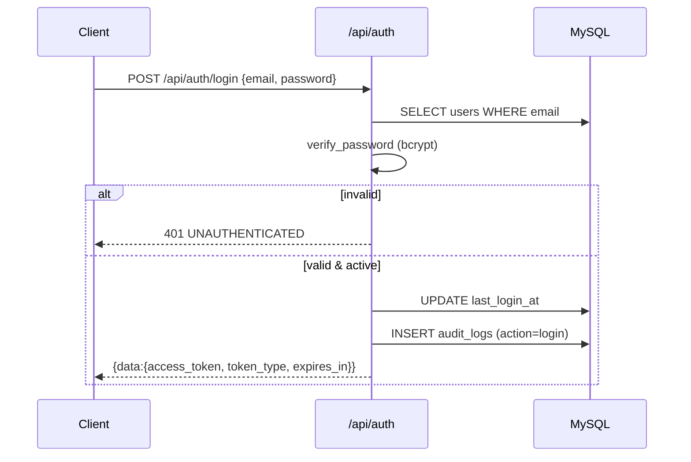

# HRMS — Module & Workflow Guide

End-to-end workflows for every module in this backend: **IAM, Organisation, HRIS,
Time, Leave, Payroll, Tax, Expenses, Loans, Onboarding, Exit, Assets, Documents,
Workflows/Approvals, Helpdesk, Currency, Analytics and Audit**.

This document mirrors the actual implementation. Source of truth:

| Layer | Location |
|---|---|
| ORM models (60 tables) | `app/models/` |
| Generic REST factory | `app/api/factory.py` |
| Resource registry | `app/api/registry.py` |
| Custom workflow endpoints | `app/api/routes/` |
| Auth / RBAC | `app/core/security.py`, `app/core/deps.py` |
| Query / filtering | `app/core/query.py` |
| Seed data | `app/seed.py` |

---

## Table of contents

1. [Platform architecture](#1-platform-architecture)
2. [Global conventions](#2-global-conventions)
3. [IAM — Identity & Access Management](#3-iam--identity--access-management)
4. [Organisation setup](#4-organisation-setup)
5. [HRIS — Employee core](#5-hris--employee-core)
6. [Time & attendance](#6-time--attendance)
7. [Leave](#7-leave)
8. [Payroll](#8-payroll)
9. [Income tax](#9-income-tax)
10. [Expenses](#10-expenses)
11. [Loans & advances](#11-loans--advances)
12. [Onboarding](#12-onboarding)
13. [Exit / offboarding](#13-exit--offboarding)
14. [Assets](#14-assets)
15. [Documents & e-signature](#15-documents--e-signature)
16. [Workflows, approvals, inbox & notifications](#16-workflows-approvals-inbox--notifications)
17. [Helpdesk](#17-helpdesk)
18. [Multi-currency](#18-multi-currency)
19. [Analytics, dashboard & reports](#19-analytics-dashboard--reports)
20. [Audit logging](#20-audit-logging)
21. [Cross-module end-to-end flows](#21-cross-module-end-to-end-flows)
22. [Status transition reference](#22-status-transition-reference)
23. [Permission catalogue](#23-permission-catalogue)
24. [Generic CRUD contract](#24-generic-crud-contract)

---

## 1. Platform architecture

```
┌───────────────────────────────────────────────────────────────────────┐
│  Client (web / mobile)                                                 │
└───────────────┬───────────────────────────────────────────────────────┘
                │  HTTPS + Bearer JWT
                ▼
┌───────────────────────────────────────────────────────────────────────┐
│  FastAPI app (app/main.py)                                             │
│   • exception handlers → {data, meta, errors} envelope                 │
│   • CORS, /health, /docs (OpenAPI)                                     │
│   • lifespan: init_db()  (+ optional AUTO_SEED)                        │
└───────────────┬───────────────────────────────────────────────────────┘
                │  /api/...
     ┌──────────┴───────────┐
     ▼                      ▼
┌─────────────────┐   ┌──────────────────────────────────────────────┐
│ Custom routers  │   │ Generic resource routers (57 resources)      │
│ auth, access,   │   │ list/get/create/patch/delete/bulk/export     │
│ employees,      │   │ generated by build_resource_router()          │
│ payroll, ...    │   │                                              │
└────────┬────────┘   └───────────────────────┬──────────────────────┘
         └──────────────────┬─────────────────┘
                            ▼
              ┌───────────────────────────────┐
              │  SQLAlchemy 2.0 + PyMySQL     │
              │  MySQL 8 (SQLite fallback)    │
              └───────────────────────────────┘
```

**Layering rules**

- Routers do HTTP + validation only; persistence goes through `app/crud/base.py`.
- Pydantic schemas for resources are auto-generated from the ORM models
  (`app/schemas/factory.py`) so the DB model stays the single source of truth.
- Every mutation on an audited entity writes `audit_logs`.

---

## 2. Global conventions

### 2.1 Authentication

- JWT bearer token (`HS256`), issued by `POST /api/auth/login`.
- Sent as `Authorization: Bearer <token>` on every protected request.
- Token subject = `users.id`; expiry = `ACCESS_TOKEN_EXPIRE_MINUTES`.

### 2.2 Response envelope

```json
{ "data": <object|array|null>, "meta": { "page":1, "pageSize":25, "total":312, "totalPages":13 }, "errors": null }
```

Errors:

```json
{ "data": null, "meta": null, "errors": [ { "code": "VALIDATION", "field": "email", "message": "..." } ] }
```

| HTTP | Code | Meaning |
|---|---|---|
| 400 | `VALIDATION` | Field-level errors |
| 401 | `UNAUTHENTICATED` | Missing/expired token |
| 403 | `FORBIDDEN` | RBAC block |
| 404 | `NOT_FOUND` | Entity missing |
| 409 | `CONFLICT` | Duplicate |
| 422 | `BUSINESS_RULE` | Illegal state change |
| 429 | `RATE_LIMITED` | Throttled |
| 500 | `INTERNAL` | Server error |

### 2.3 List querying

`?page=1&pageSize=25&sort=field:asc,-other&search=term&filter[status]=active`

Filter operators (suffix): `__eq`, `__ne`, `__gt`, `__gte`, `__lt`, `__lte`,
`__like`, `__in`, `__isnull`.

### 2.4 RBAC

- Roles (`roles`) hold permissions (`permissions`) via `role_permissions`.
- Users get roles via `user_roles`.
- Permission code = `module.action`; actions are `view, create, edit, delete, bulk, approve`.
- The **`global_admin`** role bypasses all permission checks (`app/core/deps.py`).

### 2.5 Audit

Mutations to these entities append to `audit_logs`:
`employees, employee_salaries, salary_revisions, payroll_runs, payslips,
employee_bank_details, employee_statutory_details, tax_declarations,
expense_claims, loans, legal_entities, pay_groups, salary_structures,
salary_components, roles, workflows, currency_rates, display_currency_preferences`.

Each row records `(org_id, user_id, entity_type, entity_id, action, old_values,
new_values, ip_address, created_at)`.

---

## 3. IAM — Identity & Access Management

**Tables:** `users`, `roles`, `user_roles`, `permissions`, `role_permissions`
**Routes:** `app/api/routes/auth.py`, `app/api/routes/access.py`

### 3.1 Login flow



### 3.2 Request authorisation flow

```
Request ─▶ get_current_user()
              │ decode JWT → load users.id → check is_active
              ▼
        require_permission("employee.edit")
              │
              ├─ role.code == global_admin ? allow
              └─ else permission in union(role.permissions) ? allow : 403
```

### 3.3 User & role management workflows

| Workflow | Endpoint |
|---|---|
| Register user (optionally link employee + roles) | `POST /api/auth/register` |
| Current identity | `GET /api/auth/me` |
| Change own password | `POST /api/auth/change-password` |
| Logout (client discards token) | `POST /api/auth/logout` |
| List a user's roles | `GET /api/users/{user_id}/roles` |
| Assign a role (by id or code) | `POST /api/users/{user_id}/roles` |
| Remove a role | `DELETE /api/users/{user_id}/roles/{role_id}` |
| List role permissions | `GET /api/roles/{role_id}/permissions` |
| Replace role permissions | `PUT /api/roles/{role_id}/permissions` |

Role/permission management is also available through the generic CRUD on
`/api/roles`, `/api/permissions`, `/api/users`.

---

## 4. Organisation setup

**Tables:** `organizations`, `legal_entities`, `locations`, `departments`,
`designations`, `cost_centers`
**Routes:** generic CRUD per resource

### 4.1 Hierarchy

```
Organization (base: default_currency, timezone)
   └── LegalEntity (base_currency — immutable after first payroll)
          ├── Location
          └── CostCenter
   └── Department (self-referencing parent_id, head_employee_id)
   └── Designation (title, grade)
```

### 4.2 Why legal entity matters

- Owns the **base currency** all amounts are stored in.
- Pay groups, statutory settings and payroll runs are scoped to a legal entity.
- Employees reference a legal entity, which drives their payroll currency.

### 4.3 Setup sequence

```
Organizations ─▶ Legal Entities ─▶ Locations / Cost Centres
                              └─▶ Departments (tree) / Designations
```

All six resources expose list/get/create/patch/delete/bulk/export at
`/api/organizations`, `/api/legal-entities`, `/api/locations`,
`/api/departments`, `/api/designations`, `/api/cost-centers`.

---

## 5. HRIS — Employee core

**Tables:** `employees`, `employee_personal_details`, `employee_job_history`,
`employee_bank_details`, `employee_statutory_details`, `employee_documents`,
`document_types`, `document_templates`
**Routes:** `app/api/routes/employees.py` + generic CRUD

### 5.1 Create employee

```
POST /api/employees                     (generic create, requires employee.create)
   ├─ core record: code, name, email, DOJ, employment_type, legal_entity_id,
   │   department_id, designation_id, location_id, cost_center_id,
   │   reporting_manager_id, pay_group_id
   └─ writes audit_logs
Then attach sub-records:
   PUT  /api/employees/{id}/personal-details
   POST /api/employees/{id}/bank-details
   PUT  /api/employees/{id}/statutory-details
```

### 5.2 Profile aggregate

```
GET /api/employees/{id}/profile
 └─ { employee, personal_details, statutory_details, bank_details[], job_history[] }
```

### 5.3 Job change with history

```
POST /api/employees/{id}/job-change
  { effective_date, department_id, designation_id, location_id,
    cost_center_id, reporting_manager_id, change_reason, apply_to_employee }
    │
    ├─ INSERT employee_job_history (snapshot, always)
    └─ if apply_to_employee: UPDATE employees current fields
```

### 5.4 Employee sub-resources

| Endpoint | Returns |
|---|---|
| `GET /api/employees/{id}/salaries` | All `employee_salaries` (active + superseded) |
| `GET /api/employees/{id}/payslips` | Payslip history |
| `GET /api/employees/{id}/documents` | Document list |
| `GET /api/employees/{id}/leave-balances` | Leave balances |
| `GET /api/employees/directory/list` | Active employee directory (org chart source) |

### 5.5 Employment lifecycle (status)

`active ──▶ probation ──▶ exited`

Payroll picks up `active` and `probation`. Exit sets `exited` + `date_of_exit`.

---

## 6. Time & attendance

**Tables:** `shifts`, `holidays`, `attendance_records`
**Routes:** generic CRUD + `app/api/routes/hr.py`

```
Shift / Holiday setup            (generic CRUD)
        │
        ▼
AttendanceRecord (employee, date, clock_in/out, worked_hours, overtime, status, source)
        │
        ▼  POST /api/attendance-records/{id}/regularise
   { clock_in, clock_out, status, reason }
   ├─ updates times, recomputes worked_hours
   └─ writes audit_logs
```

Attendance is not yet auto-fed into payroll deductions (loss-of-pay) — see
§21.2 for the extension point.

---

## 7. Leave

**Tables:** `leave_types`, `leave_balances`, `leave_requests`
**Routes:** generic CRUD + `app/api/routes/hr.py`

```
LeaveType (accrual_type, max_balance, encashable, is_paid)
    │
    ▼
LeaveBalance (employee, leave_type, balance, accrued, used, available)
    │
    ▼
LeaveRequest (start, end, days, status=pending)
    │
    ├─ POST /api/leave-requests/{id}/approve
    │     status=approved, approved_by
    │     balance.used += days ; balance.available = balance - used
    │
    ├─ POST /api/leave-requests/{id}/reject
    │     status=rejected
    │
    └─ POST /api/leave-requests/{id}/cancel
          status=cancelled ; if previously approved, reverse balance
```

State machine: `pending → approved | rejected`, `approved → cancelled`.

---

## 8. Payroll

**Tables:** `pay_groups`, `salary_structures`, `salary_components`,
`salary_structure_components`, `employee_salaries`, `salary_revisions`,
`payroll_runs`, `payroll_run_employees`, `payslips`, `payslip_lines`,
`statutory_settings`
**Routes:** `app/api/routes/payroll.py` + generic CRUD
**Permissions:** `payroll_run.edit/view/approve`, `payslip.approve`,
`salary_revision.create/approve`

### 8.1 Setup phase (once)

```
PayGroup (legal_entity, cycle, cut-off, pay date, currency)
        │
SalaryStructure ──▶ SalaryStructureComponent ──▶ SalaryComponent
        │              (sequence, mandatory,          (earning/deduction,
        │               default_value, formula_override) fixed/percentage/formula)
        ▼
EmployeeSalary (employee, structure, ctc, effective_from, status=active)
Employee.pay_group_id ──▶ employee included in that pay group's runs
StatutorySetting (legal_entity: pf/esi/pt/lwf/tds flags + JSON settings)
```

### 8.2 Run lifecycle (state machine)

```
POST /api/payroll-runs                       draft
        │
        ▼
POST /payroll-runs/{id}/process              draft → preview
        │   (populate payroll_run_employees + compute)
        ▼
POST /payroll-runs/{id}/validate             (no state change; checklist)
        │
        ▼
POST /payroll-runs/{id}/approve              → approved (approved_by)
        │
        ▼
POST /payroll-runs/{id}/finalize             → finalized (generates payslips)
        │
        ▼
GET  /payroll-runs/{id}/summary|employees|bank-file
POST /payslips/{id}/release | /hold
        │
        ▼
POST /payroll-runs/{id}/rollback             finalized → draft (deletes payslips)
```

**Process** (`process_run`):
1. Reject if `finalized` (locked).
2. Clear prior `payroll_run_employees`.
3. Select employees in the run's pay group with `status in (active, probation)`.
4. For each: find latest `active` `employee_salaries`.
   - none → row `status=error`, "No active salary record".
   - else → compute via `_structure_breakdown` → `gross`, `deductions`, `net_pay`, `status=processed`.
5. `draft → preview`.

**Compute** (`_structure_breakdown`):
```
monthly = ctc / 12
for each component in structure (ordered by sequence):
    fixed       → amount = default_value
    percentage  → amount = monthly * (formula% / 100)   e.g. "12%"
    deduction   → deductions += amount
    else        → gross += amount
net = gross - deductions
```

**Validate** (`validate_run`): builds a PF/ESI/PT/LWF/TDS checklist from
`statutory_settings` for the run's legal entity and flags error rows; returns an
overall `pass | warn | fail`.

**Finalize** (`finalize_run`): for each non-error run employee, create a `payslips`
row (+2 snapshot `payslip_lines`: Gross Earnings, Total Deductions), set
`finalized_at`, audit the payslip count. Run becomes locked.

**Rollback** (`rollback_run`): delete generated payslips, reset to `draft`.

### 8.3 Read / disbursement

| Endpoint | Purpose |
|---|---|
| `GET /payroll-runs/{id}/summary` | gross / deductions / net / headcount / employer cost |
| `GET /payroll-runs/{id}/employees` | per-employee register lines |
| `GET /payroll-runs/{id}/bank-file` | CSV join with `employee_bank_details` for bank upload |
| `POST /payslips/{id}/release` | `status=released`, `released_at`, channels |
| `POST /payslips/{id}/hold` | `status=held` with reason |

### 8.4 Salary revisions (mid-month / raise / correction)

```
POST /api/employees/{id}/salary-revisions
   { new_ctc, effective_date, reason, structure_id? }
   ├─ snapshot old_ctc from current active salary
   └─ INSERT salary_revisions (status=pending)

POST /api/salary-revisions/{id}/approve
   ├─ current active EmployeeSalary → status=superseded, effective_to=effective_date
   ├─ INSERT new EmployeeSalary (effective_from=effective_date, status=active)
   └─ revision.status=approved, approved_by

POST /api/salary-revisions/{id}/reject   → status=rejected
```

State machine: `pending → approved | rejected`.

> **Important:** the payroll engine currently selects the latest `active` salary
> for the whole period, so mid-month revisions are **not prorated** and
> effective dates are not yet honoured by `process_run`. History/versioning is
> correct (old rows are retained as `superseded`), computation is not date-aware.

### 8.5 How to inspect pay history

```
GET /api/employees/{id}/salaries                     # all versions incl. superseded
GET /api/employee-salaries?filter[employee_id]=...&sort=effective_from:desc
GET /api/salary-revisions?filter[employee_id]=...
GET /api/audit-logs?filter[entity_type]=salary_revisions
GET /api/employees/{id}/payslips
GET /api/payroll-runs/{run_id}/employees
```

---

## 9. Income tax

**Tables:** `tax_declarations`, `tax_proofs`
**Routes:** `app/api/routes/finance.py` + generic CRUD

```
TaxDeclaration (employee, financial_year, regime, total_declared, status)
    │
    ├─ POST /tax-declarations/{id}/submit   → submitted (+submitted_at)
    ├─ POST /tax-declarations/{id}/approve  → approved (+approved_by)
    └─ POST /tax-declarations/{id}/reject   → rejected (reason)

TaxProof (declaration, section, amount, proof_file_path, status)
    └─ POST /tax-proofs/{id}/verify {status}  → approved | rejected | pending
```

Detail aggregate: `GET /api/tax-declarations/{id}/detail` → declaration + proofs.

State machine: declaration `draft → submitted → approved | rejected`.

---

## 10. Expenses

**Tables:** `expense_policies`, `expense_claims`, `expense_claim_lines`
**Routes:** `app/api/routes/finance.py` + generic CRUD

```
ExpensePolicy (currency, max_amount, requires_receipt, approval_chain JSON)
    │
ExpenseClaim (employee, policy, claim_date, total_amount, currency, status=draft)
    └── ExpenseClaimLine (category, amount, receipt_path, expense_date)
            │
            ▼
POST /expense-claims/{id}/submit      → recalculates total from lines; submitted
POST /expense-claims/{id}/approve     → approved (+approved_by)
POST /expense-claims/{id}/reject      → rejected (reason)
POST /expense-claims/{id}/mark-paid   → paid (optionally links payroll_run_id)
```

Detail aggregate: `GET /api/expense-claims/{id}/detail` → claim + lines.

State machine: `draft → submitted → approved → paid`; `submitted → rejected`.

**Payroll integration:** `mark-paid` can reference a `payroll_runs` row
(`paid_in_payroll_run_id`) to record that the reimbursement was settled in a run.

---

## 11. Loans & advances

**Tables:** `loan_policies`, `loans`, `loan_repayments`
**Routes:** `app/api/routes/finance.py` + generic CRUD

```
LoanPolicy (interest_rate, max_amount, max_tenure_months)
    │
POST /api/loans/apply
   { employee_id, policy?, principal, interest_rate, tenure_months, disbursement_date }
   ├─ EMI = P*r*(1+r)^n / ((1+r)^n - 1)   (r = annual/1200); 0% → P/n
   └─ INSERT loans (status=pending, outstanding=principal)

POST /loans/{id}/approve
   ├─ status=active, disbursed_at=now
   └─ build loan_repayments schedule (monthly due dates, principal/interest split)

GET  /loans/{id}/schedule             # amortization table
POST /loans/{id}/skip-emi             # next pending instalment → skipped
POST /loans/{id}/foreclose            # status=closed, outstanding=0, clear pending
```

State machine: loan `pending → active → closed`; instalment `pending → skipped`
(`paid` reserved for payroll linkage).

---

## 12. Onboarding

**Tables:** `onboarding_templates`, `onboarding_tasks`, `employee_onboarding`
**Routes:** `app/api/routes/hr.py` + generic CRUD

```
OnboardingTemplate (role, department)
   └── OnboardingTask[] (title, owner_role, due_days, sequence,
                         depends_on_task_id — self-referencing, no cycles)
            │
POST /api/employees/{id}/onboarding { template_id }
   └─ INSERT employee_onboarding (status=in_progress, started_at=now)
            │
POST /api/employee-onboarding/{id}/complete
   └─ status=completed (+completed_at)
```

---

## 13. Exit / offboarding

**Tables:** `exit_requests`, `exit_tasks`
**Routes:** `app/api/routes/hr.py` + generic CRUD

```
POST /api/exit-requests (generic create)
   { employee_id, resignation_date, last_working_date, reason }  status=pending
        │
POST /exit-requests/{id}/approve     → approved (+approved_by)
        │
POST /exit-requests/{id}/complete    → completed
        │   └─ employee.status = exited ; employee.date_of_exit = last_working_date
        ▼
ExitTask (checklist)  POST /exit-tasks/{id}/complete → completed
```

State machine: `pending → approved → completed`.

F&F settlement is not implemented yet (extension point).

---

## 14. Assets

**Tables:** `assets`, `asset_assignments`
**Routes:** `app/api/routes/hr.py` + generic CRUD

```
Asset (asset_code unique, category, serial, status=available)
    │
POST /assets/{id}/assign { employee_id, assigned_date }
   ├─ guard: already assigned → 422
   ├─ asset.status = assigned
   └─ INSERT asset_assignment (status=assigned)
    │
POST /asset-assignments/{id}/return { returned_date, condition_on_return }
   ├─ assignment.status = returned
   └─ asset.status = available
```

Asset state: `available → assigned → available` (or `retired`).

---

## 15. Documents & e-signature

**Tables:** `document_types`, `employee_documents`, `document_templates`
**Routes:** `app/api/routes/documents.py` + generic CRUD

```
DocumentType (category, is_mandatory, has_expiry)
    │
POST /api/documents/upload   (multipart: employee_id, document_type_id,
                              expiry_date, file)
   ├─ store file under ./uploads (S3-swap point)
   ├─ cap size at 10 MB
   ├─ INSERT employee_documents (status=pending, uploaded_by=current user)
   └─ audit

GET /api/documents/{id}/download     # FileResponse
```

`DocumentTemplate` supports versioned letter/offer/policy bodies
(`{type, body, version, is_active}`). E-signature/OTP routing is an extension
point — the model stores the document; signing state is not yet modelled.

---

## 16. Workflows, approvals, inbox & notifications

**Tables:** `workflows`, `workflow_steps`, `approvals`, `notifications`
**Routes:** `app/api/routes/workflow.py` + generic CRUD

### 16.1 Define a workflow

```
Workflow (module, trigger_event, is_active)
   └── WorkflowStep[] (step_order, approver_role, condition JSON, is_final)
```

### 16.2 Start & action a workflow

```
POST /api/workflows/{id}/start { entity_type, entity_id }
   └─ for each step → INSERT approvals (status=pending, step_order)

GET  /api/approvals/pending          # approvals for current user (or unassigned)
POST /api/approvals/{id}/approve     # status=approved, approver_id, acted_at, comments
POST /api/approvals/{id}/reject      # status=rejected + comments
```

### 16.3 Unified inbox

```
GET /api/inbox
 └─ aggregated pending counts across modules:
    leave, expense (submitted), loan, exit, helpdesk (open/in_progress),
    workflow approvals (assigned to caller or unassigned)
```

### 16.4 Notifications

```
GET  /api/notifications/my            # latest 50 for current user
POST /api/notifications/{id}/read     # status=read, read_at
```

State machine: approval `pending → approved | rejected`; notification
`queued → sent → read`.

> Note: the workflow engine is manual/parallel — every step is created at once
> and independent. Sequential gating (step N after N-1) is an extension point.

---

## 17. Helpdesk

**Tables:** `helpdesk_tickets`
**Routes:** `app/api/routes/hr.py` + generic CRUD

```
Ticketing: create via generic POST /api/helpdesk-tickets (status=open)
    │
POST /helpdesk-tickets/{id}/assign { assigned_to, sla_due_at }
   └─ status=in_progress
    │
POST /helpdesk-tickets/{id}/close
   └─ status=closed
```

State machine: `open → in_progress → closed`.

---

## 18. Multi-currency

**Tables:** `currency_rates`, `display_currency_preferences`, (`organizations`,
`legal_entities` carry base/default currencies)
**Routes:** `app/api/routes/currency.py` + generic CRUD

### 18.1 Convert

```
GET /api/currency/convert?amount=100&base=USD&quote=INR&on_date=2026-06-01
   ├─ exact rate effective ≤ date
   ├─ else inverse pair (1/rate), flagged is_stale=true
   └─ none → 422 RATE_UNAVAILABLE
Response: rate, rate_date, converted_amount, is_stale
```

### 18.2 Display-currency precedence

```
1. user preference  (display_currency_preferences, if not use_org_default)
2. group default    (extension point — not modelled per group yet)
3. organisation default (organizations.default_currency)
4. legal entity base currency (final fallback)
```

Resolved by `GET /api/me/preferences/currency`; set via
`PUT /api/me/preferences/currency`; admin reset via
`POST /api/currency/bulk-reset`.

**Rule:** secondary currency is display-only — it never changes stored values,
statutory figures, payslips or bank files.

---

## 19. Analytics, dashboard & reports

**Routes:** `app/api/routes/analytics.py`

### 19.1 Dashboard

```
GET /api/dashboard
 └─ headcount (total + by status), joiners MTD, exits MTD, payroll cost MTD,
    pending approvals, pending leave, pending expense, active loans,
    open tickets, my last 3 payslips
```

### 19.2 Reports

```
GET /api/reports              → catalogue
GET /api/reports/{code}       → run a report
```

| Code | Content |
|---|---|
| `headcount` | by department × status |
| `attrition` | exits per month |
| `payroll-register` | all run lines |
| `salary-summary` | gross/net per period |
| `loan-outstanding` | active loans + balances |
| `expense-summary` | spend by category |
| `statutory-pf` / `statutory-esi` | statutory stubs |

---

## 20. Audit logging

**Table:** `audit_logs` (append-only)
**Route:** `GET /api/audit-logs` (read-only; no create/update/delete)

```
Any mutation on an audited entity
   └─ write_audit(...) → INSERT audit_logs
        (org_id, user_id, entity_type, entity_id, action,
         old_values JSON, new_values JSON, ip_address, created_at)
```

Sensitive actions that always audit: bank detail change, salary change,
statutory ID change, role change, currency setting change, payroll finalize,
payslip release/hold, salary revision approve/reject.

---

## 21. Cross-module end-to-end flows

### 21.1 Hire-to-payroll

```
1. Organisation setup        organisations → legal entities → locations/depts
2. IAM                       create user + global_admin/HR role
3. Employee                  POST /api/employees (+ personal/bank/statutory)
4. Payroll setup             pay group → structure + components → EmployeeSalary
5. Payroll run               create → process → validate → approve → finalize
6. Payslip                   POST /payslips/{id}/release
7. Disbursement              GET /payroll-runs/{id}/bank-file
```

```
Client ─▶ Employees API ─▶ DB
                       └─▶ Payroll API (engine reads active salaries)
                       └─▶ Payslip generation (on finalize)
                       └─▶ Banking export (bank-file)
```

### 21.2 Attendance/leave → payroll (extension point)

```
AttendanceRecord / LeaveRequest ──▶ (LOP/overtime computation) ──▶ deductions
```
Currently not wired: `_structure_breakdown` does not read attendance or leave.

### 21.3 Expense → payroll reimbursement

```
ExpenseClaim submit → approve → mark-paid { payroll_run_id }
   └─ recorded as settled in that payroll run (paid_in_payroll_run_id)
```

### 21.4 Loan → payroll EMI

```
Loan approve → loan_repayments schedule
   └─ future: EMI instalments linked to payroll_run_id during payroll processing
```
Currently the schedule is built but not auto-deducted into a run.

### 21.5 Exit → F&F (extension point)

```
ExitRequest approved → completed (employee exited)
   └─ future: F&F settlement (leave encashment, notice recovery, loan closure)
```

### 21.6 Approval across modules

```
Leave / Expense / Loan / Exit / Salary revision
   └─ dedicated action endpoints (approve/reject)
   └─ OR the generic workflow engine:
        /workflows/{id}/start → /approvals/{id}/approve|reject → /inbox
```

---

## 22. Status transition reference

| Entity | Field | Transitions |
|---|---|---|
| PayrollRun | `status` | `draft → preview → approved → finalized`; `finalized → draft` (rollback) |
| PayrollRunEmployee | `status` | `pending → processed` / `error` |
| Payslip | `status` | `draft → released` / `held` |
| SalaryRevision | `status` | `pending → approved` / `rejected` |
| EmployeeSalary | `status` | `active → superseded` |
| Employee | `status` | `active ↔ probation → exited` |
| LeaveRequest | `status` | `pending → approved` / `rejected`; `approved → cancelled` |
| ExpenseClaim | `status` | `draft → submitted → approved → paid`; `submitted → rejected` |
| Loan | `status` | `pending → active → closed` |
| LoanRepayment | `status` | `pending → skipped` (paid reserved) |
| TaxDeclaration | `status` | `draft → submitted → approved` / `rejected` |
| TaxProof | `status` | `pending → approved` / `rejected` |
| EmployeeOnboarding | `status` | `in_progress → completed` |
| ExitRequest | `status` | `pending → approved → completed` |
| ExitTask | `status` | `pending → completed` |
| Asset | `status` | `available → assigned → available` / `retired` |
| AssetAssignment | `status` | `assigned → returned` |
| HelpdeskTicket | `status` | `open → in_progress → closed` |
| Approval | `status` | `pending → approved` / `rejected` |
| Notification | `status` | `queued → sent → read` |

---

## 23. Permission catalogue

Format: `module.action`. Actions: `view, create, edit, delete, bulk, approve`.
The seed script creates every code for every module below.

Modules: `organization, legal_entity, location, department, designation,
cost_center, user, role, permission, employee, employee_salary,
employee_document, document, payroll_run, payslip, salary_structure,
salary_component, salary_revision, statutory, tax_declaration, tax_proof,
expense, loan, leave, attendance, shift, holiday, onboarding, exit, asset,
helpdesk, workflow, approval, notification, audit, currency, integration`.

Examples: `employee.view`, `employee.create`, `payroll_run.approve`,
`payslip.approve`, `salary_revision.approve`, `expense.approve`, `leave.approve`,
`tax_declaration.approve`, `currency.edit`.

`global_admin` bypasses all checks.

---

## 24. Generic CRUD contract

Every one of the **57 registered resources** (see `app/api/registry.py`)
automatically exposes:

| Method | Path | Purpose |
|---|---|---|
| `GET` | `/api/{resource}` | List (page, pageSize, sort, search, filter) |
| `GET` | `/api/{resource}/{id}` | Fetch one |
| `POST` | `/api/{resource}` | Create (201) |
| `PATCH` | `/api/{resource}/{id}` | Partial update |
| `DELETE` | `/api/{resource}/{id}` | Delete |
| `POST` | `/api/{resource}/bulk` | Bulk create `{items:[...]}` |
| `POST` | `/api/{resource}/bulk-delete` | Bulk delete `{ids:[...]}` |
| `GET` | `/api/{resource}/export?format=csv\|json` | Export |

Tables without a surrogate `id` are handled outside the factory:

- `employee_personal_details` → `PUT /api/employees/{id}/personal-details`
- `role_permissions` → `PUT /api/roles/{id}/permissions`

**Resource slugs:** `organizations, legal-entities, locations, departments,
designations, cost-centers, users, roles, permissions, employees,
employee-job-history, employee-bank-details, employee-statutory-details,
document-types, employee-documents, document-templates, pay-groups,
salary-structures, salary-components, salary-structure-components,
employee-salaries, salary-revisions, payroll-runs, payroll-run-employees,
payslips, payslip-lines, statutory-settings, tax-declarations, tax-proofs,
expense-policies, expense-claims, expense-claim-lines, loan-policies, loans,
loan-repayments, leave-types, leave-balances, leave-requests, shifts, holidays,
attendance-records, onboarding-templates, onboarding-tasks, employee-onboarding,
exit-requests, exit-tasks, assets, asset-assignments, helpdesk-tickets,
workflows, workflow-steps, approvals, notifications, audit-logs, currency-rates,
display-currency-preferences, integrations`.

---

## Extension points (not yet implemented)

1. **Date-aware payroll / mid-month proration** and arrears — `process_run` + `_structure_breakdown`.
2. **Attendance & leave → payroll** (LOP, overtime, unpaid leave deductions).
3. **Statutory computation** (PF/ESI/PT/TDS amounts) — currently only validated.
4. **Loan EMI auto-deduction** into payroll runs.
5. **Full & Final settlement** on exit.
6. **Sequential workflow gating** (step N after step N-1) and escalations/SLA.
7. **E-signature / OTP** document signing flow.
8. **Async jobs** (`202 + jobId`) for bulk import, payroll runs and PDF generation.
9. **Row-level tenancy scoping** (all rows carry `org_id`; currently filter-based).
10. **Object storage** for documents (currently local `./uploads`).

---

## 25. Session, self-service, settings & cross-cutting additions

### 25.1 Auth & session

| # | Endpoint | Behaviour |
|---|---|---|
| 25.1.1 | `POST /api/auth/refresh` | Accepts a refresh token in the body or the `refresh_token` cookie; returns a new access + refresh token and refreshes the cookie. |
| 25.1.2 | `POST /api/auth/forgot-password` | Always `200` (no account enumeration); returns a short-lived `reset_token` only when `DEBUG=true`. |
| 25.1.3 | `POST /api/auth/reset-password` | Consumes the token (single-use via a password-hash fingerprint). |
| 25.1.4 | `GET /api/auth/permissions` | Resolved permission set, role codes and `is_global_admin`; `/api/auth/me` also carries `permissions`. |
| 25.1.5 | `POST /api/auth/switch-org` | Persists the active organisation on `user_preferences`. |
| 25.1.6 | `PATCH /api/auth/me` | Self-service update of name/phone/avatar/email (employee-linked) + locale/theme. |
| 25.1.7 | `POST /api/auth/logout` | Clears the refresh cookie. |

Login now returns `access_token` **and** `refresh_token`, and sets an httpOnly `refresh_token` cookie.

### 25.2 Users / access (admin)

| Endpoint | Behaviour |
|---|---|
| `POST /api/users/{user_id}/reset-password` | Admin reset; generates a temp password when none supplied. |
| `GET /api/users/{user_id}/login-history` | Reads `audit_logs` (`entity_type=auth`). |
| `POST /api/users/invite` | Creates the account with a temp password and optional roles; `send_invite` flag. |

### 25.3 Reference data & search

| Endpoint | Behaviour |
|---|---|
| `GET /api/lookups/{type}?q=&limit=` | Generic FK picker (`employees, users, roles, departments, designations, locations, legal-entities, cost-centers, pay-groups, expense-policies, loan-policies, leave-types, document-types`). |
| `GET /api/employees/search?q=&limit=` | Employee typeahead. |
| `GET /api/search?q=` | Global grouped search: employees, documents, pages, reports. |

### 25.4 Dashboard & preferences

| Endpoint | Behaviour |
|---|---|
| `GET /api/dashboard` | Now also returns `attrition_trend`, `payroll_by_department`, `approvals[]`, `events[] (birthdays/anniversaries)` alongside the existing scalar widgets. |
| `GET/PUT /api/me/dashboard-layout` | Per-user widget order/visibility (`user_preferences.dashboard_layout`). |
| `GET/PUT /api/me/preferences` | UI prefs, locale, theme. |

### 25.5 Payroll tabs & payslip documents

| Endpoint | Behaviour |
|---|---|
| `GET /api/payroll-runs/{id}/variances` | Current vs previous finalized run per employee (net, delta, delta %). |
| `GET /api/payroll-runs/{id}/statutory` | PF/ESI/PT/LWF/TDS sub-tables + totals + enabled flags. |
| `GET /api/payroll-runs/{id}/challans?type=pf\|esi\|pt\|tds\|lwf` | `text/csv` challan download. |
| `GET /api/payroll-runs/{id}/approvals` | Approvals for the run. |
| `GET /api/payroll-runs/{id}/audit` | Audit trail for the run. |
| `GET /api/payslips/{id}/pdf` | Server-rendered payslip PDF (fpdf2), cached on `payslips.pdf_path`. |
| `POST /api/payslips/{id}/reprint` | Regenerates the PDF and audits. |
| `POST /api/payslips/bulk-release` | `{ids, action: release\|hold}` in one transaction. |

### 25.6 Finance

| Endpoint | Behaviour |
|---|---|
| `POST/GET /api/expense-claim-lines/{id}/receipt` | Attach / download a receipt (`expense_claim_lines.receipt_path`). |
| `POST /api/tax-proofs/{id}/upload` · `GET .../file` | Tax proof upload/download. |
| `POST /api/loans/{id}/mark-paid-outside-payroll` | Closes the loan, zeroes outstanding, flags `paid_outside_payroll`. |
| `POST /api/loans/{id}/remind` · `/api/tax-declarations/{id}/remind` · `/api/expense-claims/{id}/remind` | Queues a notification. |
| `POST /api/expense-claims/{id}/unpaid` | Reverses `paid → approved`, clears payroll link. |

### 25.7 Leave, attendance & lifecycle

| Endpoint | Behaviour |
|---|---|
| `GET /api/leave-requests/team-overlap?employee_id=&start=&end=` | Overlapping teammate leave (manager/department). |
| `GET /api/attendance-records/summary?from=&to=&employee_id=` | Counts by status. |
| `GET /api/attendance-records/{id}/timeline` | Record + audit events. |
| `POST /api/attendance-records/{id}/mark-manual` | Sets `source=manual` and updates times/status. |
| `POST /api/exit-requests/{id}/reject` · `/cancel` | Exit state transitions. |
| `POST /api/exit-requests/{id}/full-and-final` | F&F statement: leave encashment, loan recovery, notice recovery, net payable. |
| `POST /api/assets/{id}/unavailable` | Marks an unassigned asset unavailable. |
| `GET /api/employees/{id}/onboarding` | Per-employee onboarding records. |

### 25.8 Workflows & notifications

| Endpoint | Behaviour |
|---|---|
| `POST /api/approvals/{id}/request-info` | `status=info_requested` + comment. |
| `POST /api/notifications/read-all` | Marks all the caller's notifications read. |
| `GET /api/notifications/unread-count` | Bell badge count. |
| `GET /api/inbox/me` | Caller-scoped inbox (their workflow approvals + open helpdesk tickets). |

### 25.9 Settings, currency & integrations

| Endpoint | Behaviour |
|---|---|
| `GET /api/organizations/current` | Active org + legal entities + stored org settings. |
| `GET/PUT /api/settings/currency` | Org + per-entity currency configuration (default display currency, enabled list, override, rate source/type, rounding, surfaces, dual vs converted, disclaimer). |
| `POST /api/currency-rates/import` | CSV import (`base_currency,quote_currency,rate,effective_date,source`). |
| `GET /api/tenant/features` | Plan-tier feature flags with per-tenant overrides. |
| `POST /api/integrations/{id}/connect` | Marks connected + merges config. |
| `POST /api/integrations/{id}/callback` | OAuth code/state exchange stub. |

### 25.10 Files, reports & cross-cutting

| Endpoint | Behaviour |
|---|---|
| `POST /api/documents/{id}/signed-url` | 5-minute signed URL. |
| `GET /api/documents/download-signed?token=` | Serves the file via the signed token. |
| `POST /api/employees/{id}/avatar` · `GET .../avatar` | Avatar upload / fetch. |
| `GET /api/reports/{code}/export?format=csv\|json` | Report export. |
| `GET/POST /api/reports/schedules` · `DELETE /api/reports/schedules/{id}` | Scheduled reports. |
| `POST /api/{resource}/bulk-update` | Partial update of many rows `{ids, data}` — available on **every** resource. |
| `Idempotency-Key` header | Repeated `POST`s with the same key replay the stored response (24h, in-memory). |
