# ONBOARDING_ATTENDANCE_AND_LEAVE.md
# EMS Addendum: Employee Onboarding, Attendance Management and Leave Management

| Item | Value |
|---|---|
| Document | ONBOARDING_ATTENDANCE_AND_LEAVE.md |
| Version | 1.0 (Draft for review) |
| Date | 2026-10-29 |
| Base specification | EMPLOYEE_MANAGEMENT_SYSTEM.md v1.0 (2026-10-28), referred to as "the EMS" |
| Document type | Additive specification (addendum). It does not replace, restate or redesign the EMS. |
| Modules | Employee Onboarding (ONB), Attendance Management (ATT), Leave Management (LEV) |
| Target market | Unchanged (EMS metadata): organizations operating in India, multi-organization deployment |
| Status | Source of truth for the three modules once approved; items in §18 require product-owner and/or legal sign-off |
| Amendments | 2026-11-01: the first-run administrator also holds AIC (§10.3 note 6), so it can use `attendance.import`. |

---

## 1. Document Metadata, Conventions and Relationship to the EMS

### 1.1 Purpose
This addendum specifies only the additions, modifications, extensions and integration changes required to add onboarding, attendance and leave management to the implemented EMS. It must be read together with the EMS. It is intended to be precise enough for developers to implement the database, backend services, authorization, user interface and automated tests for the three modules without inventing business rules.

### 1.2 Relationship to the EMS
- The EMS remains authoritative for every rule, entity, field, API and convention not explicitly changed here.
- Every change to an existing EMS rule is listed in §2.6 with its disposition (Unchanged, Extended, Superseded). No other EMS rule is modified, even implicitly.
- Existing EMS field catalogs are referenced by section and field name and are not copied.
- Salary behaviour (EMS §4.3, §16–§18) is unchanged by this addendum, except as amended in the EMS on 2026-11-02: components have a `display_name` and `component_type` (EARNING/DEDUCTION), Basic is a system component, and a PERCENTAGE component is a percentage of Basic with its own amount stored at assignment time. No payroll, tax, statutory contribution, salary deduction or settlement computation is introduced (§2.5).

### 1.3 Reference Conventions
- "EMS §n" refers to a section of EMPLOYEE_MANAGEMENT_SYSTEM.md. A bare "§n" refers to this addendum.
- New identifiers are chosen so that they never collide with EMS identifiers:

| Identifier family | EMS range | Addendum range |
|---|---|---|
| Functional requirements | FR-ORG, FR-EMP, FR-SAL, … | FR-ONB-*, FR-ATT-*, FR-LEV-*, FR-INT-* |
| Non-functional requirements | NFR-01 … NFR-21 | NFR-22 onwards |
| Objectives | OBJ-1 … OBJ-7 | OBJ-8 onwards |
| Acceptance criteria | AC-01 … AC-28 | AC-29 onwards (AC-24 amended in §17.1) |
| Assumptions | A-01 … A-12 | A-13 onwards |
| Open questions / decisions | Q-01 … Q-23 | OD-01 onwards |
| Edge cases | E-01 … E-36 | E-37 onwards |
| Business rules | EMP-*, INV-*, C-* | ONB-*, ATT-*, LEV-*, INT-* |
| Warning codes | W-* | W-ONB-*, W-ATT-*, W-LEAVE-* |

### 1.4 Convention Extensions
All conventions in EMS §1.4 and §1.5 apply unchanged, including the Required? codes (M, M-A, O, C, SYS, DER), the field flags ([R], [E], [H]), logical data types, half-open effective intervals `[effective_from, effective_to)`, UTC timestamps and organization-timezone business dates. This addendum adds only the following:

| Convention | Definition |
|---|---|
| Logical type TIME | PostgreSQL `time(0) without time zone`; MySQL `TIME(0)`. A local wall-clock time (HH:MM) interpreted in the timezone of the governing attendance policy version (§5.4). Used only for shift and day-boundary definitions. |
| Logical type LEAVE_DAYS | DECIMAL(7,2). Leave quantities in days. Application durations are always multiples of 0.50; ledger quantities may carry two decimals (accruals). Ledger quantities are signed (§6.5). |
| Minutes | INTEGER or SMALLINT count of whole minutes. |
| DER (stored) | A derived value that the service computes and persists for query performance (for example attendance evaluation results). It is never accepted from clients; a supplied value is rejected with `422 FIELD_READ_ONLY` exactly as for SYS. "DER" without "(stored)" keeps the EMS meaning (display-only, not persisted). |
| Append-only tables | Follow EMS §1.5: only `id`, `created_at`, `created_by` as technical columns; never updated or deleted by the application role. Tables in this addendum marked "append-only" may add business timestamps such as `occurred_at`. |
| Half-day slot | A half of a calendar day: FIRST_HALF or SECOND_HALF. FIRST_HALF precedes SECOND_HALF. Used by attendance halves (§5.9) and leave slots (§6.8). |
| Change markers | [NEW] new artefact; [CHG] change to an existing EMS artefact; [REUSE] existing artefact used without change; [INT] integration rule. |
| Standard columns | "standard columns (EMS §1.5)" means all nine EMS §1.5 columns. Every new organization-scoped table also has `UNIQUE (organization_id, id)` (EMS §23.1). |

### 1.5 Glossary Additions

| Term | Definition |
|---|---|
| Onboarding template | Organization-scoped, versioned checklist definition. |
| Template version | Immutable-once-published set of template tasks, dependencies and applicability with an effective interval. |
| Onboarding instance | The onboarding of one employment record, created from one template version. |
| Onboarding task | A snapshot of a template task (or an ad-hoc task) inside an instance, with its own status and assignee. |
| Blocking task | A task with `blocks_activation = true`; it must be COMPLETED or WAIVED before the employment record can be activated. |
| Data submission | Staged employee-provided values for one EMS data section, applied to EMS records only after review. |
| Work schedule | For an employee and date: governing attendance policy version, shift, weekly-off pattern, holiday calendar and resulting day type (§5.6). |
| Day type | WORKING_DAY, WEEKLY_OFF or HOLIDAY for an employee on a date. |
| Shift | Organization-scoped definition of scheduled start/end times, thresholds and attendance window. |
| Attendance window | The interval around a shift within which punches are assigned to that shift's business date (§5.8). |
| Business date | The DATE to which an attendance event belongs, in the attendance policy timezone (§5.8). For overnight shifts it is the date on which the shift starts. |
| Punch | A raw IN or OUT time event. Never edited; may be voided. |
| Attendance record | The single daily record per employee and business date that holds the derived and finalized attendance outcome. |
| Finalization | Locking an attendance record against ordinary changes (§5.12). |
| Regularization | An employee-initiated, approval-controlled correction of an OPEN attendance record. |
| Leave type | Organization-scoped category of leave (e.g., code CL). |
| Leave policy | Versioned rules for one leave type: applicability, entitlement, accrual, restrictions and year-end treatment. |
| Leave year | The 12-month entitlement period starting on day 1 of `leave_year_start_month` (§6.1). Independent of the financial year. |
| Leave slot | One half-day slot covered by a leave application. |
| Leave ledger | Append-only `leave_transactions`; the authoritative source of posted balances. |
| Materialized balance | `leave_balances` row: a transactionally maintained cache of ledger sums and reservations. |
| Reservation | Days held by a SUBMITTED application against the available balance. |
| Approval chain | MANAGER_ONLY, HR_ONLY or MANAGER_THEN_HR (§7.1). |
| HR queue | The set of users holding the module's HR-approval permission in the organization. |

---

## 2. Scope Changes and Existing Functionality Reuse

### 2.1 Amended Scope Statement (EMS §1.3) [CHG]
EMS §1.3 is replaced by:

> The EMS is a **system of record for employee information**, extended by ONBOARDING_ATTENDANCE_AND_LEAVE.md with **onboarding checklists, attendance recording and leave management**. It is **not** a payroll system. It stores salary structures, statutory identifiers and dates as **reference data only**. It performs **no** payroll, tax, statutory contribution, recruitment, performance, training, expense, asset, exit-settlement or accounting computations or workflows (see EMS §4.2 as amended).

### 2.2 Product Objectives (EMS §2) [CHG — extended]

| # | Objective | Measure of success |
|---|---|---|
| OBJ-8 | Provide configurable, auditable onboarding checklists that integrate with employee activation and the document repository. | Every onboarding task transition is reconstructable from task events; activation blocking behaves exactly as configured (AC-31 to AC-33). |
| OBJ-9 | Record attendance with unambiguous business dates, explicit derivation rules and preserved history. | Overnight-shift and correction scenarios pass (AC-37 to AC-43); any record state is reconstructable (AC-55). |
| OBJ-10 | Manage leave with a reconstructable ledger, concurrency-safe balances and explicit duration rules. | Zero ledger/balance mismatches in the nightly integrity check; concurrency tests pass (AC-45, AC-47, AC-48). |
| OBJ-11 | Integrate onboarding, attendance and leave without introducing payroll computation. | AC-24 (amended) and AC-60 pass. |

### 2.3 In-Scope Additions (EMS §4.1) [CHG — extended]

| Area | Included capability |
|---|---|
| Onboarding | Versioned templates, applicability, tasks, dependencies, due dates, assignment, task execution and review, document collection through the EMS document subsystem, employee data submissions, acknowledgements, activation blocking, completion, cancellation, reopening, progress views |
| Work schedules | Weekly-off patterns, holiday calendars, branch calendar assignment |
| Attendance | Policies, shifts (including overnight), shift assignments, punches (self-service, manual, integration import), daily records, evaluation, day close, finalization, regularization with approvals, administrative correction, views and non-monetary summaries |
| Leave | Leave types, versioned policies, leave year, ledger, accrual and allocation, opening balances and adjustments, applications with half-day slots, approvals, withdrawal, cancellation and restoration, carry-forward and lapse, optional holidays, team calendar, summaries |
| Self-service | Extended per §11 (supersedes the last sentence of EMS §5.6) |

### 2.4 Out-of-Scope Revisions (EMS §4.2) [CHG]

| EMS §4.2 row | Disposition | Still excluded (MUST NOT be built) | What MAY be stored |
|---|---|---|---|
| Attendance, biometrics, shifts, timesheets | Superseded by this addendum | Biometric device management and device protocols; GPS, geofencing, photo or facial-recognition capture; project/task timesheets; overtime calculation for payment; shift premiums; attendance-based pay proration | Punch events received through the generic import API (§5.7), with source code and external event ID |
| Leave applications, balances, approvals | Superseded by this addendum | Leave encashment calculation or settlement; loss-of-pay deductions; payroll exports of payable days | `paid_classification` and `encashment_eligible` labels (§6.2) |
| Recruitment, job postings, ATS, interviews | Unchanged | Candidate, requisition, interview and offer-approval entities. Onboarding starts only from an existing EMS employee record (§4.1). | Unchanged |
| Exit/offboarding workflows, F&F, gratuity | Unchanged | Offboarding checklists | Unchanged |
| Notifications/workflow engines (email/SMS reminders) | Unchanged | Email, SMS or push notifications; reminders; escalations; a general-purpose workflow engine. Tasks and approvals appear in in-app queues only; approval chains have at most two levels (§7.1). | Overdue and pending indicators displayed in the UI |
| All other rows | Unchanged | — | — |

### 2.5 Computation Guardrails (EMS §4.3) [CHG — extended]
EMS §4.3 remains in force, including its single permitted calculation: a PERCENTAGE salary component's own amount as a percentage of Basic ([CHG 2026-11-02]). In addition, the system MUST NOT compute, store as derived values, or display: loss-of-pay days or amounts; "payable days" or "paid days" for payroll; overtime hours for payment or overtime pay; attendance-based salary proration; late-coming penalties or deductions; leave encashment amounts; or any monetary value of leave balances. `paid_classification` (§6.2) is a label and MUST NOT be combined with any salary value.

The following non-monetary values are permitted because they are defined explicitly in this addendum: worked minutes per attendance record (§5.10), counts of half-day slots by attendance status (§5.16), leave durations and balances in days (§6.5–§6.9), and onboarding progress percentages (§4.6).

### 2.6 Disposition of Existing EMS Rules

| EMS ref | Rule | Disposition | Addendum ref |
|---|---|---|---|
| §1.3 | Scope statement | Superseded (amended text) | §2.1 |
| §1.4 | Conventions | Extended (TIME, LEAVE_DAYS, DER (stored)) | §1.4 |
| §2 | Objectives | Extended | §2.2 |
| §3.1 | Functional requirements | Extended | §3 |
| §3.2 | Non-functional requirements | Extended; NFR-01–NFR-21 unchanged | §15 |
| §4.1 | In scope | Extended | §2.3 |
| §4.2 | Attendance and leave rows | Superseded; all other rows unchanged | §2.4 |
| §4.3 | Computation guardrails | Extended | §2.5 |
| §5.1 | Roles | Extended (roles OTO, AIC) | §10.1 |
| §5.2, §5.3 | Permission codes and matrix | Extended | §10.2, §10.3 |
| §5.4 | Scoping rules | Unchanged; applied to new modules | §10.4 |
| §5.5 | Enforcement | Unchanged; applied to new modules | §10.5 |
| §5.6 | "No other self-service functionality is in scope." | Superseded | §11 |
| §6.2, §6.3, §22 | Structure, consistency, relationships | Extended | §8.4, §8.5 |
| §7.5 | Organization settings | Extended (new columns) | §9.1 |
| §9.3 | Lookups | Extended (list ATTENDANCE_SOURCE) | §9.4 |
| §10.2 | DRAFT means "not yet an employee" | Unchanged; an onboarding instance does not change it | §4.1 |
| §10.3 | Activation checks | Extended (ONB-04) | §4.9 |
| §10.3 | Status transition matrix | Unchanged; side effects added | §7.5 |
| §10.7 | EMP-09 (joining date change) | Extended | §7.5 |
| §10.8 | Job changes | Extended (approver re-routing, task reassignment) | §7.1, §7.5 |
| §10.9 | Rehire / inter-organization transfer | Extended (no balance or history transfer) | §7.5 |
| §15.2 | Seeded document categories | Extended | §9.3 |
| §15.4 | Upload flow | Extended (optional `onboarding_task_id`; self-service upload for onboarding tasks) | §4.11 |
| §15.7 | Verification | Extended (task side effects) | §4.11 |
| §18.6 | Operation O4 (employment end date) | Extended (leave/attendance side effects in the same transaction) | §7.5 |
| §20.2 | Audited events | Extended | §13.1 |
| §23.2, §23.3 | Entity catalog, constraints | Extended | §8.2, §8.3 |
| §24.3, §24.5 | Error codes | Extended | §16 |
| §24.4.8 | Users | Extended (SELF-only provisioning for pre-joiners) | §4.14 |
| §24.7 | Transactions and jobs | Extended | §7.3, §14 |
| §25.6, §25.8 | Retention, legal review | Extended | §13.5, §13.6 |
| §28 AC-24 | Excluded modules absent | Superseded (amended text) | §17.1 |
| §29 | Assumptions, open questions | Extended | §18 |
| §11–§14, §16–§19, §21, §26 | Identifiers, education, family, bank, salary, ID generation, validation, search | Unchanged | — |

### 2.7 Reused Functionality [REUSE]

| Existing artefact | EMS ref | Use in this addendum |
|---|---|---|
| `organizations`, `organization_settings` | §7.2, §7.5 | Tenant root; `timezone`; new settings columns (§9.1) |
| `branches` | §8 | Applicability; holiday calendar assignment (§5.2) |
| Masters (departments, designations, grades, employment_types, work_locations, employee_categories) | §9 | Applicability dimensions; onboarding department queues |
| `employees` | §10.4–§10.6 | Subject of every new record; `status`, `joining_date`, `employment_end_date`, `probation_end_date`, `confirmation_date`, `reporting_manager_employee_id`, `gender` |
| `employee_job_history` | §10.8 | As-of-date attribute resolution (§5.6, §6.4) |
| `employee_status_history` | §10.8 | As-of-date status eligibility (§5.12, §6.6) |
| `employee_documents`, `document_categories`, upload flow, verification | §15 | All files; no new file storage |
| `employee_privacy_notices` | §25.3 | Written by privacy-notice acknowledgement tasks (§4.12) |
| `organization_files` | §23.2 | Policy documents shown in acknowledgement tasks |
| `users`, `user_organization_access`, `roles`, `permissions` | §5, §23.2 | Assignees, approvers, RBAC |
| `audit_logs` | §20 | All new audit events |
| Validation rules, warnings protocol | §21.1, §21.3 | All new validations; warning acknowledgement |
| API conventions, error envelope, ETag/If-Match, Idempotency-Key, cursor pagination | §24.1, §24.2, §26.5 | All new endpoints |
| Encryption and blind-index services | §23.7 | Encrypted data-submission payloads |
| Pending self-view change requests | §5.6 | **Not reused**: their storage is not specified in the EMS (OD-03) |

---

## 3. Updated Functional Requirements (EMS §3.1 extension)

| ID | Requirement | Priority | Section | Depends on (EMS) |
|---|---|---|---|---|
| FR-ONB-01 | Configure versioned onboarding templates with applicability, ordered tasks, dependencies, owners and due-date rules. | Must | §4.3 | §9, §15.2 |
| FR-ONB-02 | Initiate at most one active onboarding instance per employment record in DRAFT or ACTIVE status, with automatic or explicit template selection. | Must | §4.4, §4.6 | §10.2 |
| FR-ONB-03 | Snapshot tasks, resolve assignees and compute due dates at initiation; recompute joining-date-based due dates on joining-date change. | Must | §4.5, §4.7 | §10.6 |
| FR-ONB-04 | Execute tasks (start, submit, complete, accept, reject, reopen, waive, reassign) with full history. | Must | §4.8 | §20 |
| FR-ONB-05 | Collect task documents through the EMS document subsystem; document verification drives task status. | Must | §4.11 | §15 |
| FR-ONB-06 | Collect employee data submissions, review them and apply accepted values through EMS validation and edit services. | Should | §4.10 | §10–§14 |
| FR-ONB-07 | Record policy and privacy-notice acknowledgements. | Should | §4.12 | §25.3 |
| FR-ONB-08 | Apply configurable activation-blocking and completion rules. | Must | §4.9 | §10.3 |
| FR-ONB-09 | Complete, cancel and reopen instances; show progress, pending and overdue tasks. | Must | §4.2, §4.6 | — |
| FR-ONB-10 | Provision SELF-only access for pre-joiners. | Should | §4.14 | §24.4.8 |
| FR-ATT-01 | Maintain weekly-off patterns, holiday calendars and branch calendar assignments. | Must | §5.2 | §8 |
| FR-ATT-02 | Maintain shifts including overnight shifts and attendance windows. | Must | §5.3 | — |
| FR-ATT-03 | Maintain versioned attendance policies with applicability and precedence. | Must | §5.4 | §9 |
| FR-ATT-04 | Maintain effective-dated, non-overlapping shift assignments. | Must | §5.5 | §10.6 |
| FR-ATT-05 | Record punches from self-service, manual entry and integration import with duplicate handling. | Must | §5.7 | — |
| FR-ATT-06 | Assign business dates and derive daily records (day type, halves, worked minutes, late/early, exceptions) by explicit formulas. | Must | §5.8–§5.11 | — |
| FR-ATT-07 | Materialize daily records in day-close processing, including absences and non-working days. | Must | §5.12, §14 | §10.8 |
| FR-ATT-08 | Finalize and reopen attendance records. | Must | §5.12 | — |
| FR-ATT-09 | Regularize OPEN records through an approval chain. | Must | §5.14 | — |
| FR-ATT-10 | Correct records administratively with revisions preserving before/after values. | Must | §5.13 | §20 |
| FR-ATT-11 | Provide own, team and organization views and non-monetary summaries. | Must | §5.16 | §26 |
| FR-ATT-12 | Accept batch punch imports from authorized integration clients. | Should | §5.7 | — |
| FR-LEV-01 | Maintain leave types. | Must | §6.2 | — |
| FR-LEV-02 | Maintain versioned leave policies with applicability, entitlement, restrictions and year-end rules. | Must | §6.3 | §9 |
| FR-LEV-03 | Configure the leave year independently of the financial year. | Must | §6.1 | §7.2 |
| FR-LEV-04 | Maintain an append-only leave ledger and materialized balances. | Must | §6.5 | — |
| FR-LEV-05 | Post allocations and accruals idempotently by explicit formulas. | Must | §6.6 | — |
| FR-LEV-06 | Post opening balances, adjustments and reversals with authorization. | Must | §6.13 | — |
| FR-LEV-07 | Submit applications with half-day slots and exact durations. | Must | §6.8, §6.9 | — |
| FR-LEV-08 | Reserve and check balances safely under concurrency. | Must | §6.11 | — |
| FR-LEV-09 | Approve or reject applications through the shared approval chain. | Must | §7.1 | §10.6 |
| FR-LEV-10 | Withdraw, cancel (full or tail-partial) and restore balances exactly once. | Must | §6.12 | — |
| FR-LEV-11 | Process year-end carry-forward and lapse. | Must | §6.7 | — |
| FR-LEV-12 | Support optional (restricted) holidays as a leave category. | Should | §6.2, §6.10 | — |
| FR-LEV-13 | Provide team leave calendar, summaries and history. | Must | §6.15 | §5.4 |
| FR-LEV-14 | Apply for leave on behalf of an employee (HR). | Should | §6.11 | — |
| FR-INT-01 | Integrate onboarding with employee activation and lifecycle events. | Must | §4.9, §7.5 | §10.3 |
| FR-INT-02 | Keep leave and attendance consistent without erasing history. | Must | §7.4 | — |
| FR-INT-03 | Apply employee lifecycle side effects (separation, transfer, rehire, manager change, joining-date change). | Must | §7.5 | §10.3, §10.9, §18.6 |
| FR-INT-04 | Provide one shared approval model for regularizations and leave. | Must | §7.1 | — |
| FR-INT-05 | Handle holiday and schedule changes without silent rewrites. | Must | §7.6 | — |
| FR-INT-06 | Enable each module per organization. | Must | §9.1 | §7.5 |

---

## 4. Onboarding Module

### 4.1 Boundaries and Relationship to Employee Status
- Onboarding starts only from an existing EMS employee record. HR creates the DRAFT record (EMS §10.4) and then initiates onboarding. No candidate, applicant, requisition, interview or offer-approval entity exists. Offer and appointment letter dates and documents remain EMS fields and categories (EMS §10.6, §15.2).
- An onboarding instance is **not** evidence that employment has started. Employment starts per EMS rules (activation to ACTIVE; `joining_date`).
- Offboarding remains excluded (§2.4).

| Rule | Statement |
|---|---|
| ONB-01 | An instance MAY be initiated only for a non-archived employee record in status DRAFT or ACTIVE, in an ACTIVE organization with `enable_onboarding_module = true`. Otherwise `422 ONBOARDING_EMPLOYEE_NOT_ELIGIBLE`. |
| ONB-02 | At most one instance with status ≠ CANCELLED exists per employee record (partial unique index, §8.3). A second initiation returns `409 ONBOARDING_ALREADY_EXISTS`. |
| ONB-03 | While the record is DRAFT, every task type, document upload, data submission and acknowledgement is permitted. Instance completion requires the employee to be ACTIVE (§4.2). |
| ONB-04 | Activation (EMS §10.3) is extended by §4.9. Activation never completes onboarding by itself (except through auto-completion when enabled, §4.9). |
| ONB-05 | Rehire and inter-organization transfer create new employment records (EMS §10.9); a new instance is initiated for the new record if required. Earlier instances are never moved or copied. |
| ONB-06 | The instance phase (§4.6) is derived from `joining_date`; it is informational and never blocks actions. |

### 4.2 Instance Lifecycle

| From | To | Action | Permission | Conditions | Side effects |
|---|---|---|---|---|---|
| (none) | IN_PROGRESS | Initiate | onboarding.initiate | ONB-01, ONB-02; a template version is selected (§4.4) | Tasks, dependencies, assignees and due dates created; INITIATED event; audit |
| IN_PROGRESS | COMPLETED | Complete | onboarding.complete (manual) or system (auto, §4.9) | Employee ACTIVE; every task with `is_mandatory = true` is COMPLETED or WAIVED; else `422 ONBOARDING_MANDATORY_TASKS_INCOMPLETE` (details list task codes) | Open optional tasks → CANCELLED (reason OPEN_AT_COMPLETION); COMPLETED/AUTO_COMPLETED event; audit |
| IN_PROGRESS | CANCELLED | Cancel | onboarding.cancel; or system | Reason 10–1,000 chars (user); system reasons in §7.5 | Open tasks → CANCELLED (reason INSTANCE_CANCELLED); SUBMITTED data submissions → WITHDRAWN; event; audit |
| COMPLETED | IN_PROGRESS | Reopen | onboarding.reopen | Reason ≥ 20 chars; `now − completed_at ≤ onboarding_reopen_window_days`; employee not in a separated status; else `422 ONBOARDING_REOPEN_WINDOW_EXPIRED` or `ONBOARDING_EMPLOYEE_NOT_ELIGIBLE` | `reopened_count + 1`; tasks are not reopened automatically (use task reopen); REOPENED event; audit |
| CANCELLED | any | — | — | Not allowed (`422 INVALID_ONBOARDING_TRANSITION`); initiate a new instance | — |
| COMPLETED | CANCELLED | — | — | Not allowed | — |

### 4.3 Templates and Versioning

**`onboarding_templates`** [NEW]

| Field | Data Type | Required? | Validation / Constraints | Example | Notes |
|---|---|---|---|---|---|
| id | UUID | SYS | PK | | |
| organization_id | UUID | M | FK organizations.id; immutable | | |
| template_code | VARCHAR(30) | M | V-CODE; unique (organization_id, upper(template_code)); immutable | STD-JOINER | |
| template_name | VARCHAR(150) | M | 2–150 | Standard joiner onboarding | |
| description | VARCHAR(1000) | O | | | |
| status | ENUM | M | ACTIVE, INACTIVE; default ACTIVE | ACTIVE | INACTIVE removes all versions from selection |
| standard columns | EMS §1.5 | SYS | | | |

**`onboarding_template_versions`** [NEW]

| Field | Data Type | Required? | Validation / Constraints | Example | Notes |
|---|---|---|---|---|---|
| id | UUID | SYS | PK | | |
| organization_id | UUID | M | Composite FK with template | | |
| template_id | UUID | M | Composite FK (organization_id, template_id) → onboarding_templates | | |
| version_number | INTEGER | SYS | 1, 2, 3… per template | 2 | |
| status | ENUM | SYS | DRAFT, ACTIVE, ARCHIVED | ACTIVE | Changed only by publish/archive |
| effective_from | DATE | C | Required to publish; for version ≥ 2: ≥ previous version's effective_from + 1 day | 2027-01-01 | Inclusive |
| effective_to | DATE | O | > effective_from; exclusive; set automatically to the next version's effective_from on publish | | |
| priority | SMALLINT | M | 1–999; default 100; 1 = highest | 100 | §4.4 |
| applies_branch_id | UUID | O | Composite FK branches; ACTIVE at publish; null = any | | |
| applies_department_id | UUID | O | Composite FK departments; as above | | |
| applies_designation_id | UUID | O | Composite FK designations; as above | | |
| applies_grade_id | UUID | O | Composite FK grades; as above | | |
| applies_employment_type_id | UUID | O | Composite FK employment_types; as above | | |
| applies_employee_category_id | UUID | O | Composite FK employee_categories; as above | | |
| applicability_specificity | SMALLINT | DER (stored) | Count of non-null applies_* columns (0–6) | 1 | |
| change_note | VARCHAR(1000) | C | Required when publishing version ≥ 2 | Added IT asset task | |
| published_by, published_at | UUID, TIMESTAMP | SYS | | | |
| standard columns | EMS §1.5 | SYS | | | |

Template version rules:
- DRAFT versions are fully editable (header fields, tasks, dependencies). ACTIVE versions are immutable except `effective_to` and archival. A second open DRAFT for a template → `422 ONBOARDING_TEMPLATE_DRAFT_EXISTS`.
- Versions of one template never overlap (exclusion constraint, §8.7).
- Two ACTIVE versions of **different** templates with an identical applicability tuple (nulls treated as equal), the same priority and overlapping intervals conflict → `409 ONBOARDING_TEMPLATE_CONFLICT` (exclusion constraint, §8.7).
- Publish validation (`422 ONBOARDING_TEMPLATE_INVALID` with details): at least one task; task codes unique; dependency graph acyclic; every reference ACTIVE and in the same organization; owner/reviewer configuration consistent with the rules in the task catalog below.
- Deactivating a master referenced by an ACTIVE version does not invalidate it; matching continues by ID.
- Hard delete: only DRAFT versions never published, with their tasks and dependencies.

**`onboarding_template_tasks`** [NEW] (editable only while the version is DRAFT)

| Field | Data Type | Required? | Validation / Constraints | Example | Notes |
|---|---|---|---|---|---|
| id | UUID | SYS | PK | | |
| organization_id | UUID | M | Composite FK with version | | |
| template_version_id | UUID | M | Composite FK onboarding_template_versions | | |
| task_code | VARCHAR(30) | M | V-CODE; unique within version | COLLECT_PAN | |
| title | VARCHAR(200) | M | 2–200 | Upload PAN proof | |
| instructions | VARCHAR(2000) | O | | Upload a clear scan of your PAN card | Shown to the assignee |
| phase | ENUM | M | PRE_JOINING, JOINING_DAY, POST_JOINING | PRE_JOINING | Grouping and display |
| task_type | ENUM | M | CHECKLIST, DOCUMENT_UPLOAD, DATA_SUBMISSION, ACKNOWLEDGEMENT | DOCUMENT_UPLOAD | §4.8 completeness rules |
| owner_type | ENUM | M | HR_COORDINATOR, REPORTING_MANAGER, EMPLOYEE, SPECIFIC_USER, DEPARTMENT_QUEUE | EMPLOYEE | §4.7 resolution |
| owner_user_id | UUID | C | Required iff SPECIFIC_USER; FK users; user active with a grant in the organization at publish | | |
| owner_department_id | UUID | C | Required iff DEPARTMENT_QUEUE; composite FK departments | | E.g., IT, Facilities |
| is_mandatory | BOOLEAN | M | Default true | true | |
| blocks_activation | BOOLEAN | M | Default false; CHECK blocks_activation → is_mandatory; allowed only when phase ∈ {PRE_JOINING, JOINING_DAY} | true | §4.9 |
| is_waivable | BOOLEAN | M | Default true when is_mandatory = false, else false | false | |
| review_required | BOOLEAN | M | Default false; forced true for DATA_SUBMISSION; forced false for DOCUMENT_UPLOAD (review happens through document verification) | false | |
| reviewer_type | ENUM | C | Required iff review_required: HR_COORDINATOR, SPECIFIC_USER, DEPARTMENT_QUEUE | HR_COORDINATOR | |
| reviewer_user_id | UUID | C | Required iff reviewer_type = SPECIFIC_USER | | |
| reviewer_department_id | UUID | C | Required iff reviewer_type = DEPARTMENT_QUEUE; composite FK departments | | |
| due_basis | ENUM | M | JOINING_DATE, INITIATION_DATE | JOINING_DATE | |
| due_offset_days | SMALLINT | M | −365 to 365 | −3 | due_date = basis + offset |
| required_document_category_id | UUID | C | Required iff DOCUMENT_UPLOAD; composite FK document_categories; ACTIVE at publish | | |
| requires_document_verification | BOOLEAN | C | DOCUMENT_UPLOAD only; default = category.requires_verification; may be true only if category.requires_verification = true | true | |
| min_documents | SMALLINT | C | DOCUMENT_UPLOAD only; 1–20; default 1 | 1 | |
| data_section_code | ENUM | C | Required iff DATA_SUBMISSION: PERSONAL, CONTACT, IDENTIFIERS, EDUCATION, PREVIOUS_EMPLOYMENT, FAMILY, NOMINATIONS, BANK | CONTACT | §4.10 |
| acknowledgement_kind | ENUM | C | Required iff ACKNOWLEDGEMENT: PRIVACY_NOTICE, POLICY | POLICY | §4.12 |
| policy_file_id | UUID | C | Required iff POLICY; FK organization_files (same organization) | | Policy document |
| policy_version_label | VARCHAR(20) | C | Required iff ACKNOWLEDGEMENT; for PRIVACY_NOTICE equals a published `notice_version` | 2026.1 | |
| privacy_notice_basis | ENUM | C | Required iff PRIVACY_NOTICE: NOTICE_ONLY, CONSENT | NOTICE_ONLY | Copied to employee_privacy_notices.basis |
| consent_scope | VARCHAR(200) | C | Required iff privacy_notice_basis = CONSENT | | |
| acknowledgement_statement | VARCHAR(1000) | C | Required iff ACKNOWLEDGEMENT | I have read and accept the Code of Conduct | |
| requires_evidence | BOOLEAN | M | Default false; CHECKLIST only | false | Completion requires ≥ 1 linked AVAILABLE document |
| visible_to_employee | BOOLEAN | M | Default false; forced true when owner_type = EMPLOYEE | false | Internal tasks are never shown to SELF |
| display_order | INTEGER | M | ≥ 0 | 10 | |
| standard columns | EMS §1.5 | SYS | | | |

EMPLOYEE-owned tasks: owner_type EMPLOYEE is allowed for all four task types.

**`onboarding_template_task_dependencies`** [NEW]

| Field | Data Type | Required? | Validation / Constraints | Example | Notes |
|---|---|---|---|---|---|
| id | UUID | SYS | PK | | |
| organization_id | UUID | M | | | |
| template_version_id | UUID | M | Composite FK | | |
| task_id | UUID | M | FK onboarding_template_tasks (same version) | | Dependent task |
| prerequisite_task_id | UUID | M | FK onboarding_template_tasks (same version); ≠ task_id | | |
| created_at, created_by | TIMESTAMP, UUID | SYS | | | Deletable only while the version is DRAFT |

Unique (task_id, prerequisite_task_id). The graph MUST be acyclic (validated at publish).

### 4.4 Template Selection
Input: employee record E; basis date B = E.joining_date if set, otherwise today (organization timezone).

1. Candidates: versions with status ACTIVE whose template is ACTIVE; same organization; `effective_from ≤ B < coalesce(effective_to, ∞)`; every non-null applies_* column equals E's current value of that attribute on `employees` (EMS §10.6).
2. Order by `applicability_specificity` DESC, `priority` ASC, `effective_from` DESC, `template_code` ASC.
3. Select the first. If none → `422 NO_APPLICABLE_ONBOARDING_TEMPLATE` (message includes department and branch codes and B).

**Explicit selection:** the initiator MAY pass `template_id`; the system uses that template's version effective on B (else `422 NO_APPLICABLE_ONBOARDING_TEMPLATE`). If the version's applicability does not match E → warning `W-ONB-TEMPLATE-MISMATCH` (EMS §21.3). `selection_mode` records AUTOMATIC or EXPLICIT.

### 4.5 Snapshot versus Live References

| Value | Treatment |
|---|---|
| Template code, name, version number | Snapshot on the instance [H] |
| Task definition (code, title, instructions, phase, type, owner type, mandatory, blocking, waivable, review, reviewer type, due rule, section, acknowledgement settings, evidence, visibility, display order) | Snapshot on each task [H] |
| Required document category | Live FK plus `required_document_category_code_snapshot` [H] |
| Dependencies | Copied to `onboarding_task_dependencies` at initiation |
| Assignee and reviewer | Resolved at initiation, stored; changed only by reassignment (history in task events) |
| Employee attributes, reporting manager, joining date | Live (EMS); due dates recomputed per §4.7 |
| Template edits after initiation | Never affect existing instances (AC-34). Additional work is added as ad-hoc tasks. |

### 4.6 Onboarding Instances

**`onboarding_instances`** [NEW]

| Field | Data Type | Required? | Validation / Constraints | Example | Notes |
|---|---|---|---|---|---|
| id | UUID | SYS | PK | | |
| organization_id | UUID | M | Composite FK with employee | | |
| employee_id | UUID | M | Composite FK employees; immutable | | |
| template_id | UUID | M | Composite FK onboarding_templates | | |
| template_version_id | UUID | M | Composite FK onboarding_template_versions | | |
| template_code_snapshot | VARCHAR(30) | M [H] | | STD-JOINER | |
| template_name_snapshot | VARCHAR(150) | M [H] | | Standard joiner onboarding | |
| template_version_number | INTEGER | M [H] | | 2 | |
| selection_mode | ENUM | SYS | AUTOMATIC, EXPLICIT | AUTOMATIC | |
| status | ENUM | SYS | IN_PROGRESS, COMPLETED, CANCELLED; via §4.2 only | IN_PROGRESS | |
| phase | ENUM | DER | PRE_JOINING (joining_date null or today < joining_date), JOINING_DAY (today = joining_date), POST_JOINING (today > joining_date) | PRE_JOINING | Not stored |
| initiated_on | DATE | SYS | Today at initiation (organization timezone) | 2026-10-29 | |
| target_completion_date | DATE | O | ≥ initiated_on; defaults to the latest due_date of mandatory tasks; editable with onboarding.manage | 2026-12-02 | |
| hr_coordinator_user_id | UUID | M | FK users; user holds onboarding.manage in the organization at assignment; default = initiator | | |
| completed_at, completed_by | TIMESTAMP, UUID | SYS | | | |
| completion_mode | ENUM | SYS | MANUAL, AUTOMATIC | MANUAL | |
| cancelled_at, cancelled_by | TIMESTAMP, UUID | SYS | | | |
| cancellation_reason | VARCHAR(1000) | C | Required when CANCELLED (10–1,000) | Draft discarded | |
| cancellation_source | ENUM | SYS | USER, EMPLOYEE_ARCHIVED, EMPLOYEE_SEPARATED, TRANSFER | USER | |
| reopened_count | SMALLINT | SYS | Default 0 | 0 | |
| remarks | VARCHAR(2000) | O | | | Internal; never shown to SELF |
| mandatory_total, mandatory_closed, optional_total, optional_closed, overdue_count | INTEGER | DER | Computed from tasks; "closed" = COMPLETED or WAIVED | 12, 7, 3, 1, 2 | Not stored |
| progress_percent | SMALLINT | DER | floor(100 × mandatory_closed / mandatory_total); 100 when mandatory_total = 0 | 58 | |
| standard columns | EMS §1.5 | SYS | | | Instances are never archived or deleted |

**`onboarding_instance_events`** [NEW, append-only]

| Field | Data Type | Required? | Validation / Constraints | Example | Notes |
|---|---|---|---|---|---|
| id | UUID | SYS | PK | | |
| organization_id, employee_id | UUID | M | Composite FK | | |
| instance_id | UUID | M | Composite FK onboarding_instances | | |
| event_type | ENUM | M | INITIATED, COMPLETED, AUTO_COMPLETED, CANCELLED, REOPENED, COORDINATOR_CHANGED, TARGET_DATE_CHANGED, TASK_ADDED, DUE_DATES_RECALCULATED | INITIATED | |
| from_status, to_status | VARCHAR(30) | O | | IN_PROGRESS | |
| details | JSON(schema) | O | Array of {field, before, after}; non-sensitive values only | | |
| reason | VARCHAR(1000) | C | Required for CANCELLED (user), REOPENED | | |
| actor_user_id | UUID | M | FK users; system user for automatic events | | |
| occurred_at | TIMESTAMP | M | UTC | | |
| created_at, created_by | | SYS | | | |

### 4.7 Tasks and Assignments

**`onboarding_tasks`** [NEW]

| Field | Data Type | Required? | Validation / Constraints | Example | Notes |
|---|---|---|---|---|---|
| id | UUID | SYS | PK | | |
| organization_id | UUID | M | | | |
| instance_id | UUID | M | Composite FK onboarding_instances | | |
| employee_id | UUID | M | Composite FK employees; = instance.employee_id | | Denormalized for scoping |
| template_task_id | UUID | O | FK onboarding_template_tasks; null = ad-hoc task | | |
| task_code | VARCHAR(30) | M [H] | Unique within instance | COLLECT_PAN | |
| title, instructions, phase, task_type, is_mandatory, blocks_activation, is_waivable, review_required, reviewer_type, data_section_code, acknowledgement_kind, policy_file_id, policy_version_label, privacy_notice_basis, consent_scope, acknowledgement_statement, requires_evidence, visible_to_employee, display_order, owner_type, due_basis, due_offset_days, requires_document_verification, min_documents | as §4.3 | as §4.3 [H] | Same constraints as §4.3 | | Snapshot at initiation, or supplied for ad-hoc tasks |
| required_document_category_id | UUID | C | Live composite FK document_categories | | |
| required_document_category_code_snapshot | VARCHAR(40) | C [H] | | PAN_PROOF | |
| assignee_user_id | UUID | C | FK users; null when assignee is a department queue or awaiting employee access | | |
| assignee_department_id | UUID | C | Composite FK departments; set iff the resolved assignee is a department queue | | |
| assignee_resolution | ENUM | SYS | RESOLVED, FALLBACK_TO_COORDINATOR, AWAITING_EMPLOYEE_ACCESS | RESOLVED | |
| reviewer_user_id | UUID | C | Resolved like assignees | | |
| reviewer_department_id | UUID | C | | | |
| due_date | DATE | SYS | §4.7 due-date rule; null when the basis is null | 2026-11-30 | |
| due_date_source | ENUM | SYS | COMPUTED, MANUAL | COMPUTED | |
| status | ENUM | SYS | NOT_STARTED, IN_PROGRESS, SUBMITTED, REJECTED, COMPLETED, WAIVED, CANCELLED; via §4.8 only | NOT_STARTED | |
| is_blocked | BOOLEAN | DER | True if any prerequisite status ∉ {COMPLETED, WAIVED} | false | |
| is_overdue | BOOLEAN | DER | due_date < today and status ∈ {NOT_STARTED, IN_PROGRESS, SUBMITTED, REJECTED} | false | No job required |
| started_at, started_by | TIMESTAMP, UUID | SYS | | | |
| submitted_at, submitted_by | TIMESTAMP, UUID | SYS | | | |
| completed_at, completed_by | TIMESTAMP, UUID | SYS | | | |
| reviewed_at, reviewed_by | TIMESTAMP, UUID | SYS | reviewed_by ≠ submitted_by and ≠ completed_by of the submission | | |
| rejection_reason | VARCHAR(1000) | C | Required when REJECTED (10–1,000) | Image illegible | |
| waived_at, waived_by | TIMESTAMP, UUID | SYS | | | |
| waiver_reason | VARCHAR(1000) | C | Required when WAIVED (≥ 20 chars) | | |
| cancellation_reason | VARCHAR(500) | C | System codes INSTANCE_CANCELLED, OPEN_AT_COMPLETION, or text (≥ 10) for ad-hoc removal | | |
| completion_remarks | VARCHAR(1000) | O | | Laptop issued | |
| acted_on_behalf | BOOLEAN | SYS | True when the last transition was made by HR on behalf of the assignee | false | |
| reopen_count | SMALLINT | SYS | Default 0 | 0 | |
| standard columns | EMS §1.5 | SYS | | | |

**`onboarding_task_dependencies`** [NEW]: id (SYS), organization_id (M), instance_id (M, composite FK), task_id (M, FK onboarding_tasks same instance), prerequisite_task_id (M, same instance, ≠ task_id), created_at, created_by (SYS). Unique (task_id, prerequisite_task_id). Copied at initiation; ad-hoc dependencies may be added with onboarding.manage subject to an acyclicity check. Never deleted.

**`onboarding_task_events`** [NEW, append-only]

| Field | Data Type | Required? | Validation / Constraints | Example | Notes |
|---|---|---|---|---|---|
| id | UUID | SYS | PK | | |
| organization_id, instance_id, task_id | UUID | M | Composite FKs | | |
| event_type | ENUM | M | CREATED, STARTED, SUBMITTED, COMPLETED, REJECTED, REOPENED, WAIVED, CANCELLED, REASSIGNED, DUE_DATE_CHANGED, DOCUMENT_LINKED, DOCUMENT_UNLINKED | REASSIGNED | |
| from_status, to_status | VARCHAR(30) | O | | | |
| from_assignee_user_id, to_assignee_user_id | UUID | O | | | |
| from_assignee_department_id, to_assignee_department_id | UUID | O | | | |
| due_date_before, due_date_after | DATE | O | | | |
| source | ENUM | M | USER, DOCUMENT_VERIFICATION, DATA_SUBMISSION, ACKNOWLEDGEMENT, MANAGER_CHANGE, JOINING_DATE_CHANGE, INSTANCE_TRANSITION, USER_ACCESS_LINKED | USER | |
| related_document_id | UUID | O | | | |
| related_submission_id | UUID | O | | | |
| reason | VARCHAR(1000) | C | Required for REJECTED, WAIVED, REOPENED, REASSIGNED (user), DUE_DATE_CHANGED (manual) | | |
| acted_on_behalf | BOOLEAN | M | Default false | | |
| actor_user_id | UUID | M | System user for automatic events | | |
| occurred_at | TIMESTAMP | M | | | |
| created_at, created_by | | SYS | | | |

**Due-date rule:** `due_date = basis + due_offset_days`, where basis = `employees.joining_date` (JOINING_DATE) or `instance.initiated_on` (INITIATION_DATE). If the basis is null, `due_date` is null and the UI shows "Awaiting joining date". When `joining_date` changes (EMS PATCH or EMP-09), in the same transaction every open task with `due_basis = JOINING_DATE` and `due_date_source = COMPUTED` is recomputed (DUE_DATE_CHANGED events; DUE_DATES_RECALCULATED instance event). A manual due-date change (onboarding.manage, reason ≥ 10) sets `due_date_source = MANUAL`; manual dates are never recomputed.

**Assignee resolution (at initiation, on ad-hoc task creation and on re-resolution events):**

| owner_type | Resolved assignee | Fallback |
|---|---|---|
| HR_COORDINATOR | `hr_coordinator_user_id` | — |
| REPORTING_MANAGER | The active user whose `users.employee_id` = employee's `reporting_manager_employee_id`, with an active grant in the organization | Coordinator; `assignee_resolution = FALLBACK_TO_COORDINATOR`; warning `W-ONB-OWNER-FALLBACK` returned on initiation |
| EMPLOYEE | The active user linked to this employee record | `assignee_user_id = null`; `AWAITING_EMPLOYEE_ACCESS` until a user is linked (§7.5 INT-06); HR may act on behalf |
| SPECIFIC_USER | `owner_user_id` if still active with a grant | Coordinator (FALLBACK_TO_COORDINATOR) |
| DEPARTMENT_QUEUE | `assignee_department_id = owner_department_id` | — |

**Department queue membership:** a user is a member of the queue for department D if the user holds onboarding.task_execute in the organization and the user's linked employee's current `department_id` = D.

**Reassignment:** onboarding.manage; target must be an active user holding onboarding.task_execute or onboarding.manage, or a department; reason required; EMPLOYEE-owned tasks cannot be reassigned to another user (HR acts on behalf instead). Manager changes reassign REPORTING_MANAGER tasks automatically (§7.5).

### 4.8 Task State Machine

| From | To | Action | Actor | Conditions |
|---|---|---|---|---|
| NOT_STARTED | IN_PROGRESS | start | Assignee | Not blocked |
| NOT_STARTED, IN_PROGRESS | COMPLETED | complete | Assignee | `review_required = false`; not blocked; type completeness satisfied; DOCUMENT_UPLOAD, DATA_SUBMISSION and ACKNOWLEDGEMENT tasks are completed only by the system |
| NOT_STARTED, IN_PROGRESS | SUBMITTED | submit | Assignee, or system | `review_required = true` (CHECKLIST, ACKNOWLEDGEMENT with review) or system for DATA_SUBMISSION (on submission) and DOCUMENT_UPLOAD with verification (on document AVAILABLE) |
| SUBMITTED | COMPLETED | accept | Reviewer (onboarding.task_review; for DATA_SUBMISSION also §4.10 section permission), or system (document verification) | Reviewer ≠ submitter (`403 SELF_REVIEW_NOT_ALLOWED`) |
| SUBMITTED | REJECTED | reject | Reviewer, or system (document rejection) | Reason 10–1,000 |
| REJECTED | SUBMITTED | resubmit | Assignee, or system (new submission or new document version) | Type completeness satisfied |
| NOT_STARTED, IN_PROGRESS, SUBMITTED, REJECTED | WAIVED | waive | onboarding.task_waive | `is_waivable = true` else `422 TASK_NOT_WAIVABLE`; reason ≥ 20 |
| COMPLETED, WAIVED | IN_PROGRESS | reopen | onboarding.manage | Instance IN_PROGRESS; reason ≥ 10; if `blocks_activation = true` and the employee is already ACTIVE → warning `W-ONB-REOPEN-AFTER-ACTIVATION` (activation is not reversed) |
| Any open status | CANCELLED | cancel | System (instance cancel/complete), or onboarding.manage for ad-hoc tasks in NOT_STARTED | Reason |
| Any other | — | — | — | `422 INVALID_ONBOARDING_TASK_TRANSITION` |

General guards: instance status ≠ IN_PROGRESS → `422 ONBOARDING_INSTANCE_NOT_OPEN`; blocked task → `422 ONBOARDING_TASK_BLOCKED`; actor not assignee/queue member/coordinator and without onboarding.manage → `403 PERMISSION_DENIED`. HR with onboarding.manage MAY act on behalf of any assignee; the event records `acted_on_behalf = true` and a reason (≥ 10).

**Type completeness (`422 ONBOARDING_TASK_REQUIREMENTS_UNMET` when unmet):**

| task_type | Completeness |
|---|---|
| CHECKLIST | If `requires_evidence`, ≥ 1 ACTIVE link to a current, AVAILABLE document |
| DOCUMENT_UPLOAD | ≥ `min_documents` ACTIVE links to current, AVAILABLE documents in the required category; if `requires_document_verification`, all counted documents VERIFIED |
| DATA_SUBMISSION | Latest submission ACCEPTED |
| ACKNOWLEDGEMENT | An acknowledgement record exists created after the task's last REOPENED event |

Reopening a prerequisite does not change dependent tasks.

### 4.9 Activation and Completion Rules

**EMS §10.3 activation checks are extended [CHG]:** in addition to the existing checks, activation (DRAFT → ACTIVE) requires:
1. If `onboarding_required_for_activation = true`: an instance with status ≠ CANCELLED exists; else `422 ONBOARDING_REQUIRED_FOR_ACTIVATION`.
2. If an IN_PROGRESS instance exists: every task with `blocks_activation = true` is COMPLETED or WAIVED; else `422 ONBOARDING_ACTIVATION_BLOCKED` with the task codes in `details[]`.

| Configuration | Blocks activation | Blocks onboarding completion |
|---|---|---|
| Task with `blocks_activation = true` | Yes, until COMPLETED or WAIVED | Yes |
| Task with `is_mandatory = true`, `blocks_activation = false` | No | Yes |
| Task with `is_mandatory = false` | No | No (cancelled at completion) |
| EMS `document_categories.is_mandatory_for_activation` | Yes (unchanged EMS rule, independent of onboarding) | No |
| `onboarding_required_for_activation = true` | Requires an instance to exist | — |
| Employee not ACTIVE | — | Yes |

**Auto-completion:** if `onboarding_auto_complete = true`, then after any task transition and after activation, in the same transaction, the instance is completed (completion_mode AUTOMATIC) when the employee is ACTIVE and all mandatory tasks are COMPLETED or WAIVED.

### 4.10 Employee Data Collection
No new personal-data columns are added to EMS tables. Employees submit values for existing EMS fields through data submissions, which are applied only after review through the same domain services and validators as the EMS edit endpoints.

| Section | Target (EMS) | Submittable fields | Never submittable | View permission | Accept permission |
|---|---|---|---|---|---|
| PERSONAL | §10.4 | first_name, middle_name, last_name, father_name, mother_name, spouse_name, date_of_birth, gender, marital_status, nationality, blood_group; religion, social_category, disability_* only when the corresponding collect_* setting is true | employee_code, display_name, status, age_exception_*, employment fields, remarks | employee.view_personal (+ sensitive.restricted_personal for religion, social category, disability) | employee.edit (+ sensitive.restricted_personal where applicable) |
| CONTACT | §10.5 | personal_mobile, alternate_mobile, personal_email, current_* and permanent_* address fields, permanent_address_same_as_current, emergency_contact_* | official_email | employee.view_personal | employee.edit |
| IDENTIFIERS | §11.2 | Values and issue/expiry metadata for types whose policy ≠ NOT_COLLECTED | verification_status, duplicate_override_reason | identity.view_masked (masked values only) | identity.edit |
| EDUCATION | §12.1 | New rows | Edits to existing rows | employee.view_personal | employee.edit |
| PREVIOUS_EMPLOYMENT | §12.2 | New rows including reference_name and reference_contact | background_verification_*, overlap_review_* | employee.view_personal (+ bgv.view for references) | employee.edit |
| FAMILY | §13.1 | New rows | — | employee.view_personal | employee.edit |
| NOMINATIONS | §13.2 | A complete set per nomination type (applied with EMS set-replacement semantics) | — | employee.view_personal | employee.edit |
| BANK | §14.1 | account_holder_name, bank_name, branch_name, account_number, ifsc_code, account_type, requested_primary flag | verification_* fields | bank.view_masked (masked only) | bank.edit |

**`onboarding_data_submissions`** [NEW]

| Field | Data Type | Required? | Validation / Constraints | Example | Notes |
|---|---|---|---|---|---|
| id | UUID | SYS | PK | | |
| organization_id, employee_id | UUID | M | Composite FK employees | | |
| instance_id | UUID | M | Composite FK onboarding_instances | | |
| task_id | UUID | M | Composite FK onboarding_tasks; task_type = DATA_SUBMISSION; task.data_section_code = section_code | | |
| section_code | ENUM | M | As §4.3 | CONTACT | |
| submission_no | SMALLINT | SYS | 1, 2, … per task | 2 | |
| status | ENUM | SYS | SUBMITTED, ACCEPTED, REJECTED, WITHDRAWN | SUBMITTED | |
| supersedes_submission_id | UUID | SYS | Previous REJECTED or WITHDRAWN submission of the same task | | |
| payload_encrypted | BYTES | SYS [E][R] | AES-256-GCM (EMS §23.7) of the JSON payload validated against the section schema; null after purge | | Never logged or audited |
| payload_schema_version | VARCHAR(20) | SYS | `{SECTION}.v{n}` | CONTACT.v1 | Schema derived from the EMS field catalogs |
| key_version | SMALLINT | SYS | | 3 | |
| submitted_field_names | JSON(schema) | SYS | Array of field names; no values | ["personal_mobile","current_city"] | Safe for display and audit |
| submitted_by | UUID | SYS | FK users | | SELF user or HR acting on behalf |
| submitted_on_behalf | BOOLEAN | SYS | | false | |
| on_behalf_reason | VARCHAR(500) | C | Required (≥ 10 chars) when submitted_on_behalf | Paper form received at joining | |
| submitted_at | TIMESTAMP | SYS | | | |
| decided_by, decided_at | UUID, TIMESTAMP | SYS | decided_by ≠ submitted_by | | |
| rejection_reason | VARCHAR(1000) | C | Required (10–1,000) when REJECTED | Address proof does not match | |
| field_comments | JSON(schema) | O | Array of {field, comment ≤ 300 chars}; MUST NOT contain submitted values | | Shown to the submitter |
| acknowledged_warnings | JSON(schema) | SYS | Warning codes acknowledged by the reviewer at acceptance | ["W-EMERGENCY-SAME"] | EMS §21.3 |
| applied_entity_refs | JSON(schema) | SYS | On ACCEPTED: array of {entity_type, entity_id} | | Traceability to EMS rows |
| payload_purged_at | TIMESTAMP | SYS | | | |
| standard columns | EMS §1.5 | SYS | | | |

| Rule | Statement |
|---|---|
| ONB-10 | At most one SUBMITTED submission per task (partial unique index). A second submission returns `409 DATA_SUBMISSION_ALREADY_PENDING`. |
| ONB-11 | At submission, the payload MUST match the section schema exactly. Unknown or non-submittable keys → `422 FIELD_NOT_PERMITTED_IN_SECTION`. Fields disabled by policy → `422 FIELD_NOT_COLLECTED`. Field rules use EMS §21.1 (V-*). Cross-record checks (duplicate identifiers, duplicate bank accounts, official-email uniqueness) are **not** run at submission, so that no information about other employees is disclosed to the submitter. They run at acceptance. Submitting moves the task to SUBMITTED (system). |
| ONB-12 | Acceptance runs in one transaction under the global lock order (§7.3): it re-validates every value, then applies it as the reviewer through the same domain services as the EMS endpoints (EMS §24.4.3 PATCH employee for PERSONAL and CONTACT; §24.4.4 PUT identifiers per type, POST education, previous-employment and family rows, PUT nominations, POST bank-accounts and optional set-primary). EMS warnings require reviewer acknowledgement (EMS §21.3). Blocking EMS errors (for example `409 DUPLICATE_IDENTIFIER`, `422 NOMINEE_SHARE_TOTAL_INVALID`) abort the transaction and the submission stays SUBMITTED. On success: status ACCEPTED, `applied_entity_refs` set, task → COMPLETED, payload purged (`payload_encrypted = null`, `payload_purged_at = now`). EMS audit events written by the applied services carry the submission ID in `reason` and `source = ONBOARDING_SUBMISSION` in `after_values`. |
| ONB-13 | Rejection changes no EMS data. The task moves to REJECTED. Payloads of REJECTED and WITHDRAWN submissions are purged after `onboarding_submission_payload_retention_days` by the extended EMS retention purge job (§14). |
| ONB-14 | The submitter or a user with onboarding.manage may withdraw a SUBMITTED submission. The task moves from SUBMITTED to IN_PROGRESS (system transition, source DATA_SUBMISSION). This transition is permitted only for this cause. |
| ONB-15 | Viewing a payload requires the section view permission in §4.10. Identifier and bank values are returned masked (EMS §11.6, §14.2). Full values require identity.reveal or bank.reveal through the reveal endpoint (§4.14), with a reason of at least 10 characters. The reveal is audited as `ONBOARDING_SUBMISSION_VALUE_REVEALED` and returned with `Cache-Control: no-store`. Department Managers and OTO users never see payloads. |
| ONB-16 | SELF users see their own submission field names, status, rejection reason and field comments. They see their own submitted values only while the submission is SUBMITTED or REJECTED, with identifiers and bank numbers masked. SELF users never write to EMS tables directly. |

### 4.11 Documents
- All files use the EMS document subsystem (EMS §15). No new storage table exists.
- **EMS §15.4 step 1 is extended [CHG]:** the initiate-upload request accepts an optional `onboarding_task_id`. When it is supplied: the task must belong to the same employee and be open, and its instance must be IN_PROGRESS. For a DOCUMENT_UPLOAD task, the category must equal `required_document_category_id`. For a CHECKLIST task with `requires_evidence`, the category must be ONBOARDING_TASK_EVIDENCE or any ACTIVE non-restricted category. Otherwise the request fails with `422 DOCUMENT_TASK_MISMATCH`.
- **Self-service upload [CHG EMS §15.4]:** a SELF user holding self.onboarding may initiate and complete uploads only through `Org/me/onboarding/tasks/{taskId}/documents…` (§4.14), only for an open EMPLOYEE-owned task assigned to them. SELF never receives document.upload. `uploaded_by` is the SELF user.
- When the upload completes with AVAILABLE status, an ACTIVE link row is inserted in the same transaction. For DOCUMENT_UPLOAD tasks, once at least `min_documents` linked documents are current and AVAILABLE: if `requires_document_verification`, the task moves to SUBMITTED (system); otherwise it moves to COMPLETED (system, source DOCUMENT_VERIFICATION = not applicable, recorded as USER with the uploader as actor). QUARANTINED or FAILED uploads are never linked.
- **Replacement:** the EMS §15.7 versions endpoint is used. If the old version has an ACTIVE link, the new version is linked and the old link becomes SUPERSEDED. For a REJECTED task, the new AVAILABLE version moves the task to SUBMITTED (system resubmission). Replacing a document linked to a COMPLETED task does not reopen the task automatically; HR may reopen it (§4.8).
- **EMS §15.7 verification is extended [CHG]:** in the same transaction as `POST …/documents/{docId}/verify`, the following happens for every ACTIVE link to an open DOCUMENT_UPLOAD task with `requires_document_verification`:
  - On VERIFIED: if the number of current, VERIFIED linked documents is at least `min_documents`, the task moves from SUBMITTED to COMPLETED (actor = verifier, source DOCUMENT_VERIFICATION).
  - On REJECTED: a SUBMITTED task moves to REJECTED, and the document's `rejection_reason` is copied to the task.
  - Side effects apply only when the task is in the expected status, so repeated or racing calls are no-ops. EMS verifier rules are unchanged. SELF never holds document.verify.
- **Link existing documents:** onboarding.manage may link a document that is current, AVAILABLE, belongs to the same employee and matches the category rule. **Unlink:** onboarding.manage with a reason; not allowed when the task is COMPLETED (reopen it first). Unlinking never deletes the document.
- **Access:** viewing or downloading linked documents requires the EMS permissions (document.download; document.download_restricted for restricted categories; salary.view for SALARY_* categories). Task assignees without these permissions (for example OTO and DM users) see only category, upload status and verification status. A SELF user may view metadata and obtain download URLs only for documents they uploaded through their own onboarding tasks while the instance is not CANCELLED; downloads are audited (DOCUMENT_DOWNLOADED).

**`onboarding_task_documents`** [NEW]

| Field | Data Type | Required? | Validation / Constraints | Example | Notes |
|---|---|---|---|---|---|
| id | UUID | SYS | PK | | |
| organization_id | UUID | M | | | |
| instance_id, task_id | UUID | M | Composite FKs (same instance) | | |
| employee_id | UUID | M | = task.employee_id | | |
| document_id | UUID | M | Composite FK (employee_id, document_id) → employee_documents (employee_id, id) | | Same employee guaranteed |
| link_status | ENUM | SYS | ACTIVE, SUPERSEDED, UNLINKED | ACTIVE | |
| linked_by, linked_at | UUID, TIMESTAMP | SYS | | | |
| unlinked_by, unlinked_at | UUID, TIMESTAMP | SYS | | | |
| unlink_reason | VARCHAR(500) | C | Required (≥ 10) when UNLINKED | | |
| standard columns | EMS §1.5 | SYS | | | |

Unique (task_id, document_id).

### 4.12 Acknowledgements

**`onboarding_acknowledgements`** [NEW, append-only]

| Field | Data Type | Required? | Validation / Constraints | Example | Notes |
|---|---|---|---|---|---|
| id | UUID | SYS | PK | | |
| organization_id, employee_id | UUID | M | Composite FK employees | | |
| instance_id, task_id | UUID | M | Composite FKs; task_type = ACKNOWLEDGEMENT | | |
| acknowledgement_kind | ENUM | M [H] | PRIVACY_NOTICE, POLICY | POLICY | |
| policy_file_id | UUID | C [H] | Required for POLICY; FK organization_files | | |
| policy_version_label | VARCHAR(20) | M [H] | | 2026.1 | |
| statement_snapshot | VARCHAR(1000) | M [H] | Copied from the task | I have read and accept the Code of Conduct | |
| method | ENUM | M | ELECTRONIC, PAPER_UPLOADED | ELECTRONIC | |
| supporting_document_id | UUID | C | Required for PAPER_UPLOADED; composite FK employee_documents (same employee) | | Signed paper copy |
| delivered_at | TIMESTAMP | M | ELECTRONIC: = acknowledged_at (the notice is shown on the acknowledgement screen). PAPER_UPLOADED: supplied, ≤ acknowledged_at | | |
| acknowledged_by_user_id | UUID | M | FK users | | |
| acknowledged_on_behalf | BOOLEAN | M | True only with PAPER_UPLOADED | false | |
| on_behalf_reason | VARCHAR(500) | C | Required (≥ 10) when on behalf | | |
| privacy_notice_id | UUID | C | Required for PRIVACY_NOTICE; FK employee_privacy_notices (same employee) | | |
| acknowledged_at | TIMESTAMP | M | | | |
| created_at, created_by | | SYS | | | |

Rules:
- ELECTRONIC acknowledgements can be made only by the SELF user linked to the employee. HR may record an acknowledgement on behalf only with method PAPER_UPLOADED and a signed document. Electronic acknowledgement on behalf is rejected with `422 VALIDATION_FAILED`.
- For PRIVACY_NOTICE, the same transaction inserts an `employee_privacy_notices` row (EMS §25.3) with: `notice_version = policy_version_label`, `basis = privacy_notice_basis`, `consent_scope`, `delivered_at`, `acknowledged_at`, and `method` (ELECTRONIC or PAPER_UPLOADED). Consent withdrawal follows EMS §25.3 unchanged.
- The task moves to COMPLETED, or to SUBMITTED when `review_required = true`. After a task reopen, a new acknowledgement row is required.

### 4.13 Concurrency and Idempotency
- All onboarding mutations, EMS activation, and document verification with task side effects follow the global lock order (§7.3): `employees` row → `onboarding_instances` → `onboarding_tasks` (ascending id) → `onboarding_data_submissions`. Locking the employee row first serializes activation against reopening a blocking task.
- State-changing actions on instances, tasks and submissions require `If-Match` (row_version); a stale value returns `412 PRECONDITION_FAILED`.
- `Idempotency-Key` is required on initiation, ad-hoc task creation, data submission, acknowledgement and self-service upload initiation (EMS §24.1 semantics, 24 hours).
- Concurrent initiation for the same employee is rejected by the partial unique index → `409 ONBOARDING_ALREADY_EXISTS`.

### 4.14 Onboarding APIs
Paths are relative to `/api/v1`; "Org" = `/orgs/{orgId}`. EMS §24.1 conventions apply (§12). All mutations require `enable_onboarding_module = true`; otherwise `403 MODULE_NOT_ENABLED`.

**Templates**

| Method | Path | Purpose | Permission | Request | Response | Key validations / errors |
|---|---|---|---|---|---|---|
| GET | Org/onboarding-templates | List templates | onboarding.template_manage or onboarding.initiate | status, q, cursor | Templates with latest version summary | — |
| POST | Org/onboarding-templates | Create template with DRAFT v1 | onboarding.template_manage | §4.3 header + version fields, tasks[], dependencies[] {task_code, prerequisite_task_code}; Idempotency-Key | Template + version + tasks | Unique code; task rules |
| GET / PATCH | Org/onboarding-templates/{tid} | Read / edit header | onboarding.template_manage | template_name, description; If-Match | Template | template_code immutable |
| POST | Org/onboarding-templates/{tid}/deactivate · /reactivate | Change status | onboarding.template_manage | reason | Template | Existing instances unaffected |
| POST | Org/onboarding-templates/{tid}/versions | New DRAFT copied from the latest version | onboarding.template_manage | — | Version (DRAFT) | ONBOARDING_TEMPLATE_DRAFT_EXISTS |
| GET / PATCH | …/versions/{vid} | Read / edit DRAFT version | onboarding.template_manage | effective_from, priority, applies_*, change_note; If-Match | Version + tasks | DRAFT only, else ONBOARDING_TEMPLATE_VERSION_LOCKED |
| PUT | …/versions/{vid}/tasks | Replace tasks and dependencies | onboarding.template_manage | tasks[], dependencies[] | Tasks | DRAFT only; unique codes; acyclic |
| POST | …/versions/{vid}/publish | Publish | onboarding.template_manage | — | Version (ACTIVE) | ONBOARDING_TEMPLATE_INVALID; ONBOARDING_TEMPLATE_CONFLICT |
| POST | …/versions/{vid}/archive | Archive version | onboarding.template_manage | reason | Version (ARCHIVED) | — |
| POST | Org/onboarding-templates/resolve | Preview selection (no writes) | onboarding.initiate | employee_id, basis_date (O) | selected_version, candidates[] with ordering keys | NO_APPLICABLE_ONBOARDING_TEMPLATE |

**Instances and tasks**

| Method | Path | Purpose | Permission | Request | Response | Key validations / errors |
|---|---|---|---|---|---|---|
| POST | Org/employees/{id}/onboarding | Initiate | onboarding.initiate | template_id (O), hr_coordinator_user_id (O), target_completion_date (O), remarks (O), acknowledged_warnings; Idempotency-Key | Instance + tasks + warnings | ONB-01/02; ONBOARDING_ALREADY_EXISTS; NO_APPLICABLE_ONBOARDING_TEMPLATE; INVALID_ORGANIZATION_REFERENCE |
| GET | Org/employees/{id}/onboarding | Instances of a record (current first) | onboarding.view | include_cancelled | Instances | DM scope (EMS §5.4) |
| GET | Org/onboarding | List | onboarding.view | status[], phase[], template_id, hr_coordinator_user_id, overdue_only, joining_date_from/to, department_id[], branch_id[], cursor, sort ∈ {joining_date, initiated_on, target_completion_date, progress_percent} | items[] {id, employee summary per EMS §26.6, status, phase, progress_percent, overdue_count, target_completion_date} | EMS §26.5 pagination |
| GET | Org/onboarding/summary | Dashboard counts | onboarding.view | Same filters | Counts by status, phase; overdue tasks; blocked activations | — |
| GET | Org/onboarding/{iid} | Detail | onboarding.view | — | Instance + tasks (with is_blocked, is_overdue) + events | Field filtering (§10.5) |
| PATCH | Org/onboarding/{iid} | Edit coordinator, target date, remarks | onboarding.manage | If-Match | Instance | Coordinator must hold onboarding.manage |
| POST | Org/onboarding/{iid}/complete | Complete | onboarding.complete | remarks (O); If-Match | Instance | ONBOARDING_MANDATORY_TASKS_INCOMPLETE; ONBOARDING_EMPLOYEE_NOT_ELIGIBLE |
| POST | Org/onboarding/{iid}/cancel | Cancel | onboarding.cancel | reason; If-Match | Instance | INVALID_ONBOARDING_TRANSITION |
| POST | Org/onboarding/{iid}/reopen | Reopen | onboarding.reopen | reason; If-Match | Instance | ONBOARDING_REOPEN_WINDOW_EXPIRED |
| POST | Org/onboarding/{iid}/tasks | Add an ad-hoc task | onboarding.manage | §4.3 task fields, assignee override (O), prerequisite_task_ids[]; Idempotency-Key | Task | ONBOARDING_INSTANCE_NOT_OPEN; acyclic |
| GET | Org/onboarding-tasks | Work and review queues | onboarding.task_execute, onboarding.task_review or onboarding.manage | assigned_to=me, queue=mine, review_queue=mine, status[], phase[], overdue_only, cursor; default sort due_date asc | Tasks with minimal employee profile (code, name, department, designation, joining_date, status) | Without onboarding.view, only tasks the caller may act on are returned |
| GET | Org/onboarding/{iid}/tasks/{taskId} | Task detail | onboarding.view or task actor | — | Task + events + linked document metadata (filtered) + submission summaries | — |
| POST | …/tasks/{taskId}/start · /complete · /submit · /resubmit | Assignee actions | Task actor, or onboarding.manage on behalf | completion_remarks (O), on_behalf_reason (C); If-Match | Task | §4.8 guards; ONBOARDING_TASK_REQUIREMENTS_UNMET |
| POST | …/tasks/{taskId}/accept · /reject | Review | onboarding.task_review (resolved reviewer) | rejection_reason (C); If-Match | Task | SELF_REVIEW_NOT_ALLOWED |
| POST | …/tasks/{taskId}/waive | Waive | onboarding.task_waive | waiver_reason; If-Match | Task | TASK_NOT_WAIVABLE |
| POST | …/tasks/{taskId}/reopen | Reopen | onboarding.manage | reason, acknowledged_warnings; If-Match | Task | W-ONB-REOPEN-AFTER-ACTIVATION |
| POST | …/tasks/{taskId}/reassign | Reassign | onboarding.manage | assignee_user_id or assignee_department_id; reviewer change (O); reason; If-Match | Task | Target validity; EMPLOYEE-owned tasks excluded |
| POST | …/tasks/{taskId}/due-date | Manual due date | onboarding.manage | due_date, reason; If-Match | Task | — |
| POST | …/tasks/{taskId}/cancel | Remove an ad-hoc task | onboarding.manage | reason; If-Match | Task | Ad-hoc and NOT_STARTED only |
| POST | …/tasks/{taskId}/documents | Link an existing document | onboarding.manage | document_id | Link | DOCUMENT_TASK_MISMATCH |
| POST | …/tasks/{taskId}/documents/{linkId}/unlink | Unlink | onboarding.manage | reason | Link | Not when task COMPLETED |

**Data submissions, acknowledgements and pre-joiner access**

| Method | Path | Purpose | Permission | Request | Response | Key validations / errors |
|---|---|---|---|---|---|---|
| POST | …/tasks/{taskId}/submissions | Submit on behalf (paper form) | onboarding.manage | payload (section schema), on_behalf_reason; Idempotency-Key | Submission (masked) | DATA_SUBMISSION_ALREADY_PENDING; FIELD_NOT_PERMITTED_IN_SECTION; FIELD_NOT_COLLECTED; VALIDATION_FAILED |
| GET | …/tasks/{taskId}/submissions · /{sid} | Read | Section view permission (§4.10) | — | Submission with masked payload; payload omitted after purge | — |
| POST | …/submissions/{sid}/accept | Accept and apply | onboarding.task_review + section accept permission (§4.10) | acknowledged_warnings; If-Match | Submission + applied_entity_refs | EMS errors pass through unchanged (e.g., DUPLICATE_IDENTIFIER, WARNINGS_REQUIRE_ACKNOWLEDGEMENT, NOMINEE_SHARE_TOTAL_INVALID) |
| POST | …/submissions/{sid}/reject | Reject | onboarding.task_review | rejection_reason, field_comments (O); If-Match | Submission | — |
| POST | …/submissions/{sid}/withdraw | Withdraw | Submitter or onboarding.manage | reason (O); If-Match | Submission | SUBMITTED only |
| POST | …/submissions/{sid}/reveal | Reveal one identifier or bank value | identity.reveal or bank.reveal | field, reason (≥ 10) | value (`Cache-Control: no-store`) | Audited; rate-limited per EMS §24.3 |
| POST | …/tasks/{taskId}/acknowledgements | Record a paper acknowledgement on behalf | onboarding.manage | method = PAPER_UPLOADED, supporting_document_id, delivered_at, on_behalf_reason | Acknowledgement | ELECTRONIC on behalf → VALIDATION_FAILED |
| POST | Org/employees/{id}/self-service-access | Provision or link a user with a SELF-only grant [CHG EMS §24.4.8] | onboarding.self_access_manage | email (V-EMAIL), display_name, auth_provider; or existing user_id | user_id, grant_id | Employee DRAFT or ACTIVE; email unique; user not linked to another employee; only role SELF is granted |
| DELETE | Org/employees/{id}/self-service-access/{grantId} | Revoke | onboarding.self_access_manage | reason | 204 | Effective within 60 s (EMS §5.5) |

Self-service onboarding endpoints (`Org/me/onboarding…`) are listed in §11. The system sends no email or SMS; delivery of credentials or activation links follows the identity provider's existing process (OD-02).

---

## 5. Attendance Module

### 5.1 Scope and Capture Sources

| Source | Created by | Timestamp authority | Enabled when |
|---|---|---|---|
| SELF_SERVICE | SELF user via `Org/me/attendance/punches` | Server receipt time; client time is ignored | Policy `self_punch_enabled` and organization `enable_attendance_self_service` |
| MANUAL | User with attendance.punch_manage | Supplied `punch_at`; remarks required | Policy `manual_punch_enabled` |
| INTEGRATION | Client holding role AIC (attendance.import) | Supplied `punch_at` (RFC 3339, UTC) with `integration_source_code` and `external_event_id` | Policy `integration_punch_enabled`; source code ACTIVE in lookup ATTENDANCE_SOURCE (§9.4) |
| REGULARIZATION | System on approval of a regularization request | Requested `punch_at` | Policy `regularization_enabled` |

Not provided: device management, GPS, geofencing, photo capture, facial recognition and IP-based restrictions (§2.4, OD-04).

| Rule | Statement |
|---|---|
| ATT-01 | Attendance is tracked for employee E on business date D only if all of the following hold: (a) `enable_attendance_module = true`; (b) D ≥ `attendance_tracking_start_date`; (c) E is not archived; (d) `joining_date ≤ D ≤ coalesce(employment_end_date, ∞)`; (e) E's status as of D is ACTIVE or ON_NOTICE; (f) an attendance policy version applies to E on D (§5.4). Otherwise punches are rejected with `422 EMPLOYEE_NOT_ELIGIBLE_FOR_ATTENDANCE` (or `NO_APPLICABLE_ATTENDANCE_POLICY` for (f)), and day close creates no record. |
| ATT-02 | "Status as of D" is the `to_status` of the latest `employee_status_history` row (EMS §10.8) with `status_effective_date ≤ D`, with ties broken by `created_at`. For today, the current `employees.status` is used. |

### 5.2 Work-Schedule Configuration (shared with Leave)
Weekly-off patterns and holiday calendars are available whenever the attendance or leave module is enabled. Leave uses them to compute durations (§6.9).

**`weekly_off_patterns`** [NEW]

| Field | Data Type | Required? | Validation / Constraints | Example | Notes |
|---|---|---|---|---|---|
| id | UUID | SYS | PK | | |
| organization_id | UUID | M | FK organizations | | |
| pattern_code | VARCHAR(30) | M | V-CODE; unique per organization; immutable | SUN-2SAT-4SAT | |
| pattern_name | VARCHAR(100) | M | 2–100 | Sundays, 2nd and 4th Saturdays | |
| status | ENUM | M | ACTIVE, INACTIVE | ACTIVE | |
| standard columns | EMS §1.5 | SYS | | | |

**`weekly_off_pattern_days`** [NEW]

| Field | Data Type | Required? | Validation / Constraints | Example | Notes |
|---|---|---|---|---|---|
| id | UUID | SYS | PK | | |
| organization_id | UUID | M | | | |
| pattern_id | UUID | M | Composite FK weekly_off_patterns | | |
| day_of_week | SMALLINT | M | 1–7 (ISO 8601: 1 = Monday, 7 = Sunday) | 6 | |
| occurrence | ENUM | M | ALL, FIRST, SECOND, THIRD, FOURTH, FIFTH, LAST | SECOND | |
| created_at, created_by | | SYS | | | |

Rules: unique (pattern_id, day_of_week, occurrence). If ALL exists for a day, no other occurrence may exist for that day. For date D: occurrence number n = ceil(day_of_month(D) / 7); D is LAST if D + 7 days falls in the next month. A pattern with no rows means no weekly offs. Pattern rows are editable only while the pattern is not referenced by an ACTIVE attendance policy version, any shift assignment, or `organization_settings.default_weekly_off_pattern_id`; otherwise `422 WEEKLY_OFF_PATTERN_IN_USE` (create a new pattern and re-point the references).

Example: rows (7, ALL), (6, SECOND), (6, FOURTH) define "all Sundays plus the 2nd and 4th Saturdays".

**`holiday_calendars`** [NEW]

| Field | Data Type | Required? | Validation / Constraints | Example | Notes |
|---|---|---|---|---|---|
| id | UUID | SYS | PK | | |
| organization_id | UUID | M | | | |
| calendar_code | VARCHAR(30) | M | V-CODE; unique per organization; immutable | GJ-OFFICES | |
| calendar_name | VARCHAR(150) | M | 2–150 | Gujarat offices | |
| is_organization_default | BOOLEAN | M | Default false; at most one ACTIVE default per organization (partial unique) | true | Fallback calendar |
| status | ENUM | M | ACTIVE, INACTIVE | ACTIVE | |
| standard columns | EMS §1.5 | SYS | | | |

**`holidays`** [NEW]

| Field | Data Type | Required? | Validation / Constraints | Example | Notes |
|---|---|---|---|---|---|
| id | UUID | SYS | PK | | |
| organization_id | UUID | M | | | |
| calendar_id | UUID | M | Composite FK holiday_calendars | | |
| holiday_date | DATE | M | Immutable (cancel and add instead) | 2026-11-08 | |
| holiday_name | VARCHAR(150) | M | 2–150 | Diwali | Editable |
| holiday_type | ENUM | M | MANDATORY, OPTIONAL; immutable | MANDATORY | OPTIONAL holidays are working days unless taken as leave (§6.2) |
| status | ENUM | SYS | ACTIVE, CANCELLED | ACTIVE | |
| cancellation_reason | VARCHAR(500) | C | Required (≥ 10) when CANCELLED | Declared in error | |
| standard columns | EMS §1.5 | SYS | | | Never hard-deleted |

Unique (calendar_id, holiday_date) where status = ACTIVE. Calendars are not bound to a year. Adding or cancelling a holiday triggers §7.6.

**`branch_holiday_calendar_assignments`** [NEW]

| Field | Data Type | Required? | Validation / Constraints | Example | Notes |
|---|---|---|---|---|---|
| id | UUID | SYS | PK | | |
| organization_id | UUID | M | | | |
| branch_id | UUID | M | Composite FK branches | | |
| calendar_id | UUID | M | Composite FK holiday_calendars (ACTIVE at assignment) | | |
| effective_from | DATE | M | | 2026-01-01 | Inclusive |
| effective_to | DATE | O | > effective_from; exclusive | | |
| standard columns | EMS §1.5 | SYS | | | |

Assignments are non-overlapping per branch (exclusion constraint, §8.7). Changes trigger §7.6.

### 5.3 Shifts

**`shifts`** [NEW]

| Field | Data Type | Required? | Validation / Constraints | Example | Notes |
|---|---|---|---|---|---|
| id | UUID | SYS | PK | | |
| organization_id | UUID | M | | | |
| shift_code | VARCHAR(30) | M | V-CODE; unique per organization; immutable | NIGHT-22 | |
| shift_name | VARCHAR(100) | M | 2–100 | Night shift | Editable |
| start_time | TIME | M | | 22:00 | Local, policy timezone |
| end_time | TIME | M | ≠ start_time | 06:00 | |
| is_overnight | BOOLEAN | DER (stored) | end_time < start_time | true | |
| duration_minutes | SMALLINT | DER (stored) | (end_minute − start_minute + 1440) mod 1440 | 480 | 24-hour shifts are not supported |
| break_minutes | SMALLINT | M | 0 ≤ x < duration_minutes; default 0 | 30 | Used only with break_deduction_mode FIXED_FROM_SHIFT |
| full_day_min_work_minutes | SMALLINT | M | 1 ≤ x ≤ duration_minutes | 450 | §5.10 |
| half_day_min_work_minutes | SMALLINT | M | 1 ≤ x < full_day_min_work_minutes | 225 | §5.10 |
| window_before_minutes | SMALLINT | M | 0–720; default 120 | 120 | Attendance window opens before start |
| window_after_minutes | SMALLINT | M | 0–720; default 240 | 240 | Attendance window closes after end |
| status | ENUM | M | ACTIVE, INACTIVE | ACTIVE | INACTIVE: no new assignments or policy defaults |
| standard columns | EMS §1.5 | SYS | | | |

| Rule | Statement |
|---|---|
| ATT-03 | `duration_minutes + window_before_minutes + window_after_minutes ≤ 1440` (CHECK; `422 SHIFT_WINDOW_INVALID`). This guarantees that the attendance windows of consecutive days on the same shift never overlap, so every punch has at most one candidate business date for that shift. |
| ATT-04 | start_time, end_time, break_minutes, both thresholds and both window fields are immutable once the shift is referenced by any `attendance_records` row (`422 SHIFT_IN_USE_IMMUTABLE`). To change timings, create a new shift and reassign. |

### 5.4 Attendance Policies

**`attendance_policies`** [NEW]: id (SYS); organization_id (M); policy_code VARCHAR(30) (M; V-CODE; unique per organization; immutable); policy_name VARCHAR(150) (M); description VARCHAR(1000) (O); status ENUM ACTIVE, INACTIVE (M); standard columns.

**`attendance_policy_versions`** [NEW]

| Field | Data Type | Required? | Validation / Constraints | Example | Notes |
|---|---|---|---|---|---|
| id | UUID | SYS | PK | | |
| organization_id | UUID | M | | | |
| policy_id | UUID | M | Composite FK attendance_policies | | |
| version_number | INTEGER | SYS | 1, 2, … | 1 | |
| status | ENUM | SYS | DRAFT, ACTIVE, ARCHIVED | ACTIVE | |
| effective_from | DATE | C | Required to publish; ATT-05 | 2026-11-01 | |
| effective_to | DATE | O | > effective_from; exclusive; set on publish of the next version | | |
| priority | SMALLINT | M | 1–999; default 100 | 100 | |
| applies_branch_id, applies_department_id, applies_work_location_id, applies_employment_type_id, applies_employee_category_id | UUID | O | Composite FKs; ACTIVE at publish; null = any | | |
| applicability_specificity | SMALLINT | DER (stored) | Count of non-null applies_* columns (0–5) | 1 | |
| timezone | VARCHAR(50) | M | IANA name; default organization timezone | Asia/Kolkata | Business-date timezone |
| default_shift_id | UUID | O | Composite FK shifts (ACTIVE at publish); null = flexible | | |
| default_weekly_off_pattern_id | UUID | M | Composite FK weekly_off_patterns | | |
| punch_evaluation_mode | ENUM | M | FIRST_IN_LAST_OUT (default), PAIRED_PUNCHES | FIRST_IN_LAST_OUT | §5.10 |
| break_deduction_mode | ENUM | M | NONE (default), FIXED_FROM_SHIFT; FIXED_FROM_SHIFT only with FIRST_IN_LAST_OUT (CHECK) | FIXED_FROM_SHIFT | |
| late_grace_minutes | SMALLINT | M | 0–240; default 0 | 10 | |
| early_departure_grace_minutes | SMALLINT | M | 0–240; default 0 | 10 | |
| flexible_full_day_min_work_minutes | SMALLINT | C | Required when default_shift_id is null; 1–1440 | 480 | Employees without a shift |
| flexible_half_day_min_work_minutes | SMALLINT | C | Required when default_shift_id is null; 1 ≤ x < flexible full | 240 | |
| flexible_day_start_time | TIME | M | Default 00:00 | 00:00 | Business-day boundary for flexible employees |
| self_punch_enabled | BOOLEAN | M | Default false | true | |
| allow_remote_self_punch | BOOLEAN | M | Default false | false | Allows work_arrangement REMOTE on self punches |
| manual_punch_enabled | BOOLEAN | M | Default true | true | |
| integration_punch_enabled | BOOLEAN | M | Default false | false | |
| duplicate_punch_window_seconds | SMALLINT | M | 0–600; default 60 | 60 | §5.7 |
| regularization_enabled | BOOLEAN | M | Default true | true | |
| regularization_backdate_limit_days | SMALLINT | M | 0–90; default 7 | 7 | §5.14 |
| on_duty_requests_enabled | BOOLEAN | M | Default false | false | |
| regularization_approval_chain | ENUM | M | MANAGER_ONLY (default), HR_ONLY, MANAGER_THEN_HR | MANAGER_ONLY | §7.1 |
| auto_finalize_after_days | SMALLINT | O | 1–90; null = manual finalization only | 10 | §5.12 |
| incomplete_on_finalize | ENUM | M | BLOCK (default), MARK_ABSENT | BLOCK | §5.12 |
| change_note | VARCHAR(1000) | C | Required for version ≥ 2 | | |
| published_by, published_at | UUID, TIMESTAMP | SYS | | | |
| standard columns | EMS §1.5 | SYS | | | |

| Rule | Statement |
|---|---|
| ATT-05 | Version ≥ 2: `effective_from > today` and > the previous version's effective_from. Version 1 MAY have `effective_from ≤ today` only if no `attendance_records` exist in the organization with `business_date ≥ effective_from`. Otherwise `422 POLICY_VERSION_NOT_FUTURE`. Because records snapshot their policy version at creation (§5.9), publishing a version never changes an existing record. |
| ATT-06 | Versions of one policy never overlap. Two ACTIVE versions of different policies with an identical applicability tuple (nulls equal), the same priority and overlapping intervals conflict → `409 ATTENDANCE_POLICY_CONFLICT` (exclusion constraint, §8.7). |
| ATT-07 | Resolution for E on D: take E's attributes as of D from `employee_job_history` (latest row with `effective_date ≤ D`, then highest `sequence_no`). Candidates are ACTIVE versions of ACTIVE policies effective on D whose non-null applies_* columns match. Order by applicability_specificity DESC, priority ASC, effective_from DESC, policy_code ASC. Select the first; none → `422 NO_APPLICABLE_ATTENDANCE_POLICY`. |

### 5.5 Shift Assignments

**`employee_shift_assignments`** [NEW]

| Field | Data Type | Required? | Validation / Constraints | Example | Notes |
|---|---|---|---|---|---|
| id | UUID | SYS | PK | | |
| organization_id, employee_id | UUID | M | Composite FK employees | | |
| shift_id | UUID | C | Composite FK shifts (ACTIVE at assignment); null = use the policy default shift | | |
| weekly_off_pattern_id | UUID | C | Composite FK weekly_off_patterns (ACTIVE); null = use the policy default pattern | | Supports per-employee weekly offs |
| effective_from | DATE | M | ≥ joining_date; ATT-08 | 2026-11-02 | Inclusive |
| effective_to | DATE | O | > effective_from; exclusive; ≤ employment_end_date + 1 | | |
| reason | VARCHAR(500) | C | Required (≥ 10) when backdated | | |
| standard columns | EMS §1.5 | SYS | | | |

CHECK: shift_id and weekly_off_pattern_id are not both null. Assignments are non-overlapping per employee (exclusion constraint, §8.7).

| Rule | Statement |
|---|---|
| ATT-08 | `effective_from ≥ today` with attendance.shift_assign. A backdated assignment (`effective_from < today`) requires attendance.correct and a reason, and is rejected with `422 SHIFT_ASSIGNMENT_DATE_INVALID` if any FINALIZED record exists for the employee with `business_date ≥ effective_from − 1 day`. |
| ATT-09 | Creating an assignment starting on F truncates, in the same transaction, the assignment containing F (its effective_to becomes F). The truncation is returned as a boundary adjustment and audited; warning `W-SHIFT-ASSIGNMENT-TRUNCATES` must be acknowledged. Any assignment starting after F → `409 SHIFT_ASSIGNMENT_OVERLAP` (end it first). |
| ATT-10 | For a backdated assignment, in the same transaction: every VALID or OUT_OF_WINDOW punch of the employee with `punch_at ≥` the start of business date `effective_from − 1` has its business date re-derived (§5.8); affected OPEN records are re-snapshotted and re-evaluated; a SCHEDULE_RECALCULATED revision (§5.13) lists the moved punch IDs. |
| ATT-11 | Bulk assignment accepts at most 500 employees per request and is all-or-nothing (one transaction; employee rows locked in ascending id order). |

### 5.6 Work-Schedule Resolution
SCHEDULE(E, D) returns {policy version PV, shift S, weekly-off pattern W, holiday calendar C, day_type, holiday} as follows:
1. PV = attendance policy version for E on D (ATT-07). If the attendance module is disabled or no version applies, PV = null.
2. A = E's shift assignment covering D, if any.
3. S = A.shift_id if not null; otherwise PV.default_shift_id. If S is null, E is **flexible** on D.
4. W = A.weekly_off_pattern_id if not null; otherwise PV.default_weekly_off_pattern_id; otherwise `organization_settings.default_weekly_off_pattern_id`; otherwise none.
5. C = calendar assigned to E's branch (as of D, from job history) covering D; otherwise the ACTIVE organization default calendar; otherwise none.
6. day_type = HOLIDAY if C has an ACTIVE MANDATORY holiday on D; otherwise WEEKLY_OFF if D matches W; otherwise WORKING_DAY. HOLIDAY takes precedence over WEEKLY_OFF. OPTIONAL holidays do not change the day type.

When only the leave module is enabled, steps 1–3 yield PV = null and S = null, and steps 4–6 apply unchanged.

### 5.7 Punch Events

**`attendance_punches`** [NEW]

| Field | Data Type | Required? | Validation / Constraints | Example | Notes |
|---|---|---|---|---|---|
| id | UUID | SYS | PK | | |
| organization_id, employee_id | UUID | M | Composite FK employees; immutable | | |
| punch_at | TIMESTAMP | M | UTC; SELF_SERVICE: server time (client value rejected with FIELD_READ_ONLY); others: ≤ now + 5 minutes, else `422 PUNCH_TIME_INVALID`; immutable | 2026-11-02T16:25:00Z | |
| punch_type | ENUM | M | IN, OUT; immutable | IN | |
| source | ENUM | SYS | SELF_SERVICE, MANUAL, INTEGRATION, REGULARIZATION; immutable | SELF_SERVICE | |
| work_arrangement | ENUM | O | OFFICE, REMOTE; REMOTE on SELF_SERVICE only if allow_remote_self_punch | OFFICE | Self-declared; not verified |
| integration_source_code | VARCHAR(30) | C | Required iff INTEGRATION; ACTIVE value in lookup ATTENDANCE_SOURCE | ACCESS_CTRL_1 | |
| external_event_id | VARCHAR(100) | C | Required iff INTEGRATION; unique (organization_id, integration_source_code, external_event_id) | evt-99812 | Replay detection |
| business_date | DATE | SYS | §5.8 | 2026-11-02 | Changes only under ATT-10 |
| attendance_record_id | UUID | SYS | Composite FK attendance_records | | |
| punch_status | ENUM | SYS | VALID, DUPLICATE, OUT_OF_WINDOW, HELD, VOIDED | VALID | |
| duplicate_of_punch_id | UUID | SYS | Set when DUPLICATE | | |
| regularization_request_id | UUID | C | Required iff source = REGULARIZATION | | |
| remarks | VARCHAR(500) | C | Required (≥ 10) for MANUAL | Badge reader offline | |
| voided_at, voided_by | TIMESTAMP, UUID | SYS | | | |
| void_reason | VARCHAR(500) | C | Required (≥ 10) when VOIDED | | |
| void_source | ENUM | SYS | ADMIN_CORRECTION, REGULARIZATION | | |
| standard columns | EMS §1.5 | SYS | | | Only punch_status, void fields, business_date and attendance_record_id ever change |

| Rule | Statement |
|---|---|
| ATT-12 | Punches are never edited or deleted. Corrections void a punch and add a new one. |
| ATT-13 | **Duplicates:** if a VALID punch of the same employee and punch_type exists with `|Δ punch_at| ≤ duplicate_punch_window_seconds`, the new punch is stored with status DUPLICATE and `duplicate_of_punch_id`, is excluded from evaluation, and the response is `200` with `duplicate_of`. An INTEGRATION punch whose (source, external_event_id) already exists returns the existing punch (`200`, `replayed = true`) if the payload is identical, and `409 CONFLICTING_ATTENDANCE_EVENT` if it differs. Self and manual punches also honour `Idempotency-Key` (EMS §24.1). |
| ATT-14 | **Out-of-order arrival** is irrelevant: evaluation always sorts by (punch_at, id). |
| ATT-15 | A SELF_SERVICE or MANUAL punch whose business date's record is FINALIZED is rejected with `422 ATTENDANCE_RECORD_FINALIZED`. An INTEGRATION punch for a FINALIZED record is stored with status HELD (not evaluated; `has_held_punch = true`) so the integration does not lose data; HR may apply it through administrative correction (§5.13). |
| ATT-16 | Source enablement and eligibility (ATT-01) are checked against the policy version that governs the resolved business date; failures → `422 ATTENDANCE_SOURCE_DISABLED` or ATT-01 errors. |

### 5.8 Business-Date Assignment
For a punch at instant t for employee E:
1. d0 = the calendar date of t in the organization timezone. tz = PV(E, d0).timezone (if PV(E, d0) is null, try PV(E, d0 − 1); if both are null → `NO_APPLICABLE_ATTENDANCE_POLICY`). Recompute d0 as the calendar date of t in tz.
2. Candidates, checked in this order: d0 − 1, then d0.
3. For a candidate d with a shift S(d): `start(d)` = d at S.start_time in tz; `end(d)` = (d + 1 day if S.is_overnight, else d) at S.end_time in tz. Window(d) = `[start(d) − window_before_minutes, end(d) + window_after_minutes)`. If t ∈ Window(d), the business date is d.
4. For a candidate d where E is flexible: the business date is d if t ∈ `[d at flexible_day_start_time, (d + 1) at flexible_day_start_time)` in tz.
5. The first candidate that matches wins. Windows are computed on every candidate date regardless of day type. If two candidates overlap (possible only when consecutive days have different shifts), the earlier date wins.
6. If no candidate matches, the punch is stored with status OUT_OF_WINDOW, `business_date = d0`, attached to the d0 record (created if absent), excluded from evaluation, and the record's `has_out_of_window_punch` is set.

**Worked example (overnight):** shift NIGHT-22 (22:00–06:00, window 120 before, 240 after), tz Asia/Kolkata.

| Punch (IST) | d0 | Window(d0 − 1) | Window(d0) | Business date |
|---|---|---|---|---|
| IN 2026-11-02 21:55 | 2026-11-02 | [2026-11-01 20:00, 2026-11-02 10:00) — no | [2026-11-02 20:00, 2026-11-03 10:00) — yes | 2026-11-02 |
| OUT 2026-11-03 06:10 | 2026-11-03 | [2026-11-02 20:00, 2026-11-03 10:00) — yes | — | 2026-11-02 |

### 5.9 Daily Attendance Records

**`attendance_records`** [NEW]

| Field | Data Type | Required? | Validation / Constraints | Example | Notes |
|---|---|---|---|---|---|
| id | UUID | SYS | PK | | |
| organization_id, employee_id | UUID | M | Composite FK employees | | |
| business_date | DATE | M | ATT-01 | 2026-11-02 | Unique per employee |
| attendance_policy_version_id | UUID | M [H] | Composite FK; resolved at creation | | Never re-resolved |
| timezone_snapshot | VARCHAR(50) | M [H] | | Asia/Kolkata | |
| shift_id | UUID | O [H] | Composite FK shifts; null = flexible | | |
| shift_assignment_id | UUID | O | Composite FK employee_shift_assignments | | |
| shift_code_snapshot | VARCHAR(30) | C [H] | Required when shift_id set | NIGHT-22 | |
| scheduled_start_at, scheduled_end_at | TIMESTAMP | C [H] | UTC; required when shift_id set | 2026-11-02T16:30:00Z | |
| scheduled_work_minutes | SMALLINT | C [H] | duration_minutes − break_minutes | 450 | Display only |
| weekly_off_pattern_id | UUID | O [H] | | | |
| holiday_calendar_id | UUID | O [H] | | | |
| day_type | ENUM | SYS | WORKING_DAY, WEEKLY_OFF, HOLIDAY | WORKING_DAY | Changes only via schedule recalculation (revision) |
| holiday_id | UUID | O | Composite FK holidays | | |
| first_in_at, last_out_at | TIMESTAMP | DER (stored) | §5.10 | | |
| gross_minutes | INTEGER | DER (stored) | §5.10 | 495 | |
| break_deducted_minutes | SMALLINT | DER (stored) | §5.10 | 30 | |
| worked_minutes | INTEGER | DER (stored) | §5.10; null when not computable | 465 | Not overtime; not payable time |
| late_by_minutes, early_by_minutes | SMALLINT | DER (stored) | §5.10; null when not applicable | 0 | |
| is_late, is_early_departure | BOOLEAN | DER (stored) | §5.10 | false | |
| has_missing_punch | BOOLEAN | DER (stored) | §5.10 | false | |
| has_out_of_window_punch, has_held_punch | BOOLEAN | DER (stored) | | false | |
| worked_on_non_working_day | BOOLEAN | DER (stored) | day_type ≠ WORKING_DAY and worked_minutes > 0 | false | No compensatory credit (OD-08) |
| punch_on_leave_conflict | BOOLEAN | DER (stored) | A VALID punch lies on a business date with an ON_LEAVE half | false | Review aid |
| first_half_status, second_half_status | ENUM | C | PRESENT, ABSENT, ON_LEAVE, WEEKLY_OFF, HOLIDAY; null = undetermined | PRESENT | §5.10 |
| first_half_source, second_half_source | ENUM | SYS | EVALUATED, LEAVE, OVERRIDE, ON_DUTY | EVALUATED | |
| first_half_leave_application_id, second_half_leave_application_id | UUID | C | Composite FK leave_applications; required iff the half source is LEAVE | | |
| day_status | ENUM | DER (stored) | PRESENT, ABSENT, ON_LEAVE, WEEKLY_OFF, HOLIDAY, SPLIT, INCOMPLETE | PRESENT | §5.11 |
| work_arrangement | ENUM | DER (stored) | OFFICE, REMOTE, ON_DUTY, UNSPECIFIED | OFFICE | |
| record_state | ENUM | SYS | OPEN, FINALIZED | OPEN | |
| finalized_at, finalized_by | TIMESTAMP, UUID | SYS | | | |
| finalization_mode | ENUM | SYS | MANUAL, AUTOMATIC | | |
| auto_marked_absent | BOOLEAN | SYS | | false | Set by MARK_ABSENT or §7.4 INT-12 |
| has_pending_regularization | BOOLEAN | SYS | | false | |
| post_finalization_change | BOOLEAN | SYS | True once any change is made after finalization | false | |
| day_close_processed_at | TIMESTAMP | SYS | | | §14 |
| evaluation_version | SMALLINT | SYS | Version of the §5.10 algorithm used | 1 | Reproducibility |
| revision_no | INTEGER | SYS | Count of revisions | 0 | |
| remarks | VARCHAR(500) | O | HR-only; never shown to SELF | | |
| standard columns | EMS §1.5 | SYS | | | Never archived or deleted |

Unique (organization_id, employee_id, business_date).

### 5.10 Evaluation Rules and Formulas
Evaluation is a deterministic function of: the VALID punches of the record; the record's snapshots (policy version, shift, scheduled times, day type); the halves fixed by LEAVE, OVERRIDE or ON_DUTY sources; and the current time (for window closure only). It runs on every punch change, regularization approval, leave approval or cancellation, override change, schedule recalculation and day close. FINALIZED records are evaluated only by the explicit operations that write revisions (§5.13, §7.4).

**Minute arithmetic:** every instant is truncated to the whole minute: `m(t) = floor(epoch_seconds(t) / 60)`. No other rounding is applied. Durations are computed on UTC instants, so daylight-saving transitions in non-Indian policy timezones cannot distort them.

**Step 1 — intervals.**
- FIRST_IN_LAST_OUT: `first_in` = earliest VALID IN. `last_out` = latest VALID OUT with `m(OUT) > m(first_in)`. If either is missing → `has_missing_punch = true` and there are no intervals. Otherwise there is one interval `[first_in, last_out)`; intermediate punches are ignored.
- PAIRED_PUNCHES: scan the VALID punches in order with `open = null`. On IN: if `open ≠ null`, set `has_missing_punch = true` and discard the earlier IN; then `open = this IN`. On OUT: if `open = null`, set `has_missing_punch = true` and discard the OUT; otherwise add the interval `[open, OUT)` if `m(OUT) > m(open)`, then `open = null`. At the end, if `open ≠ null`, set `has_missing_punch = true`. `first_in` and `last_out` are the earliest interval start and the latest interval end. Gaps between intervals are breaks.

**Step 2 — gross time.** `gross_minutes = Σ (m(end) − m(start))` over the intervals.

**Step 3 — break deduction.** NONE → 0. FIXED_FROM_SHIFT (shift employees only; flexible → 0) → `break_deducted_minutes = min(shift.break_minutes, gross_minutes)`.

**Step 4 — worked time.** `worked_minutes = gross_minutes − break_deducted_minutes`. With FIRST_IN_LAST_OUT and `has_missing_punch`, `worked_minutes = null`. With PAIRED_PUNCHES, the value from the valid pairs is stored for information.

**Step 5 — late arrival and early departure** (only when a shift exists and day_type = WORKING_DAY):
- `midpoint = scheduled_start_at + floor(duration_minutes / 2)` minutes.
- `ref_start = midpoint` if the first half is ON_LEAVE, else `scheduled_start_at`. `ref_end = midpoint` if the second half is ON_LEAVE, else `scheduled_end_at`. If both halves are ON_LEAVE, late and early are not evaluated.
- `late_by_minutes = max(0, m(first_in) − m(ref_start))`; `is_late = late_by_minutes > late_grace_minutes`.
- `early_by_minutes = max(0, m(ref_end) − m(last_out))`; `is_early_departure = early_by_minutes > early_departure_grace_minutes`.
- If first_in (or last_out) is null, the corresponding fields are null and the flag is false. Grace affects only the flags, not the stored minutes. Lateness never changes half statuses (OD-07).

**Step 6 — half statuses.** First, fixed halves are applied:
- LEAVE (ACTIVE, counted slot of an APPROVED application, §7.4) → ON_LEAVE.
- OVERRIDE (§5.13) → the override value.
- ON_DUTY (approved regularization) → PRESENT.
- Then, if day_type ≠ WORKING_DAY, every other half takes the day_type value (WEEKLY_OFF or HOLIDAY).

The remaining WORKING_DAY halves are **free halves**. They are evaluated only once the window has closed: for a shift, `now ≥ scheduled_end_at + window_after_minutes`; for a flexible employee, `now ≥ (business_date + 1) at flexible_day_start_time`. Before closure, free halves are null. After closure, with FD and HD taken from the shift or from the flexible policy fields:

| Condition | Free halves |
|---|---|
| `has_missing_punch` | null (undetermined) |
| No VALID punches | ABSENT |
| Both halves free, W ≥ FD | PRESENT, PRESENT |
| Both halves free, HD ≤ W < FD | One PRESENT, one ABSENT. For shift employees, the first half is PRESENT if `m(first_in) < m(midpoint)`, otherwise the second half is PRESENT. For flexible employees, the first half is PRESENT. |
| Both halves free, W < HD | ABSENT, ABSENT |
| One half free, W ≥ HD | PRESENT |
| One half free, W < HD | ABSENT |

**Step 7 — day status** (§5.11). **Step 8 — work arrangement:** ON_DUTY if any half source is ON_DUTY; else REMOTE if the earliest VALID IN declares REMOTE; else OFFICE if any VALID punch declares OFFICE; else UNSPECIFIED.

**Worked example** (NIGHT-22: duration 480, break 30, FD 450, HD 225; FIRST_IN_LAST_OUT; FIXED_FROM_SHIFT; grace 10/10): IN 21:55, OUT 06:10 → gross 495, break 30, worked 465 ≥ FD → PRESENT/PRESENT; late_by 0, early_by 0. With OUT at 02:30 instead: gross 275, worked 245 → HD ≤ W < FD; first_in before the midpoint (02:00) → first half PRESENT, second ABSENT → day_status SPLIT; early_by = 210 → is_early_departure = true.

### 5.11 Status Model

**Day status derivation:** any null half → INCOMPLETE. Both halves equal → that value. Otherwise → SPLIT.

How the attendance statuses requested by the business are represented (no redundant statuses):

| Business concept | Representation |
|---|---|
| Present | day_status PRESENT |
| Absent | day_status ABSENT |
| Half-day | day_status SPLIT with one PRESENT and one ABSENT half |
| Weekly off / Holiday | day_status WEEKLY_OFF / HOLIDAY |
| On approved leave | ON_LEAVE halves (full day → day_status ON_LEAVE; half day → SPLIT) linked to the application |
| Work from home | work_arrangement REMOTE (not a status) |
| On duty / authorized external work | Half source ON_DUTY (half = PRESENT) and work_arrangement ON_DUTY |
| Missing punch | `has_missing_punch` flag; day_status INCOMPLETE until resolved |
| Pending regularization | `has_pending_regularization` flag |
| Organization-defined statuses | Not supported in v1 (OD-27) |

Summaries count **half-day units**: for each status X, `days_X = 0.5 × number of halves with status X` in the range. These are non-monetary counts (§2.5) and MUST NOT be labelled as payable or paid days.

### 5.12 Record Creation, Day Close and Finalization
- **Creation:** a record is created (insert-if-absent on the unique key) when the first punch for its business date arrives, when HR performs a correction, when leave is applied to an existing date, or by day close. At creation, SCHEDULE(E, D) (§5.6) is snapshotted, and approved leave slots for D are applied (§7.4 INT-11).
- **Day close (FR-ATT-07):** the ATTENDANCE_DAY_CLOSE job (§14) processes business dates D from max(today − 7, attendance_tracking_start_date) to today − 1. For every employee eligible on D (ATT-01) it creates any missing record, evaluates every OPEN record whose window has closed, and sets `day_close_processed_at`. Records whose window is still open are retried on the next run.
- **Finalization (manual):** attendance.finalize for an employee filter and a date range of at most 31 days. A record is finalized only if: it is OPEN; its window has closed; it has no pending regularization; and its day_status ≠ INCOMPLETE, unless the snapshotted policy has `incomplete_on_finalize = MARK_ABSENT`, in which case null halves become ABSENT and `auto_marked_absent = true`. Ineligible records are skipped and listed with reason codes (`ATTENDANCE_FINALIZATION_BLOCKED` with sub-codes WINDOW_OPEN, PENDING_REGULARIZATION, INCOMPLETE). Each finalization writes a FINALIZED revision.
- **Finalization (automatic):** the ATTENDANCE_AUTO_FINALIZE job (§14) applies the same rules to records with `business_date ≤ today − auto_finalize_after_days`.
- **Effects of FINALIZED state:** self and manual punches are rejected (ATT-15); regularization is not allowed; administrative correction (§5.13) and leave approval or cancellation (§7.4) remain possible and write revisions. The record stays FINALIZED and `post_finalization_change` becomes true.
- **Reopen:** attendance.correct with a reason (≥ 20 chars) moves FINALIZED → OPEN, writes a REOPENED revision, and re-evaluates the record. Reopening an OPEN record → `422 ATTENDANCE_RECORD_NOT_FINALIZED`.

### 5.13 Administrative Correction and Revisions
Administrative correction (attendance.correct, reason ≥ 20 chars, If-Match on the record) supports these operations, applied together in one transaction: add a MANUAL punch; void a VALID, OUT_OF_WINDOW or HELD punch (HELD punches may instead be applied, which changes their status to VALID); set a half override to PRESENT or ABSENT; clear an override; mark a half ON_DUTY.

| Rule | Statement |
|---|---|
| ATT-17 | A half with source LEAVE cannot be overridden or marked ON_DUTY (`422 ATTENDANCE_CONFLICTS_WITH_LEAVE`); the leave must be cancelled (§6.12). ON_LEAVE, WEEKLY_OFF and HOLIDAY cannot be set by override: they derive from leave and the schedule. |
| ATT-18 | An actor whose linked employee is the record's employee cannot correct it (`403 SELF_CORRECTION_NOT_ALLOWED`). |
| ATT-19 | Corrections are allowed on OPEN and FINALIZED records and always write a revision with before and after snapshots. |

**`attendance_record_revisions`** [NEW, append-only]

| Field | Data Type | Required? | Validation / Constraints | Example | Notes |
|---|---|---|---|---|---|
| id | UUID | SYS | PK | | |
| organization_id, employee_id | UUID | M | Composite FK | | |
| attendance_record_id | UUID | M | Composite FK attendance_records | | |
| revision_no | INTEGER | M | 1, 2, … per record; unique (attendance_record_id, revision_no) | 2 | |
| change_source | ENUM | M | MANUAL_PUNCH, PUNCH_VOIDED, HELD_PUNCH_APPLIED, REGULARIZATION_APPROVED, ADMIN_CORRECTION, LEAVE_APPROVED, LEAVE_CANCELLED, FINALIZED, REOPENED, SCHEDULE_RECALCULATED, HOLIDAY_RECALCULATED | ADMIN_CORRECTION | |
| before_snapshot | JSON(schema) | M [H] | record_state, day_type, holiday_id, halves and sources, leave application IDs, first_in_at, last_out_at, worked_minutes, late/early fields, flags, work_arrangement, day_status | | |
| after_snapshot | JSON(schema) | M [H] | Same schema | | |
| related_punch_ids | JSON(schema) | O | Array of punch IDs added, voided, applied or moved | | |
| related_regularization_request_id | UUID | O | | | |
| related_leave_application_id | UUID | O | | | |
| reason | VARCHAR(1000) | C | Required for ADMIN_CORRECTION and REOPENED (≥ 20) | | |
| actor_user_id | UUID | M | System user for jobs | | |
| occurred_at | TIMESTAMP | M | | | |
| created_at, created_by | | SYS | | | |

A revision is written for every change except: (a) re-evaluation of an OPEN record caused by SELF_SERVICE or INTEGRATION punch ingestion, and (b) day-close evaluation of an OPEN record. Both are reconstructible from punches (§5.15). Every change to a FINALIZED record writes a revision.

### 5.14 Regularization

**`attendance_regularization_requests`** [NEW]

| Field | Data Type | Required? | Validation / Constraints | Example | Notes |
|---|---|---|---|---|---|
| id | UUID | SYS | PK | | |
| organization_id, employee_id | UUID | M | Composite FK employees | | |
| attendance_record_id | UUID | M | Composite FK attendance_records (same employee); record OPEN at submission | | |
| business_date | DATE | M [H] | = record.business_date | 2026-11-02 | |
| request_type | ENUM | M | MISSING_PUNCH, PUNCH_CORRECTION, ON_DUTY | MISSING_PUNCH | |
| reason | VARCHAR(1000) | M | 10–1,000 | Forgot to punch out | Visible to the employee and approvers |
| supporting_document_id | UUID | O | Composite FK employee_documents (same employee; category ATTENDANCE_EVIDENCE) | | |
| status | ENUM | SYS | SUBMITTED, APPROVED, REJECTED, WITHDRAWN, CANCELLED | SUBMITTED | |
| approval_chain_snapshot | ENUM | M [H] | From the record's policy version | MANAGER_ONLY | §7.1 |
| current_approval_level | SMALLINT | SYS | 1 or 2; null when terminal | 1 | |
| current_approver_type | ENUM | SYS | MANAGER, HR_QUEUE | MANAGER | |
| current_approver_user_id | UUID | SYS | Set when MANAGER | | |
| current_approver_employee_id | UUID | SYS [H] | Manager's employee record at routing | | |
| submitted_by, submitted_at | UUID, TIMESTAMP | SYS | | | |
| submitted_on_behalf | BOOLEAN | SYS | | false | |
| decided_by, decided_at | UUID, TIMESTAMP | SYS | | | |
| decision_comment | VARCHAR(1000) | C | Required (10–1,000) on REJECTED | | |
| resubmission_of_request_id | UUID | O | A REJECTED or WITHDRAWN request for the same record | | |
| cancellation_reason | VARCHAR(500) | C | System code: EMPLOYMENT_END, EMPLOYEE_ARCHIVED | | |
| standard columns | EMS §1.5 | SYS | | | |

Partial unique (attendance_record_id) WHERE status = 'SUBMITTED'.

**`attendance_regularization_items`** [NEW] (immutable after submission)

| Field | Data Type | Required? | Validation / Constraints | Example | Notes |
|---|---|---|---|---|---|
| id | UUID | SYS | PK | | |
| organization_id | UUID | M | | | |
| request_id | UUID | M | Composite FK attendance_regularization_requests | | |
| item_type | ENUM | M | ADD_PUNCH, VOID_PUNCH, SET_ON_DUTY | ADD_PUNCH | |
| punch_type | ENUM | C | Required iff ADD_PUNCH: IN, OUT | OUT | |
| punch_at | TIMESTAMP | C | Required iff ADD_PUNCH; ≤ now; MUST resolve to the request's business_date via §5.8 | 2026-11-03T00:40:00Z | |
| work_arrangement | ENUM | O | ADD_PUNCH only; OFFICE, REMOTE | | |
| target_punch_id | UUID | C | Required iff VOID_PUNCH; a VALID or OUT_OF_WINDOW punch of the same record | | |
| half | ENUM | C | Required iff SET_ON_DUTY: FIRST_HALF, SECOND_HALF | FIRST_HALF | |
| created_punch_id | UUID | SYS | Set on approval for ADD_PUNCH | | |
| created_at, created_by | | SYS | | | |

Item composition (`422 REGULARIZATION_ITEMS_INVALID`): MISSING_PUNCH → at least one ADD_PUNCH and no other items. PUNCH_CORRECTION → at least one VOID_PUNCH and at least one ADD_PUNCH. ON_DUTY → one or two SET_ON_DUTY items with distinct halves, requires `on_duty_requests_enabled`. At most 10 items per request.

**`attendance_regularization_actions`** [NEW, append-only]: id; organization_id; request_id (composite FK); action ENUM SUBMITTED, APPROVED_LEVEL_1, APPROVED_FINAL, OVERRIDE_APPROVED, REJECTED, WITHDRAWN, REASSIGNED, CANCELLED; approval_level SMALLINT; from_status, to_status; from_approver_type, to_approver_type; from_approver_user_id, to_approver_user_id; comment VARCHAR(1000) (C: required for REJECTED, REASSIGNED, OVERRIDE_APPROVED); actor_user_id (M); actor_employee_id (O [H]); occurred_at (M); created_at, created_by.

| Rule | Statement |
|---|---|
| ATT-20 | Submission requires: `regularization_enabled` (else `422 REGULARIZATION_NOT_ENABLED`); `business_date ≤ today` and `≥ today − regularization_backdate_limit_days` (else `422 REGULARIZATION_WINDOW_EXPIRED`); record OPEN (else `ATTENDANCE_RECORD_FINALIZED`); no SUBMITTED request for the record (else `409 REGULARIZATION_ALREADY_PENDING`); no targeted half with source LEAVE (`ATTENDANCE_CONFLICTS_WITH_LEAVE`); an added punch MUST NOT duplicate an existing VALID punch under ATT-13 (`REGULARIZATION_ITEMS_INVALID`). Sets `has_pending_regularization = true`. |
| ATT-21 | Transitions: SUBMITTED → SUBMITTED (level 2, after level-1 approval with MANAGER_THEN_HR); SUBMITTED → APPROVED (final approval); SUBMITTED → REJECTED; SUBMITTED → WITHDRAWN (employee, or HR on behalf); SUBMITTED → CANCELLED (system only, §7.5). APPROVED, REJECTED, WITHDRAWN and CANCELLED are terminal. Any other transition → `422 INVALID_APPROVAL_TRANSITION`. Routing, authorization, self-approval prevention and reassignment follow §7.1. |
| ATT-22 | Final approval runs in one transaction under §7.3 (employee → record → request). It verifies that the record is still OPEN (else `ATTENDANCE_RECORD_FINALIZED`; the request stays SUBMITTED) and that every target punch is still VALID or OUT_OF_WINDOW (else `409 REGULARIZATION_STALE`). It then inserts the added punches (source REGULARIZATION), voids the targets (void_source REGULARIZATION), applies ON_DUTY halves, re-evaluates the record, writes a REGULARIZATION_APPROVED revision, sets the request to APPROVED, clears `has_pending_regularization`, and writes the action and audit records. |
| ATT-23 | Rejection, withdrawal and cancellation never change the record; they clear `has_pending_regularization`. A correction after rejection is a new request with `resubmission_of_request_id`. |

### 5.15 Historical Reconstruction
The state of an attendance record at any instant T is reconstructed as follows:
1. Take the latest revision with `occurred_at ≤ T`; its after_snapshot gives the fixed halves (LEAVE, OVERRIDE, ON_DUTY), record_state and day_type. If there is none, use the creation snapshot (schedule snapshot plus approved leave slots as of T).
2. Take the punches with `created_at ≤ T` that were VALID at T (not voided, or `voided_at > T`), using their business_date as of T (moves are recorded in SCHEDULE_RECALCULATED revisions).
3. Apply §5.10 with `evaluation_version` and "now" = T.

Finalized records are reconstructed directly from their revision snapshots. Acceptance test AC-55 verifies this procedure.

### 5.16 Attendance APIs
All mutations require `enable_attendance_module = true` (else `403 MODULE_NOT_ENABLED`). Date-range limits: at most 366 days for one employee; at most 31 days for organization or team lists.

**Configuration**

| Method | Path | Purpose | Permission | Request | Response | Key validations / errors |
|---|---|---|---|---|---|---|
| GET / POST | Org/weekly-off-patterns | List / create pattern with days | attendance.view or leave.type_manage / attendance.policy_manage or leave.type_manage | §5.2 fields, days[] | Pattern | Unique code; occurrence rules |
| GET / PATCH | Org/weekly-off-patterns/{id} | Read / edit name, status, days | as above | If-Match | Pattern | WEEKLY_OFF_PATTERN_IN_USE |
| GET / POST / PATCH | Org/holiday-calendars[/{cid}] | Manage calendars | holiday.manage (GET: any authenticated user with a grant) | §5.2 | Calendar | One default per organization |
| GET / POST | Org/holiday-calendars/{cid}/holidays | List / add holidays | GET: any granted user / holiday.manage | year or from/to; §5.2 fields | Holidays + `recalculation_run_id` when a past date is affected | Unique date; past dates also require attendance.correct; W-ATT-FINALIZED-RECORDS-AFFECTED |
| PATCH | …/holidays/{hid} | Rename | holiday.manage | holiday_name | Holiday | Date and type immutable |
| POST | …/holidays/{hid}/cancel | Cancel | holiday.manage (+ attendance.correct if past) | cancellation_reason | Holiday + run reference | §7.6 |
| GET / POST | Org/branches/{bid}/holiday-calendar-assignments | Branch calendars | holiday.manage | calendar_id, effective_from, effective_to | Assignments | Non-overlap; §7.6 |
| GET | Org/employees/{id}/holidays | Resolved holidays for an employee | attendance.view, leave.view or self | from, to (≤ 366 days) | Holidays with type and calendar | — |
| GET / POST / PATCH | Org/shifts[/{id}] | Manage shifts | attendance.view / attendance.policy_manage | §5.3 | Shift | ATT-03, ATT-04 |
| GET / POST | Org/attendance-policies | List / create policy with DRAFT v1 | attendance.view / attendance.policy_manage | §5.4 | Policy + version | — |
| GET / PATCH | Org/attendance-policies/{pid} | Read / edit header | as above | If-Match | Policy | — |
| POST | Org/attendance-policies/{pid}/versions | New DRAFT version | attendance.policy_manage | — | Version | One open draft (ATTENDANCE_POLICY_DRAFT_EXISTS) |
| PATCH | …/versions/{vid} | Edit DRAFT | attendance.policy_manage | §5.4 fields; If-Match | Version | DRAFT only |
| POST | …/versions/{vid}/publish · /archive | Publish / archive | attendance.policy_manage | reason (archive) | Version | ATT-05, ATT-06 |
| POST | Org/attendance-policies/resolve | Resolve the schedule (no writes) | attendance.view | employee_id, date | SCHEDULE(E, D) result | NO_APPLICABLE_ATTENDANCE_POLICY |
| GET / POST | Org/employees/{id}/shift-assignments | List / create | attendance.view / attendance.shift_assign (+ attendance.correct if backdated) | §5.5 fields, acknowledged_warnings | Assignment + boundary adjustments | ATT-08, ATT-09; SHIFT_ASSIGNMENT_OVERLAP |
| PATCH | …/shift-assignments/{aid} | Set or shorten effective_to | attendance.shift_assign | effective_to, reason; If-Match | Assignment | effective_to ≥ today unless attendance.correct |
| POST | Org/shift-assignments/bulk | Bulk assign (≤ 500 employees) | attendance.shift_assign | employee_ids[], shift_id, weekly_off_pattern_id, effective_from | Per-employee results | ATT-11 |

**Punches and records**

| Method | Path | Purpose | Permission | Request | Response | Key validations / errors |
|---|---|---|---|---|---|---|
| POST | Org/me/attendance/punches | Self punch | self.attendance | punch_type, work_arrangement (O); Idempotency-Key | Punch (business_date, punch_status, duplicate_of) + record summary | ATT-01; ATTENDANCE_SOURCE_DISABLED; ATTENDANCE_RECORD_FINALIZED |
| POST | Org/employees/{id}/attendance/punches | Manual punch | attendance.punch_manage | punch_at, punch_type, work_arrangement (O), remarks; Idempotency-Key | Punch + record summary | PUNCH_TIME_INVALID; ATT-15 |
| POST | Org/attendance/punch-imports | Integration batch (≤ 1,000 items) | attendance.import | items[] {employee_id or employee_code, punch_at, punch_type, integration_source_code, external_event_id} | Per-item {external_event_id, outcome ∈ CREATED, DUPLICATE, REPLAYED, HELD, OUT_OF_WINDOW, REJECTED, error_code} | Each item in its own transaction; CONFLICTING_ATTENDANCE_EVENT |
| GET | Org/employees/{id}/attendance/punches | Punches | attendance.view (S for DM) | from, to, include_voided | Punches | — |
| GET | Org/employees/{id}/attendance | Employee records | attendance.view (S) | from, to (≤ 366 days) | Records (remarks only with attendance.correct) | — |
| GET | Org/employees/{id}/attendance/{date} | Record detail | attendance.view (S) | — | Record + punches + regularizations + revision count | — |
| GET | Org/attendance | Organization or team list | attendance.view (S) | date or from/to (≤ 31 days), department_id[], branch_id[], employee filters per EMS §26.2, day_status[], flags (missing_punch, late, out_of_window, held, pending_regularization), record_state; cursor; sort business_date, employee_code, display_name | Records with EMS §26.6 employee summary | DM scope enforced |
| POST | Org/attendance/finalize | Finalize | attendance.finalize | employee filter, from, to (≤ 31 days) | finalized_count, skipped[] {record_id, reason} | §5.12 |
| POST | Org/employees/{id}/attendance/{date}/reopen | Reopen | attendance.correct | reason; If-Match | Record | ATTENDANCE_RECORD_NOT_FINALIZED |
| POST | Org/employees/{id}/attendance/{date}/corrections | Administrative correction | attendance.correct | operations[] {add_punch, void_punch_id, apply_held_punch_id, set_override {half, status}, clear_override {half}, set_on_duty {half}}, reason; If-Match | Record + revision | ATT-17, ATT-18 |
| GET | Org/employees/{id}/attendance/{date}/revisions | Revisions | attendance.view (S) | — | Revisions (snapshots) | — |
| GET | Org/attendance/summary | Non-monetary summary | attendance.view (S) | from, to (≤ 366 days), employee filters, cursor | Per employee: days_present, days_absent, days_on_leave, days_weekly_off, days_holiday (half-day units), incomplete_count, late_count, early_departure_count, missing_punch_count, total_worked_minutes | §2.5 labelling rule |
| POST | Org/attendance/day-close-runs | Manual day close for one date | attendance.correct | business_date (today − 31 to today − 1) | Run (§14) | JOB_ALREADY_RUNNING |

**Regularization**

| Method | Path | Purpose | Permission | Request | Response | Key validations / errors |
|---|---|---|---|---|---|---|
| POST | Org/me/attendance/regularizations | Submit | self.attendance | business_date, request_type, reason, items[], supporting_document_id (O), resubmission_of_request_id (O); Idempotency-Key | Request + routing | ATT-20 |
| POST | Org/employees/{id}/attendance/regularizations | Submit on behalf | attendance.punch_manage | As above + on_behalf_reason | Request | Submitter cannot later approve (§7.1) |
| GET | Org/attendance/regularizations | List | attendance.view (S), or assigned approver | status[], approver=me, hr_queue=true, employee_id, from/to, stale_approver_only; cursor | Requests | — |
| GET | Org/attendance/regularizations/{rid} | Detail | Requester, assigned approver, attendance.view (S) | — | Request + items + actions | — |
| POST | …/{rid}/approve | Approve current level | attendance.regularize_approve (assigned) or attendance.regularize_approve_hr | comment (O; required for override); If-Match | Request (+ record when final) | §7.1; ATT-22; SELF_APPROVAL_NOT_ALLOWED; NOT_CURRENT_APPROVER |
| POST | …/{rid}/reject | Reject | As approve | decision_comment; If-Match | Request | — |
| POST | …/{rid}/withdraw | Withdraw | Requester (employee) or attendance.punch_manage | reason (O); If-Match | Request | SUBMITTED only |
| POST | …/{rid}/reassign | Reassign approver | attendance.regularize_approve_hr | to_user_id or to_hr_queue, reason; If-Match | Request | §7.1 |

---

## 6. Leave Management Module

### 6.1 Leave Year

| Rule | Statement |
|---|---|
| LEV-01 | The leave year is configured per organization by `organization_settings.leave_year_start_month` (1–12, default 1). Leave year Y is the half-open interval `[date(Y, m, 1), date(Y + 1, m, 1))`, identified by its first day (`leave_year_start`). It is labelled "2027" when m = 1, otherwise "2027-28". |
| LEV-02 | The leave year is independent of `organizations.financial_year_start_month` (EMS §7.2). Neither setting affects the other. |
| LEV-03 | `leave_year_start_month` may be changed only while no `leave_transactions` row exists for the organization. Otherwise `422 LEAVE_YEAR_CHANGE_NOT_ALLOWED` (OD-11). |
| LEV-04 | No ledger posting, accrual or application may relate to a leave year that ends on or before `leave_tracking_start_date` (§9.1). The first leave year processed is the one containing `leave_tracking_start_date`. Accrual periods starting before that date are not posted; migrated balances are entered as OPENING_BALANCE (§6.13). |

### 6.2 Leave Types

**`leave_types`** [NEW]

| Field | Data Type | Required? | Validation / Constraints | Example | Notes |
|---|---|---|---|---|---|
| id | UUID | SYS | PK | | |
| organization_id | UUID | M | FK organizations | | |
| leave_type_code | VARCHAR(30) | M | V-CODE; unique (organization_id, upper(code)); immutable | CL | |
| leave_type_name | VARCHAR(100) | M | 2–100 | Casual Leave | Editable; snapshots keep the code |
| description | VARCHAR(500) | O | | | |
| leave_category | ENUM | M | STANDARD, OPTIONAL_HOLIDAY; immutable once any policy or application references it | STANDARD | §6.10 LEV-28 |
| paid_classification | ENUM | M | PAID, UNPAID, NOT_SPECIFIED | PAID | Label only (§2.5); never used in any calculation |
| tracks_balance | BOOLEAN | M | Default true; MUST be true for OPTIONAL_HOLIDAY; immutable once referenced | true | false = no ledger, no balance checks (e.g., unpaid leave) |
| show_type_in_team_calendar | BOOLEAN | M | Default false | false | Privacy (§6.15) |
| encashment_eligible | BOOLEAN | M | Default false | false | Reference label only; no encashment computation (§2.4) |
| display_order | INTEGER | M | ≥ 0 | 10 | |
| status | ENUM | M | ACTIVE, INACTIVE | ACTIVE | INACTIVE: no new applications or postings except reversals and cancellations |
| standard columns | EMS §1.5 | SYS | | | |

No leave types, entitlements or statutory leave rules are seeded or hard-coded. Each organization configures them (OD-10).

### 6.3 Leave Policies

**`leave_policies`** [NEW]: id (SYS); organization_id (M); leave_type_id (M, composite FK leave_types, immutable); policy_code VARCHAR(30) (M, V-CODE, unique per organization, immutable); policy_name VARCHAR(150) (M); description VARCHAR(1000) (O); status ENUM ACTIVE, INACTIVE (M); standard columns.

**`leave_policy_versions`** [NEW]

| Field | Data Type | Required? | Validation / Constraints | Example | Notes |
|---|---|---|---|---|---|
| id | UUID | SYS | PK | | |
| organization_id | UUID | M | | | |
| policy_id | UUID | M | Composite FK leave_policies | | |
| leave_type_id | UUID | M | Composite FK leave_types; = policy.leave_type_id | | Denormalized for the conflict constraint |
| version_number | INTEGER | SYS | 1, 2, … | 1 | |
| status | ENUM | SYS | DRAFT, ACTIVE, ARCHIVED | ACTIVE | |
| effective_from | DATE | C | Required to publish; LEV-05 | 2027-01-01 | |
| effective_to | DATE | O | > effective_from; exclusive; set on publish of the next version | | |
| priority | SMALLINT | M | 1–999; default 100 | 100 | |
| applies_branch_id, applies_department_id, applies_designation_id, applies_grade_id, applies_employment_type_id, applies_employee_category_id | UUID | O | Composite FKs; ACTIVE at publish; null = any | | |
| applies_gender | LOOKUP(GENDER) | O | ACTIVE value | | Legal review required (OD-17) |
| applicability_specificity | SMALLINT | DER (stored) | Count of non-null applies_* (0–7) | 1 | |
| allocation_method | ENUM | M | NONE, ANNUAL_UPFRONT, PERIODIC_ACCRUAL; MUST be NONE when tracks_balance = false | PERIODIC_ACCRUAL | NONE: credits only via opening balance or adjustment |
| annual_entitlement_days | LEAVE_DAYS | C | Required unless NONE; 0 < x ≤ 366.00 | 18.00 | |
| accrual_frequency | ENUM | C | Required iff PERIODIC_ACCRUAL: MONTHLY, QUARTERLY, HALF_YEARLY | MONTHLY | |
| accrual_timing | ENUM | C | Required iff PERIODIC_ACCRUAL: PERIOD_START, PERIOD_END | PERIOD_END | |
| joining_cutoff_day | SMALLINT | C | Required unless NONE; 1–31; default 15 | 15 | §6.6 |
| upfront_proration | ENUM | C | Required iff ANNUAL_UPFRONT: NONE, MONTHLY | MONTHLY | §6.6 |
| rounding_mode | ENUM | M | TWO_DECIMALS (default), NEAREST_HALF_DAY, DOWN_TO_HALF_DAY | TWO_DECIMALS | §6.6 |
| max_balance_days | LEAVE_DAYS | O | > 0; null = no cap | 45.00 | Applies to allocation and accrual only |
| accrue_during_inactive | BOOLEAN | M | Default false | false | EMS status INACTIVE |
| carry_forward_enabled | BOOLEAN | M | Default false | true | §6.7 |
| max_carry_forward_days | LEAVE_DAYS | C | Required when carry_forward_enabled; ≥ 0 | 10.00 | |
| negative_balance_year_end | ENUM | M | CARRY_FORWARD (default), WRITE_OFF | CARRY_FORWARD | §6.7 |
| allow_negative_balance | BOOLEAN | M | Default false | false | Advance leave |
| max_negative_balance_days | LEAVE_DAYS | C | Required when allow_negative_balance; > 0 | 3.00 | |
| reserve_pending_applications | BOOLEAN | M | Default true | true | §6.11 |
| allow_half_day | BOOLEAN | M | Default true | true | |
| min_days_per_application | LEAVE_DAYS | O | Multiple of 0.50; > 0 | 0.50 | |
| max_days_per_application | LEAVE_DAYS | O | Multiple of 0.50; ≥ min | 10.00 | |
| max_consecutive_days | LEAVE_DAYS | O | Multiple of 0.50 | 15.00 | §6.10 LEV-24 |
| min_service_days | SMALLINT | O | 0–3650 | 90 | start_date ≥ joining_date + x |
| allowed_during_probation | BOOLEAN | M | Default true | true | §6.10 |
| allowed_during_notice | BOOLEAN | M | Default true | true | |
| min_notice_days | SMALLINT | O | 0–365 | 2 | start_date ≥ submission date + x |
| max_backdate_days | SMALLINT | M | 0–365; default 30 | 30 | start_date ≥ today − x |
| max_future_days | SMALLINT | M | 0–730; default 365 | 365 | end_date ≤ today + x |
| count_weekly_offs | BOOLEAN | M | Default false | false | §6.9 |
| count_holidays | BOOLEAN | M | Default false | false | §6.9 |
| document_required_above_days | LEAVE_DAYS | O | ≥ 0 | 2.00 | Supporting document required when requested_days > x |
| max_applications_per_year | SMALLINT | O | 1–366 | | Counts SUBMITTED and APPROVED applications in the leave year |
| approval_chain | ENUM | M | MANAGER_ONLY (default), HR_ONLY, MANAGER_THEN_HR | MANAGER_ONLY | §7.1 |
| employee_cancellation_allowed | BOOLEAN | M | Default true | true | §6.12 |
| change_note | VARCHAR(1000) | C | Required for version ≥ 2 | | |
| published_by, published_at | UUID, TIMESTAMP | SYS | | | |
| standard columns | EMS §1.5 | SYS | | | |

| Rule | Statement |
|---|---|
| LEV-05 | Version ≥ 2: `effective_from ≥ today` and > the previous version's effective_from. Version 1 MAY start earlier only if no leave_transactions or leave_applications for the leave type exist with dates ≥ effective_from. Otherwise `422 POLICY_VERSION_NOT_FUTURE`. Publishing never alters posted transactions or existing applications (applications snapshot their version, §6.8). |
| LEV-06 | Versions of one policy never overlap. Two ACTIVE versions of different policies **for the same leave type** with an identical applicability tuple (nulls equal), the same priority and overlapping intervals → `409 LEAVE_POLICY_CONFLICT` (exclusion constraint, §8.7). |
| LEV-07 | Policy configuration (this table), employee transactions (`leave_applications`) and balances (`leave_transactions`, `leave_balances`) are separate entities. A policy never stores employee-specific values. |

### 6.4 Policy Resolution
For employee E, leave type T and date D: the candidates are ACTIVE versions of ACTIVE policies of T, effective on D, whose non-null applies_* columns equal E's attributes as of D (job history, EMS §10.8) and whose `applies_gender`, if set, equals E's current `gender`. Order by applicability_specificity DESC, priority ASC, effective_from DESC, policy_code ASC, and select the first. If there is none, T is not available to E on D (`422 LEAVE_TYPE_NOT_APPLICABLE`). Applications resolve on their `start_date` (§6.8). Accruals resolve on the eligibility date (§6.6). Year-end closure resolves on the last day of the year (§6.7).

### 6.5 Balance Model: Ledger and Materialized Balances
Decision: the balance is a **ledger plus materialized balance**. `leave_transactions` is authoritative and append-only. `leave_balances` caches ledger sums and reservations, is updated in the same transaction as every posting or reservation change, and is verified nightly (§14).

**`leave_transactions`** [NEW, append-only]

| Field | Data Type | Required? | Validation / Constraints | Example | Notes |
|---|---|---|---|---|---|
| id | UUID | SYS | PK | | |
| organization_id, employee_id | UUID | M | Composite FK employees | | |
| leave_type_id | UUID | M | Composite FK leave_types; tracks_balance = true | | |
| leave_year_start | DATE | M | A valid leave-year start (LEV-01) | 2027-01-01 | |
| transaction_type | ENUM | M | See the sign table below | ACCRUAL | |
| quantity_days | DECIMAL(7,2) | M | Signed; ≠ 0 except ACCRUAL and ALLOCATION (which may be 0.00 when fully capped) | 1.50 | |
| entitled_quantity_days | DECIMAL(7,2) | C | Required for ACCRUAL and ALLOCATION; ≥ 0; amount before the cap | 1.50 | §6.6 |
| effective_date | DATE | M | Within [leave_year_start, next leave_year_start) | 2027-01-31 | Date the posting takes effect |
| idempotency_key | VARCHAR(200) | M | Unique (organization_id, idempotency_key) | ACR:…:2027-01-01 | Duplicate-posting protection |
| leave_application_id | UUID | C | Required for CONSUMPTION and CONSUMPTION_REVERSAL; composite FK leave_applications | | |
| application_action_id | UUID | C | Required for CONSUMPTION and CONSUMPTION_REVERSAL; FK leave_application_actions | | |
| reverses_transaction_id | UUID | C | Required for REVERSAL; composite FK leave_transactions (same employee, type, year); target type ∈ {OPENING_BALANCE, ALLOCATION, ACCRUAL, ADJUSTMENT_CREDIT, ADJUSTMENT_DEBIT}; unique (one reversal per target) | | |
| year_closure_id | UUID | C | Required for CARRY_FORWARD_OUT, CARRY_FORWARD_IN, LAPSE, NEGATIVE_BALANCE_WRITE_OFF | | |
| policy_version_id | UUID | C [H] | Required for ALLOCATION, ACCRUAL and year-end types | | |
| accrual_period_start | DATE | C | Required for ACCRUAL | 2027-01-01 | |
| job_run_id | UUID | O | FK background_job_runs | | |
| reason | VARCHAR(1000) | C | Required (≥ 20) for OPENING_BALANCE, ADJUSTMENT_*, REVERSAL, and CONSUMPTION_REVERSAL with restoration_mode RESTORE_TO_CURRENT_YEAR | | |
| created_at, created_by | | SYS | created_by = system user for jobs | | |

| transaction_type | Sign of quantity_days | Created by | Idempotency key |
|---|---|---|---|
| OPENING_BALANCE | ≠ 0 (may be negative) | leave.balance_adjust | `OPN:{employee_id}:{leave_type_id}:{leave_year_start}` (at most one per employee, type and year; else `409 OPENING_BALANCE_EXISTS`) |
| ALLOCATION | ≥ 0 | Accrual job (ANNUAL_UPFRONT) | `ALC:{employee_id}:{leave_type_id}:{leave_year_start}` |
| ACCRUAL | ≥ 0 | Accrual job (PERIODIC_ACCRUAL) | `ACR:{employee_id}:{leave_type_id}:{accrual_period_start}` |
| CONSUMPTION | < 0 | Final approval; duration increase in recalculation | `CON:{application_id}:{application_action_id}` |
| CONSUMPTION_REVERSAL | > 0 | Cancellation; duration decrease in recalculation | `CRV:{application_id}:{application_action_id}` |
| CARRY_FORWARD_OUT | Opposite sign of the carried amount | Year-end job | `CFO:{year_closure_id}` |
| CARRY_FORWARD_IN | ≠ 0 (negative when a negative balance is carried) | Year-end job | `CFI:{year_closure_id}` |
| LAPSE | < 0 | Year-end job | `LAP:{year_closure_id}` |
| NEGATIVE_BALANCE_WRITE_OFF | > 0 | Year-end job | `NWO:{year_closure_id}` |
| ADJUSTMENT_CREDIT | > 0 | leave.balance_adjust | `ADJ:{Idempotency-Key header}` |
| ADJUSTMENT_DEBIT | < 0 | leave.balance_adjust | `ADJ:{Idempotency-Key header}` |
| REVERSAL | = −(target quantity) | leave.balance_adjust | `REV:{reverses_transaction_id}` |

**`leave_balances`** [NEW, materialized]

| Field | Data Type | Required? | Validation / Constraints | Example | Notes |
|---|---|---|---|---|---|
| id | UUID | SYS | PK | | |
| organization_id, employee_id | UUID | M | Composite FK employees | | |
| leave_type_id | UUID | M | Composite FK leave_types | | |
| leave_year_start | DATE | M | | 2027-01-01 | |
| leave_year_end | DATE | M | Exclusive; = next leave_year_start | 2028-01-01 | |
| credited_days | DECIMAL(9,2) | SYS | Σ positive quantity_days of the year | 18.00 | |
| debited_days | DECIMAL(9,2) | SYS | Σ |negative quantity_days| of the year | 6.50 | |
| posted_balance_days | DECIMAL(9,2) | DER | credited_days − debited_days | 11.50 | |
| reserved_days | DECIMAL(9,2) | SYS | Σ requested_days of SUBMITTED applications in the year with reserves_balance = true; ≥ 0 | 2.00 | |
| available_days | DECIMAL(9,2) | DER | posted_balance_days − reserved_days | 9.50 | |
| closure_status | ENUM | SYS | OPEN, CLOSED | OPEN | §6.7 |
| last_transaction_id | UUID | SYS | | | |
| standard columns | EMS §1.5 | SYS | row_version used for optimistic reads | | Never archived or deleted |

Unique (organization_id, employee_id, leave_type_id, leave_year_start). The row is created on demand (insert-if-absent on the unique key, then `SELECT … FOR UPDATE`).

| Invariant | Statement |
|---|---|
| LEV-INV-1 | credited_days and debited_days equal the ledger sums for (employee, type, year). Every posting updates the row in the same transaction. |
| LEV-INV-2 | reserved_days equals Σ requested_days of SUBMITTED applications with reserves_balance = true for that year. |
| LEV-INV-3 | No transaction is posted into a year whose closure_status = CLOSED, except the CARRY_FORWARD_OUT, LAPSE and NEGATIVE_BALANCE_WRITE_OFF postings written by the closure itself. Otherwise `422 LEAVE_YEAR_CLOSED`. |
| LEV-INV-4 | Leave balance is not interchangeable with attendance status. Attendance never posts ledger transactions, and leave never reads attendance to compute balances. |

### 6.6 Allocation and Accrual
Executed by the LEAVE_ACCRUAL job (§14), or on manual trigger by leave.process_run. Every posting uses a deterministic idempotency key (§6.5).

**Rounding R(x)** per `rounding_mode`:
- TWO_DECIMALS: round half up to 0.01.
- NEAREST_HALF_DAY: round to the nearest 0.50, ties up.
- DOWN_TO_HALF_DAY: floor to 0.50.

**Periods (PERIODIC_ACCRUAL).** P = 12 (MONTHLY), 4 (QUARTERLY) or 2 (HALF_YEARLY). Period k (1..P) of leave year Y = `[Y_start + (k − 1) × 12/P months, Y_start + k × 12/P months)`. The **cutoff date** of a period is day `min(joining_cutoff_day, days in month)` of the period's first month.

**Eligibility of employee E for period k.** Let ed = the period start (PERIOD_START) or the last day of the period (PERIOD_END), and e* = max(ed, joining_date). E is eligible when all of the following hold:
1. `joining_date ≤ cutoff date` of the period.
2. `employment_end_date` is null or ≥ ed.
3. E's status as of e* (ATT-02 method) is ACTIVE or ON_NOTICE, or INACTIVE when `accrue_during_inactive = true`.
4. A version V of a policy for type T applies to E on e* (§6.4) with allocation_method = PERIODIC_ACCRUAL.
5. The period starts on or after `leave_tracking_start_date`.

The posting is made once `today ≥ e*` and E is not DRAFT, with `effective_date = e*` and `policy_version_id = V`. Ineligible periods are not posted and never become eligible later, except through correction of the underlying EMS data followed by a manual run.

**Cumulative accrual amount** (self-correcting for rounding):
- n = 1 + the number of ACCRUAL transactions already posted for (E, T, Y) with policy_version_id = V. Zero-quantity accruals are counted; REVERSAL does not reduce n.
- prior = Σ entitled_quantity_days of those transactions.
- entitled = max(0, R(annual_entitlement_days(V) × n / P) − prior).
- When V changes within the year, n and prior restart for the new version, because they are counted per version.

**Cap.** If `max_balance_days` is set: `quantity = min(entitled, max(0, max_balance_days − posted_balance_before))`. Otherwise `quantity = entitled`. The capped difference is forfeited; it is visible as `entitled_quantity_days − quantity_days` and is never re-credited, because the cumulative formula uses entitled amounts.

**ANNUAL_UPFRONT.** One ALLOCATION per (E, T, Y). ed = max(Y_start, joining_date). Conditions 2–5 above apply at ed, with allocation_method = ANNUAL_UPFRONT. Amount:
- If upfront_proration = NONE, or joining_date ≤ Y_start: entitled = annual_entitlement_days.
- If MONTHLY: M = the number of calendar months from the joining month to the last month of Y inclusive, minus 1 when `day(joining_date) > joining_cutoff_day`. entitled = R(annual × M / 12).

The cap applies as above. A mid-year policy-version change does not re-allocate. Separation does not claw back the allocation (OD-14).

**Ordering.** An ALLOCATION or ACCRUAL for year Y + 1 is deferred for (E, T) until the closure of Y for (E, T) is CLOSED, or no `leave_balances` row exists for Y (§6.7). This ensures that cap calculations include carried-forward amounts. Periods are always processed in ascending k (catch-up after outages is limited to the current open leave year).

**Worked example** (annual 10.00, MONTHLY, PERIOD_END, TWO_DECIMALS, cutoff 15, leave year January; joining 2027-03-10):

| Period | Eligible | n | R(10 × n / 12) | prior | entitled | Posted (no cap) |
|---|---|---|---|---|---|---|
| Jan, Feb | No (joined after the cutoff dates) | — | — | — | — | — |
| Mar | Yes (joined 10 ≤ 15) | 1 | 0.83 | 0.00 | 0.83 | 0.83 on 2027-03-31 |
| Apr | Yes | 2 | 1.67 | 0.83 | 0.84 | 0.84 on 2027-04-30 |
| May | Yes | 3 | 2.50 | 1.67 | 0.83 | 0.83 on 2027-05-31 |

Annual-upfront example (annual 12.00, MONTHLY proration, cutoff 15, January year, joining 2027-03-20): months March–December = 10; day 20 > 15 → M = 9; entitled = R(12 × 9 / 12) = 9.00.

### 6.7 Year-End Carry-Forward and Lapse

**`leave_year_closures`** [NEW]

| Field | Data Type | Required? | Validation / Constraints | Example | Notes |
|---|---|---|---|---|---|
| id | UUID | SYS | PK | | |
| organization_id, employee_id | UUID | M | Composite FK employees | | |
| leave_type_id | UUID | M | Composite FK leave_types | | |
| leave_year_start | DATE | M | Year being closed | 2027-01-01 | |
| status | ENUM | SYS | DEFERRED, CLOSED | CLOSED | |
| deferred_reason | ENUM | C | Required when DEFERRED: PENDING_APPLICATIONS | | |
| closing_posted_balance | DECIMAL(9,2) | C [H] | Required when CLOSED | 14.50 | |
| carried_forward_days | DECIMAL(9,2) | C [H] | Required when CLOSED; may be negative | 10.00 | |
| lapsed_days | DECIMAL(9,2) | C [H] | Required when CLOSED; ≥ 0 | 4.50 | |
| written_off_days | DECIMAL(9,2) | C [H] | Required when CLOSED; ≥ 0 | 0.00 | |
| policy_version_id | UUID | O [H] | Version governing the closure | | |
| processed_at | TIMESTAMP | SYS | | | |
| job_run_id | UUID | SYS | FK background_job_runs | | |
| standard columns | EMS §1.5 | SYS | | | |

Unique (organization_id, employee_id, leave_type_id, leave_year_start).

**Algorithm.** For each (E, T, Y) with a `leave_balances` row, where Y has ended (`today ≥ next_year_start`) and is not CLOSED, in one transaction:
1. Lock the employee row, then the `leave_balances` rows for Y and Y + 1 (insert the Y + 1 row if absent).
2. If any SUBMITTED application exists for (E, T, Y): set the closure to DEFERRED (PENDING_APPLICATIONS) and stop. The job retries on every run; HR sees deferred closures (§6.15).
3. B = posted_balance_days of Y. V = the version applicable to E on the last day of Y. If none applies on that day, V = the latest version that applied to E during Y. If none applied at all, carry-forward is disabled and the negative-balance mode is CARRY_FORWARD.
4. If B > 0: CF = (carry_forward_enabled ? min(B, max_carry_forward_days) : 0), L = B − CF, W = 0.
   If B < 0: CARRY_FORWARD → CF = B, L = 0, W = 0; WRITE_OFF → CF = 0, L = 0, W = −B.
   If B = 0: CF = L = W = 0.
5. Post into Y: CARRY_FORWARD_OUT (−CF) if CF ≠ 0; LAPSE (−L) if L > 0; NEGATIVE_BALANCE_WRITE_OFF (+W) if W > 0. Y's posted balance becomes 0.00.
6. Post into Y + 1: CARRY_FORWARD_IN (+CF), effective on the first day of Y + 1, if CF ≠ 0. `max_balance_days` does not cap carry-forward.
7. Set the closure to CLOSED with its snapshots, set Y's `leave_balances.closure_status = CLOSED`, and write audit LEAVE_YEAR_CLOSED.

Example: B = 14.50, max_carry_forward_days = 10 → CARRY_FORWARD_OUT −10.00 and LAPSE −4.50 in Y; CARRY_FORWARD_IN +10.00 in Y + 1.

Carry-forward amounts do not expire within the new year (OD-13). Re-running the closure is a no-op: the unique closure row and the ledger keys prevent duplicates.

### 6.8 Leave Applications

**`leave_applications`** [NEW]

| Field | Data Type | Required? | Validation / Constraints | Example | Notes |
|---|---|---|---|---|---|
| id | UUID | SYS | PK | | |
| organization_id, employee_id | UUID | M | Composite FK employees | | |
| leave_type_id | UUID | M | Composite FK leave_types (ACTIVE at submission) | | |
| leave_type_code_snapshot | VARCHAR(30) | M [H] | | CL | |
| policy_version_id | UUID | M [H] | Version resolved on start_date at submission (§6.4); governs the application for its whole life | | |
| leave_year_start | DATE | SYS | Leave year containing start_date | 2026-01-01 | |
| start_date | DATE | M | §6.10 | 2026-11-13 | |
| start_half | ENUM | M | FIRST_HALF, SECOND_HALF | FIRST_HALF | First half-day slot included |
| end_date | DATE | M | ≥ start_date; same leave year as start_date (`422 LEAVE_SPANS_LEAVE_YEARS`) | 2026-11-16 | |
| end_half | ENUM | M | FIRST_HALF, SECOND_HALF; if start_date = end_date then start_half ≤ end_half (`422 INVALID_LEAVE_DATE_RANGE`) | FIRST_HALF | Last half-day slot included |
| holiday_id | UUID | C | Required iff the leave type is OPTIONAL_HOLIDAY; composite FK holidays | | LEV-28 |
| requested_days | LEAVE_DAYS | SYS | §6.9; > 0; multiple of 0.50 | 1.50 | Stored; recomputed only per §6.11 and §6.13 |
| reason | VARCHAR(1000) | O [R] | ≤ 1,000 | Family function | Visibility in §10.5 |
| supporting_document_id | UUID | C | Required when requested_days > document_required_above_days; composite FK employee_documents (same employee, category LEAVE_SUPPORTING_DOCUMENT, AVAILABLE) | | Restricted category |
| status | ENUM | SYS | SUBMITTED, APPROVED, REJECTED, WITHDRAWN, CANCELLED | SUBMITTED | §6.11 |
| reserves_balance | BOOLEAN | SYS [H] | = tracks_balance AND reserve_pending_applications at submission | true | |
| approval_chain_snapshot | ENUM | M [H] | From the version | MANAGER_ONLY | |
| current_approval_level | SMALLINT | SYS | 1 or 2; null when terminal | 1 | |
| current_approver_type | ENUM | SYS | MANAGER, HR_QUEUE | MANAGER | |
| current_approver_user_id | UUID | SYS | | | |
| current_approver_employee_id | UUID | SYS [H] | | | |
| submitted_by, submitted_at | UUID, TIMESTAMP | SYS | | | |
| submitted_on_behalf | BOOLEAN | SYS | | false | |
| on_behalf_reason | VARCHAR(500) | C | Required (≥ 10) when on behalf | | |
| decided_by, decided_at | UUID, TIMESTAMP | SYS | Final decision | | |
| decision_comment | VARCHAR(1000) | C | Required (10–1,000) on REJECTED | | |
| consumed_days | LEAVE_DAYS | SYS | Net days consumed: requested_days at approval, reduced by cancellations | 1.50 | |
| cancelled_days | LEAVE_DAYS | SYS | Default 0.00 | 0.00 | |
| has_partial_cancellation | BOOLEAN | SYS | | false | |
| cancellation_reason | VARCHAR(1000) | C | Required on any cancellation (user ≥ 10 chars; system codes EMPLOYMENT_END, EMPLOYEE_ARCHIVED) | | |
| schedule_review_required | BOOLEAN | SYS | Set by §7.6 | false | |
| resubmission_of_application_id | UUID | O | A REJECTED or WITHDRAWN application of the same employee | | |
| standard columns | EMS §1.5 | SYS | | | Never archived or deleted |

CHECK: when status ∈ {APPROVED, CANCELLED}: `consumed_days + cancelled_days = requested_days`.

**`leave_application_slots`** [NEW]

| Field | Data Type | Required? | Validation / Constraints | Example | Notes |
|---|---|---|---|---|---|
| id | UUID | SYS | PK | | |
| organization_id, employee_id | UUID | M | Composite FK employees | | |
| application_id | UUID | M | Composite FK leave_applications (same employee) | | |
| slot_date | DATE | M | Within the application range | 2026-11-14 | |
| half | ENUM | M | FIRST_HALF, SECOND_HALF | FIRST_HALF | |
| day_type | ENUM | M [H] | WORKING_DAY, WEEKLY_OFF, HOLIDAY (SCHEDULE, §5.6) at the last duration evaluation | WEEKLY_OFF | |
| counted | BOOLEAN | M [H] | §6.9 | false | |
| slot_status | ENUM | SYS | ACTIVE, RELEASED, CANCELLED | ACTIVE | RELEASED when rejected, withdrawn or system-cancelled before approval; CANCELLED when cancelled after approval |
| cancelled_by_action_id | UUID | SYS | FK leave_application_actions | | |
| standard columns | EMS §1.5 | SYS | | | Only slot_status, day_type, counted and cancelled_by_action_id change |

Partial unique (employee_id, slot_date, half) WHERE slot_status = 'ACTIVE'. This is the database-level overlap guarantee for both pending and approved leave.

**`leave_application_actions`** [NEW, append-only]

| Field | Data Type | Required? | Validation / Constraints | Example | Notes |
|---|---|---|---|---|---|
| id | UUID | SYS | PK | | |
| organization_id | UUID | M | | | |
| application_id | UUID | M | Composite FK | | |
| action | ENUM | M | SUBMITTED, APPROVED_LEVEL_1, APPROVED_FINAL, OVERRIDE_APPROVED, REJECTED, WITHDRAWN, CANCELLED, PARTIALLY_CANCELLED, SYSTEM_CANCELLED, REASSIGNED, DURATION_RECALCULATED, ADMIN_RECALCULATED | APPROVED_FINAL | |
| approval_level | SMALLINT | O | | 1 | |
| from_status, to_status | VARCHAR(30) | O | | | |
| from_approver_type, to_approver_type | VARCHAR(20) | O | | | |
| from_approver_user_id, to_approver_user_id | UUID | O | | | |
| requested_days_after | LEAVE_DAYS | M [H] | requested_days after this action | 1.50 | Reservation reconstruction |
| days_affected | LEAVE_DAYS | O | Cancelled or recalculated days | 0.50 | |
| cancel_from_date, cancel_from_half | DATE, ENUM | C | Required for tail cancellation | | §6.12 |
| restoration_mode | ENUM | C | NORMAL, RESTORE_TO_CURRENT_YEAR, NO_RESTORATION | NORMAL | §6.12 |
| comment | VARCHAR(1000) | C | Required for REJECTED, REASSIGNED, OVERRIDE_APPROVED, CANCELLED (user), ADMIN_RECALCULATED | | |
| actor_user_id | UUID | M | | | |
| actor_employee_id | UUID | O [H] | Actor's linked employee at action time | | |
| occurred_at | TIMESTAMP | M | | | |
| created_at, created_by | | SYS | | | |

### 6.9 Duration Calculation
For an application with range (start_date, start_half) to (end_date, end_half):
1. **Slots:** every (d, h) with d in [start_date, end_date] and h ∈ {FIRST_HALF, SECOND_HALF} such that `(start_date, start_half) ≤ (d, h) ≤ (end_date, end_half)`, ordered lexicographically with FIRST_HALF < SECOND_HALF.
2. **day_type(d):** from SCHEDULE(E, d) (§5.6), as known at evaluation time. OPTIONAL holidays are WORKING_DAY.
3. **counted(d, h):** WORKING_DAY → true; WEEKLY_OFF → count_weekly_offs; HOLIDAY → count_holidays. (HOLIDAY takes precedence over WEEKLY_OFF per §5.6, so a holiday on a weekly off is governed by count_holidays.)
4. **requested_days = 0.50 × the number of counted slots.**

Non-counted slots are still stored and still occupy the overlap key, so two applications can never cover the same half-day even on non-working days.

**Worked example** (count_weekly_offs = false, count_holidays = false; Saturday and Sunday are weekly offs; no holidays): start 2026-11-13 (Friday) FIRST_HALF, end 2026-11-16 (Monday) FIRST_HALF.

| Date | FIRST_HALF | SECOND_HALF | Counted slots |
|---|---|---|---|
| 2026-11-13 Fri | WORKING (counted) | WORKING (counted) | 2 |
| 2026-11-14 Sat | WEEKLY_OFF (not counted) | WEEKLY_OFF (not counted) | 0 |
| 2026-11-15 Sun | WEEKLY_OFF (not counted) | WEEKLY_OFF (not counted) | 0 |
| 2026-11-16 Mon | WORKING (counted) | — (outside range) | 1 |

requested_days = 0.50 × 3 = **1.50**. With count_weekly_offs = true, the result would be 3.50.

### 6.10 Eligibility and Validation
All checks run at submission; the checks marked † run again at final approval.

| Rule | Check | Error |
|---|---|---|
| LEV-20 | Leave module enabled; leave type ACTIVE; a policy version applies on start_date (§6.4) | MODULE_NOT_ENABLED; LEAVE_TYPE_NOT_APPLICABLE |
| LEV-21† | Employee not archived; current status ACTIVE, or ON_NOTICE when allowed_during_notice; never DRAFT | EMPLOYEE_NOT_ELIGIBLE_FOR_LEAVE |
| LEV-22 | `start_date ≥ joining_date` and `≥ joining_date + min_service_days`; `end_date ≤ employment_end_date` when set; start_date ≥ leave_tracking_start_date | EMPLOYEE_NOT_ELIGIBLE_FOR_LEAVE |
| LEV-23 | Probation: if allowed_during_probation = false and the employee is in probation on start_date (probation_end_date not null, start_date ≤ probation_end_date, and confirmation_date null or start_date < confirmation_date) | EMPLOYEE_NOT_ELIGIBLE_FOR_LEAVE |
| LEV-24 | Range: end ≥ start; same leave year; half ordering; half-day slots used only when allow_half_day (otherwise start_half = FIRST_HALF and end_half = SECOND_HALF); start and end dates must be WORKING_DAY unless the corresponding count flag is true; requested_days > 0; min/max per application; consecutive chain ≤ max_consecutive_days. The chain is this application plus any SUBMITTED or APPROVED applications of the same type whose ranges are adjacent to it, where every calendar date between them is non-working, recursively. | INVALID_LEAVE_DATE_RANGE; LEAVE_SPANS_LEAVE_YEARS; HALF_DAY_NOT_ALLOWED; LEAVE_BOUNDARY_ON_NON_WORKING_DAY; LEAVE_ZERO_DURATION; LEAVE_DURATION_LIMIT; LEAVE_CONSECUTIVE_LIMIT_EXCEEDED |
| LEV-25 | Timing: `start_date ≥ today − max_backdate_days`; `end_date ≤ today + max_future_days`; `start_date ≥ today + min_notice_days`. HR on behalf (leave.apply_on_behalf) MAY bypass min_notice_days only, with on_behalf_reason. | LEAVE_TIMING_VIOLATION |
| LEV-26† | No ACTIVE slot of the employee on any (date, half) in the range (also enforced by the unique index) | LEAVE_OVERLAP |
| LEV-27 | Supporting document present when requested_days > document_required_above_days; max_applications_per_year not exceeded | LEAVE_DOCUMENT_REQUIRED; LEAVE_APPLICATION_LIMIT_EXCEEDED |
| LEV-28 | OPTIONAL_HOLIDAY: single full day (start = end; FIRST_HALF to SECOND_HALF); holiday_id ACTIVE, type OPTIONAL, holiday_date = start_date, and the holiday belongs to the employee's calendar on that date (§5.6). Entitlement is the configured annual entitlement (number of optional holidays allowed). requested_days = 1.00 regardless of count flags. | OPTIONAL_HOLIDAY_INVALID |
| LEV-29† | Balance (tracks_balance only): `available_days − requested_days ≥ −(allow_negative_balance ? max_negative_balance_days : 0)`. At final approval, the check excludes the application's own reservation. | INSUFFICIENT_LEAVE_BALANCE (details: available, requested, allowed negative) |
| LEV-30 | If any counted slot falls on a date whose attendance record has VALID punches in that half → warning W-LEAVE-PUNCH-CONFLICT. If the application takes the balance below zero → warning W-LEAVE-NEGATIVE-BALANCE. Both must be acknowledged (EMS §21.3). | WARNINGS_REQUIRE_ACKNOWLEDGEMENT |
| LEV-31† | No slot conflicts with an attendance OVERRIDE or ON_DUTY half, or with a pending ON_DUTY regularization for the same half | LEAVE_CONFLICTS_WITH_ATTENDANCE_OVERRIDE; LEAVE_CONFLICTS_WITH_PENDING_REGULARIZATION |

### 6.11 Application Lifecycle and Balance Effects

| From | To | Action | Actor | Balance effect | Attendance effect |
|---|---|---|---|---|---|
| (none) | SUBMITTED | Submit | Employee (self.leave) or leave.apply_on_behalf | If reserves_balance: reserved += requested | None |
| SUBMITTED (level 1) | SUBMITTED (level 2) | Approve level 1 (MANAGER_THEN_HR) | Level-1 approver (§7.1) | None | None |
| SUBMITTED | APPROVED | Final approval | Current approver (§7.1) | Recalculate duration (below); post CONSUMPTION (−requested) if tracks_balance; reserved −= requested (if reserved); consumed_days = requested | §7.4 INT-10 |
| SUBMITTED | REJECTED | Reject | Current approver | reserved −= requested (if reserved); slots RELEASED | None |
| SUBMITTED | WITHDRAWN | Withdraw | Submitting employee, or leave.apply_on_behalf | As reject | None |
| SUBMITTED | CANCELLED | System only (§7.5) | System | As reject; action SYSTEM_CANCELLED | None |
| APPROVED | APPROVED | Tail cancellation leaving ACTIVE slots | §6.12 | Restoration | §7.4 INT-12 |
| APPROVED | CANCELLED | Full cancellation, or tail cancellation of all remaining slots | §6.12 | Restoration | §7.4 INT-12 |
| REJECTED, WITHDRAWN, CANCELLED | any | — | — | — | `422 INVALID_APPROVAL_TRANSITION` |

**Submission transaction** (lock order §7.3): lock the employee row; insert-if-absent and lock the `leave_balances` row for the year; run LEV-20 to LEV-31; insert the application and its slots (a unique-index violation maps to `409 LEAVE_OVERLAP`); update reserved_days; insert the SUBMITTED action; route the approver (§7.1); write the audit record. Commit.

**Final-approval transaction:** lock the employee row, the `leave_balances` row and the application (`FOR UPDATE`). Re-check status, approver authorization and LEV-21, LEV-26, LEV-29 and LEV-31. Recompute slot day types and requested_days with the current schedule. If they changed: update the slots, adjust reserved_days by the delta, and insert a DURATION_RECALCULATED action; a new value of 0 → `422 LEAVE_ZERO_DURATION` (the approver should reject). Then post CONSUMPTION with key `CON:{application_id}:{approval action id}`, release the reservation, set status APPROVED, apply the attendance effects (§7.4), and write the action and audit records.

**Concurrency:** because every submission and approval for an employee locks the employee row and the balance row in a fixed order, two concurrent applications against the same balance are serialized. The second sees the first's reservation and fails with INSUFFICIENT_LEAVE_BALANCE if necessary (AC-45). When `reserve_pending_applications = false`, pending applications do not reduce `available_days`; the balance is checked at submission and again at final approval, so an over-committed later approval fails with INSUFFICIENT_LEAVE_BALANCE.

### 6.12 Cancellation and Restoration
A cancellation is either **full** (all ACTIVE slots) or a **tail cancellation** from (cancel_from_date, cancel_from_half) onwards. Cancelling a slot in the middle of a range is not supported in v1. Cancelled slots become CANCELLED; slots are never re-activated.

| Who | Allowed scope |
|---|---|
| The employee (self.leave), when employee_cancellation_allowed | Only slots with slot_date > today (organization timezone) |
| leave.cancel_any | Any ACTIVE slots, past or future; reason ≥ 10 |
| leave.admin_correct | Required in addition when the application's leave year is CLOSED (restoration_mode required) |

**Restoration** (one transaction, lock order §7.3):
- restored = 0.50 × the number of **counted** slots cancelled. It must be ≤ consumed_days (guard against double restoration).
- If tracks_balance and the application's year is OPEN: post CONSUMPTION_REVERSAL +restored into that year, effective today if today is in that year, otherwise on the last day of that year; restoration_mode = NORMAL.
- If the year is CLOSED: `restoration_mode` is mandatory (`422 RESTORATION_MODE_REQUIRED`):
  - RESTORE_TO_CURRENT_YEAR: CONSUMPTION_REVERSAL into the leave year containing today, effective today, with a reason.
  - NO_RESTORATION: no posting; the action records the decision and reason.
- Update consumed_days −= restored, cancelled_days += restored, and has_partial_cancellation. Set status CANCELLED if no ACTIVE slots remain.
- Apply attendance effects (§7.4 INT-12). Insert a CANCELLED or PARTIALLY_CANCELLED action and the audit record.

The idempotency key `CRV:{application_id}:{action_id}`, combined with the one-way slot transition ACTIVE → CANCELLED, ensures that a retry or a concurrent second cancellation cannot restore days twice. The second request finds no ACTIVE slots in its scope and fails with `422 LEAVE_NOT_CANCELLABLE`.

### 6.13 Administrative Operations

| Operation | Permission | Rules |
|---|---|---|
| Opening balance | leave.balance_adjust | One per (employee, type, year); year OPEN; reason ≥ 20; used for migration and transfers (OD-20) |
| Adjustment credit or debit | leave.balance_adjust | tracks_balance; year OPEN; reason ≥ 20; Idempotency-Key; a debit taking the balance below zero raises warning W-LEAVE-NEGATIVE-AFTER-ADJUSTMENT (must be acknowledged) |
| Reversal | leave.balance_adjust | Target type ∈ {OPENING_BALANCE, ALLOCATION, ACCRUAL, ADJUSTMENT_*}; target year OPEN; at most one reversal per target (`409 LEAVE_TRANSACTION_ALREADY_REVERSED`); reason ≥ 20. Reversing an ACCRUAL is permanent: the job will not re-post it because its idempotency key already exists. |
| Recalculate an approved application (e.g., after a holiday change) | leave.admin_correct | Status APPROVED. Recompute day_type and counted for ACTIVE slots; delta = new counted days − consumed_days. Post CONSUMPTION (delta > 0, subject to LEV-29) or CONSUMPTION_REVERSAL (delta < 0) keyed by the action ID. Update requested_days and consumed_days, clear schedule_review_required, write an ADMIN_RECALCULATED action and audit, and apply attendance effects for slots whose counted value changed. Delta = 0 only clears the flag. |
| Manual job run | leave.process_run | §14 |
| Self-adjustment | — | An actor whose linked employee is the target employee cannot post opening balances, adjustments or reversals for that employee (`403 SELF_ADJUSTMENT_NOT_ALLOWED`) |

Ledger rows are never edited. Corrections are always new transactions.

### 6.14 Balance Reconstruction
- **Posted balance** of (E, T, Y) on effective date D, as known at instant K: Σ quantity_days of transactions with leave_year_start = Y, effective_date ≤ D and created_at ≤ K.
- **Reserved days** at instant K: Σ, over applications with reserves_balance = true and leave_year_start = Y whose SUBMITTED action occurred ≤ K and that had no terminal action (APPROVED_FINAL, REJECTED, WITHDRAWN, SYSTEM_CANCELLED) ≤ K, of `requested_days_after` from their latest action ≤ K.
- **Available** = posted − reserved.

The nightly integrity check (§14) compares `leave_balances` with these formulas at K = now. Any mismatch is a P1 defect (NFR-29). Acceptance test AC-56 verifies the procedure.

### 6.15 Leave APIs
All mutations require `enable_leave_module = true` (else `403 MODULE_NOT_ENABLED`).

**Configuration**

| Method | Path | Purpose | Permission | Request | Response | Key validations / errors |
|---|---|---|---|---|---|---|
| GET / POST | Org/leave-types | List / create | leave.view or self.leave / leave.type_manage | §6.2 | Leave type | Unique code |
| GET / PATCH | Org/leave-types/{id} | Read / edit | as above | Editable fields; If-Match | Leave type | Immutability rules |
| POST | Org/leave-types/{id}/deactivate · /reactivate | Status | leave.type_manage | reason | Leave type | — |
| GET / POST | Org/leave-policies | List / create policy with DRAFT v1 | leave.view / leave.type_manage | §6.3 | Policy + version | — |
| GET / PATCH | Org/leave-policies/{pid} | Read / edit header | as above | If-Match | Policy | — |
| POST | Org/leave-policies/{pid}/versions | New DRAFT version | leave.type_manage | — | Version | LEAVE_POLICY_DRAFT_EXISTS |
| PATCH | …/versions/{vid} | Edit DRAFT | leave.type_manage | §6.3 fields; If-Match | Version | DRAFT only |
| POST | …/versions/{vid}/publish · /archive | Publish / archive | leave.type_manage | reason (archive) | Version | LEV-05, LEV-06 |
| POST | Org/leave-policies/resolve | Resolve (no writes) | leave.view | employee_id, leave_type_id, date | Version or LEAVE_TYPE_NOT_APPLICABLE | — |
| GET / PUT | Org/settings (EMS §24.4.1) | Leave year, tracking start date, module flags | org.manage | §9.1 fields | Settings | LEAVE_YEAR_CHANGE_NOT_ALLOWED |

**Balances and transactions**

| Method | Path | Purpose | Permission | Request | Response | Key validations / errors |
|---|---|---|---|---|---|---|
| GET | Org/employees/{id}/leave-balances | Balances | leave.balance_view (S/C for DM) | leave_year (default current), leave_type_id (O), as_of (O; posted basis per §6.14) | Per type: credited, debited, posted, reserved, available, closure_status, applicable policy summary | — |
| GET | Org/employees/{id}/leave-transactions | Ledger | leave.balance_view | leave_type_id, leave_year, transaction_type[], cursor (sort effective_date, created_at) | Transactions | — |
| POST | Org/employees/{id}/leave-transactions | Opening balance or adjustment | leave.balance_adjust | transaction_type ∈ {OPENING_BALANCE, ADJUSTMENT_CREDIT, ADJUSTMENT_DEBIT}, leave_type_id, leave_year_start, quantity_days, effective_date, reason, acknowledged_warnings; Idempotency-Key | Transaction + balance | OPENING_BALANCE_EXISTS; LEAVE_YEAR_CLOSED; LEAVE_TRANSACTION_INVALID; SELF_ADJUSTMENT_NOT_ALLOWED |
| POST | …/leave-transactions/{tid}/reverse | Reversal | leave.balance_adjust | reason; Idempotency-Key | Reversal + balance | LEAVE_TRANSACTION_ALREADY_REVERSED |
| GET | Org/leave-year-closures | Closure status | leave.balance_view | status (e.g., DEFERRED), leave_year, leave_type_id, cursor | Closures | — |

**Applications**

| Method | Path | Purpose | Permission | Request | Response | Key validations / errors |
|---|---|---|---|---|---|---|
| POST | Org/leave-applications/preview | Dry run (no writes, no locks) | self.leave (own) or leave.apply_on_behalf | Application body | slots[], requested_days, balance before/after, warnings, validation errors | — |
| POST | Org/me/leave-applications | Submit own | self.leave | leave_type_id, start_date, start_half, end_date, end_half, holiday_id (C), reason (O), supporting_document_id (C), resubmission_of_application_id (O), acknowledged_warnings; Idempotency-Key | Application + slots + balance + routing | LEV-20 to LEV-31 |
| POST | Org/employees/{id}/leave-applications | Submit on behalf | leave.apply_on_behalf | As above + on_behalf_reason | As above | Submitter cannot approve (§7.1) |
| GET | Org/leave-applications | List | leave.view (S), or as assigned approver | status[], employee_id, leave_type_id, from/to (overlap), approver=me, hr_queue=true, schedule_review_required, stale_approver_only; cursor; sort submitted_at, start_date | Applications (reason and document per §10.5) | — |
| GET | Org/leave-applications/{aid} | Detail | Owner, approvers, leave.view (S) | — | Application + slots + actions | Field filtering |
| POST | …/{aid}/approve | Approve current level | leave.approve (assigned) or leave.approve_hr | comment (O; required for override), acknowledged_warnings; If-Match | Application + balance + attendance revisions | §7.1; §6.11; SELF_APPROVAL_NOT_ALLOWED; NOT_CURRENT_APPROVER; APPROVER_ALREADY_ACTED |
| POST | …/{aid}/reject | Reject | As approve | decision_comment; If-Match | Application | — |
| POST | …/{aid}/withdraw | Withdraw | Owner (self.leave) or leave.apply_on_behalf | reason (O); If-Match | Application | SUBMITTED only |
| POST | …/{aid}/cancel | Full or tail cancellation | Owner (self.leave, future slots only) or leave.cancel_any (+ leave.admin_correct for closed years) | scope ∈ {FULL, FROM}, cancel_from_date, cancel_from_half, reason, restoration_mode (C); If-Match | Application + restored days + attendance revisions | LEAVE_NOT_CANCELLABLE; RESTORATION_MODE_REQUIRED |
| POST | …/{aid}/reassign | Reassign approver | leave.approve_hr | to_user_id or to_hr_queue, reason; If-Match | Application | §7.1 |
| POST | …/{aid}/recalculate | Administrative recalculation | leave.admin_correct | reason; If-Match | Application + transactions | §6.13 |

**Calendars, summaries and processing**

| Method | Path | Purpose | Permission | Request | Response | Key validations / errors |
|---|---|---|---|---|---|---|
| GET | Org/leave-calendar | Team or organization calendar | leave.view (S for DM) | from, to (≤ 92 days), department_id[], branch_id[], reporting_manager_employee_id, include_pending | Entries {employee summary, date, half, status ∈ APPROVED, SUBMITTED, label}. The label is the leave type name if show_type_in_team_calendar = true or the caller has leave.approve_hr; otherwise "On leave". Also the holidays of the relevant calendars. | No reasons or documents |
| GET | Org/employees/{id}/leave-summary | Employee summary | leave.balance_view (S/C) | leave_year | Per type: entitlement source, credited, consumed, reserved, available, applications count | — |
| GET | Org/leave-summary | Organization or team summary | leave.balance_view | leave_year, employee filters, leave_type_id[], cursor | Per employee per type: posted, reserved, available, consumed days | Days only (§2.5) |
| GET / POST | Org/leave-processing/runs | List / trigger runs | leave.process_run | job_code ∈ {LEAVE_ACCRUAL, LEAVE_YEAR_END}, as_of_date ≤ today; Idempotency-Key | Run (§14) | JOB_ALREADY_RUNNING |

Self-service leave endpoints are listed in §11.

---

## 7. Approval Model and Cross-Module Integration

### 7.1 Shared Approval Model (FR-INT-04)
One model governs attendance regularizations and leave applications. It is deliberately minimal: at most two levels, no conditional routing, no escalation and no general workflow engine (§2.4).

| Module | Level-1 manager permission | HR permission | Chain setting |
|---|---|---|---|
| Attendance regularization | attendance.regularize_approve | attendance.regularize_approve_hr | attendance_policy_versions.regularization_approval_chain |
| Leave | leave.approve | leave.approve_hr | leave_policy_versions.approval_chain |

| Rule | Statement |
|---|---|
| INT-30 | **Chains.** MANAGER_ONLY: level 1 = MANAGER. HR_ONLY: level 1 = HR_QUEUE. MANAGER_THEN_HR: level 1 = MANAGER, level 2 = HR_QUEUE. The chain is snapshotted on the request at submission. |
| INT-31 | **Manager routing** (at submission and re-routing): M = the employee's current `reporting_manager_employee_id`. U = the active user with `users.employee_id = M`, an active grant in the organization and the module's level-1 or HR permission. If M is null, M is archived, M's status is separated, or U does not exist, the level is routed to HR_QUEUE (fallback, noted in the action comment). If level 1 falls back to HR_QUEUE under MANAGER_THEN_HR, level 1 is the final level (HR does not approve twice). |
| INT-32 | **Authorization at action time.** The actor must be either (a) `current_approver_user_id` and hold the level-1 permission, or (b) for HR_QUEUE, any user holding the HR permission. A holder of the HR permission MAY also act on a MANAGER-level request as an override (action OVERRIDE_APPROVED or REJECTED), with a comment of at least 20 characters. Otherwise `403 NOT_CURRENT_APPROVER`. |
| INT-33 | **Self-approval prevention.** The actor MUST NOT be the request's `submitted_by`, and the actor's linked employee MUST NOT be the request's employee. Otherwise `403 SELF_APPROVAL_NOT_ALLOWED` (EMS code reused). |
| INT-34 | **Distinct approvers.** The level-2 actor MUST differ from the level-1 actor (`409 APPROVER_ALREADY_ACTED`). |
| INT-35 | **Reassignment.** A holder of the HR permission may reassign the current level to a specific user holding the level-1 or HR permission (approver type MANAGER), or to HR_QUEUE, with a reason. The target must not violate INT-33. A REASSIGNED action is recorded. |
| INT-36 | **Manager change.** In the same transaction as an EMS job change that alters `reporting_manager_employee_id` (EMS §10.8), every SUBMITTED request of that employee whose current level has approver type MANAGER is re-routed per INT-31. A REASSIGNED action is recorded with reason MANAGER_CHANGE and actor = the job-change actor. Requests already at HR_QUEUE are unaffected. |
| INT-37 | **Inactive approvers.** If the current approver's user is deactivated, the request remains SUBMITTED and appears under `stale_approver_only = true` (DER: approver user inactive or without the permission). HR reassigns (INT-35). No automatic job runs. |
| INT-38 | **No deadlines or escalation.** Requests do not expire. `pending_age_days` (DER = today − submission date) is shown in lists only. |
| INT-39 | **History.** Action rows are append-only and keep the original actor (`actor_user_id`, `actor_employee_id` snapshot). Later changes to users or reporting lines never alter past decisions. |

### 7.2 Authoritative Sources

| Fact | Authoritative record | Derived or cached in |
|---|---|---|
| Employee identity, employment dates, status, manager | `employees` (EMS) | — |
| Attributes and status as of a date | `employee_job_history`, `employee_status_history` (EMS) | Snapshots on attendance records, applications and ledger transactions |
| Onboarding progress and completion | `onboarding_tasks`, `onboarding_instances` | Progress fields (DER) |
| Files | `employee_documents` (EMS) | `onboarding_task_documents` links only |
| Raw attendance time | `attendance_punches` | `attendance_records` derived fields |
| Work schedule of a date | Configuration resolved by §5.6 | Snapshots on attendance records and leave slots |
| Leave coverage of a half-day | ACTIVE `leave_application_slots` of APPROVED applications | Attendance halves with source LEAVE |
| Attendance outcome of a half-day | `attendance_records` halves (with revisions) | Summaries |
| Leave balance | `leave_transactions` | `leave_balances` (credited, debited) |
| Reservations | SUBMITTED `leave_applications` | `leave_balances.reserved_days` |
| Approval decisions | `*_actions` tables | Status fields on requests |

### 7.3 Global Lock Order and Transactions (EMS §18.8 extension)
Every transaction that touches more than one of the tables below acquires row locks in this order, to prevent deadlocks:

1. `employees` row(s), ascending id
2. `onboarding_instances`
3. `onboarding_tasks`, ascending id
4. `onboarding_data_submissions`
5. `leave_balances` rows, ascending (leave_type_id, leave_year_start)
6. `leave_applications`
7. `attendance_records`, ascending business_date
8. `attendance_regularization_requests`
9. `attendance_punches`

- Isolation level READ COMMITTED with these explicit locks (EMS §18.8) applies.
- No external calls are made inside these transactions (EMS §24.7).
- Lock or serialization failures return `409 CONCURRENT_MODIFICATION` (retryable; EMS §24.7 client guidance applies).
- Every cross-module side effect in §7.4–§7.6 runs **in the same transaction** as its trigger, except the asynchronous ATTENDANCE_RECALCULATION described in §7.6.

### 7.4 Leave and Attendance Integration (FR-INT-02)

| Rule | Statement |
|---|---|
| INT-10 | **On final leave approval:** for each ACTIVE, counted slot whose date already has an attendance record (OPEN or FINALIZED), the half becomes ON_LEAVE with source LEAVE and the application ID. The free halves are re-evaluated and a LEAVE_APPROVED revision is written. A FINALIZED record remains FINALIZED with `post_finalization_change = true`. Non-counted slots do not change halves; the day type governs them. VALID punches in leave halves are retained and `punch_on_leave_conflict` is set. |
| INT-11 | **Records created later** (by punch, day close or correction) for dates with ACTIVE counted slots of APPROVED applications receive those LEAVE halves at creation. |
| INT-12 | **On cancellation:** for each cancelled counted slot with a record, the half's source LEAVE is removed and the half is re-evaluated from punches (§5.10), and a LEAVE_CANCELLED revision is written. For a FINALIZED record, any half left undetermined becomes ABSENT with `auto_marked_absent = true`, so finalized records stay complete. Rejection, withdrawal and system cancellation of SUBMITTED applications never touch attendance, because pending leave is never applied. |
| INT-13 | **Attendance never changes leave.** Regularization and administrative correction cannot alter LEAVE halves (ATT-17, ATT-20). To work during approved leave, the employee or HR cancels the leave (§6.12). Punching on a leave day never consumes or restores balance. |
| INT-14 | **No duplicate consumption or restoration:** slot uniqueness (LEV-26), consumption keyed by approval action, restoration bounded by consumed_days and keyed by cancellation action, and one-way slot transitions (§6.12). |
| INT-15 | **No silent overwrites:** every attendance change caused by leave writes a revision with before and after snapshots; every leave change writes an action and ledger rows. Both are audited in the same transaction. |

### 7.5 Employee Lifecycle Side Effects (FR-INT-03)

| EMS event (trigger transaction) | Onboarding | Attendance | Leave |
|---|---|---|---|
| DRAFT archived / discarded (EMS §10.3) | Open instance → CANCELLED (EMPLOYEE_ARCHIVED) | None (DRAFT records have no attendance) | None (no leave for DRAFT) |
| Activation (EMS §10.3) | Activation checks ONB-04 / §4.9; auto-completion check | Records begin from max(joining_date, tracking start) through day close | Allocation and accrual eligibility begins (§6.6) |
| `employment_end_date` set or changed to E (ON_NOTICE, separation, transfer; EMS §18.6 O4 extended) | — | Punches with business_date > E rejected (ATT-01). SUBMITTED regularizations for dates > E → CANCELLED (EMPLOYMENT_END). OPEN records with business_date > E: none can exist (ATT-01). | SUBMITTED applications with any slot > E → CANCELLED by system (EMPLOYMENT_END; reservation released; slots RELEASED). APPROVED applications: slots > E cancelled by system (tail cancellation from E + 1, NORMAL restoration, or NO_RESTORATION if the year is CLOSED). |
| `employment_end_date` cleared (resignation withdrawn) | — | No automatic change | Applications cancelled by the system are not revived; the employee reapplies |
| Transition to RESIGNED, TERMINATED, RETIRED or a custom separated status | Open instance → CANCELLED (EMPLOYEE_SEPARATED) | Requests for dates ≤ E stay actionable | Pending applications for dates ≤ E stay actionable; no further accrual (eligibility fails); no lapse, encashment or settlement computed |
| Transition to INACTIVE or ABSCONDING | — | No records created for dates in those statuses (ATT-01) | New applications rejected (LEV-21); accrual for INACTIVE only if accrue_during_inactive |
| Return to ACTIVE | — | Records resume | Applications and accruals resume |
| EMS status correction (EMS §10.3) | None | No automatic reversal; HR uses corrections (OD-22) | No automatic reversal |
| Job change (department, branch, grade, etc.) | — | Future policy resolution and calendars only; existing records keep their snapshots | Future policy resolution only |
| Reporting manager change | REPORTING_MANAGER tasks reassigned (§4.7) | Approvals re-routed (INT-36) | Approvals re-routed (INT-36) |
| `joining_date` change (EMS PATCH or EMP-09) | Due dates recomputed (§4.7) | **EMP-09 extended [CHG]:** rejected with `422 JOINING_DATE_CONFLICT` if attendance records exist with business_date < the new joining date | **EMP-09 extended [CHG]:** rejected with `422 JOINING_DATE_CONFLICT` if any ACTIVE leave slot or leave transaction has a date < the new joining date |
| `users.employee_id` linked (EMS §24.4.8 or §4.14) — INT-06 | AWAITING_EMPLOYEE_ACCESS tasks assigned to the user | — | — |
| Rehire or inter-organization transfer (EMS §10.9 extended [CHG]) | New record starts with no instance (ONB-05); the source instance is cancelled (TRANSFER) if open and the source record separates | New record has no history; the source record's history is unchanged | New record starts with no balances; no automatic transfer between legal entities; HR may post OPENING_BALANCE with a reason (OD-20) |
| Employee record archived (non-draft, EMS §24.4.3) | Open instance → CANCELLED (EMPLOYEE_ARCHIVED) | No further processing; history retained | SUBMITTED applications → CANCELLED (EMPLOYEE_ARCHIVED); history retained |

### 7.6 Schedule and Holiday Changes (FR-INT-05)

| Rule | Statement |
|---|---|
| INT-20 | Adding or cancelling a MANDATORY holiday, or creating or changing a branch calendar assignment, never alters FINALIZED attendance records or the durations of APPROVED applications silently. |
| INT-21 | **Attendance (dates ≤ today):** the change enqueues an ATTENDANCE_RECALCULATION run (§14) with run_key `HOLIDAY:{holiday_id}:{row_version}` or `CALASSIGN:{assignment_id}:{row_version}`. For each affected employee and date with an OPEN record, the run re-derives the day type, re-evaluates the record and writes a HOLIDAY_RECALCULATED revision. FINALIZED records are counted and reported (warning W-ATT-FINALIZED-RECORDS-AFFECTED on the change request); HR corrects them through §5.13 if needed. Changing a past date requires attendance.correct in addition to holiday.manage. |
| INT-22 | **Leave:** SUBMITTED applications spanning the date are recalculated at their next approval step (§6.11). APPROVED applications with ACTIVE slots on the date are flagged `schedule_review_required = true` in the same transaction; HR resolves them through administrative recalculation (§6.13) or leaves them unchanged. |
| INT-23 | **Weekly-off pattern and shift-assignment changes** affect only future dates (ATT-08), except backdated shift assignments, which follow ATT-10 for attendance and INT-22 for leave. |

---

## 8. Database Schema and Relationship Changes

### 8.1 Conventions
- EMS §23.1 applies unchanged: PostgreSQL 15+ is recommended and MySQL 8.0+ is supported with the compensating controls in §8.7. Every new organization-scoped table has `UNIQUE (organization_id, id)`. Every reference between organization-scoped rows uses a composite foreign key that includes `organization_id`, or `(employee_id, …)` where the target is unique per employee.
- Business tables carry the standard columns (EMS §1.5). Append-only tables carry only `id`, `created_at` and `created_by`, plus any business timestamps listed in their field catalogs. The application database role has INSERT and SELECT only on append-only tables (as for `audit_logs`, EMS §20.1).
- No comma-separated multi-value columns are used. JSON is used only where a field catalog states `JSON(schema)`; every JSON column is strictly validated against a versioned schema and is never queried as business data.
- Hard deletes are limited to: DRAFT template and policy versions that were never published (with their child rows); configuration rows that were never referenced (EMS §23.4); and payload purges by nulling `onboarding_data_submissions.payload_encrypted`. No other row in this addendum is ever deleted.
- Every foreign key is `ON DELETE RESTRICT`, except link rows owned by a DRAFT version, which cascade only while the version is DRAFT.

### 8.2 Entity Catalog (EMS §23.2 extension)
Kinds: **B** = business table with standard columns; **A** = append-only; **M** = materialized cache; **O** = operational.

| Table | Purpose and owning service | Field catalog | Kind | Archive / delete | Audit | Concurrency |
|---|---|---|---|---|---|---|
| onboarding_templates | Template header (Onboarding) | §4.3 | B | Deactivate; never deleted once a version is published | ONBOARDING_TEMPLATE_* | If-Match |
| onboarding_template_versions | Versioned definitions | §4.3 | B | ARCHIVED status; DRAFT hard-deletable | ONBOARDING_TEMPLATE_VERSION_* | If-Match; exclusion constraints |
| onboarding_template_tasks | Task definitions | §4.3 | B | Mutable only in DRAFT | Within version events | Version row lock |
| onboarding_template_task_dependencies | Prerequisites | §4.3 | B (no row_version) | Mutable only in DRAFT | Within version events | Version row lock |
| onboarding_instances | One onboarding per record | §4.6 | B | Never archived or deleted | ONBOARDING_* | Lock order §7.3; If-Match; partial unique |
| onboarding_instance_events | Instance history | §4.6 | A | Never deleted (retention §13.5) | — | — |
| onboarding_tasks | Instance tasks | §4.7 | B | Never deleted | ONBOARDING_TASK_* | Lock order; If-Match |
| onboarding_task_dependencies | Instance prerequisites | §4.7 | A | Never deleted | — | — |
| onboarding_task_events | Task history | §4.7 | A | Never deleted | — | — |
| onboarding_task_documents | Task ↔ document links | §4.11 | B | Status only | ONBOARDING_TASK_DOCUMENT_* | Task lock |
| onboarding_data_submissions | Staged employee data | §4.10 | B | Payload purged; row retained | ONBOARDING_SUBMISSION_* | Lock order; partial unique |
| onboarding_acknowledgements | Acknowledgement evidence | §4.12 | A | Never deleted | ONBOARDING_ACKNOWLEDGED | Task lock |
| weekly_off_patterns | Weekly-off definitions (shared) | §5.2 | B | Deactivate | WEEKLY_OFF_PATTERN_* | If-Match |
| weekly_off_pattern_days | Pattern rows | §5.2 | B (no row_version) | Editable only while unreferenced | Within pattern events | Pattern lock |
| holiday_calendars | Calendars (shared) | §5.2 | B | Deactivate | HOLIDAY_CALENDAR_* | If-Match |
| holidays | Holiday dates | §5.2 | B | CANCELLED status; never deleted | HOLIDAY_* | If-Match |
| branch_holiday_calendar_assignments | Calendar per branch | §5.2 | B | Effective-dated; never deleted | HOLIDAY_CALENDAR_ASSIGNED | Exclusion constraint |
| shifts | Shift definitions | §5.3 | B | Deactivate | SHIFT_* | If-Match |
| attendance_policies | Policy header | §5.4 | B | Deactivate | ATTENDANCE_POLICY_* | If-Match |
| attendance_policy_versions | Versioned settings | §5.4 | B | ARCHIVED; DRAFT hard-deletable | ATTENDANCE_POLICY_VERSION_* | Exclusion constraints |
| employee_shift_assignments | Shift and weekly-off per employee | §5.5 | B | Effective-dated; never deleted | SHIFT_ASSIGNMENT_* | Employee lock; exclusion constraint |
| attendance_punches | Raw time events | §5.7 | B (append-mostly) | Void only | ATTENDANCE_PUNCH_* | Record lock; unique keys |
| attendance_records | Daily outcome | §5.9 | B | Never deleted | ATTENDANCE_RECORD_* | Lock order; If-Match; unique key |
| attendance_record_revisions | Record history | §5.13 | A | Never deleted | — | Record lock |
| attendance_regularization_requests | Corrections | §5.14 | B | Never deleted | ATTENDANCE_REGULARIZATION_* | Lock order; partial unique |
| attendance_regularization_items | Requested changes | §5.14 | B (immutable after insert) | Never deleted | — | Request lock |
| attendance_regularization_actions | Approval history | §5.14 | A | Never deleted | — | Request lock |
| leave_types | Leave types | §6.2 | B | Deactivate | LEAVE_TYPE_* | If-Match |
| leave_policies | Policy header | §6.3 | B | Deactivate | LEAVE_POLICY_* | If-Match |
| leave_policy_versions | Versioned rules | §6.3 | B | ARCHIVED; DRAFT hard-deletable | LEAVE_POLICY_VERSION_* | Exclusion constraints |
| leave_applications | Applications | §6.8 | B | Never deleted | LEAVE_APPLICATION_* | Lock order; If-Match |
| leave_application_slots | Half-day coverage | §6.8 | B | Status only | — | Partial unique index |
| leave_application_actions | Approval and cancellation history | §6.8 | A | Never deleted | — | Application lock |
| leave_transactions | Balance ledger | §6.5 | A | Never deleted (retention §13.5) | LEAVE_TRANSACTION_POSTED | Balance-row lock; idempotency key |
| leave_balances | Balance cache | §6.5 | M | Never deleted | Changes audited through transactions | Balance-row lock |
| leave_year_closures | Year-end outcomes | §6.7 | B | Never deleted | LEAVE_YEAR_CLOSED | Unique key; balance locks |
| background_job_runs | Job runs and idempotency | §14.2 | O | Retention §13.5 | JOB_RUN_* | Unique run key |

### 8.3 Keys, Constraints and Indexes (EMS §23.3 extension)
All primary keys are `id`. All foreign keys follow §8.1 and §8.4.

| Table | Unique constraints | Check constraints | Key indexes and query patterns |
|---|---|---|---|
| onboarding_templates | (organization_id, upper(template_code)); (organization_id, id) | status in list | (organization_id, status) |
| onboarding_template_versions | (template_id, version_number); exclusion: one template's non-ARCHIVED, non-DRAFT versions never overlap; exclusion: cross-template conflict (§8.7) | effective_to > effective_from; priority 1–999 | (organization_id, status, effective_from) for selection |
| onboarding_template_tasks | (template_version_id, upper(task_code)) | blocks_activation → is_mandatory; type-specific required columns (§4.3); due_offset_days −365..365; min_documents 1–20 | template_version_id |
| onboarding_template_task_dependencies | (task_id, prerequisite_task_id) | task_id ≠ prerequisite_task_id | template_version_id |
| onboarding_instances | Partial unique (employee_id) WHERE status <> 'CANCELLED'; (organization_id, id) | target_completion_date ≥ initiated_on | (organization_id, status, initiated_on); (organization_id, hr_coordinator_user_id, status); (organization_id, employee_id) |
| onboarding_instance_events | — | — | (instance_id, occurred_at) |
| onboarding_tasks | (instance_id, upper(task_code)) | blocks_activation → is_mandatory; status in list | (organization_id, assignee_user_id, status, due_date); (organization_id, assignee_department_id, status, due_date); (organization_id, reviewer_user_id, status); (instance_id, display_order); partial (organization_id, due_date) WHERE status IN open set, for overdue queries |
| onboarding_task_dependencies | (task_id, prerequisite_task_id) | task_id ≠ prerequisite_task_id | instance_id |
| onboarding_task_events | — | — | (task_id, occurred_at) |
| onboarding_task_documents | (task_id, document_id) | — | (organization_id, document_id) WHERE link_status = 'ACTIVE' (verification side effects) |
| onboarding_data_submissions | Partial unique (task_id) WHERE status = 'SUBMITTED'; (task_id, submission_no) | payload_encrypted null ⇔ payload_purged_at not null | (organization_id, status, submitted_at); partial on payload_purged_at IS NULL AND status IN ('REJECTED','WITHDRAWN') for the purge job |
| onboarding_acknowledgements | — | method PAPER_UPLOADED → supporting_document_id not null | (task_id, acknowledged_at) |
| weekly_off_patterns | (organization_id, upper(pattern_code)) | — | (organization_id, status) |
| weekly_off_pattern_days | (pattern_id, day_of_week, occurrence) | day_of_week 1–7 | pattern_id |
| holiday_calendars | (organization_id, upper(calendar_code)); partial unique (organization_id) WHERE is_organization_default AND status = 'ACTIVE' | — | (organization_id, status) |
| holidays | Partial unique (calendar_id, holiday_date) WHERE status = 'ACTIVE' | — | (calendar_id, holiday_date) |
| branch_holiday_calendar_assignments | Exclusion: per branch, non-overlapping intervals | effective_to > effective_from | (branch_id, effective_from) |
| shifts | (organization_id, upper(shift_code)) | end_time ≠ start_time; break < duration; half < full ≤ duration; duration + windows ≤ 1440 | (organization_id, status) |
| attendance_policies | (organization_id, upper(policy_code)) | — | (organization_id, status) |
| attendance_policy_versions | (policy_id, version_number); exclusion: per-policy non-overlap; exclusion: cross-policy conflict (§8.7) | effective_to > effective_from; break mode/evaluation mode compatibility; flexible thresholds present when default_shift_id is null | (organization_id, status, effective_from) |
| employee_shift_assignments | Exclusion: per employee, non-overlapping intervals WHERE archived_at IS NULL | Not (shift_id IS NULL AND weekly_off_pattern_id IS NULL); effective_to > effective_from | (employee_id, effective_from) |
| attendance_punches | Partial unique (organization_id, integration_source_code, external_event_id) WHERE source = 'INTEGRATION' | Source-specific required columns (§5.7) | (organization_id, employee_id, punch_at); (attendance_record_id, punch_status); (organization_id, punch_status) WHERE punch_status IN ('HELD','OUT_OF_WINDOW') |
| attendance_records | (organization_id, employee_id, business_date) | Half/source/leave-link consistency; record_state in list | (organization_id, business_date, day_status); (organization_id, employee_id, business_date DESC); partial (organization_id, business_date) WHERE record_state = 'OPEN', for day close and finalization; partial WHERE has_pending_regularization |
| attendance_record_revisions | (attendance_record_id, revision_no) | — | (attendance_record_id, occurred_at) |
| attendance_regularization_requests | Partial unique (attendance_record_id) WHERE status = 'SUBMITTED' | — | (organization_id, status, current_approver_user_id); (organization_id, status, current_approver_type); (organization_id, employee_id, business_date) |
| attendance_regularization_items | — | Item-type required columns (§5.14) | request_id |
| attendance_regularization_actions | — | — | (request_id, occurred_at) |
| leave_types | (organization_id, upper(leave_type_code)) | OPTIONAL_HOLIDAY → tracks_balance | (organization_id, status) |
| leave_policies | (organization_id, upper(policy_code)) | — | (organization_id, leave_type_id, status) |
| leave_policy_versions | (policy_id, version_number); exclusion: per-policy non-overlap; exclusion: cross-policy conflict per leave type (§8.7) | Method-specific required columns (§6.3); min ≤ max; tracks_balance = false → allocation_method = NONE (service check) | (organization_id, leave_type_id, status, effective_from) |
| leave_applications | (organization_id, id) | end_date ≥ start_date; same-day half ordering; requested_days > 0 and a multiple of 0.5; consumed + cancelled = requested when APPROVED or CANCELLED | (organization_id, employee_id, start_date); (organization_id, status, current_approver_user_id); (organization_id, status, current_approver_type); (organization_id, leave_year_start, leave_type_id, status); partial WHERE schedule_review_required |
| leave_application_slots | **Partial unique (employee_id, slot_date, half) WHERE slot_status = 'ACTIVE'** | — | (application_id); (organization_id, slot_date) WHERE slot_status = 'ACTIVE', for the team calendar |
| leave_application_actions | — | — | (application_id, occurred_at) |
| leave_transactions | (organization_id, idempotency_key); partial unique (reverses_transaction_id) WHERE not null | Sign per transaction type (§6.5); entitled ≥ quantity ≥ 0 for ACCRUAL and ALLOCATION | (organization_id, employee_id, leave_type_id, leave_year_start, effective_date); (leave_application_id) |
| leave_balances | (organization_id, employee_id, leave_type_id, leave_year_start) | reserved_days ≥ 0; credited_days ≥ 0; debited_days ≥ 0 | (organization_id, leave_year_start, leave_type_id) |
| leave_year_closures | (organization_id, employee_id, leave_type_id, leave_year_start) | CLOSED → snapshot columns not null | (organization_id, status) |
| background_job_runs | (organization_id, job_code, run_key, attempt_no) | counts ≥ 0 | (organization_id, job_code, started_at DESC); partial (status) WHERE status = 'RUNNING' |

### 8.4 Organization Consistency Additions (EMS §6.3 extension)

| Relationship | Rule | Enforcement |
|---|---|---|
| All new child rows → employee | Same organization | Composite FK (organization_id, employee_id) → employees (organization_id, id) |
| Version applies_* columns, policy defaults, assignments → masters, shifts, patterns, calendars, branches | Same organization | Composite FKs |
| Onboarding task / submission / acknowledgement / link → instance and employee | Same instance and employee | Composite FKs (organization_id, instance_id); service check that employee_id = instance.employee_id |
| Task links, regularization evidence, leave supporting documents, acknowledgement documents → employee_documents | Document belongs to the same employee | Composite FK (employee_id, document_id) → employee_documents (employee_id, id); relies on the key implied by EMS §6.3 |
| Punch → attendance record | Same employee | Composite FK (organization_id, attendance_record_id) plus service check on employee_id |
| Regularization → record; slots → application; ledger → application | Same employee | Composite FKs plus service checks |
| Attendance record halves → leave application | Same employee | Composite FK plus service check |
| organization_settings.default_weekly_off_pattern_id → weekly_off_patterns | Same organization | Composite FK (organization_id, default_weekly_off_pattern_id) |
| Assignee, reviewer, approver and coordinator user IDs → users | User holds an active grant in the organization at assignment | Service validation (users are platform rows, EMS §6.4) |

No new cross-organization reference is permitted (EMS §6.4 unchanged). Any violation → `422 INVALID_ORGANIZATION_REFERENCE`, and the composite FK rejects direct inserts.

### 8.5 Relationships (EMS §22 extension)

| Parent | Child | Cardinality | FK (child) | On delete |
|---|---|---|---|---|
| organizations | every new table except background_job_runs platform rows | 1:N | organization_id | RESTRICT |
| onboarding_templates | onboarding_template_versions | 1:N | (organization_id, template_id) | RESTRICT |
| onboarding_template_versions | onboarding_template_tasks, onboarding_template_task_dependencies | 1:N | template_version_id | CASCADE only while DRAFT |
| onboarding_template_versions | onboarding_instances | 1:N | (organization_id, template_version_id) | RESTRICT |
| employees | onboarding_instances | 1:N (≤ 1 not cancelled) | (organization_id, employee_id) | RESTRICT |
| onboarding_instances | onboarding_instance_events, onboarding_tasks, onboarding_task_dependencies | 1:N | (organization_id, instance_id) | RESTRICT |
| onboarding_template_tasks | onboarding_tasks | 1:N optional | template_task_id | RESTRICT |
| onboarding_tasks | onboarding_task_events, onboarding_task_documents, onboarding_data_submissions, onboarding_acknowledgements | 1:N | task_id | RESTRICT |
| employee_documents | onboarding_task_documents | 1:N | (employee_id, document_id) | RESTRICT |
| employee_privacy_notices | onboarding_acknowledgements | 1:N optional | privacy_notice_id | RESTRICT |
| organization_files | onboarding_template_tasks, onboarding_tasks, onboarding_acknowledgements | 1:N optional | policy_file_id | RESTRICT |
| weekly_off_patterns | weekly_off_pattern_days | 1:N | pattern_id | RESTRICT |
| holiday_calendars | holidays, branch_holiday_calendar_assignments | 1:N | (organization_id, calendar_id) | RESTRICT |
| branches | branch_holiday_calendar_assignments | 1:N | (organization_id, branch_id) | RESTRICT |
| attendance_policies | attendance_policy_versions | 1:N | (organization_id, policy_id) | RESTRICT |
| shifts, weekly_off_patterns | attendance_policy_versions, employee_shift_assignments, attendance_records | 1:N optional | composite | RESTRICT |
| employees | employee_shift_assignments, attendance_punches, attendance_records, attendance_regularization_requests | 1:N | (organization_id, employee_id) | RESTRICT |
| attendance_policy_versions | attendance_records | 1:N | (organization_id, attendance_policy_version_id) | RESTRICT |
| attendance_records | attendance_punches, attendance_record_revisions, attendance_regularization_requests | 1:N | (organization_id, attendance_record_id) | RESTRICT |
| attendance_regularization_requests | attendance_regularization_items, attendance_regularization_actions, attendance_punches (source REGULARIZATION) | 1:N | request_id | RESTRICT |
| leave_types | leave_policies, leave_balances, leave_transactions, leave_applications | 1:N | (organization_id, leave_type_id) | RESTRICT |
| leave_policies | leave_policy_versions | 1:N | (organization_id, policy_id) | RESTRICT |
| leave_policy_versions | leave_applications, leave_transactions, leave_year_closures | 1:N | policy_version_id | RESTRICT |
| employees | leave_applications, leave_application_slots, leave_balances, leave_transactions, leave_year_closures | 1:N | (organization_id, employee_id) | RESTRICT |
| leave_applications | leave_application_slots, leave_application_actions, leave_transactions | 1:N | (organization_id, application_id) | RESTRICT |
| leave_applications | attendance_records (half leave links) | 1:N optional | first/second_half_leave_application_id | RESTRICT |
| holidays | leave_applications (optional holiday) | 1:N optional | (organization_id, holiday_id) | RESTRICT |
| leave_year_closures | leave_transactions | 1:N optional | year_closure_id | RESTRICT |
| background_job_runs | leave_transactions, leave_year_closures | 1:N optional | job_run_id | RESTRICT |

### 8.6 Modifications to Existing Tables [CHG]

| Existing table (EMS) | Modification |
|---|---|
| organization_settings (§7.5) | New columns listed in §9.1 |
| lookup_values (§9.3) | `list_code` CHECK extended with ATTENDANCE_SOURCE (§9.4) |
| document_categories (§15.2) | No schema change; three seeded rows added per organization by migration (§9.3) |
| roles, permissions, role_permissions (§23.2) | New role rows OTO and AIC; new permission rows (§10.2); seed grants per §10.3 |
| employees (§10.4–§10.6) | **No column changes.** Existing columns are reused. |
| employee_documents (§15.3) | No column changes. The initiate-upload API accepts the transient request field `onboarding_task_id` (not persisted on this table; persisted as a link row). Requires the unique key (employee_id, id) implied by EMS §6.3 for composite references. |
| employee_privacy_notices (§25.3) | No change; written by privacy-notice acknowledgement tasks (§4.12) |
| audit_logs (§20.1) | No schema change; new action codes (§13.1) |
| users, user_organization_access (§23.2) | No schema change; SELF-only provisioning path (§4.14) |
| Jobs (§24.7) | Retention purge and integrity checker extended (§14) |

### 8.7 Illustrative Constraint Definitions (PostgreSQL)
These snippets illustrate the required constraints; they are not migrations. `btree_gist` is required, as for EMS §23.5.

```sql
-- One non-cancelled onboarding instance per employment record
CREATE UNIQUE INDEX ux_onb_instance_open
  ON onboarding_instances (employee_id)
  WHERE status <> 'CANCELLED';

-- Cross-template onboarding conflict (identical applicability, same priority, overlapping dates)
ALTER TABLE onboarding_template_versions
  ADD CONSTRAINT ex_onb_template_conflict
  EXCLUDE USING gist (
    organization_id WITH =,
    (COALESCE(applies_branch_id,            '00000000-0000-0000-0000-000000000000'::uuid)) WITH =,
    (COALESCE(applies_department_id,        '00000000-0000-0000-0000-000000000000'::uuid)) WITH =,
    (COALESCE(applies_designation_id,       '00000000-0000-0000-0000-000000000000'::uuid)) WITH =,
    (COALESCE(applies_grade_id,             '00000000-0000-0000-0000-000000000000'::uuid)) WITH =,
    (COALESCE(applies_employment_type_id,   '00000000-0000-0000-0000-000000000000'::uuid)) WITH =,
    (COALESCE(applies_employee_category_id, '00000000-0000-0000-0000-000000000000'::uuid)) WITH =,
    priority WITH =,
    daterange(effective_from, effective_to, '[)') WITH &&
  ) WHERE (status = 'ACTIVE');
-- attendance_policy_versions and leave_policy_versions use the same pattern
-- (leave adds leave_type_id WITH = and COALESCE(applies_gender, '') WITH =).

-- Non-overlapping shift assignments per employee
ALTER TABLE employee_shift_assignments
  ADD CONSTRAINT ex_shift_assignment_overlap
  EXCLUDE USING gist (
    employee_id WITH =,
    daterange(effective_from, effective_to, '[)') WITH &&
  ) WHERE (archived_at IS NULL);

-- One attendance record per employee and business date
ALTER TABLE attendance_records
  ADD CONSTRAINT ux_attendance_record_day
  UNIQUE (organization_id, employee_id, business_date);

-- Integration replay detection
CREATE UNIQUE INDEX ux_punch_external_event
  ON attendance_punches (organization_id, integration_source_code, external_event_id)
  WHERE source = 'INTEGRATION';

-- At most one pending regularization per record
CREATE UNIQUE INDEX ux_regularization_pending
  ON attendance_regularization_requests (attendance_record_id)
  WHERE status = 'SUBMITTED';

-- Leave overlap protection at half-day granularity (pending and approved)
CREATE UNIQUE INDEX ux_leave_slot_active
  ON leave_application_slots (employee_id, slot_date, half)
  WHERE slot_status = 'ACTIVE';

-- Ledger idempotency
ALTER TABLE leave_transactions
  ADD CONSTRAINT ux_leave_txn_idempotency UNIQUE (organization_id, idempotency_key);

-- Ledger sign rules (excerpt)
ALTER TABLE leave_transactions ADD CONSTRAINT ck_leave_txn_sign CHECK (
  (transaction_type IN ('ALLOCATION','ACCRUAL') AND quantity_days >= 0) OR
  (transaction_type IN ('CONSUMPTION','LAPSE','ADJUSTMENT_DEBIT') AND quantity_days < 0) OR
  (transaction_type IN ('CONSUMPTION_REVERSAL','ADJUSTMENT_CREDIT','NEGATIVE_BALANCE_WRITE_OFF') AND quantity_days > 0) OR
  (transaction_type IN ('OPENING_BALANCE','CARRY_FORWARD_IN','CARRY_FORWARD_OUT','REVERSAL') AND quantity_days <> 0)
);
```

**MySQL compensating controls (EMS §18.8 approach):**
- Exclusion constraints are replaced by the employee-row lock (§7.3) or the parent-row lock (version and policy publish lock the policy and organization configuration rows), an in-transaction overlap query, and the nightly integrity checker (§14).
- Partial unique indexes are emulated with generated columns that are NULL when the predicate is false. For example, `active_slot_key = IF(slot_status = 'ACTIVE', CONCAT(employee_id, slot_date, half), NULL)` with a UNIQUE index.
- Any violation found by the integrity checker is a P1 defect.

### 8.8 Logical Data Model (addendum entities)
Every new table also references `organizations` through `organization_id`; those edges are omitted for readability. Existing EMS entities appear only where a new entity references them.

```mermaid
erDiagram
  organizations ||--|| organization_settings : "configured by"
  employees ||--o{ employee_job_history : "has"
  employees ||--o{ employee_status_history : "has"
  employees ||--o{ employee_documents : "owns"
  users |o--o| employees : "linked via users.employee_id"
  users ||--o{ audit_logs : "acts in"

  onboarding_templates ||--o{ onboarding_template_versions : "versions"
  onboarding_template_versions ||--o{ onboarding_template_tasks : "defines"
  onboarding_template_tasks ||--o{ onboarding_template_task_dependencies : "requires"
  document_categories |o--o{ onboarding_template_tasks : "required category"
  organization_files |o--o{ onboarding_template_tasks : "policy file"
  onboarding_template_versions ||--o{ onboarding_instances : "instantiated as"
  employees ||--o{ onboarding_instances : "onboarded via"
  onboarding_instances ||--o{ onboarding_instance_events : "logs"
  onboarding_instances ||--o{ onboarding_tasks : "contains"
  onboarding_template_tasks |o--o{ onboarding_tasks : "snapshot of"
  onboarding_tasks ||--o{ onboarding_task_dependencies : "requires"
  onboarding_tasks ||--o{ onboarding_task_events : "logs"
  onboarding_tasks ||--o{ onboarding_task_documents : "links"
  employee_documents ||--o{ onboarding_task_documents : "linked in"
  onboarding_tasks ||--o{ onboarding_data_submissions : "receives"
  onboarding_tasks ||--o{ onboarding_acknowledgements : "records"
  employee_privacy_notices |o--o{ onboarding_acknowledgements : "written to"

  weekly_off_patterns ||--o{ weekly_off_pattern_days : "days"
  holiday_calendars ||--o{ holidays : "contains"
  holiday_calendars ||--o{ branch_holiday_calendar_assignments : "assigned via"
  branches ||--o{ branch_holiday_calendar_assignments : "uses"
  attendance_policies ||--o{ attendance_policy_versions : "versions"
  shifts |o--o{ attendance_policy_versions : "default shift"
  weekly_off_patterns ||--o{ attendance_policy_versions : "default pattern"
  employees ||--o{ employee_shift_assignments : "assigned"
  shifts |o--o{ employee_shift_assignments : "uses"
  weekly_off_patterns |o--o{ employee_shift_assignments : "overrides"
  employees ||--o{ attendance_records : "has"
  attendance_policy_versions ||--o{ attendance_records : "governs"
  shifts |o--o{ attendance_records : "scheduled by"
  employees ||--o{ attendance_punches : "punches"
  attendance_records ||--o{ attendance_punches : "aggregates"
  attendance_records ||--o{ attendance_record_revisions : "history"
  attendance_records ||--o{ attendance_regularization_requests : "corrected by"
  attendance_regularization_requests ||--o{ attendance_regularization_items : "items"
  attendance_regularization_requests ||--o{ attendance_regularization_actions : "actions"

  leave_types ||--o{ leave_policies : "governed by"
  leave_policies ||--o{ leave_policy_versions : "versions"
  employees ||--o{ leave_applications : "applies"
  leave_policy_versions ||--o{ leave_applications : "governs"
  holidays |o--o{ leave_applications : "optional holiday"
  leave_applications ||--o{ leave_application_slots : "covers"
  leave_applications ||--o{ leave_application_actions : "actions"
  leave_applications |o--o{ attendance_records : "applied to halves"
  employees ||--o{ leave_balances : "holds"
  leave_types ||--o{ leave_balances : "per type"
  employees ||--o{ leave_transactions : "ledger"
  leave_applications |o--o{ leave_transactions : "consumes or restores"
  employees ||--o{ leave_year_closures : "closes"
  leave_year_closures |o--o{ leave_transactions : "produces"
  background_job_runs |o--o{ leave_transactions : "posted by"
  background_job_runs |o--o{ leave_year_closures : "processed by"
```



---

## 9. Organization Settings and Master Data Changes

### 9.1 New `organization_settings` Columns (EMS §7.5 extension) [CHG]

| Field | Data Type | Required? | Validation / Constraints | Example | Notes |
|---|---|---|---|---|---|
| enable_onboarding_module | BOOLEAN | M | Default false | true | FR-INT-06 |
| enable_attendance_module | BOOLEAN | M | Default false | true | |
| enable_leave_module | BOOLEAN | M | Default false | true | |
| attendance_tracking_start_date | DATE | C | Required when enable_attendance_module = true; immutable once any attendance record exists | 2026-11-01 | ATT-01 |
| leave_tracking_start_date | DATE | C | Required when enable_leave_module = true; immutable once any leave transaction or application exists | 2027-01-01 | LEV-04 |
| leave_year_start_month | SMALLINT | M | 1–12; default 1; LEV-03 | 1 | Independent of financial_year_start_month |
| default_weekly_off_pattern_id | UUID | O | Composite FK weekly_off_patterns (ACTIVE) | | Fallback in §5.6 step 4 |
| attendance_day_close_time | TIME | M | Default 12:00 (organization timezone) | 12:00 | §14 |
| onboarding_required_for_activation | BOOLEAN | M | Default false | false | §4.9 |
| onboarding_auto_complete | BOOLEAN | M | Default false | false | §4.9 |
| onboarding_reopen_window_days | SMALLINT | M | 0–365; default 30; 0 disables reopening | 30 | §4.2 |
| onboarding_submission_payload_retention_days | SMALLINT | M | 1–365; default 30 | 30 | ONB-13 |
| enable_onboarding_self_service | BOOLEAN | M | Default false | true | §11 |
| enable_attendance_self_service | BOOLEAN | M | Default false | true | §11 |
| enable_leave_self_service | BOOLEAN | M | Default false | true | §11 |

Settings changes are audited as SETTINGS_UPDATED (EMS §20.2). Disabling a module does not delete data:
- Authorized users can still read existing data.
- Mutations return `403 MODULE_NOT_ENABLED`.
- The module's jobs skip the organization.
- For attendance: activation checks no longer apply ONB-04 if onboarding is disabled.
- Re-enabling resumes processing from the current date. Day close does not back-fill beyond its 7-day catch-up window.

### 9.2 New Configuration Masters
weekly_off_patterns, holiday_calendars, holidays, shifts, attendance_policies, leave_types, leave_policies and onboarding_templates follow EMS §9.4 master rules: codes unique per organization (case-insensitive) and immutable; deactivation instead of deletion once referenced; inactive items cannot be newly assigned (`422 MASTER_INACTIVE`) but remain valid in history. Managing them requires the permissions in §10.2, not master.manage.

### 9.3 Seeded Document Categories (EMS §15.2 extension) [CHG]
Added for every organization (new organizations at creation; existing organizations by migration):

| category_code | Restricted | Verification | Expiry | Multiple current | Notes |
|---|---|---|---|---|---|
| LEAVE_SUPPORTING_DOCUMENT | Yes | No | No | Yes | Medical certificates and similar; restricted by default (OD-16) |
| ATTENDANCE_EVIDENCE | No | No | No | Yes | Regularization evidence |
| ONBOARDING_TASK_EVIDENCE | No | No | No | Yes | Evidence for CHECKLIST tasks |

All other EMS category rules (allowlists, size limits, retention) apply unchanged.

### 9.4 Lookups (EMS §9.3 extension) [CHG]

| list_code | Default values | Editable? | Use |
|---|---|---|---|
| ATTENDANCE_SOURCE | None seeded | Yes | Registered integration source codes (§5.7); deactivating a code rejects new imports from that source |

---

## 10. RBAC and Permission Matrix

### 10.1 New Roles (EMS §5.1 extension) [CHG]

| Role | Code | Scope | Purpose |
|---|---|---|---|
| Onboarding Task Owner | OTO | Granted organizations | IT, facilities and other non-HR staff who execute or review onboarding tasks assigned to them or to their department queue. Sees only the minimal employee profile of those tasks' employees (code, name, department, designation, joining date, status). No other employee data. |
| Attendance Integration Client | AIC | Granted organizations | Service accounts (OAuth 2.0 client credentials through the existing identity provider) that import punches. No read access beyond import results. Not subject to NFR-12 MFA (no interactive login) [ASSUMPTION A-15]. |

Existing roles are unchanged. Roles remain combinable (EMS §5.1).

### 10.2 New Permission Codes (EMS §5.2 extension) [CHG]

| Code | Description |
|---|---|
| onboarding.template_manage | Manage onboarding templates and versions |
| onboarding.view | View onboarding instances, tasks and progress |
| onboarding.initiate | Initiate onboarding |
| onboarding.manage | Coordinate: edit instances, add ad-hoc tasks, reassign, change due dates, reopen tasks, link documents, act on behalf |
| onboarding.task_execute | Act on tasks assigned to the user or the user's department queue |
| onboarding.task_review | Accept or reject submitted tasks and data submissions as the resolved reviewer |
| onboarding.task_waive | Waive waivable tasks |
| onboarding.complete | Complete an instance |
| onboarding.cancel | Cancel an instance |
| onboarding.reopen | Reopen a completed instance |
| onboarding.self_access_manage | Provision or revoke SELF-only access for an employee record |
| holiday.manage | Manage holiday calendars, holidays and branch calendar assignments |
| attendance.policy_manage | Manage attendance policies, shifts and weekly-off patterns |
| attendance.shift_assign | Assign shifts and weekly-off overrides (future-dated) |
| attendance.view | View attendance records, punches, regularizations and summaries |
| attendance.punch_manage | Record manual punches; submit regularizations on behalf |
| attendance.import | Import punches from integrations |
| attendance.finalize | Finalize attendance records |
| attendance.correct | Administrative correction, reopening, backdated shift assignment, past-date holiday changes, manual day close |
| attendance.regularize_approve | Approve or reject regularizations when assigned as manager approver |
| attendance.regularize_approve_hr | HR-queue approval, override and reassignment of regularizations |
| leave.type_manage | Manage leave types, policies and weekly-off patterns |
| leave.view | View leave applications and the leave calendar |
| leave.balance_view | View other employees' balances, ledgers, summaries and closures |
| leave.apply_on_behalf | Submit and withdraw applications on behalf of employees |
| leave.approve | Approve or reject leave when assigned as manager approver |
| leave.approve_hr | HR-queue approval, override and reassignment of leave |
| leave.cancel_any | Cancel approved leave, including past dates |
| leave.balance_adjust | Post opening balances, adjustments and reversals |
| leave.admin_correct | Closed-year cancellations, administrative recalculation |
| leave.process_run | Trigger accrual and year-end runs manually |
| self.onboarding | Self-service onboarding operations (§11) |
| self.attendance | Self-service attendance operations (§11) |
| self.leave | Self-service leave operations (§11) |

### 10.3 Permission Matrix (EMS §5.3 extension) [CHG]

> **[CHG 2026-11-01] Note 6, first-run administrator.** `app.cli bootstrap` grants the first administrator SSA, OA, HRA **and AIC**, each as an ordinary `user_organization_access` row. AIC is the only holder of `attendance.import`, so without it the "all access" administrator could not import punches. The three `self.*` permissions (`self.onboarding`, `self.attendance`, `self.leave`) are deliberately **not** granted: they are `C` cells for SELF, act on the caller's own employee record (which the bootstrap user does not have), and are off until an OA enables them. An AIC grant is intended for service accounts; revoking that one row removes `attendance.import` from the administrator without touching the rest. The change applies to new bootstraps only; the bootstrap remains a no-op once any user or organization exists.
Legend (EMS §5.3): **Y** = granted; **N** = not granted; **S** = scoped subset (EMS §5.4 Department Manager scope); **C** = not granted by default, may be enabled per organization by an OA; **A** (new) = only for items assigned to the user (as assignee, queue member, reviewer or current approver). SSA keeps break-glass access only (EMS §5.3 note 1). The SELF column is new: EMS §5.3 did not show self-service, which this addendum defines in §11.

| Capability (permission codes) | SSA | OA | HRA | HRE | DM | RV | RDR | OTO | AIC | SELF |
|---|---|---|---|---|---|---|---|---|---|---|
| Manage onboarding templates (onboarding.template_manage) | N | Y | Y | C | N | N | N | N | N | N |
| View onboarding (onboarding.view) | N | Y | Y | Y | S | N | Y¹ | A | N | N |
| Initiate onboarding (onboarding.initiate) | N | N | Y | Y | N | N | N | N | N | N |
| Coordinate onboarding (onboarding.manage) | N | N | Y | Y | N | N | N | N | N | N |
| Execute assigned tasks (onboarding.task_execute) | N | N | Y | Y | A | N | N | A | N | N |
| Review tasks and submissions (onboarding.task_review) | N | N | Y | Y | A | N | N | A | N | N |
| Waive tasks (onboarding.task_waive) | N | N | Y | C | N | N | N | N | N | N |
| Complete onboarding (onboarding.complete) | N | N | Y | Y | N | N | N | N | N | N |
| Cancel onboarding (onboarding.cancel) | N | N | Y | C | N | N | N | N | N | N |
| Reopen onboarding (onboarding.reopen) | N | N | Y | N | N | N | N | N | N | N |
| Provision SELF access (onboarding.self_access_manage) | N | Y | Y | C | N | N | N | N | N | N |
| Manage holidays (holiday.manage) | N | Y | Y | C | N | N | N | N | N | N |
| Manage attendance policies, shifts, patterns (attendance.policy_manage) | N | Y | Y | N | N | N | N | N | N | N |
| Assign shifts (attendance.shift_assign) | N | Y | Y | Y | N | N | N | N | N | N |
| View attendance (attendance.view) | N | C | Y | Y | S | C | N | N | N | N |
| Manual punches, on-behalf regularizations (attendance.punch_manage) | N | N | Y | Y | N | N | N | N | N | N |
| Import punches (attendance.import) | N | N | N | N | N | N | N | N | Y | N |
| Finalize attendance (attendance.finalize) | N | N | Y | C | N | N | N | N | N | N |
| Correct, reopen, backdate (attendance.correct) | N | N | Y | N | N | N | N | N | N | N |
| Approve regularizations as manager (attendance.regularize_approve) | N | N | A | A | A | N | N | N | N | N |
| HR-approve, override, reassign regularizations (attendance.regularize_approve_hr) | N | N | Y | C | N | N | N | N | N | N |
| Manage leave types and policies (leave.type_manage) | N | Y | Y | N | N | N | N | N | N | N |
| View leave applications and calendar (leave.view) | N | C | Y | Y | S | C | N | N | N | N |
| View others' balances (leave.balance_view) | N | N | Y | Y | C² | N | N | N | N | N |
| Apply on behalf (leave.apply_on_behalf) | N | N | Y | Y | N | N | N | N | N | N |
| Approve leave as manager (leave.approve) | N | N | A | A | A | N | N | N | N | N |
| HR-approve, override, reassign leave (leave.approve_hr) | N | N | Y | C | N | N | N | N | N | N |
| Cancel any approved leave (leave.cancel_any) | N | N | Y | C | N | N | N | N | N | N |
| Adjust balances (leave.balance_adjust) | N | N | Y | N | N | N | N | N | N | N |
| Administrative leave correction (leave.admin_correct) | N | N | Y | N | N | N | N | N | N | N |
| Trigger leave processing (leave.process_run) | N | Y | Y | N | N | N | N | N | N | N |
| Self-service onboarding (self.onboarding) | N | N | N | N | N | N | N | N | N | C³ |
| Self-service attendance (self.attendance) | N | N | N | N | N | N | N | N | N | C³ |
| Self-service leave (self.leave) | N | N | N | N | N | N | N | N | N | C³ |
| View new audit events (audit.view, unchanged code) | Y⁴ | Y | Y | N | N | N | N | N | N | N |

Notes:
1. RDR sees instances and DOCUMENT_UPLOAD tasks with the RDR minimal profile (EMS §5.4), so that document verification can be performed in context. RDR has no other onboarding actions; verification uses document.verify (EMS).
2. When enabled, a DM sees balances of scoped employees only (S applied).
3. Effective only when the matching `enable_*_self_service` setting is true and the user is linked to the employee record (§11). The A grants of HRA and HRE apply only when such a user is the routed manager approver.
4. Platform events and break-glass only, as in EMS §5.3 note 3.

Existing EMS permissions continue to govern EMS data reached through the new modules: document.download, document.download_restricted and document.verify for documents; identity.view_masked, identity.reveal, bank.view_masked, bank.reveal and the EMS edit permissions for data submissions (§4.10).

### 10.4 Scoping Rules (EMS §5.4 applied)
- **Organization scope:** unchanged.
- **Department Manager (S):** the EMS §5.4 reportee and department-head scope applies to onboarding instances (including DRAFT records whose reporting manager is the DM), attendance records, regularizations, leave applications, the leave calendar and, when enabled, balances. A DM never sees attendance remarks, leave reasons of other managers' reportees, payloads, or restricted documents unless separately permitted.
- **A (assigned):** the item's assignee, queue member, reviewer or current approver, resolved at request time per §4.7 and §7.1.
- **SELF:** only the employee record linked to the user (`users.employee_id`), resolved from the token and never from the path (§11).

### 10.5 Enforcement and Field Visibility (EMS §5.5 applied)
EMS §5.5 applies to every new endpoint: backend enforcement, field-level filtering (restricted fields omitted, not nulled), object-level organization checks, PostgreSQL row-level security on all new organization-scoped tables (EMS §23.6), and permission propagation within 60 seconds.

| Field or data | Visible to |
|---|---|
| leave_applications.reason [R] | The employee; the current and past approvers of that application (from its actions); holders of leave.approve_hr |
| leave_applications.supporting_document_id content | EMS document permissions (category LEAVE_SUPPORTING_DOCUMENT is restricted → document.download_restricted). Approvers without it see only "Document attached". |
| Leave type on the team calendar | §6.15 rule |
| attendance_records.remarks | attendance.correct holders |
| Punch work_arrangement and source | attendance.view (S) and SELF (own) |
| onboarding_data_submissions payload | §4.10 view permissions; masked identifiers and bank values; never DM or OTO |
| onboarding_instances.remarks and internal tasks | Never SELF |
| Assignee identities of internal tasks | Not shown to SELF |
| Ledger reasons | leave.balance_view; SELF sees the transaction type and quantity but not administrative reasons |

---

## 11. Employee Self-Service (supersedes the last sentence of EMS §5.6) [CHG]
EMS §5.6 (profile self-view and contact change requests) is unchanged in what it offers. Its final sentence ("No other self-service functionality is in scope") is superseded by this section.

**Preconditions for every self-service operation:**
1. The user is active and linked to an employee record (`users.employee_id`), and holds an active SELF grant in the organization.
2. The module and its `enable_*_self_service` setting are enabled; otherwise `403 SELF_SERVICE_NOT_ENABLED`.
3. The employee ID is taken from the user link. Self endpoints live under `Org/me/…` and never accept an employee ID.
4. Eligibility: onboarding self-service is allowed for DRAFT and ACTIVE records; attendance and leave self-service require the eligibility rules of ATT-01 and LEV-21.
5. A DRAFT record's user can reach only `Org/me/onboarding…`. Profile self-view requires `enable_employee_self_view` (EMS §5.6) and an ACTIVE record.

| Area | Operation | Method and path | Permitted fields and conditions |
|---|---|---|---|
| Onboarding | View own onboarding | GET Org/me/onboarding | Instance status, phase, progress; tasks with visible_to_employee = true only (title, instructions, phase, status, due date, rejection reason, linked document metadata); internal tasks, remarks and other assignees hidden |
| Onboarding | Start or complete own CHECKLIST task | POST Org/me/onboarding/tasks/{taskId}/start · /complete · /submit | EMPLOYEE-owned tasks only; §4.8 guards; If-Match |
| Onboarding | Upload a document for a task | POST Org/me/onboarding/tasks/{taskId}/documents (initiate, EMS §15.4 step 1); POST …/documents/{docId}/complete | Category per §4.11; title, description, original_file_name, declared mime_type, file_size_bytes, document_number (O), issue/expiry dates (O); Idempotency-Key. Cannot verify, archive or replace documents not linked to own tasks. |
| Onboarding | Submit, resubmit or withdraw data | POST Org/me/onboarding/tasks/{taskId}/submissions; POST Org/me/onboarding/submissions/{sid}/withdraw | Section allow-list (§4.10); ONB-10 to ONB-16 |
| Onboarding | Acknowledge | POST Org/me/onboarding/tasks/{taskId}/acknowledge | method ELECTRONIC; the statement and policy file shown; §4.12 |
| Onboarding | Download own uploads | POST Org/me/onboarding/documents/{docId}/download-url | Only documents uploaded by the user through own onboarding tasks (§4.11) |
| Attendance | Punch | POST Org/me/attendance/punches | punch_type; work_arrangement when allowed; server time |
| Attendance | View own records, punches and summary | GET Org/me/attendance?from&to; GET Org/me/attendance/{date}; GET Org/me/attendance/summary | Records without HR remarks; punches including voided ones with void reason; revisions are not exposed (only "corrected by HR" with date) |
| Attendance | Regularize | POST Org/me/attendance/regularizations; POST Org/me/attendance/regularizations/{rid}/withdraw; GET Org/me/attendance/regularizations | ATT-20; evidence upload through category ATTENDANCE_EVIDENCE using the self upload path `Org/me/attendance/evidence` (same EMS flow, category fixed) |
| Leave | View balances and own ledger | GET Org/me/leave-balances; GET Org/me/leave-transactions | §10.5 ledger rule |
| Leave | Preview, apply, withdraw, cancel future slots | POST Org/leave-applications/preview; POST Org/me/leave-applications; POST Org/me/leave-applications/{aid}/withdraw · /cancel | §6.10–§6.12; cancellation only of slots after today; supporting documents through category LEAVE_SUPPORTING_DOCUMENT using `Org/me/leave/supporting-documents` (same EMS flow, category fixed) |
| Leave | View own applications and history | GET Org/me/leave-applications; GET Org/me/leave-applications/{aid} | Including actions (approver names and comments) |
| Leave | View applicable holidays and weekly offs | GET Org/me/holidays?from&to | Resolved per §5.6 |

**Prohibited for SELF in all cases:** editing or voiding punches; altering finalized attendance or any attendance half; posting or adjusting leave transactions; approving or rejecting any request, including their own (INT-33 applies even if the user also holds an approver role); viewing other employees' records (team views require the DM role); verifying documents; seeing internal onboarding tasks; completing DOCUMENT_UPLOAD or DATA_SUBMISSION tasks directly (only the system completes them, after review or verification).

---

## 12. API Conventions, Validation and Error Handling (EMS §24 applied)

### 12.1 Conventions
EMS §24.1 applies unchanged: base path `/api/v1`; organization-scoped paths `Org = /orgs/{orgId}` with the four checks (authentication, organization access, resource ownership by organization, permission); JSON; dates `YYYY-MM-DD`; timestamps RFC 3339 UTC; `ETag`/`If-Match` with `412 PRECONDITION_FAILED`; `X-Request-Id` correlation; restricted fields omitted; error envelope EMS §24.2; warnings protocol EMS §21.3 (`422 WARNINGS_REQUIRE_ACKNOWLEDGEMENT` and `acknowledged_warnings`); validation failures and SYS/DER (stored) fields supplied by clients → `422 VALIDATION_FAILED` and `422 FIELD_READ_ONLY`. Additions:

| Topic | Rule |
|---|---|
| Idempotency-Key | Required (UUID, 24-hour replay window, `409 IDEMPOTENCY_KEY_REUSED` on payload mismatch) on: onboarding template creation, initiation, ad-hoc tasks, data submissions, acknowledgements, self-service uploads, self and manual punches, regularization submission, leave application submission, leave transactions and reversals, manual job runs. Integration imports use external_event_id per item instead. |
| If-Match | Required on every state-changing action on an existing resource (task actions, submission decisions, approvals, withdrawals, cancellations, corrections, reopen, version edits). Bulk endpoints (finalize, bulk shift assignment) do not take If-Match; they apply per-row state checks and report per-row outcomes. |
| Module flags | Mutations on a disabled module → `403 MODULE_NOT_ENABLED`; reads continue for authorized users. |
| Cross-organization references | Path organization mismatch → `403 ORG_ACCESS_DENIED`; resource IDs belonging to another organization → `404 RESOURCE_NOT_FOUND` (no existence disclosure); body references to another organization's rows → `422 INVALID_ORGANIZATION_REFERENCE`. |
| Lists | Cursor pagination per EMS §26.5 (limit default 25, max 100; signed cursor; stable tie-breaker id asc). Every list states its allowed sort fields; unknown sort → `422 VALIDATION_FAILED`. Employee summary fields in list items follow EMS §26.6. |
| Date ranges | Inclusive from/to; limits stated per endpoint; exceeding them → `422 VALIDATION_FAILED` (code DATE_RANGE_TOO_LARGE in details). |
| Bulk operations | Maximum sizes stated per endpoint; responses list per-item {id or key, outcome, error_code}. All-or-nothing only where stated (bulk shift assignment). |
| Transactions | One request = one transaction, except per-item import and bulk finalization (one transaction per item). Retryable `409 CONCURRENT_MODIFICATION` per EMS §24.7. |
| Rate limits | Self punches: 30 per user per hour; reveal endpoints as EMS §24.3; integration imports: 60 batches per client per minute [ASSUMPTION]. Exceeding a limit → `429 RATE_LIMITED`. |
| Framework | The EMS does not prescribe a backend framework; neither does this addendum. Request and response schemas are defined by the field catalogs plus the request columns of the endpoint tables. |

### 12.2 Response Composition Rules
- Every resource response includes `id`, `row_version` (also as ETag), the fields of its field catalog permitted to the caller (§10.5), and the DER fields listed in that catalog.
- Action endpoints return the updated primary resource plus side-effect summaries: `boundary_adjustments` (shift assignments), `balance` (leave), `attendance_revisions[]` {record_id, business_date, revision_no} (leave approval and cancellation), and `warnings[]`.
- Snapshot ([H]) fields are always returned with their live counterparts where both exist (for example `template_name_snapshot` and the current template name).

### 12.3 Example Payloads

**Initiate onboarding (request):**
```json
{
  "hr_coordinator_user_id": "0192c3a4-0000-7000-8000-000000000901",
  "target_completion_date": "2026-12-15",
  "acknowledged_warnings": []
}
```

**Initiate onboarding (response, 201, abridged):**
```json
{
  "id": "0192c3a5-1111-7000-8000-000000000001",
  "employee_id": "0192c3a4-7b1e-7cc0-9f00-1a2b3c4d5e6f",
  "status": "IN_PROGRESS",
  "phase": "PRE_JOINING",
  "template_code_snapshot": "STD-JOINER",
  "template_version_number": 2,
  "selection_mode": "AUTOMATIC",
  "progress_percent": 0,
  "tasks": [
    { "task_code": "COLLECT_PAN", "task_type": "DOCUMENT_UPLOAD", "status": "NOT_STARTED",
      "owner_type": "EMPLOYEE", "assignee_resolution": "AWAITING_EMPLOYEE_ACCESS",
      "is_mandatory": true, "blocks_activation": true, "due_date": "2026-10-30" }
  ],
  "warnings": [],
  "row_version": 1
}
```

**Integration punch import (request, abridged):**
```json
{
  "items": [
    { "employee_code": "ABC-IT-0038", "punch_type": "IN",
      "punch_at": "2026-11-02T16:25:00Z",
      "integration_source_code": "ACCESS_CTRL_1", "external_event_id": "evt-99812" }
  ]
}
```

**Integration punch import (response, 200):**
```json
{
  "results": [
    { "external_event_id": "evt-99812", "outcome": "CREATED",
      "punch_id": "0192c3a6-…", "business_date": "2026-11-02", "error_code": null }
  ]
}
```

**Submit leave (request):**
```json
{
  "leave_type_id": "0192c3a4-0000-7000-8000-000000000701",
  "start_date": "2026-11-13", "start_half": "FIRST_HALF",
  "end_date": "2026-11-16", "end_half": "FIRST_HALF",
  "reason": "Family function",
  "acknowledged_warnings": []
}
```

**Submit leave (response, 201, abridged):**
```json
{
  "id": "0192c3a7-…",
  "status": "SUBMITTED",
  "requested_days": 1.50,
  "current_approval_level": 1,
  "current_approver_type": "MANAGER",
  "slots": [
    { "slot_date": "2026-11-13", "half": "FIRST_HALF", "day_type": "WORKING_DAY", "counted": true },
    { "slot_date": "2026-11-13", "half": "SECOND_HALF", "day_type": "WORKING_DAY", "counted": true },
    { "slot_date": "2026-11-14", "half": "FIRST_HALF", "day_type": "WEEKLY_OFF", "counted": false }
  ],
  "balance": { "leave_year_start": "2026-01-01", "posted_balance_days": 8.00,
               "reserved_days": 1.50, "available_days": 6.50 },
  "row_version": 1
}
```

**Insufficient balance (422):**
```json
{
  "error": {
    "code": "INSUFFICIENT_LEAVE_BALANCE",
    "message": "The application exceeds the available leave balance.",
    "details": [
      { "field": "requested_days", "code": "INSUFFICIENT",
        "message": "Available 1.00, requested 1.50, allowed negative 0.00." }
    ],
    "warnings": [],
    "correlation_id": "c1f9b2…"
  }
}
```

---

## 13. Audit, Security and Privacy

### 13.1 New Audited Events (EMS §20.2 extension) [CHG]
Every event is written to `audit_logs` (EMS §20.1) in the same transaction as the change (NFR-10). Each record contains the actor, actor roles, organization, entity type and ID, employee ID, changed fields, masked before/after values, reason where required, and correlation ID.

| Area | Actions |
|---|---|
| Onboarding configuration | ONBOARDING_TEMPLATE_CREATED, ONBOARDING_TEMPLATE_UPDATED, ONBOARDING_TEMPLATE_STATUS_CHANGED, ONBOARDING_TEMPLATE_VERSION_CREATED, ONBOARDING_TEMPLATE_VERSION_UPDATED, ONBOARDING_TEMPLATE_VERSION_PUBLISHED, ONBOARDING_TEMPLATE_VERSION_ARCHIVED |
| Onboarding execution | ONBOARDING_INITIATED, ONBOARDING_UPDATED, ONBOARDING_COMPLETED, ONBOARDING_CANCELLED, ONBOARDING_REOPENED, ONBOARDING_TASK_ADDED, ONBOARDING_TASK_STATUS_CHANGED, ONBOARDING_TASK_REASSIGNED, ONBOARDING_TASK_DUE_DATE_CHANGED, ONBOARDING_TASK_DOCUMENT_LINKED, ONBOARDING_TASK_DOCUMENT_UNLINKED, ONBOARDING_SUBMISSION_CREATED, ONBOARDING_SUBMISSION_ACCEPTED, ONBOARDING_SUBMISSION_REJECTED, ONBOARDING_SUBMISSION_WITHDRAWN, ONBOARDING_SUBMISSION_VALUE_REVEALED, ONBOARDING_SUBMISSION_PAYLOAD_PURGED, ONBOARDING_ACKNOWLEDGED, ONBOARDING_ACTIVATION_BLOCKED, SELF_SERVICE_ACCESS_GRANTED, SELF_SERVICE_ACCESS_REVOKED |
| Work schedules | WEEKLY_OFF_PATTERN_CREATED, WEEKLY_OFF_PATTERN_UPDATED, HOLIDAY_CALENDAR_CREATED, HOLIDAY_CALENDAR_UPDATED, HOLIDAY_ADDED, HOLIDAY_RENAMED, HOLIDAY_CANCELLED, HOLIDAY_CALENDAR_ASSIGNED |
| Attendance configuration | SHIFT_CREATED, SHIFT_UPDATED, ATTENDANCE_POLICY_CREATED, ATTENDANCE_POLICY_UPDATED, ATTENDANCE_POLICY_VERSION_PUBLISHED, ATTENDANCE_POLICY_VERSION_ARCHIVED, SHIFT_ASSIGNMENT_CREATED, SHIFT_ASSIGNMENT_UPDATED, SHIFT_ASSIGNMENT_BACKDATED |
| Attendance records | ATTENDANCE_PUNCH_RECORDED (MANUAL and REGULARIZATION sources; SELF_SERVICE and INTEGRATION punches are covered by the punch table itself plus one ATTENDANCE_IMPORT_BATCH event per import request), ATTENDANCE_PUNCH_VOIDED, ATTENDANCE_HELD_PUNCH_APPLIED, ATTENDANCE_RECORD_CORRECTED, ATTENDANCE_RECORD_FINALIZED (one event per finalization request or job run, listing record IDs), ATTENDANCE_RECORD_REOPENED, ATTENDANCE_RECORD_RECALCULATED, ATTENDANCE_DAY_CLOSE_COMPLETED |
| Regularization | ATTENDANCE_REGULARIZATION_SUBMITTED, ATTENDANCE_REGULARIZATION_APPROVED, ATTENDANCE_REGULARIZATION_REJECTED, ATTENDANCE_REGULARIZATION_WITHDRAWN, ATTENDANCE_REGULARIZATION_CANCELLED, ATTENDANCE_REGULARIZATION_REASSIGNED |
| Leave configuration | LEAVE_TYPE_CREATED, LEAVE_TYPE_UPDATED, LEAVE_TYPE_STATUS_CHANGED, LEAVE_POLICY_CREATED, LEAVE_POLICY_UPDATED, LEAVE_POLICY_VERSION_PUBLISHED, LEAVE_POLICY_VERSION_ARCHIVED |
| Leave applications | LEAVE_APPLICATION_SUBMITTED, LEAVE_APPLICATION_APPROVED (level and final), LEAVE_APPLICATION_REJECTED, LEAVE_APPLICATION_WITHDRAWN, LEAVE_APPLICATION_CANCELLED, LEAVE_APPLICATION_PARTIALLY_CANCELLED, LEAVE_APPLICATION_SYSTEM_CANCELLED, LEAVE_APPLICATION_REASSIGNED, LEAVE_APPLICATION_RECALCULATED |
| Leave balances | LEAVE_TRANSACTION_POSTED (opening, adjustment, reversal, and consumption/restoration made by users), LEAVE_ACCRUAL_RUN_COMPLETED (one per run with counts; individual accruals are traceable through ledger rows and job_run_id), LEAVE_YEAR_CLOSED (one per run with counts), LEAVE_YEAR_CLOSURE_DEFERRED |
| Jobs | JOB_RUN_STARTED, JOB_RUN_COMPLETED, JOB_RUN_FAILED, JOB_RUN_TRIGGERED_MANUALLY |
| Access and settings | Existing EMS actions (ORG_ACCESS_GRANTED, ROLE_PERMISSIONS_CHANGED, SETTINGS_UPDATED) cover the new roles, permissions and settings |

### 13.2 Audit Content Rules (EMS §20.3 applied)
- Data-submission payload values are never written to audit records. Records list `submitted_field_names` only. Values applied to EMS tables are audited by the EMS services with EMS masking rules.
- Leave `reason` text is recorded as `"***provided***"` or `"***changed***"`. Supporting documents are referenced by ID only.
- Identifier and bank values revealed from submissions are never logged; the reveal event records the field name and reason.
- Punch timestamps, attendance halves, worked minutes and leave quantities are not sensitive and may appear in before/after values.
- Attendance record revisions, task events, application actions and the leave ledger are business history; the audit log references them by entity ID rather than duplicating them.

### 13.3 Security Controls
- **Tenant isolation:** composite foreign keys (§8.4), PostgreSQL row-level security on every new organization-scoped table (EMS §23.6), the mandatory MySQL repository filter, and automated cross-organization tests for every new endpoint (AC-53).
- **RBAC:** backend enforcement and serialization filtering (§10.5). Assignment-based checks (A) are re-evaluated on each request.
- **Ownership:** self endpoints derive the employee from the token (§11). Approver identity checks follow INT-32 and INT-33.
- **Documents:** EMS §15.4–§15.7 controls (pre-signed URLs with 15-minute upload and 5-minute download lifetimes, malware scanning, MIME sniffing, restricted categories, download audit) apply to every onboarding, attendance and leave document.
- **Immutability:** append-only tables are granted INSERT and SELECT only. FINALIZED attendance and APPROVED leave change only through operations that write revisions or actions. Ledger rows are never updated.
- **Duplicate processing:** idempotency keys (§6.5), the integration replay key (ATT-13), unique run keys (§14.2), partial unique indexes and the global lock order (§7.3).
- **Integration clients:** AIC role only; client-credential tokens with access-token TTL ≤ 15 minutes (EMS NFR-13); per-client rate limits (§12.1); source codes registered in lookup ATTENDANCE_SOURCE.
- **Logging:** application logs contain no punch payloads with employee identifiers beyond internal IDs, no leave reasons, no submission payloads (EMS §25.9).

### 13.4 Privacy (EMS §25.2 applied)
- No location, device fingerprint, biometric, photograph or IP-based attendance data is collected (§2.4). `work_arrangement` is self-declared and unverified.
- Leave reasons are restricted ([R]). Medical evidence is stored in the restricted category LEAVE_SUPPORTING_DOCUMENT. The team calendar hides leave types by default.
- Data submissions are encrypted at rest and purged after acceptance, or after the retention period when rejected or withdrawn.
- `applies_gender` and statutory leave configuration are subject to legal review (OD-10, OD-17).
- Pre-joiner (DRAFT) records are processed under the organization's notice and lawful-basis decisions (EMS §25.8 item 1); privacy-notice acknowledgement tasks record delivery and acknowledgement (§4.12).

### 13.5 Retention (EMS §25.6 extension) [CHG]
All values are **placeholders** requiring confirmation by counsel (OD-19). They are configurable per organization and executed by the extended EMS retention purge (two-person approval and legal hold per EMS §25.6 apply).

| Data | Default retention (placeholder) | Action at end |
|---|---|---|
| Onboarding instances, tasks, events, links, acknowledgements | With the employee record (EMS §25.6: 8 years after employment end) | Anonymize free-text remarks; keep codes, dates and statuses |
| Data-submission payloads | Purged on acceptance; REJECTED/WITHDRAWN after `onboarding_submission_payload_retention_days` | Null payload; keep metadata |
| Attendance punches, records, revisions, regularizations | 8 years after business date | Delete; keep yearly aggregate counts per employee (no personal data beyond IDs) |
| Leave applications, slots, actions | 8 years after employment end | Delete reason text earlier: 3 years after the application's end date [ASSUMPTION] |
| Leave ledger, balances, closures | 8 years after employment end | Delete |
| Configuration (policies, templates, shifts, calendars) | Indefinite while referenced | Deactivate only |
| background_job_runs | 2 years | Delete |

### 13.6 Items Requiring Legal Review (EMS §25.8 extension) [CHG]
12. Attendance and working-hour record-keeping obligations under the labour codes and state Shops and Establishments Acts, including minimum retention and register formats (the system stores records; it does not generate statutory registers).
13. Statutory leave entitlements (for example maternity benefit and earned leave) and whether any organization's configuration meets them; the system does not hard-code entitlements.
14. Gender-based leave applicability and the handling of transgender and undisclosed genders.
15. Collection, storage and manager visibility of medical certificates.
16. Employee monitoring implications of remote self-punching, and any future location capture.
17. Attendance and leave processing for employees or interns under 18.
18. Processing of pre-joiners' personal data before the employment relationship starts.
19. Retention periods for attendance and leave data.

---

## 14. Background Processing, Idempotency and Concurrency

### 14.1 Jobs
No notification, reminder or escalation job is introduced (§2.4). Onboarding needs no job: overdue state is derived at read time (§4.7).

| Job | Trigger and schedule | Timezone | Eligibility and window | Transaction | Idempotency | Retry and failure | Manual execution |
|---|---|---|---|---|---|---|---|
| ATTENDANCE_DAY_CLOSE | Daily at `attendance_day_close_time` | Organization timezone (record windows use the policy timezone) | Business dates from max(today − 7, attendance_tracking_start_date) to today − 1; employees eligible per ATT-01; records whose window has closed | One transaction per employee (all dates for that employee), lock order §7.3 | Unique record key (insert-if-absent); evaluation is deterministic; run key = today's date | Failed employees listed in failure_details; retried on the next run while within the 7-day window; dates outside the window require manual correction | attendance.correct: `POST Org/attendance/day-close-runs` for one date within the last 31 days |
| ATTENDANCE_AUTO_FINALIZE | Daily at `attendance_day_close_time` + 30 minutes, after day close succeeds or partially succeeds | Organization | OPEN records with `business_date ≤ today − auto_finalize_after_days` (from their policy snapshot) | One transaction per record | State check (OPEN only); run key = today's date | Skipped records reported; retried daily | Equivalent manual operation: `POST Org/attendance/finalize` |
| ATTENDANCE_RECALCULATION | Event: holiday added or cancelled for a date ≤ today; calendar assignment created or changed (INT-21) | Policy timezone | Affected employees and dates ≤ today with OPEN records | One transaction per employee | Run key `HOLIDAY:{id}:{row_version}` or `CALASSIGN:{id}:{row_version}`; re-evaluation is deterministic | Retried up to 5 attempts with exponential backoff, then FAILED and visible to HR | Re-trigger by HR through the run endpoint with the same key (creates attempt_no + 1) |
| LEAVE_YEAR_END | Daily at 00:15 | Organization | (employee, type, year) with a balance row, year ended, closure not CLOSED | One transaction per (employee, type), lock order §7.3 | Unique closure row; ledger keys CFO/CFI/LAP/NWO | DEFERRED rows retried daily; failures listed | leave.process_run |
| LEAVE_ACCRUAL | Daily at 00:30 (after LEAVE_YEAR_END) | Organization | Allocations and accruals due per §6.6 in the current open leave year; skipped where the prior-year closure is pending | One transaction per (employee, type) | Ledger keys ALC/ACR; run key = today's date | Failures listed; retried on the next run (catch-up within the leave year) | leave.process_run with as_of_date ≤ today |
| Retention purge (EMS §24.7, extended) | Daily 02:00 IST | — | Adds: submission payload purge (ONB-13) and §13.5 rules | Per EMS | Per EMS | Per EMS | Per EMS |
| Integrity checker (EMS §24.7, extended) | Nightly | — | Adds: LEV-INV-1 and LEV-INV-2; attendance halves with source LEAVE match ACTIVE approved slots; at most one non-cancelled onboarding instance per employee; on MySQL, the overlap and partial-uniqueness rules of §8.7 | Read-only | — | Every finding reported as a P1 defect | — |

All jobs:
- skip organizations that are INACTIVE or have the module disabled;
- use the system user as actor;
- never call external services inside transactions;
- process organizations independently, so a failure in one organization never blocks another (NFR-36).

### 14.2 `background_job_runs` [NEW]

| Field | Data Type | Required? | Validation / Constraints | Example | Notes |
|---|---|---|---|---|---|
| id | UUID | SYS | PK | | |
| organization_id | UUID | M | FK organizations | | |
| job_code | ENUM | M | ATTENDANCE_DAY_CLOSE, ATTENDANCE_AUTO_FINALIZE, ATTENDANCE_RECALCULATION, LEAVE_YEAR_END, LEAVE_ACCRUAL | LEAVE_ACCRUAL | |
| run_key | VARCHAR(100) | M | Date `YYYY-MM-DD`, `MANUAL:{uuid}`, `HOLIDAY:{id}:{rv}` or `CALASSIGN:{id}:{rv}` | 2027-02-01 | |
| attempt_no | SMALLINT | SYS | 1, 2, …; unique (organization_id, job_code, run_key, attempt_no) | 1 | |
| trigger | ENUM | M | SCHEDULED, MANUAL, EVENT | SCHEDULED | |
| parameters | JSON(schema) | O | Per job code: as_of_date, business_date, holiday_id, leave_type_id | {"as_of_date":"2027-02-01"} | |
| status | ENUM | SYS | RUNNING, SUCCEEDED, PARTIALLY_FAILED, FAILED | SUCCEEDED | |
| started_at, heartbeat_at, finished_at | TIMESTAMP | SYS | Heartbeat updated at least every 60 seconds while RUNNING | | |
| processed_count, succeeded_count, skipped_count, failed_count | INTEGER | SYS | ≥ 0 | 1200, 1198, 0, 2 | |
| failure_details | JSON(schema) | O | Array (≤ 1,000) of {employee_id, error_code}; no personal data | | |
| requested_by | UUID | M | FK users; system user for scheduled runs | | |
| standard columns | EMS §1.5 | SYS | | | Operational table; not archived |

**Run-level concurrency:** a runner inserts a RUNNING row for (organization, job_code, run_key, next attempt_no) only if no RUNNING row exists for (organization, job_code). The check-and-insert happens in one transaction holding a row lock on the organization's settings row. A second runner exits with `409 JOB_ALREADY_RUNNING` (manual trigger) or silently (scheduler). A RUNNING row whose heartbeat is older than 15 minutes is marked FAILED by the next runner, which then starts a new attempt. Correctness never depends on run-level locking alone: item-level idempotency (ledger keys, unique closures, unique records, state checks) makes any rerun safe (AC-47, AC-48).

---

## 15. Non-Functional Requirements (EMS §3.2 extension)
EMS NFR-01 to NFR-21 remain in force and apply to the new modules where relevant: NFR-05 (referential integrity), NFR-07 to NFR-09 (availability, recovery, backup), NFR-10 (audit), NFR-11 to NFR-13 (security), NFR-14 (accessibility), NFR-16 (tests), NFR-20 (localization). New targets marked [ASSUMPTION] require product-owner confirmation (OD-26).

| ID | Category | Requirement | Target |
|---|---|---|---|
| NFR-22 | Performance | Organization attendance list for one date, 25 rows, organization of 100,000 employees | p95 ≤ 800 ms [ASSUMPTION] |
| NFR-23 | Performance | One employee's attendance for 366 days | p95 ≤ 1 s [ASSUMPTION] |
| NFR-24 | Performance | Punch API (self and manual) | p95 ≤ 300 ms; sustained 200 punches/s per deployment [ASSUMPTION] |
| NFR-25 | Performance and concurrency | Leave submission including balance locking | p95 ≤ 1 s; 50 concurrent submissions for the same employee and type produce zero over-reservation (AC-45) [ASSUMPTION] |
| NFR-26 | Performance | Leave balance retrieval (materialized) | p95 ≤ 300 ms [ASSUMPTION] |
| NFR-27 | Performance | Onboarding task queue (assigned to me), 25 rows | p95 ≤ 500 ms [ASSUMPTION] |
| NFR-28 | Batch | Day close for 100,000 employees; accrual for 100,000 employees × 5 leave types | Each ≤ 60 minutes [ASSUMPTION] |
| NFR-29 | Data integrity | Ledger and materialized balances; attendance/leave consistency | Zero mismatches in the nightly integrity check; any mismatch is a P1 defect |
| NFR-30 | Auditability | Audit coverage of new mutations | 100%, same transaction (extends NFR-10) |
| NFR-31 | Correctness | Timezone and business date | Automated tests cover overnight shifts, flexible day boundaries, a non-Asia/Kolkata policy timezone including a daylight-saving transition, and leave-year boundaries |
| NFR-32 | Reconstruction | Historical attendance and balances | Any attendance record state and any leave balance at any past instant are reproducible by §5.15 and §6.14 (AC-55, AC-56) |
| NFR-33 | Scalability | Volume | 1,000,000 employees produce about 365 million attendance records per year. On PostgreSQL, `attendance_records`, `attendance_punches` and `attendance_record_revisions` MUST be range-partitioned by business_date (monthly). Indexes in §8.3 serve all list queries without full scans [ASSUMPTION]. |
| NFR-34 | Accessibility | New screens, including calendars, timelines and punch buttons | WCAG 2.2 AA (NFR-14); calendar views fully keyboard-operable with text alternatives for colour-coded statuses |
| NFR-35 | Testing | Coverage | NFR-16 applies; 100% of AC-29 onwards automated; property-based tests for §5.10, §6.6 and §6.9 formulas |
| NFR-36 | Reliability | Background jobs | One organization's failure never blocks another; missed attendance runs recover within the 7-day catch-up; missed accruals recover within the leave year |
| NFR-37 | Usability | Duration and balance transparency | The leave form shows the slot breakdown, requested days and balance after submission from the preview endpoint before submission |

---

## 16. Error Codes, Warnings and Edge Cases

### 16.1 New Error Codes (EMS §24.3 and §24.5 extension) [CHG]
The EMS error envelope (EMS §24.2) is used unchanged. Reused EMS codes keep their meaning: `412 PRECONDITION_FAILED` (stale record version), `409 CONCURRENT_MODIFICATION`, `409 IDEMPOTENCY_KEY_REUSED`, `404 RESOURCE_NOT_FOUND`, `403 ORG_ACCESS_DENIED`, `403 PERMISSION_DENIED`, `403 SELF_APPROVAL_NOT_ALLOWED`, `422 INVALID_ORGANIZATION_REFERENCE`, `422 VALIDATION_FAILED`, `422 WARNINGS_REQUIRE_ACKNOWLEDGEMENT`, `422 FIELD_READ_ONLY`, `422 FIELD_NOT_COLLECTED`, `422 MASTER_INACTIVE`, `422 JOINING_DATE_CONFLICT` (extended by §7.5), `429 RATE_LIMITED`.

| HTTP | Code | Trigger |
|---|---|---|
| 403 | MODULE_NOT_ENABLED | Mutation on a disabled module (§9.1) |
| 403 | SELF_SERVICE_NOT_ENABLED | Self endpoint with the setting disabled or no linked employee (§11) |
| 403 | NOT_CURRENT_APPROVER | Actor is not the current approver and lacks the HR permission (INT-32) |
| 409 | APPROVER_ALREADY_ACTED | Level-2 actor equals the level-1 actor (INT-34) |
| 422 | INVALID_APPROVAL_TRANSITION | Action on a terminal request or not allowed at its status (ATT-21, §6.11) |
| 409 | JOB_ALREADY_RUNNING | Manual trigger while a run is RUNNING (§14.2) |
| 422 | POLICY_VERSION_NOT_FUTURE | Retroactive attendance or leave policy version (ATT-05, LEV-05) |
| 422 | NO_APPLICABLE_ONBOARDING_TEMPLATE | No template version matches (§4.4) |
| 409 | ONBOARDING_TEMPLATE_CONFLICT | Conflicting ACTIVE versions (§4.3) |
| 422 | ONBOARDING_TEMPLATE_DRAFT_EXISTS | Second open DRAFT for a template |
| 422 | ONBOARDING_TEMPLATE_VERSION_LOCKED | Editing a non-DRAFT version |
| 422 | ONBOARDING_TEMPLATE_INVALID | Publish validation failure (details list problems) |
| 422 | ONBOARDING_EMPLOYEE_NOT_ELIGIBLE | ONB-01 failure, or completion or reopen with an ineligible employee status |
| 409 | ONBOARDING_ALREADY_EXISTS | ONB-02 |
| 422 | INVALID_ONBOARDING_TRANSITION | Instance transition not allowed (§4.2) |
| 422 | ONBOARDING_MANDATORY_TASKS_INCOMPLETE | Completion with open mandatory tasks |
| 422 | ONBOARDING_REOPEN_WINDOW_EXPIRED | Reopen beyond the window |
| 422 | ONBOARDING_INSTANCE_NOT_OPEN | Task action on a non-IN_PROGRESS instance |
| 422 | INVALID_ONBOARDING_TASK_TRANSITION | Task transition not in §4.8 |
| 422 | ONBOARDING_TASK_BLOCKED | Prerequisites not closed |
| 422 | ONBOARDING_TASK_REQUIREMENTS_UNMET | Type completeness not satisfied |
| 422 | TASK_NOT_WAIVABLE | Waiving a non-waivable task |
| 403 | SELF_REVIEW_NOT_ALLOWED | Reviewer equals submitter (§4.8, ONB-12) |
| 422 | ONBOARDING_REQUIRED_FOR_ACTIVATION | Activation without an instance when required (§4.9) |
| 422 | ONBOARDING_ACTIVATION_BLOCKED | Activation with open blocking tasks (§4.9) |
| 409 | DATA_SUBMISSION_ALREADY_PENDING | ONB-10 |
| 422 | FIELD_NOT_PERMITTED_IN_SECTION | ONB-11 |
| 422 | DOCUMENT_TASK_MISMATCH | Upload or link incompatible with the task (§4.11) |
| 422 | NO_APPLICABLE_ATTENDANCE_POLICY | ATT-07 |
| 409 | ATTENDANCE_POLICY_CONFLICT | ATT-06 |
| 422 | ATTENDANCE_POLICY_DRAFT_EXISTS | Second open DRAFT for a policy |
| 422 | WEEKLY_OFF_PATTERN_IN_USE | Editing the days of a referenced pattern (§5.2) |
| 422 | SHIFT_WINDOW_INVALID | ATT-03 |
| 422 | SHIFT_IN_USE_IMMUTABLE | ATT-04 |
| 409 | SHIFT_ASSIGNMENT_OVERLAP | ATT-09 |
| 422 | SHIFT_ASSIGNMENT_DATE_INVALID | ATT-08 |
| 422 | EMPLOYEE_NOT_ELIGIBLE_FOR_ATTENDANCE | ATT-01 |
| 422 | ATTENDANCE_SOURCE_DISABLED | ATT-16 |
| 422 | PUNCH_TIME_INVALID | Supplied punch_at more than 5 minutes in the future |
| 409 | CONFLICTING_ATTENDANCE_EVENT | Integration replay with a different payload (ATT-13) |
| 422 | ATTENDANCE_RECORD_FINALIZED | Punch, regularization or approval against a FINALIZED record |
| 422 | ATTENDANCE_RECORD_NOT_FINALIZED | Reopening an OPEN record |
| 422 | ATTENDANCE_FINALIZATION_BLOCKED | Per-record finalization skip (sub-codes WINDOW_OPEN, PENDING_REGULARIZATION, INCOMPLETE) |
| 422 | ATTENDANCE_CONFLICTS_WITH_LEAVE | Override, ON_DUTY or regularization targeting a LEAVE half (ATT-17, ATT-20) |
| 403 | SELF_CORRECTION_NOT_ALLOWED | ATT-18 |
| 422 | REGULARIZATION_NOT_ENABLED | Policy disables regularization |
| 422 | REGULARIZATION_WINDOW_EXPIRED | Outside the backdate limit or a future date |
| 409 | REGULARIZATION_ALREADY_PENDING | Second pending request for a record |
| 422 | REGULARIZATION_ITEMS_INVALID | Item composition or content invalid |
| 409 | REGULARIZATION_STALE | Target punches changed since submission (ATT-22) |
| 422 | LEAVE_YEAR_CHANGE_NOT_ALLOWED | LEV-03 |
| 422 | LEAVE_TYPE_NOT_APPLICABLE | No applicable policy (§6.4) |
| 409 | LEAVE_POLICY_CONFLICT | LEV-06 |
| 422 | LEAVE_POLICY_DRAFT_EXISTS | Second open DRAFT for a leave policy |
| 422 | EMPLOYEE_NOT_ELIGIBLE_FOR_LEAVE | LEV-21 to LEV-23 |
| 422 | INVALID_LEAVE_DATE_RANGE | End before start or invalid half ordering |
| 422 | LEAVE_SPANS_LEAVE_YEARS | Range crosses a leave-year boundary |
| 422 | HALF_DAY_NOT_ALLOWED | Half-day slots when allow_half_day = false |
| 422 | LEAVE_BOUNDARY_ON_NON_WORKING_DAY | Start or end on a non-counted non-working day |
| 422 | LEAVE_ZERO_DURATION | No counted slots |
| 422 | LEAVE_DURATION_LIMIT | Below the minimum or above the maximum per application |
| 422 | LEAVE_CONSECUTIVE_LIMIT_EXCEEDED | Chain exceeds max_consecutive_days |
| 422 | LEAVE_TIMING_VIOLATION | Backdate, future or notice limits (LEV-25) |
| 409 | LEAVE_OVERLAP | Slot already ACTIVE for the employee (LEV-26) |
| 422 | LEAVE_DOCUMENT_REQUIRED | Missing required supporting document |
| 422 | LEAVE_APPLICATION_LIMIT_EXCEEDED | max_applications_per_year reached |
| 422 | OPTIONAL_HOLIDAY_INVALID | LEV-28 |
| 422 | INSUFFICIENT_LEAVE_BALANCE | LEV-29 |
| 409 | LEAVE_CONFLICTS_WITH_ATTENDANCE_OVERRIDE | LEV-31 |
| 409 | LEAVE_CONFLICTS_WITH_PENDING_REGULARIZATION | LEV-31 |
| 422 | LEAVE_NOT_CANCELLABLE | No ACTIVE slots in scope, or the employee attempts to cancel slots dated today or earlier |
| 422 | RESTORATION_MODE_REQUIRED | Cancellation into a CLOSED year without restoration_mode |
| 422 | LEAVE_YEAR_CLOSED | Posting into a CLOSED year (LEV-INV-3) |
| 409 | OPENING_BALANCE_EXISTS | Second opening balance for the same employee, type and year |
| 422 | LEAVE_TRANSACTION_INVALID | Wrong sign, type, year or a non-tracking leave type |
| 409 | LEAVE_TRANSACTION_ALREADY_REVERSED | Second reversal of the same transaction |
| 403 | SELF_ADJUSTMENT_NOT_ALLOWED | §6.13 |

### 16.2 New Warning Codes (EMS §21.3 protocol)

| Code | Trigger |
|---|---|
| W-ONB-TEMPLATE-MISMATCH | Explicit template whose applicability does not match the employee (§4.4) |
| W-ONB-OWNER-FALLBACK | One or more tasks fell back to the coordinator at initiation (§4.7) |
| W-ONB-REOPEN-AFTER-ACTIVATION | Reopening a blocking task after activation (§4.8) |
| W-SHIFT-ASSIGNMENT-TRUNCATES | A new assignment shortens the existing one (ATT-09) |
| W-ATT-FINALIZED-RECORDS-AFFECTED | A holiday or calendar change touches FINALIZED records (INT-21) |
| W-LEAVE-PUNCH-CONFLICT | Leave covers halves with VALID punches (LEV-30) |
| W-LEAVE-NEGATIVE-BALANCE | Application takes the balance below zero within the allowed limit (LEV-30) |
| W-LEAVE-NEGATIVE-AFTER-ADJUSTMENT | Administrative debit makes the balance negative (§6.13) |

### 16.3 Edge Cases (EMS §27 extension)

| # | Scenario | Expected behaviour |
|---|---|---|
| E-37 | Employee joins on a weekly off or holiday | Record created with WEEKLY_OFF/HOLIDAY halves; no absence |
| E-38 | Punch arrives 30 minutes after the window closed | OUT_OF_WINDOW; record flagged; regularization or correction needed |
| E-39 | Consecutive days with different shifts produce overlapping windows | The earlier business date wins (§5.8 step 5) |
| E-40 | Integration sends a punch for a FINALIZED day | Stored as HELD; HR may apply it via correction (ATT-15) |
| E-41 | Leave approved for a past date whose record shows ABSENT | Halves become ON_LEAVE; LEAVE_APPROVED revision; FINALIZED state kept with post_finalization_change |
| E-42 | Manager has no user account | Requests route to the HR queue (INT-31); REPORTING_MANAGER tasks fall back to the coordinator |
| E-43 | Holiday added after leave approval | Application flagged schedule_review_required; balance unchanged until HR recalculates (INT-22) |
| E-44 | Joining date moved later after accruals were posted | Rejected with JOINING_DATE_CONFLICT (§7.5); HR reverses the transactions first |
| E-45 | Accrual job down for 3 months | Catch-up posts the missed periods in order within the open leave year; amounts are identical to on-time posting (cumulative formula) |
| E-46 | Year-end with a pending application from last December | Closure DEFERRED until the application is decided; next-year accrual for that type waits (§6.6) |
| E-47 | Employee cancels leave starting tomorrow while HR approves a related correction | Serialized by the employee lock; the second operation sees the new state or fails with PRECONDITION_FAILED |
| E-48 | Template version published while an initiation is in flight | Initiation uses the version selected inside its own transaction; result is consistent either way |
| E-49 | Pre-joiner submits a PAN that already belongs to another active employee | Submission accepted (no cross-record check, ONB-11); reviewer acceptance fails with DUPLICATE_IDENTIFIER; reviewer rejects or overrides per EMS §11.5 |
| E-50 | Employee resigns with approved leave after the last working day | Slots after employment_end_date cancelled by the system with restoration (§7.5) |

---

## 17. Acceptance Criteria and Test Scenarios
Each criterion is written as Given / When / Then and MUST be automated (NFR-35).

### 17.1 Amended EMS Criterion [CHG]

| ID | Scenario | Given | When | Then |
|---|---|---|---|---|
| AC-24 (amended) | Excluded modules absent | Full API and UI inventory | Reviewed and tested | No endpoints, screens or jobs exist for payroll, payslips, tax, statutory contributions, recruitment, performance, training, expenses, assets, offboarding, F&F, accounting, notifications, device management or location tracking. Attendance and leave exist only as specified in this addendum. No stored or displayed monetary totals, loss-of-pay, payable days, overtime pay or encashment amounts exist (§2.5). |

### 17.2 New Criteria

| ID | Scenario | Given | When | Then |
|---|---|---|---|---|
| AC-29 | Onboarding initiated in the correct organization | DRAFT employee E in ABC; ACTIVE template matching E's department | HRE of ABC initiates onboarding | Instance created in ABC with tasks snapshotted from the selected version; due dates computed; INITIATED event and audit written. The same call using an XYZ template ID returns 422 INVALID_ORGANIZATION_REFERENCE. |
| AC-30 | Duplicate initiation | E has an IN_PROGRESS instance; two concurrent initiation requests with different Idempotency-Keys | Both execute | Exactly one instance exists; the other request returns 409 ONBOARDING_ALREADY_EXISTS |
| AC-31 | Mandatory tasks block completion | E ACTIVE; one mandatory task NOT_STARTED | HRA completes the instance | 422 ONBOARDING_MANDATORY_TASKS_INCOMPLETE listing the task code; after the task is COMPLETED, completion succeeds |
| AC-32 | Optional tasks do not block completion | All mandatory tasks COMPLETED; one optional task IN_PROGRESS | HRA completes | Instance COMPLETED; the optional task becomes CANCELLED with reason OPEN_AT_COMPLETION; events recorded |
| AC-33 | Blocking tasks block activation | DRAFT E; task with blocks_activation = true NOT_STARTED | HRE activates E | 422 ONBOARDING_ACTIVATION_BLOCKED; after HRA waives the (waivable) task with a reason, activation succeeds. A non-blocking mandatory task never blocks activation. |
| AC-34 | Template changes do not rewrite instances | E's instance from STD-JOINER v1 | v2 is published with renamed and removed tasks | E's tasks, titles, due rules and template_version_number are unchanged; new instances use v2 |
| AC-35 | Document verification drives the task | DOCUMENT_UPLOAD task (PAN_PROOF, verification required) assigned to the employee | SELF uploads a PDF; RDR rejects it; SELF uploads a new version; RDR verifies it | Task: SUBMITTED → REJECTED (reason copied) → SUBMITTED → COMPLETED; the verifier is never the uploader; all events and audits exist |
| AC-36 | Data submission review | CONTACT DATA_SUBMISSION task | SELF submits a payload including official_email; then a valid payload; reviewer rejects; SELF resubmits; reviewer accepts | First → 422 FIELD_NOT_PERMITTED_IN_SECTION; rejection leaves EMS contact data unchanged; acceptance updates EMS via the edit service with audit referencing the submission; payload purged; task COMPLETED |
| AC-37 | Overnight shift across midnight | Shift 22:00–06:00 (windows 120/240), tz Asia/Kolkata | IN 2026-11-02 21:55 IST and OUT 2026-11-03 06:10 IST | Both punches have business_date 2026-11-02; one record; worked_minutes 465 (break 30); halves PRESENT/PRESENT; no record for 2026-11-03 holds these punches |
| AC-38 | Duplicate punches and integration replay | duplicate_punch_window_seconds = 60 | SELF punches IN twice 20 s apart; the integration sends the same external_event_id twice, then a third time with a different punch_at | Second self punch stored as DUPLICATE (200, duplicate_of); second import REPLAYED with no new row; third → 409 CONFLICTING_ATTENDANCE_EVENT; evaluation unchanged |
| AC-39 | Concurrent attendance correction | OPEN record at row_version 5 | Two HRA users submit corrections with If-Match 5 | One succeeds (revision written); the other gets 412 PRECONDITION_FAILED; no lost update |
| AC-40 | Regularization approval | Record with IN only (INCOMPLETE); chain MANAGER_ONLY | Employee submits MISSING_PUNCH with an OUT; the manager approves | REGULARIZATION punch created; record re-evaluated to PRESENT; REGULARIZATION_APPROVED revision has before (INCOMPLETE) and after (PRESENT); request APPROVED with action history |
| AC-41 | Regularization rejection and self-approval | E is also a DM with an HRA grant | E submits a regularization and attempts to approve it; the manager rejects it | Self-approval → 403 SELF_APPROVAL_NOT_ALLOWED; rejection leaves the record unchanged and clears has_pending_regularization |
| AC-42 | Finalized records are protected | FINALIZED record | SELF punches for that date; SELF submits a regularization; HRE (without attendance.correct) attempts a correction; HRA corrects with a reason | First two → 422 ATTENDANCE_RECORD_FINALIZED; HRE → 403; HRA succeeds; the record stays FINALIZED with post_finalization_change = true and a revision |
| AC-43 | Leave overlapping attendance | FINALIZED ABSENT record on D; an OPEN record with VALID punches on D + 1 | Leave for D and D + 1 (full days) is approved after acknowledging W-LEAVE-PUNCH-CONFLICT | Both records show ON_LEAVE halves linked to the application; LEAVE_APPROVED revisions keep the before values; punches retained; punch_on_leave_conflict = true on D + 1 |
| AC-44 | Insufficient balance | available 1.00; no negative balance allowed | Employee applies for 1.50 days | 422 INSUFFICIENT_LEAVE_BALANCE with available, requested and allowed negative; no rows written |
| AC-45 | Concurrent applications for one balance | available 2.00; reservation enabled | Two 1.50-day applications for different dates are submitted concurrently | Exactly one succeeds; reserved_days = 1.50; the other gets INSUFFICIENT_LEAVE_BALANCE; ledger unchanged |
| AC-46 | Cancellation and restoration | Approved 3.00-day leave starting in 5 days (consumed 3.00) | Employee cancels from day 2; then retries the identical request; then HRE (leave.cancel_any) cancels the rest | First: 2.00 restored (one CONSUMPTION_REVERSAL), consumed 1.00, partial flag set. Retry → 422 LEAVE_NOT_CANCELLABLE with no second reversal. Final: 1.00 restored; status CANCELLED; total restored = 3.00 exactly. |
| AC-47 | Accrual run twice | Monthly accrual due for 1,000 employees | LEAVE_ACCRUAL runs, then is triggered manually for the same date, and two runners start concurrently | Each (employee, period) has exactly one ACCRUAL row; the concurrent runner exits or gets JOB_ALREADY_RUNNING; balances equal ledger sums |
| AC-48 | Year-end idempotency and deferral | Year closed for most employees; employee P has a SUBMITTED application in the old year | LEAVE_YEAR_END runs twice | Exactly one closure and one set of CF/LAPSE rows per closed employee; P's closure DEFERRED; after P's application is decided, the next run closes P; next-year accrual for P starts only after closure |
| AC-49 | Unauthorized approvers | Application routed to manager M | An RV user, a DM who is not M, the HRE who submitted on behalf, and M act on it | RV and the non-assigned DM → 403 (NOT_CURRENT_APPROVER or PERMISSION_DENIED); the submitter → 403 SELF_APPROVAL_NOT_ALLOWED; M succeeds |
| AC-50 | Manager change while pending | Leave and regularization pending at level 1 with manager M1 | HRA records a job change setting the manager to M2 | In the same transaction both requests are re-routed to M2 with REASSIGNED actions (reason MANAGER_CHANGE); M1 can no longer act; M2 can approve |
| AC-51 | Termination with pending and approved items | E has: pending leave after the planned end date; approved leave spanning the end date; a pending regularization for a date before the end | HRA sets employment_end_date and status ON_NOTICE, later TERMINATED | Pending leave → CANCELLED (EMPLOYMENT_END), reservation released; approved leave tail-cancelled after the end date with restoration; regularization stays actionable; punches after the end date rejected; open onboarding cancelled on TERMINATED |
| AC-52 | Inter-organization transfer | E in ABC with balances and attendance | E is transferred to XYZ | The new XYZ record has no balances, records or onboarding; ABC data is unchanged; an XYZ opening balance is possible only through leave.balance_adjust with a reason |
| AC-53 | Cross-organization access | User U has HRA in ABC only | U calls every new list, detail and action endpoint for XYZ (XYZ path, and ABC path with XYZ IDs) | XYZ path → 403 ORG_ACCESS_DENIED; ABC path with XYZ IDs → 404; no XYZ data returned; attempts audited; composite FKs reject direct cross-organization inserts |
| AC-54 | Sensitive onboarding documents and data | Task linked to a PAN_PROOF document and an IDENTIFIERS submission | An OTO assignee, a DM, an HRE and an RDR open the task | OTO and DM see category and status only (no download, no payload); HRE sees the masked identifier and no restricted download; RDR can download and verify; reveal requires identity.reveal with a reason and is audited |
| AC-55 | Attendance reconstruction | A record with punches, a voided punch, a regularization, leave approval, finalization and a correction | The record state is reconstructed at five instants via §5.15 | Each reconstructed state equals the state observed at that instant in the test log |
| AC-56 | Leave balance reconstruction | A year with opening balance, accruals, consumption, cancellation, adjustment, reversal and closure | Balances are reconstructed at chosen (D, K) pairs via §6.14 | Each equals the materialized value observed at K; the nightly checker reports no mismatch |
| AC-57 | Leave duration rules | Policy without weekly-off or holiday counting; Saturday and Sunday weekly offs | Apply 2026-11-13 FIRST_HALF to 2026-11-16 FIRST_HALF; then start on Saturday; then the same range with count_weekly_offs = true | 1.50 days with the slot breakdown of §6.9; Saturday start → LEAVE_BOUNDARY_ON_NON_WORKING_DAY; counting weekly offs gives 3.50 |
| AC-58 | Accrual formula and cap | Annual 10.00 monthly, TWO_DECIMALS; joiner on 2027-03-10; max_balance_days 1.00 for a second employee | Accrual runs for March–May | First employee receives 0.83, 0.84, 0.83 (§6.6). The second employee's credits stop at a 1.00 posted balance; entitled amounts recorded; forfeited amounts never re-credited. |
| AC-59 | Holiday added after approval | Approved leave including date H; H becomes a MANDATORY holiday | HRA adds the holiday | Application flagged schedule_review_required; balance unchanged; OPEN attendance records on past dates recalculated with revisions; recalculation through §6.13 restores the correct days with a ledger row |
| AC-60 | No payroll computation through attendance or leave | Records, summaries, balances and leave types marked PAID/UNPAID | Every attendance and leave response and export is inspected | No monetary values, LOP or payable-day labels, overtime pay or encashment amounts appear; summaries report half-day counts and minutes only |
| AC-61 | Team calendar privacy | Leave type with show_type_in_team_calendar = false; leave with a reason and medical document | A DM views the team calendar; an HRA with leave.approve_hr views it | DM sees "On leave" without type, reason or document; HRA sees the type; the reason is visible only per §10.5 |
| AC-62 | Module disabled | Leave module disabled after use | Users read and attempt mutations; jobs run | Reads succeed for authorized users; mutations → 403 MODULE_NOT_ENABLED; leave jobs skip the organization; no data deleted |
| AC-63 | Optional holiday | Calendar with an OPTIONAL holiday on H; entitlement 2 | Employee applies for H, then for a non-holiday date with the same type, then a third optional holiday | First succeeds (1.00 day); second → OPTIONAL_HOLIDAY_INVALID; third → INSUFFICIENT_LEAVE_BALANCE |
| AC-64 | Policy changes do not rewrite history | Records created under attendance policy v1; leave accrued under v1 | v2 is published effective tomorrow with different thresholds and entitlement; a backdated v2 is attempted | Backdated attempt → POLICY_VERSION_NOT_FUTURE; existing records and ledger rows unchanged; records from tomorrow snapshot v2; accrual restarts cumulative counting for v2 |

---

## 18. Open Decisions and Assumptions

### 18.1 Open Decisions (EMS §29.2 extension)
"Blocks implementation" means engineering cannot finish the affected feature without the decision. "Configurable later" means a safe default is implemented and organizations or the product owner can change it.

| ID | Question | Why it matters | Provisional default | Blocks implementation? | Approver |
|---|---|---|---|---|---|
| OD-01 | Which onboarding tasks should block activation in seeded examples? | Wrong defaults could block hiring | No task blocks activation unless configured | No (configurable) | Product owner |
| OD-02 | How are pre-joiner credentials or activation links delivered without an email system? | Self-service onboarding needs pre-joiners to sign in | Delivery by the identity provider's existing invitation process, outside the EMS | Blocks pre-joiner self-service go-live only | Product owner, security |
| OD-03 | Should onboarding data submissions be unified with the EMS §5.6 pending change requests, whose storage the EMS does not specify? | Avoids two staging mechanisms | Separate table (§4.10) | No | Architect, product owner |
| OD-04 | Which capture modes does each organization use; are device, GPS or geofencing integrations needed later? | Scope, privacy and legal review | Self, manual and generic import only | No | Product owner, legal |
| OD-05 | Shift thresholds, grace periods and windows per organization | Determines PRESENT/ABSENT outcomes | No seeded shifts; organizations configure | Blocks attendance go-live per organization | HR process owner |
| OD-06 | Should worked minutes be clipped to the scheduled shift? | Affects reported minutes | Not clipped | No | Product owner |
| OD-07 | Are lateness rules (e.g., three late arrivals = half day) required? | Penalty-like rules raise legal and payroll questions | Not supported; lateness is flagged only | No | Product owner, legal |
| OD-08 | Compensatory leave for work on holidays and weekly offs | Common practice; affects balances | Manual ADJUSTMENT_CREDIT by HR | No | Product owner |
| OD-09 | Rotational rosters or per-day shift overrides | Factory and shift-based organizations | Effective-dated assignments only | No | Product owner |
| OD-10 | Statutory leave entitlements (maternity, earned leave and others) per organization and state | Legal compliance | Nothing seeded; organizations configure; legal confirms | Blocks leave go-live per organization | Legal reviewer |
| OD-11 | Leave-year definition and changes after go-live | Re-basing balances is complex | Calendar year; change blocked once used | No | Product owner |
| OD-12 | Should pending applications reserve balance by default? | Concurrency and user expectations | Yes | No (per policy) | Product owner |
| OD-13 | Expiry of carried-forward leave within the new year | Common in some organizations | Not supported | No | Product owner |
| OD-14 | Negative balance at separation; claw-back of upfront allocation; encashment | Financial settlement is excluded | No recovery or computation; balances frozen | No | Product owner, legal |
| OD-15 | Approval chains with more than two levels; delegation | Workflow complexity | Two levels; HR reassignment | No | Product owner |
| OD-16 | Should managers see medical documents? | Privacy | No (restricted category) | No | Legal reviewer |
| OD-17 | Gender-based leave applicability | Legal and inclusion concerns | Allowed as optional configuration | No | Legal reviewer |
| OD-18 | Limits on correcting finalized attendance (e.g., only within 90 days) | Audit and dispute risk | No time limit; attendance.correct with reason | No | Product owner |
| OD-19 | Retention periods for new data | Legal compliance | Placeholders in §13.5 | No | Legal reviewer |
| OD-20 | Transfer of balances on inter-organization transfer or rehire | Legal entities differ | No automatic transfer; opening balance by HR | No | Product owner, legal |
| OD-21 | Maker-checker for balance adjustments and attendance corrections | Fraud risk | Not required; reason and audit only | No | Product owner |
| OD-22 | Effects of EMS status corrections on attendance and leave | Rare but complex | No automatic reversal; manual corrections | No | Product owner |
| OD-23 | Integration authentication model and limits | Security | AIC role, client credentials, 1,000 items per batch, 60 batches per minute | No | Security reviewer |
| OD-24 | Half-day holidays | Some regions observe them | Not supported | No | Product owner |
| OD-25 | Attendance for INACTIVE employees (suspension, sabbatical) | Records and accrual | No records; accrual per policy flag | No | Product owner |
| OD-26 | Confirmation of [ASSUMPTION] performance targets (NFR-22 to NFR-28, NFR-33) | Capacity planning | As stated | No | Product owner |
| OD-27 | Organization-defined attendance statuses | Flexibility versus a consistent model | Not supported; flags and work arrangement cover the stated needs | No | Product owner |

### 18.2 Assumptions (EMS §29.1 extension)

| ID | Assumption |
|---|---|
| A-13 | Each attendance policy version has one timezone; most organizations use Asia/Kolkata. |
| A-14 | Server time is authoritative for self-service punches; clocks are synchronized by NTP. |
| A-15 | The identity provider supports OAuth 2.0 client credentials for AIC service accounts. |
| A-16 | Users check in-app queues for tasks and approvals; no notifications are sent. |
| A-17 | Leave quantities are recorded in half-day units; hourly leave is out of scope. |
| A-18 | Attendance and leave history before the tracking start dates is not migrated, except leave opening balances. |
| A-19 | Days of the week follow ISO 8601 (Monday = 1). |
| A-20 | Integration rate limits and the 2-minute heartbeat thresholds in §12.1 and §14.2 are initial values. |

Organization-configurable policy values (templates, shifts, thresholds, entitlements, chains, retention) are kept separate from platform invariants (lock order, immutability, idempotency, tenant isolation, formulas), which no organization can change.

---

## 19. Implementation Dependencies and Traceability

### 19.1 Dependencies on the Existing EMS

| Addendum capability | EMS dependency |
|---|---|
| All modules | Organization settings (EMS §7.5), RBAC tables and grants (EMS §5, §23.2), audit logs (EMS §20), row-level security (EMS §23.6), error envelope and API conventions (EMS §24) |
| As-of-date resolution | `employee_job_history` with JOINING rows written on create (EMS §10.8, §24.7) and `employee_status_history` |
| Onboarding | Employee activation service (EMS §10.3), document subsystem (EMS §15), employee edit services (EMS §24.4.3, §24.4.4), privacy notices (EMS §25.3), user provisioning (EMS §24.4.8) |
| Attendance and leave | Branches and masters (EMS §8, §9), job-change service (EMS §10.8), employment-end operation O4 (EMS §18.6), status-transition service (EMS §10.3) |
| Encryption | KMS and envelope encryption (EMS §23.7) |
| Jobs | Existing job infrastructure, retention purge and integrity checker (EMS §24.7) |

### 19.2 Suggested Build Order
1. Settings, roles, permissions, document categories, lookups (§9, §10).
2. Work schedules: weekly-off patterns, holiday calendars and assignments (§5.2).
3. Leave types, policies, ledger and balances (§6.1–§6.5), then accrual and year end (§6.6, §6.7, §14).
4. Leave applications and the shared approval model (§6.8–§6.15, §7.1).
5. Shifts, attendance policies and assignments (§5.3–§5.6).
6. Punches, records, evaluation, day close and finalization (§5.7–§5.12).
7. Corrections and regularization (§5.13–§5.14), then the leave–attendance integration (§7.4).
8. Onboarding (§4); it can be built in parallel after step 1.
9. Lifecycle side effects and EMS service extensions (§7.5, §7.6).
10. Integrity-checker extensions, NFR testing and acceptance criteria (§14, §15, §17).

### 19.3 Traceability to the Specification Brief

| Brief requirement | Addendum sections |
|---|---|
| Inspect and reuse the EMS; additive changes only | §1.2, §2.6, §2.7, Appendix A |
| Scope changes (in/out of scope, objectives, guardrails) | §2 |
| Onboarding lifecycle, templates, instances, tasks, documents, data collection, APIs | §4 |
| Attendance policies, shifts, holidays, punches, records, statuses, regularization, APIs | §5 |
| Leave types, policies, applications, balances, accrual, approvals, cancellation, APIs | §6, §7.1 |
| Cross-module integration and authoritative sources | §7 |
| Database schema, constraints, indexes, ER diagram | §8 |
| Settings and master data | §9 |
| RBAC and permission matrix | §10 |
| Self-service | §11 |
| API conventions, validation and errors | §12, §16 |
| Audit, security, privacy, retention | §13 |
| Background processing, idempotency, concurrency | §7.3, §14 |
| Functional and non-functional requirements | §3, §15 |
| Acceptance criteria (the 20 required scenarios) | 1: AC-29; 2: AC-31; 3: AC-32; 4: AC-34; 5: AC-35; 6: AC-37; 7: AC-38, AC-39; 8: AC-40, AC-41; 9: AC-43; 10: AC-44; 11: AC-45; 12: AC-46; 13: AC-47, AC-48; 14: AC-41, AC-49; 15: AC-50; 16: AC-51, AC-52; 17: AC-53; 18: AC-54; 19: AC-55, AC-56; 20: AC-42 |
| Open decisions and assumptions | §18 |

---

## Appendix A. EMS Change Register
Every change this addendum makes to the EMS, in EMS section order. Sections not listed are unchanged.

| EMS section | Change | Type | Addendum ref |
|---|---|---|---|
| §1.3 Scope summary | Replaced with amended text including onboarding, attendance and leave | Superseded | §2.1 |
| §1.4 Conventions | TIME and LEAVE_DAYS logical types; DER (stored) | Extended | §1.4 |
| §2 Objectives | OBJ-8 to OBJ-11 | Extended | §2.2 |
| §3.1 Functional requirements | FR-ONB, FR-ATT, FR-LEV, FR-INT | Extended | §3 |
| §3.2 Non-functional requirements | NFR-22 to NFR-37 | Extended | §15 |
| §4.1 In scope | New areas | Extended | §2.3 |
| §4.2 Out of scope | Attendance and leave rows replaced; remaining exclusions restated | Superseded (two rows) | §2.4 |
| §4.3 Computation guardrails | Additional prohibitions | Extended | §2.5 |
| §5.1 Roles | OTO, AIC | Extended | §10.1 |
| §5.2 Permission codes | 34 new codes | Extended | §10.2 |
| §5.3 Permission matrix | New rows; OTO, AIC and SELF columns; legend A | Extended | §10.3 |
| §5.6 Self-view | Final sentence superseded; self-service operations defined | Superseded (one sentence) | §11 |
| §6.2, §6.3 Structure and consistency | New tables and composite FKs | Extended | §8.4, §8.5 |
| §7.5 Organization settings | 15 new columns | Extended | §9.1 |
| §9.3 Lookups | List ATTENDANCE_SOURCE | Extended | §9.4 |
| §10.3 Activation checks | ONBOARDING_REQUIRED_FOR_ACTIVATION, ONBOARDING_ACTIVATION_BLOCKED | Extended | §4.9 |
| §10.3 Status transitions | Side effects on onboarding, attendance and leave (matrix unchanged) | Extended | §7.5 |
| §10.7 EMP-09 | Joining-date change also checks attendance records, leave slots and ledger dates | Extended | §7.5 |
| §10.8 Job changes | Re-route approvals and reassign manager tasks in the same transaction | Extended | §7.1 INT-36, §4.7 |
| §10.9 Rehire and transfer | No transfer of balances, records or onboarding | Extended | §7.5 |
| §15.2 Document categories | LEAVE_SUPPORTING_DOCUMENT, ATTENDANCE_EVIDENCE, ONBOARDING_TASK_EVIDENCE | Extended | §9.3 |
| §15.4 Upload flow | Optional onboarding_task_id; self-service upload paths for onboarding, attendance evidence and leave documents | Extended | §4.11, §11 |
| §15.7 Verification | Onboarding task side effects | Extended | §4.11 |
| §18.6 Operation O4 | Leave and attendance side effects in the same transaction | Extended | §7.5 |
| §18.8 Locking | Global lock order including new tables | Extended | §7.3 |
| §20.2 Audited events | New action codes | Extended | §13.1 |
| §22, §23.2, §23.3 Entities, schema, constraints | New tables, constraints and indexes | Extended | §8 |
| §24.3, §24.5 Error codes | New codes | Extended | §16.1 |
| §24.4.8 Users | SELF-only provisioning by onboarding.self_access_manage | Extended | §4.14 |
| §24.7 Jobs | New jobs; extended retention purge and integrity checker | Extended | §14 |
| §25.6 Retention | New placeholder rows | Extended | §13.5 |
| §25.8 Legal review | Items 12–19 | Extended | §13.6 |
| §27 Edge cases | E-37 to E-50 | Extended | §16.3 |
| §28 AC-24 | Amended text | Superseded | §17.1 |
| §29 Assumptions and questions | A-13 to A-20; OD-01 to OD-27 | Extended | §18 |
| Appendix A Completeness checklist | Superseded for the new modules by §19.3 | Extended | §19.3 |